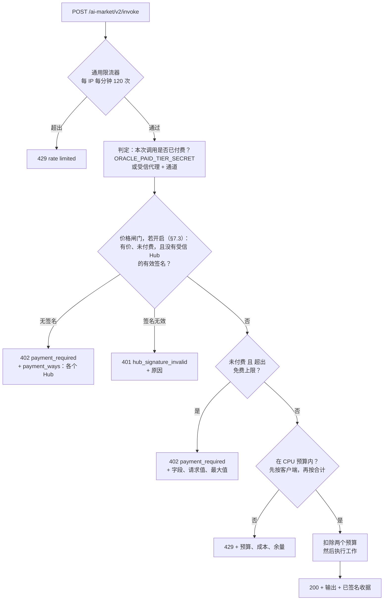
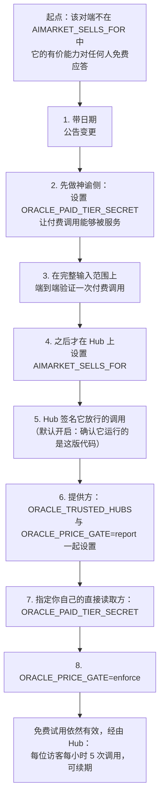
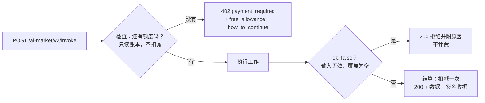

# 免费与付费层级 —— 生态系统免费给出什么，以及为什么

*其他语言版本：[English](free-and-paid-tiers.md) · [Русский](free-and-paid-tiers.ru.md) · [Español](free-and-paid-tiers.es.md) · [Français](free-and-paid-tiers.fr.md)*

`modelmarket.dev` 上几乎每一项能力目前都是免费的 —— 不需要密钥、不需要通道、不需要
账号 —— 这是一个决定，而非疏漏。本页说明：什么是免费的，什么不是，免费层级由什么来
约束，以及开启售卖的那些开关。

---

## 1. 默认免费，而且是刻意的

Hub 列出的 47 项能力中，有 42 项从神谕族联邦而来，向任何提出请求的人提供。无论有没有
人调用，服务器都在运行，因此一个陌生人试用一次的边际成本只是噪声；而一个**能够**试用的
陌生人，是这个项目最便宜的推广。

有两点让这个免费层级比通常的演示更有价值：

- **免费调用与付费调用的收据签名方式完全相同。** 免费调用者拿到的是真实的 Ed25519
  收据，覆盖真实的规范化字符串，可用提供方 `/.well-known` 中的密钥验证。没有任何
  桩件。评估协议的人评估到的就是真正的协议。
- **不会静默降级。** 当一次免费调用无法被完整服务时，它会带着原因和数字被**拒绝**，
  而不是悄悄按更小的规模执行。见 §4。

## 2. 例外：两项能力售卖的是计算

大多数能力在构造上就是有界的 —— 有上限输入上的图度量、哈希、抽签。它们最坏的合法输入
只花几分之一毫秒。

有两项在性质上不同。Wesolowski VDF 与 RSW 时间锁谜题的**定价单位就是被强制的顺序平方
运算**：工作本身就是产品，它在构造上是顺序的，再多硬件也无法并行化。每一次调用都会在
其全部时长内占满一个核心。

在基准机器上实测：

| 能力 | 最坏合法输入 | CPU |
|---|---|---|
| `aestus.seal@v1` | `T = 5 000 000`（`MAX_T`） | **约 36 秒** —— 1M 时 7.3 秒，2M 时 14.5 秒，严格线性 |
| `chronos.eval@v1` | `difficulty = 1 000 000`（`MAX_DIFFICULTY`） | **6.8 秒** —— 1 000 时 8.2 毫秒，10 000 时 69 毫秒，100 000 时 680 毫秒 |
| `aestus.open@v1` | `puzzle.T = 5 000 000` | 约 36 秒 —— 同样的平方运算，诚实地重做一遍 |
| `betti.homology@v1` | 300 个点 | 1.3 秒 —— 通过 `MAX_SIMPLICES` 自我封顶 |
| 其余 38 项 | 最大值 | 几分之一毫秒 |

`aestus.seal@v1` 还有**第二个独立的成本旋钮**：生成新素数在 2048 位时约 0.6 秒，在
3072 位上限时约 2.7 秒。发送 `T=1` 配 `modulus_bits=3072` 的调用者几乎不做值得计量的
平方运算，却仍要花掉近三秒。

### 为什么这是容量问题，而不是收入问题

通用的按客户端限流器允许每分钟 120 次调用。在最坏合法输入下，这意味着来自单一地址、
针对服务整个族的同一台机器、每一秒挂钟时间约七十 CPU 秒的需求：


这不需要恶意。一个读了清单、看到 `maximum: 5000000` 然后开始循环的调用者，做的正是
schema 邀请他做的事。而按地址限流约束不了分布式调用者 —— 运营者自己的流量分析已经在
真实环境中发现过一支 72 个住宅代理组成的机队。

所以解决办法不是开始收费，而是**约束工作量** —— 未付费调用者能索取多少工作，以及单项
能力能占据机器多大份额。

## 3. 免费层级上限

每个上限都设为该能力自身 schema 已经声明的**默认值**。这一点很重要：完全不传参数的
调用者永远不会被拒绝，而免费层级完整地展示了这个原语 —— 证明可验证、延迟真实、收据
已签名。

| 能力 | 字段 | 免费上限 | 付费最大值 |
|---|---|---|---|
| `chronos.eval@v1` | `difficulty` | 100 000（约 0.68 秒） | 1 000 000 |
| `aestus.seal@v1` | `T` | 1 000 000（约 7.3 秒） | 5 000 000 |
| `aestus.seal@v1` | `modulus_bits` | 2048（约 0.6 秒） | 3072 |
| `aestus.open@v1` | `puzzle.T` | 1 000 000 | 5 000 000 |

`puzzle.T` 是刻意的嵌套路径。`aestus.open@v1` 接收整个谜题并执行 `T` 次平方，而 `T`
是谜题**内部**的字段，所以只检查顶层会约束住 `seal`，却让隔壁端点上同样的 36 秒完全
敞开 —— 用一个从未经过 `seal` 的手写谜题就能触达。

有一个后果值得直说：**用付费的 `T` 封装的谜题无法免费打开。** 两个方向是同一份工作，
所以这是一致的，而非别扭。而 `aestus.verify@v1` 保持免费且不设上限 —— 它只是一次哈希
—— 因此真正打开了大谜题的人可以公布 `b`，让其他所有人免费确认解锁。

### 拒绝，绝不削减

超过上限的调用会得到 `402 Payment Required`，上限就在响应体里。它不会被静默地按上限
值服务。

悄悄做得比请求的更少，就会签发一张证明调用者并未请求的难度的收据；而调用者一测响应
时间，就会合理地得出神谕在作弊的结论。对于一个全部价值就在于「可证明地流逝了这么多
顺序时间」的原语来说，这不是小事。

```json
{
  "ok": false,
  "error": "payment_required",
  "detail": "aestus.seal@v1: 'T'=5000000 exceeds the free-tier ceiling of 1000000. …",
  "capability_id": "aestus.seal@v1",
  "free_tier": { "field": "T", "requested": 5000000, "max": 1000000 }
}
```

（Chronos 与 Aestus 仍会在内部按各自的硬上限削减。那是另一道更早的防线 —— 防的是超出
**已声明 schema** 的输入 —— 它保留。）

## 4. CPU 预算：配给工作，而不是配给调用次数

对这些能力来说，限制调用**次数**是错误的形式，因为它们的成本跨越四个数量级。无论选哪
个数字，都会在某一个方向上出错：

- 按昂贵输入来定，那么普通的探索在第二个请求之后就被拒绝。这不是假设：最先尝试的是
  每分钟 2 次的固定限额，它在第四个请求上弄坏了 Aestus 自己的测试套件。
- 按廉价输入来定，那么一串昂贵调用的循环会把机器烧穿。

因此每项昂贵能力都声明一个以**每分钟 CPU 毫秒**为单位的预算，每个请求按其真实成本
扣费，成本由拟合 §2 实测数据的公式估算。

| 能力 | 每客户端 | 所有客户端合计 | 成本公式 |
|---|---|---|---|
| `chronos.eval@v1` | 20 000 毫秒/分钟 | 60 000 毫秒/分钟 | `difficulty / 147` |
| `aestus.seal@v1` | 20 000 毫秒/分钟 | 60 000 毫秒/分钟 | `T / 137 + 600`（超过 2560 位则 `+ 2700`） |
| `aestus.open@v1` | 20 000 毫秒/分钟 | 60 000 毫秒/分钟 | `puzzle.T / 137` |

20 000 毫秒/分钟是每客户端三分之一个核心。60 000 毫秒/分钟是该能力在所有人之间合计
一个整核 —— 这才是真正保护共享机器的那个数字，因为按地址的预算约束不了代理机队。

对 `chronos.eval@v1` 来说，预算具体买到了什么：

| 输入 | 成本 | 每客户端每分钟调用次数 |
|---|---|---|
| `difficulty = 1 000` | 7 毫秒 | 约 2 900（再往上先撞到通用的 120/分钟） |
| `difficulty = 100 000`（免费上限） | 680 毫秒 | 29 |
| `difficulty = 1 000 000`（付费最大值） | 6 800 毫秒 | 2 |

以 `difficulty=1000` 探索的开发者实际上不受限制；索取完整一百万的调用者每分钟得到
两次。这正是固定调用次数限额无法表达的性质。

两个预算都会在**任何一个被扣费之前先做检查**，因此因服务器容量而被拒的请求，不会为
从未执行的工作静默地扣掉调用者自己的额度。

## 5. 检查顺序



上限检查排在预算检查**之前**，这个顺序是承重的。超过上限的请求是永久超过的，所以
`429 稍后重试` 会把调用者推进一个永远不可能成功的循环。`402` 告诉他真实的上限，以及
付费可以解除它。相反，预算耗尽确实会自行恢复 —— 所以那才是配得上 `429` 的拒绝，它排
在第二位。

价格闸门开启时排在这两项之前，所以被它拒绝的调用既不消耗预算，也不启动任何工作。Hub
的签名只让调用通过闸门，仅此而已：它不会解除免费上限，解除上限仍然需要运营者的指定
（§7.1）。

预算给出的 `429` 会点明三个数字，因为一个明显未达 120/分钟却仍被拒绝的调用者，需要
这三个数字才能判断是该等待还是该少要一些工作：

```
rate limited: chronos.eval@v1 budgets 20000 ms of CPU per minute per client
because its cost scales with the input; this call is ~680 ms and 272 ms remain.
Retry later, or ask for less work.
```

## 6. 买家在不花一分钱之前能读到什么

上限与预算都发布在已签名的清单中，因此正在发现阶段的智能体无需花掉一次调用去试探：

```json
{
  "capability_id": "aestus.seal@v1",
  "price_per_call_usd": 0.006,
  "free_tier_max": { "T": 1000000, "modulus_bits": 2048 },
  "cpu_budget_ms_per_min": 20000,
  "global_cpu_budget_ms_per_min": 60000
}
```

没有成本控制的能力 —— 42 项中的 39 项 —— 不发布上述任何键，因此它们的清单条目保持
不变。

聚合端点 `oracle-family` 同理，而 Hub 实际联邦的正是它：它从 17 个兄弟那里收集真实的
能力对象，因此上限、预算和已发布字段无需额外接线就会到达那里。请注意预算是**按进程**
计的 —— 一个既独立运行又在族内运行的神谕，在两处各有一只独立的桶。

## 7. 开启售卖

决定是否售卖的开关有两个，两侧各一个，而且**默认都是关闭的**（§7.1、§7.2）。第三个
是提供方的价格闸门（§7.3），它让提供方不会在自己的 URL 上白送 Hub 在卖的东西；它默认
也是关闭的。§7.4 把它们排成一个不会伤到任何人的顺序。

### 7.1 神谕侧 —— 谁被允许越过上限

神谕无法自行验证支付通道：通道存放在 Hub 的账本里，而通道标识会随收据一起流传，因此
仅凭标识存在并不能证明任何事。为了不让每次调用都去 Hub 往返一趟，解除上限只授予运营者
明确指定的调用方。

| 变量 | 含义 |
|---|---|
| `ORACLE_PAID_TIER_SECRET` | 通过 `X-AIMarket-Paid-Tier` 发送的共享密钥，按常量时间比较。与网络拓扑无关 —— **优先选它**。 |
| `ORACLE_TRUSTED_PAYMENT_PROXIES` | 逗号分隔的 IP/CIDR。来自其中之一并带有非空 `X-Payment-Channel` 的请求算作已付费，理由是 Hub 在转发前已经做了预留。这要求信任反向代理设置 `X-Real-IP` —— 与限流器已经给出的信任相同。 |

**两者都未设置**（出厂状态）意味着*任何调用都永远不会被解除上限*，包括来自 Hub 的
调用。免费上限对所有人生效。对一个当前什么都不卖的族来说，这正是想要的默认行为：它向
关闭的一侧失败，而开启售卖是每侧一个环境变量，而不是改代码。

`ORACLE_TRUSTED_PAYMENT_PROXIES` 中格式错误的条目会被忽略，而不是当作通配符，也不会
妨碍旁边有效条目的工作。

### 7.2 Hub 侧 —— `AIMARKET_SELLS_FOR`

> [!WARNING]
> **`AIMARKET_SELLS_FOR` 默认未设置，一旦设置，42 项当前免费的能力会同时变为付费。**
>
> 未设置时，Hub 对联邦调用不收取任何费用：`fed_price` 为 `0.0`，不要求通道，不做
> 预留，不收路由费。每一项联邦能力对任何人都是免费的。
>
> 一旦其中列入某个对端的 URL 前缀，该对端的每一项联邦能力都变成有价。没有
> `X-Payment-Channel` 的调用会得到 `402 payment_required`。现有的免费调用者 ——
> 包括任何已经在用它们的智能体、桥或 MCP 客户端 —— 会在同一分钟内开始失败。
>
> 没有分批上线，也没有宽限期。当你确实打算售卖时再设置它，而不是为了看看会发生
> 什么。

它的值是逗号分隔的对端 URL 前缀列表，表示 Hub 代其售卖，按路径前缀匹配：

```bash
AIMARKET_SELLS_FOR=https://oracles.modelmarket.dev
```

**为什么必须显式声明而不能推断。** 显而易见的捷径是「如果对端返回了 200 而没有收费，
说明对端不收费，那我们就可以收」。这是错的，五个路由费测试抓住了它：一个在带外开票的
对端同样返回 200。从状态码推断同意，会让这个 Hub 在对端自己的账单之上再收一次 ——
买家付两次钱，而且无从察觉。所以代他人售卖是运营者逐个对端显式声明的事。

`AIMARKET_SELLS_FOR` 同时独立于 `AIFACTORY_CRYPTO_ENABLED`（见
[crypto-switch](crypto-switch.zh.md)）和沙盒试用层级。只有在加密已开启、该调用不是
沙盒试用、**并且**对端已列入时，价格才生效。

### 7.3 神谕侧 —— 价格闸门：有价调用经由 Hub

§7.1 和 §7.2 决定的是一次*经由 Hub* 的调用花多少钱。两者都没有关上另一扇门：提供方的
调用 URL 是公开的，而在 oracle-core 0.5.0 之前，提供方没有办法拒绝直接调用有价能力的
人。2026-10-16 实测：未付费地向 GAIA 自己的 URL `POST` `gaia.power.window@v1`、向
EMPORION 的 URL `POST` `emporion.vat.check@v1`（各 $0.002），都返回了 `ok: true` 和
完整输出；而同样的调用经由 `modelmarket.dev` 则按目录价得到 `402`。

闸门不收款。通道、预留和账本已经在 Hub 里。ATLAS 自己计量（§10），这对一个服务行得
通，但在每个提供方里各放一本账，就是重复 Hub 的账本。闸门只是让提供方能分辨一次调用是
Hub 放行的，还是绕过了 Hub。放行一次调用的 Hub（它收了款，或决定给一次试用）用自己的
联邦密钥签名这次调用，也就是它 `/.well-known/ai-market.json` 中的 `signer_public_key`。
签名覆盖能力、确切输入的哈希、Hub 投递请求的调用 URL、时间戳和一个新的 nonce，所以在
一个提供方处为一次调用做的签名，既买不到另一次调用，也买不到另一个提供方处的同一次
调用。提供方固定（pin）这个 Hub 的密钥。

对价格大于零的能力，除非调用方是运营者指定的（§7.1）：

| 调用带着 | 提供方的回答 |
|---|---|
| 没有 Hub 签名 | `402 payment_required`，`payment_ways` 中列出售卖它的 Hub |
| 不成立的签名：未知 Hub、错误密钥、过期、别的能力或输入、发给别的提供方、已用过的 nonce | `401 hub_signature_invalid` 及原因。Hub 会把它转成 `502` 并释放买家的预留，所以没有人为此付钱。 |
| 成立的签名 | 正常服务；免费上限和 CPU 预算依然适用 |

免费能力永远不经过闸门。线上格式 —— 五个 `X-AIMarket-Hub-*` 头 —— 写在
`oracles/core/oracle_core/price_gate.py` 的 docstring 里，Hub 和提供方固定同一个测试
向量。

提供方侧：

| 变量 | 含义 |
|---|---|
| `ORACLE_TRUSTED_HUBS` | `url=key,url=key`：你接受其放行的每个 Hub，及其来自 well-known 的 Ed25519 `signer_public_key`（base64）。密钥轮换期间重复写同一个 URL，即可同时接受两把密钥。格式错误的条目会被丢弃并记入日志，绝不会放宽名单。第三方运营者固定自己的 Hub。 |
| `ORACLE_PRICE_GATE` | `enforce`、`report` 或 `off`。**未设置时，只要有受信 Hub 就是 `enforce`**，没有则为 `off`，即核心以前的行为。`report` 服务每一次调用，并把本会拒绝的记入日志。其他任何值都按 `enforce` 读取，免得一个笔误就把有价工作白送出去。 |
| `ORACLE_HUB_AUDIENCES` | 除 `public_url` 之外你还会应答的基础 URL，供以别的名字访问你的 Hub 使用。 |
| `ORACLE_HUB_MAX_SKEW_S` | Hub 的时间戳与你的时钟最多可相差多少秒。默认 120。 |

闸门开启时，well-known 会多出一个 `price_gate` 对象（模式、受信 Hub、方案），让买家在
调用之前就能看到去哪里买。闸门关闭时，文档逐字节不变。以 `AIFACTORY_PROD=1` 启动、
有有价能力而闸门关闭的提供方，会在日志里说明这一点。

Hub 侧无需设置任何东西：它会签名自己放行的调用。本地上架项的调用总是签名，因为 Hub 的
付费墙或试用已经执行过了。联邦对端的调用只在本 Hub 是该对端的记录卖方时才签名
（`AIMARKET_SELLS_FOR`，§7.2）。对于 Hub 只做中介的对端，由对端自己向买家收费，签名会
对一个带闸门的对端谎称一次无人付费的调用「已付」。`AIMARKET_SIGN_PROVIDER_REQUESTS=0`
关闭签名。签名出错绝不会让买家的调用失败：调用以未签名的方式发出，由提供方决定。

**你自己的直接读取方。** 你自己的某个服务若直接调用提供方而不经过 Hub，会得到同样的
`402`。按 §7.1 指定它：在提供方上设置 `ORACLE_PAID_TIER_SECRET`，并在
`X-AIMarket-Paid-Tier` 中发送同一个值。ATLAS 就是这样读取 GAIA 的，值放在
`ATLAS_GAIA_PAID_TIER_SECRET` 中。这个密钥同时会解除免费上限，所以只给你自己的服务。

闸门不做的事：

- **它信任 Hub 的决定，看不到钱。** 受信的 Hub 连同它的全部策略一起被信任：它作为试用
  送出去的，就是从这个提供方送出去的。
- **防重放是按进程、在内存里做的。** 以多个 worker 运行的提供方，在时钟偏差窗口内会对
  每个 worker 各接受一次重放，重启后也会忘掉见过的 nonce。
- **只做中介的 Hub 不签名**，所以它的买家会收到提供方的 `402`，指向售卖它的 Hub。这是
  有意的。只有当某个 Hub 应该售卖你的能力时才固定它。

### 7.4 不会伤到任何人的顺序



第 2 步先于第 4 步，是值得坚持的部分。先设置 `AIMARKET_SELLS_FOR` 会让 Hub 为那些
神谕在免费上限之上仍会拒绝的能力索取付款 —— 买家为收不到的工作付钱。

第 5 到 8 步关上的是提供方自己的门，它们的顺序同样重要。对于直接在 Hub 上架、而非经
联邦接入的提供方，第 4 步不适用：Hub 无论如何都会签名它的调用。

- **先让 Hub 签名，再让提供方执行闸门。** 处于 `enforce` 的提供方若仍收到 Hub 发来的
  未签名调用，会对每一笔销售回答 `402`，而 Hub 会把这个 `402` 转给买家。销售停止，
  不过没有人被扣费。
- **先 `report` 后 `enforce`，并且与 `ORACLE_TRUSTED_HUBS` 在同一次变更中设置。** 只
  设置 Hub 就立即意味着 `enforce`。在 report 模式下，提供方服务一切，并每分钟在日志里
  记下有多少有价调用带着有效签名、没有签名或签名无效，以及未签名的调用来自哪些地址。
  如果某一行说某次调用是 `signed for` 一个你并不应答的 URL，说明 Hub 用另一个名字访问
  你：把这个 URL 加进 `ORACLE_HUB_AUDIENCES`。
- **先处理你自己的读取方，再 `enforce`。** 报告里列出的未签名调用方，要么是你自己的
  服务，给它们付费层级密钥；要么是陌生的调用方，会得到 `402` 和可以购买的 Hub。

回退不需要重新构建：`ORACLE_PRICE_GATE=report`（或 `off`）然后重启提供方。
`AIMARKET_SIGN_PROVIDER_REQUESTS=0` 会停止 Hub 签名，但只有在没有任何固定了该 Hub 的
提供方处于 `enforce` 时才安全。

## 8. 给神谕作者

`Capability` 上四个可选字段，默认全为空，因此那 39 项什么都不需要的能力，行为与从前
完全一致：

```python
Capability(
    capability_id="mine.expensive@v1",
    handler=_run,
    # 未付费调用者超过这些值会被拒绝；请填 schema 自身的默认值，
    # 这样不带参数的调用永远不会被拒。
    free_tier_max={"iterations": 10_000},
    # 一次输入的成本，单位是 CPU 毫秒。请拟合一次实测并在注释里写明 ——
    # 只有相对精度重要，因为更慢的机器会等比放大所有成本。
    cost_ms=lambda d: d.get("iterations", 10_000) / 25.0,
    cpu_budget_ms_per_min=20_000,        # 每客户端三分之一个核心
    global_cpu_budget_ms_per_min=60_000, # 所有人合计一个核心
)
```

抛出异常的成本公式会被当作默认的 1 毫秒，而不是变成 500：成本估算器是一种便利，它不
应该有能力把神谕搞挂。估算值下限为 1 毫秒，因此返回零的公式无法让预算放行无限次调用。

在成本本已有界的能力上声明 `free_tier_max` 没有任何收益，只多出一条拒绝路径 —— 除非
最坏合法输入确实贵得可测，否则留空。

## 9. 配额窗口：在覆盖面与收入之间的旋钮

免费试用最初是**终身**额度——每位访客一共 3 次调用，永久有效。当稀缺的是算力容量时，
这个形状是对的；当稀缺的是"听说过这张网络的人"时，它就是错的：3 月用完三次调用的访客，
到 8 月没有任何回头路，而拒绝他的那行账本记录，与拒绝滥用者的那行毫无区别。

所以额度现在有了**窗口**，而这个窗口就是一个旋钮：

| 窗口 | 含义 | 何时适用 |
|---|---|---|
| `lifetime` | 每位访客共 N 次调用，永久 | 容量是硬约束，没有增长目标 |
| `hourly` | 每位访客每 UTC 小时 N 次 | **当前生产设置** —— 仍能约束死循环的最宽松窗口 |
| `daily` | 每位访客每 UTC 日 N 次 | 稳定评估，又不至于长开水龙头 |
| `weekly` | 每 ISO 周 N 次 | 缓慢、审慎的试用 |

生产环境今天在签名清单中公布的内容，让发现它的智能体在花掉任何额度之前就能读到条款：

```json
"free_trial": {
  "enabled": true,
  "max_invokes_per_visitor": 5,
  "quota_window": "hourly",
  "renews": true,
  "visitor_header": "X-AIMarket-Sandbox-Visitor"
}
```

`renews` 摆在数字旁边并非装饰。被拒绝的调用方只有两个合理反应——等待，或者开一条支付通道——
而只有这个字段说明哪一个会奏效。终身额度只公布 `max` 和 `used` 时，两种答案同样合理，
而猜"等待"的智能体会去轮询一个永不移动的限额。

**为什么是小时而不是天。** 面对死循环两者完全相同：五次调用，然后拒绝。差别出现在我们真正
想要的那类人身上：读清单、试一个能力、看错 schema、再试一次。在按天的窗口下这个人被锁到明天，
实际上就等于永远失去；在按小时的窗口下，他还没关掉标签页就已经恢复。更宽松的窗口在滥用一侧
不付任何代价，却消除了真正会流失人的那种失败。它被刻意设在仍然有用的最柔和档位，等负载真的
要求时再收紧——不会更早。

如何设置：环境变量 `AIMARKET_SANDBOX_QUOTA_WINDOW` 与
`AIMARKET_SANDBOX_MAX_PER_VISITOR`，或 `data/sandbox_trial_policy.json` 中的 `quota_window`
与 `max_per_visitor`；
环境变量优先，因此运维方可以覆盖烤进镜像的文件。无法识别的窗口值回落到 `lifetime`
而不是"无限制"——策略文件里的一个拼写错误不该把整张网络白送出去。

**额度用尽时返回哪个状态码，以及两个服务为何不同。** Hub 返回 `429 trial_quota_exhausted`，
ATLAS 返回 `402 payment_required`。这不是需要统一的前后矛盾，而是「会自行恢复的限额」与「可以付钱解决的价格」
之间的区别：Hub 的可续期额度确实靠等待就能解决——那正是 429 的含义；ATLAS 的 SKU 有公开价格和可开启的支付通道
——那正是 402 的含义。Hub 把 `exhausted_status` 与 `exhausted_error` 与额度并列公布，让智能体依据明示的事实分支，
而不是靠猜。之所以要写下来：Hub 自己的旧文案承诺的是 402——那是终身额度时代写的，改为可续期窗口后从未更正——
相信它的智能体会把一次临时拒绝读成「必须付费」，放弃自己其实还有的免费额度，然后再也不回来。

窗口按 UTC 取键（`%Y-%m-%dT%H`、`%Y-%m-%d`、ISO `%G-W%V`），因此对所有调用方在同一瞬间翻转，
不牵涉任何本地时钟。额度按窗口键计数：账本保留旧记录，窗口翻转后访客的历史仍然可读。

第一个旋钮背后还有第二个：`AIMARKET_SANDBOX_MAX_PER_IP_HOUR`（默认 30，或策略文件中的
`max_per_ip_hour`）限制每个网络地址每小时的试用次数。按访客的额度之所以能给得宽松，正是因为
visitor-id 由客户端自选、铸造成本为零；真正能约束「一个人铸一千个 id」的是按地址的上限，
它也是负载真的让柔和窗口变得不舒服时，第一个该去调的数字。

## 10. ATLAS 是怎么开始收费的

ATLAS 公布了价目表，却把一切免费提供。它的清单写着 `price_per_call_usd: 0.06`；
未付款的 `POST /ai-market/v2/invoke` 返回 `200 OK` 并附带数据。那不是免费层级，
而是一个没人被要求遵守的价格——从外面看，这张付费网络看起来标了价，事实上却没有计量。

现在收费已强制执行（enforced），条款与 Hub 提供的完全一致，好让发现其中任一服务的智能体
看到的是同一份条件，而不是两份：

```bash
ATLAS_PAYMENT_ENFORCED=1          # 默认关闭；启用强制执行是运维方的决定
ATLAS_TRIAL_WINDOW=hourly         # 与 Hub 相同的词汇
ATLAS_TRIAL_MAX_PER_CALLER=5
```

线上行为，端到端验证过：五次成功交付，然后

```json
{
  "error": "payment_required",
  "capability_id": "atlas.situation.brief@v1",
  "price_per_call_usd": 0.06,
  "free_allowance": { "max": 5, "used": 5, "quota_window": "hourly", "renews": true },
  "how_to_continue": [
    "Wait for the hourly allowance to renew.",
    "Send X-AIMarket-Sandbox-Visitor with a stable id (8-64 chars) to hold your own allowance rather than sharing your network's.",
    "Open a payment channel at the hub and invoke through it: https://modelmarket.dev/.well-known/ai-market.json"
  ]
}
```

### 被拒绝的调用不计费

额度在干活之前**检查**，只有产品真的返回了数据才**扣减**。第一版在入口处就扣费，
那个错误值得记录下来：发送畸形 bounding box 的调用方，把整份免费额度烧在 `refuse_reason` 上，
却连一条读数都没看到。作为一张付费网络的第一印象，没有比这更糟的了。

这不是罕见分支。只要覆盖为空，ATLAS 就拒绝而不猜测——那是它的诚实策略，不是错误——
所以拒绝是常态：重新部署之后传感器机群是冷的，在预热完成前**每一次**调用都会拒绝。
为它们收费，等于让调用方为运维方的重启付账。



另有三条性质，每一条都是选择而非继承：

- **不设置即关闭。** 强制收费会改变现有调用方拿到的结果，因此它必须是运维方的显式决定，
  绝不能是一次部署的副作用。
- **免费能力永不消耗额度。** 价格为 0 的 SKU 若扣掉一次试用，就会报出错误的限额，
  并把真正的限额藏在一个无关的拒绝背后。
- **失败时放行（fail-open）。** 若账本无法读写，调用照常进行。坏掉的计量器不该拖垮网络：
  少收钱可以补，拒绝所有人不可以。只捕获 `sqlite3.Error` 并不够——不可写的账本路径
  会在任何 SQL 之前从 `mkdir` 抛出 `OSError`。

调用方用 `X-AIMarket-Sandbox-Visitor`（8–64 个字符）表明身份并持有自己的额度。没有它就使用
网络地址，因此共享地址背后的智能体依然拿到真实额度而不是拒绝——402 的响应体还会告诉它
如何不再共享。

## 11. 已发布的产品：默认不带钱包

工厂发布的产品，必须对这样的访客也能用：没有钱包、没听说过 USDC、也不会去注册账号。
所以除非运维方另有指示，部署不携带钱包：它依靠上文的免费额度运行，以带稳定 visitor-id 的
普通调用方身份调用网络能力，其输出携带与付费调用相同的签名收据。

```bash
# 在工厂侧，发布之前。缺省 = 部署中 WALLET_ENABLED=0。
AIFACTORY_PRODUCT_WALLET_ADDRESS=0x…      # 显式启用
AIFACTORY_PRODUCT_WALLET_CHAIN=base       # 可选，默认 base
```

**绝不放私钥。** 地址是配置，私钥是资金托管。serverless 函数的环境变量，任何能重新部署该项目
的人都能读到，所以"默认无钱包"同时也是安全的默认值——需要在免费额度之外结算的产品，
绑定的是一个地址，其私钥始终留在运维方手里。

由此得出一条设计后果，值得直说：**已发布的产品在额度耗尽时，应当降级为缓存答案，而不是错误。**
把最近一次读数连同它的读取时间一起显示，是诚实的，而且依然有用；一个画出 `402` 的面板两者都不是。
本生态的产品正是这样定义的：缓存最新数据并标注读取时间，是需求书里的要求，不是点缀。

## 12. 相关文档

- [crypto-switch](crypto-switch.zh.md) —— 链上经济的总开关
- [payment-enable-runbook](payment-enable-runbook.md) —— 在 Hub 上启用真实支付
- `oracles/core/oracle_core/tiers.py` —— 实现，数字都写在注释里
- `oracles/core/tests/test_tiers.py` —— 覆盖此行为的 52 个测试
- `oracles/core/oracle_core/price_gate.py` —— 价格闸门；其 docstring 记录了线上格式
- `aimarket-hub/aimarket_hub/provider_request_auth.py` —— Hub 何时签名它放行的调用
- `aimarket-hub/aimarket_hub/sandbox_trials.py` —— 试用账本及其窗口
- `atlas/atlas/payment_gate.py` —— ATLAS 计量器，含 check/settle 拆分
- `web/backend/services/vercel_fullstack_adapter.py` —— `wallet_env()`，默认不带钱包
