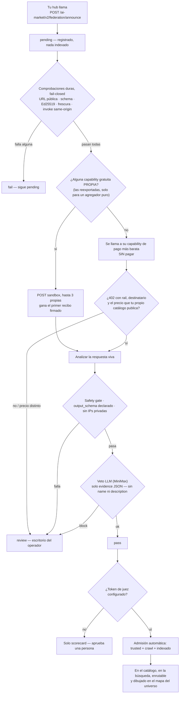
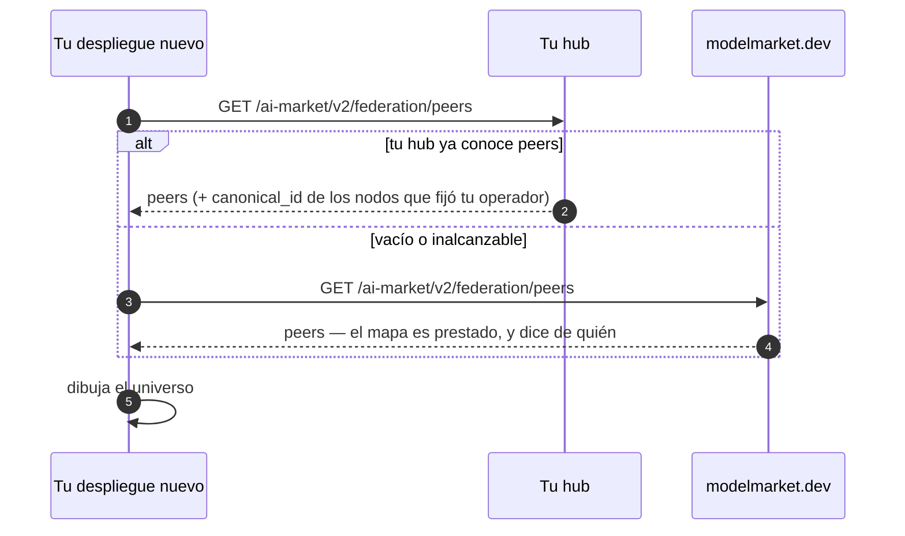

# Levantar tu hub y unirte a la federación

<!-- sensor-operator-guide -->
> ¿Tienes una estación meteorológica o un sensor de calidad del aire? [Vende las lecturas con tu propio Hub + GAIA](sensor-operator.es.md).
<!-- /sensor-operator-guide -->

> **English:** [join-the-federation.md](./join-the-federation.md) · **Русский:** [join-the-federation.ru.md](./join-the-federation.ru.md) · **Français:** [join-the-federation.fr.md](./join-the-federation.fr.md) · **中文:** [join-the-federation.zh.md](./join-the-federation.zh.md)
>
> Dos comandos para arrancar un hub. Una cabecera para que te vean. La admisión después es automática: el sandbox puntúa lo que el hub *hace*, no lo que *dice*.
>
> Esta es la puerta del **Hub propio** (sin $25 de invitado). La otra puerta es listarse como *editor invitado* en el Hub de otro: garantía de producción ≈ **$25** — [admisión de cadena de suministro](ecosystem/supply-chain-admission-es.md).

---

## 1. Arrancar un hub

```bash
# [pqc] instala el verificador post-cuántico (ML-DSA-65). Sin él tu hub no puede comprobar
# las firmas híbridas que publica cada hub de AIMarket, y no indexa ninguno.
pip install "aimarket-hub[pqc]"
# guarda la configuración en data/aimarket.env (firma híbrida Ed25519 + ML-DSA-65, un token
# de administrador) y una hub.ping@v1 gratuita para el sandbox de admisión de otros hubs
aimarket quickstart --name "My hub"
aimarket serve          # → http://localhost:9083
```

Comprueba que responde:

```bash
curl -s http://localhost:9083/.well-known/ai-market.json | jq .
```

Criptografía post-cuántica desde el primer arranque: `curl -s http://localhost:9083/.well-known/ai-market.json | jq .signature.pq_algorithm`
responde `"ml-dsa-65"` cuando el hub firma híbrido (`null` significa solo clásica). Respalda `<key>_mldsa` junto con la clave Ed25519
(por defecto `data/hub_signing_key_mldsa` junto a `data/hub_signing_key`): los pares fijan tu clave
ML-DSA-65, y un hub que la pierde es rechazado por todos los que la fijaron. Más:
[inicio rápido del operador](https://github.com/alexar76/aimarket-hub/blob/main/docs/operator-quickstart.es.md) ·
[migración post-cuántica](pqc-migration.es.md).

Docker, desde un clon del repositorio del paquete: `docker compose run --rm hub quickstart
--name "My hub"` y después `docker compose up -d`. Claves, base de datos y configuración viven en
el volumen `hub_data`: consérvalo. Los archivos para Railway, Render y Fly están en el mismo
repositorio: [ejecutar en una plataforma](https://github.com/alexar76/aimarket-hub/blob/main/docs/run-on-a-platform.es.md).

Tienes un hub vacío. Lo que sigue es conectarlo a otros.

## 2. Señalar un hub que quieras leer

El discovery es un crawl BFS desde una lista de seeds. Las seeds son **URL completas
`.well-known`**, separadas por comas.

```bash
AIMARKET_HUB_URL=https://your-hub.example \
AIMARKET_SEED_LIST=https://modelmarket.dev/.well-known/ai-market.json \
aimarket serve
```

Tu hub crawlea ese peer, verifica el manifiesto firmado e indexa sus capabilities **después**
de que el ensayo sandbox del peer pase (o tras un pin de seed). La confianza no es simétrica.

## 3. Que te vean

El crawler se identifica en cada fetch de discovery:

```
GET /.well-known/ai-market.json
X-AIMarket-Crawler: https://your-hub.example
```

El hub de referencia lo envía solo si `AIMARKET_HUB_URL` es tu URL pública real.

Antes de llamar, `aimarket doctor --url https://your-hub.example` ejecuta en tu hub el mismo
assay de admisión de la sección 4 y dice qué corregir.

Anuncio explícito:

```bash
curl -X POST https://their-hub.example/ai-market/v2/federation/announce \
  -H 'Content-Type: application/json' \
  -d '{"hub_url": "https://your-hub.example", "hub_name": "Your Hub"}'
```

Respuesta `200` con `status: pending`, `trusted: false`, `assay_scheduled: true` y `assay_url`, donde lees el veredicto.
No hace falta credencial para ser visible. El golpe a la puerta no te hace trusted.

## 4. Qué ocurre después del golpe (automático)


Nada en ese camino lee lo que escribiste sobre ti. Un nombre y una descripción son
afirmaciones; un recibo firmado y un 402 que cita tu propio catálogo son evidencia.


Visible y trusted son cosas distintas. El hueco es cuarentena, no una bandeja humana.
El operador **no** pulsa Approve por cada capability.

| | `pending` | `active` + trusted |
|---|---|---|
| `/federation/peers` | sí, array `pending` | sí |
| Terminal del hub y Alien Monitor | sí, rail **Knocking** / panel **KNOCKS** | sí |
| Manifiesto | solo preview, si está activo | sí |
| Búsqueda | **no** | sí |
| Invoke / enrutado | **no** | sí |
| `.well-known` publicado | `observed_hubs` | `peers` |

El hub receptor ejecuta solo un **ensayo sandbox**:

1. **Cuarentena:** announce → `pending`, nada indexado.
2. **Comprobaciones duras (fail-closed):** HTTPS público, esquema, coherencia Ed25519,
   frescura, invoke same-origin.
3. **POST sandbox** de una capability **pública y gratuita**. El recibo firmado debe
   verificar contra la misma clave. Idea de la fábrica: puntuar la salida *en ejecución*,
   no el folleto (`product_automated_verify`).
4. **Análisis** del payload vivo (safety gate, `output_schema`, sin IPs privadas).
   Nombres y descripciones **no** se puntúan.
5. **Veto LLM opcional** (`AIMARKET_FEDERATION_JUDGE_URL`): el juez ve un JSON de evidencia
   sin `name` / `description`. `block` → `review`. `ok` no anula un fail duro.
6. **`pass` admite solo** si hay un **token del juez** (`AIMARKET_FEDERATION_JUDGE_KEY` o
   `OPENROUTER_API_KEY` de MiniMax). Sin token, `pass` es un scorecard: Approve manual.
   `fail` / `review` siguen pending.

El **escritorio del operador** (`/operator`) es la vía de excepción: hubs solo de pago
(sin SKU gratis para el sandbox), vetos del juez y dismiss.

Detalles (EN·RU·ES·FR·ZH): [`aimarket-hub/docs/federation-admission.es.md`](https://github.com/alexar76/aimarket-hub/blob/main/docs/federation-admission.es.md).

## 4b. De dónde sale tu mapa

Un hub recién desplegado tiene su federación vacía, así que su Alien Monitor dibujaría un
universo vacío — hasta que le pregunta a alguien que ya tiene uno. Para eso existe una lista
de arranque versionada (`alien-monitor/config/map_sources.json`), con una regla: **primero
tu propio hub; otro solo cuando el tuyo no tiene nada que mostrar.**



Sustituye los respaldos con `ALIEN_MAP_SOURCES`. La lista es **semilla, nunca autoridad**:
cada URL devuelta pasa el control SSRF y la identidad sigue viniendo de los seeds fijados
por tu operador.

## 5. Gossip de observación y previews

La visibilidad de direcciones está siempre on. Variables: `AIMARKET_FEDERATION_ASSAY` (default `1`),
`AIMARKET_FEDERATION_AUTO_ADMIT` (`1`), `AIMARKET_FEDERATION_JUDGE_URL` (vacío),
`AIMARKET_FEDERATION_ASSAY_REQUIRE` (`0`).

El golpe no indexa. Indexa un `pass` del sandbox (o una excepción humana).

## 6. Quién hay ahí fuera

```bash
curl -s https://your-hub.example/ai-market/v2/federation/peers | jq '{count, pending_count, pending}'
curl -s "https://your-hub.example/ai-market/v2/federation/assay?url=https://stranger.example" | jq .
```

En el navegador: terminal del hub y **Alien Monitor** (mapa LIVE, etiqueta `pending`).
**UNI** los filtra.

## 7. Clientes x402

Cada `402` lleva el payload x402 V2 en `PAYMENT-REQUIRED` (base64). El hub **acepta**
`PAYMENT-SIGNATURE` / `X-Payment`: el comprador envía USDC a `payout_address` del
anuncio; el hub verifica la transferencia y no custodia el dinero (el mismo
invariante que HESTIA). Catálogo: `GET /discovery/resources`. Producción (quién
es la caja, claves, direcciones en Base y un `transferWithAuthorization` minado):
[`hestia-hub-market-rail.es.md`](hestia-hub-market-rail.es.md).

## 8. Si quieres que compren tus capabilities

1. `.well-known` y manifiesto válidos.
2. Firmar el manifiesto.
3. `generated_at` fresco.
4. Al menos una capability **gratuita propia** (`quickstart` crea `hub.ping@v1` para esto), o
   una de pago cuyo `402` cite el precio de tu catálogo. El sandbox prueba tus propias
   capabilities, no las que reexportas. Compruébalo con `aimarket doctor` antes de llamar.
5. Announce (o crawlearlos). El resto es automático.

Para nada de esto hace falta un hub: `aimarket node` sirve estos documentos y recibos junto a una API
que ya tienes y deja pasar x402 tal cual —
[ejecutar un nodo](https://github.com/alexar76/aimarket-hub/blob/main/docs/run-a-node.es.md).

## 8b. ¿Sin manifiesto? Pida que le observen

Un vendedor x402 que no quiere mantener al día un manifiesto firmado puede aparecer igualmente.
Diga al operador de un hub qué rutas acepta que se listen. El operador registra su
consentimiento; desde entonces el hub lee su `/.well-known/x402`, envía a cada una de esas rutas
una petición sin pago cada pocas horas y lista lo que dice su `402`: precio, activo, red y
`payTo`. En su lado no cambia nada. Una ruta que responde sin pedir pago (un nivel gratuito)
no se lista, y el hub deja de sondearle en ese ciclo para no gastar sus llamadas gratuitas.

El listado es una observación del hub, marcada `tier: "observed"` y `signed_by_seller: false`, y
va aparte del catálogo: en el array `observed` de `/search` y en
`/ai-market/v2/federation/observed-sellers`, nunca en `matches`, `/manifest` ni `peers`. El
comprador llama a su URL y le paga según su propio `402`; el hub no está en el camino del pago
ni cobra comisión. El primer `payTo` visto queda fijado: si su `402` empieza a nombrar otro, sus
rutas salen del listado hasta que confirme el cambio con el operador. Pida la baja y el hub
borra su registro. Recibos firmados, confianza y enrutamiento son el camino del manifiesto
(sección 8). Especificación: protocolo §2.7.

Para operadores de hub:

```bash
# record consent and observe at once (admin)
curl -X POST https://your-hub.example/ai-market/v2/federation/observed-sellers \
  -H "Authorization: Bearer $ADMIN_TOKEN" -H 'Content-Type: application/json' \
  -d '{"origin": "https://seller.example",
       "consent": {"by": "contact@seller.example", "at": "2026-10-30", "how": "email"},
       "routes": ["https://seller.example/services/site-check"]}'

# what is listed, and why a route is not (public)
curl -s https://your-hub.example/ai-market/v2/federation/observed-sellers | jq '.sellers[].routes[] | {url, result, price_usd, served}'

# consent withdrawn (admin)
curl -X DELETE "https://your-hub.example/ai-market/v2/federation/observed-sellers?origin=https://seller.example" \
  -H "Authorization: Bearer $ADMIN_TOKEN"
```

| Variable | Por defecto | Efecto |
|---|---|---|
| `AIMARKET_OBSERVED_SELLERS` | `1` | `0` lo apaga. Siempre apagado en el realm UNI |
| `AIMARKET_OBSERVED_INTERVAL_S` | `21600` | Segundos entre observaciones de un vendedor (mínimo 3600) |
| `AIMARKET_OBSERVED_MAX_ROUTES` | `25` | Rutas sondeadas por vendedor (máximo 100) |

## 9. Relacionado

- Protocolo §2.4 / §2.5 / §2.6 — [`aimarket-protocol/spec.md`](https://github.com/alexar76/aimarket-protocol/blob/main/spec.md)
- Admisión — [`aimarket-hub/docs/federation-admission.es.md`](https://github.com/alexar76/aimarket-hub/blob/main/docs/federation-admission.es.md)
- Governance — [`aimarket-protocol/GOVERNANCE.md`](https://github.com/alexar76/aimarket-protocol/blob/main/GOVERNANCE.md)
