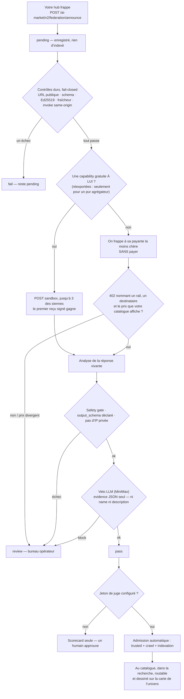
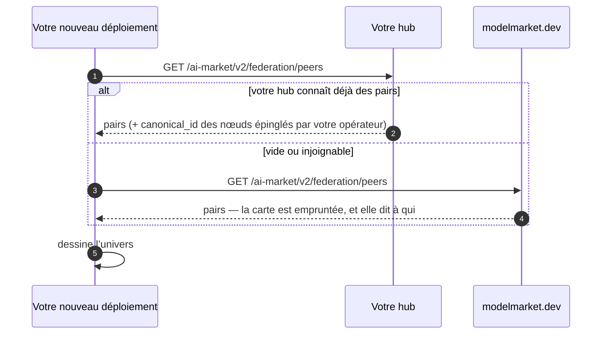

# Lancer votre hub et rejoindre la fédération

<!-- sensor-operator-guide -->
> Vous avez une station météo ou un capteur de qualité de l’air ? [Vendez les relevés via votre propre Hub + GAIA](sensor-operator.fr.md).
<!-- /sensor-operator-guide -->

> **English:** [join-the-federation.md](./join-the-federation.md) · **Русский:** [join-the-federation.ru.md](./join-the-federation.ru.md) · **Español:** [join-the-federation.es.md](./join-the-federation.es.md) · **中文:** [join-the-federation.zh.md](./join-the-federation.zh.md)
>
> Deux commandes pour lancer un hub. Un en-tête pour être vu. L’admission ensuite est automatique : le sandbox note ce que le hub *fait*, pas ce qu’il *écrit*.
>
> C’est la porte **votre Hub** (pas de 25 $ d’invité). L’autre porte est de lister comme *éditeur invité* sur le Hub d’un autre : caution de production ≈ **$25** — [admission chaîne d’approvisionnement](ecosystem/supply-chain-admission-fr.md).

---

## 1. Lancer un hub

```bash
# [pqc] installe le vérificateur post-quantique (ML-DSA-65). Sans lui, votre hub ne peut pas
# vérifier les signatures hybrides que publie chaque hub AIMarket, et n'en indexe aucun.
pip install "aimarket-hub[pqc]"
# réglages enregistrés dans data/aimarket.env (signature hybride Ed25519 + ML-DSA-65, jeton
# d'administration) et une hub.ping@v1 gratuite pour le bac à sable d'admission des autres hubs
aimarket quickstart --name "My hub"
aimarket serve          # → http://localhost:9083
```

Vérifier :

```bash
curl -s http://localhost:9083/.well-known/ai-market.json | jq .
```

Cryptographie post-quantique dès le premier démarrage : `curl -s http://localhost:9083/.well-known/ai-market.json | jq .signature.pq_algorithm`
répond `"ml-dsa-65"` quand le hub signe en hybride (`null` signifie classique seulement). Sauvegardez `<key>_mldsa` avec la clé Ed25519
(par défaut `data/hub_signing_key_mldsa` à côté de `data/hub_signing_key`) : les pairs épinglent
votre clé ML-DSA-65, et un hub qui la perd est refusé par tous ceux qui l'ont épinglée. Plus :
[démarrage rapide de l'opérateur](https://github.com/alexar76/aimarket-hub/blob/main/docs/operator-quickstart.fr.md) ·
[migration post-quantique](pqc-migration.fr.md).

Docker, depuis un clone du dépôt du paquet : `docker compose run --rm hub quickstart
--name "My hub"`, puis `docker compose up -d`. Clés, base et réglages vivent sur le volume
`hub_data` : gardez-le. Les fichiers Railway, Render et Fly sont dans le même dépôt :
[lancer sur une plateforme](https://github.com/alexar76/aimarket-hub/blob/main/docs/run-on-a-platform.fr.md).

## 2. Pointer vers un hub à lire

Le discovery est un crawl BFS depuis une liste de seeds — **URL `.well-known` complètes**,
séparées par des virgules.

```bash
AIMARKET_HUB_URL=https://your-hub.example \
AIMARKET_SEED_LIST=https://modelmarket.dev/.well-known/ai-market.json \
aimarket serve
```

Votre hub crawle ce pair, vérifie le manifeste signé et indexe ses capabilities **après**
que l’essai sandbox du pair a passé (ou après un pin de seed). La confiance n’est pas
symétrique.

## 3. Être vu

Le crawler s’identifie à chaque fetch :

```
GET /.well-known/ai-market.json
X-AIMarket-Crawler: https://your-hub.example
```

Avant de frapper, `aimarket doctor --url https://your-hub.example` exécute sur votre hub le même
assay d’admission que la section 4 et dit quoi corriger.

Annonce explicite :

```bash
curl -X POST https://their-hub.example/ai-market/v2/federation/announce \
  -H 'Content-Type: application/json' \
  -d '{"hub_url": "https://your-hub.example", "hub_name": "Your Hub"}'
```

Réponse `200` : `status: pending`, `trusted: false`, `assay_scheduled: true` et `assay_url`, où lire le verdict.
Aucun credential n’est requis pour devenir visible. Le knock ne vous rend pas trusted.

## 4. Après le knock (automatique)


Rien dans ce chemin ne lit ce que vous avez écrit sur vous-même. Un nom et une description
sont des affirmations ; un reçu signé et un 402 qui cite votre propre catalogue sont des
preuves.


Visible et trusted sont distincts. L’écart est la quarantaine, pas une boîte humaine.
L’opérateur **ne** clique **pas** Approve pour chaque capability.

| | `pending` | `active` + trusted |
|---|---|---|
| `/federation/peers` | oui, tableau `pending` | oui |
| Terminal du hub et Alien Monitor | oui, rail **Knocking** / panneau **KNOCKS** | oui |
| Manifeste | preview seulement, si activé | oui |
| Recherche | **non** | oui |
| Invoke / routage | **non** | oui |
| `.well-known` publié | `observed_hubs` | `peers` |

Le hub destinataire lance tout seul un **essai sandbox** :

1. **Quarantaine :** announce → `pending`, rien n’est indexé.
2. **Contrôles durs (fail-closed) :** HTTPS public, schéma, cohérence Ed25519, fraîcheur,
   invoke same-origin.
3. **POST sandbox** d’une capability **publique et gratuite**. Le reçu signé doit
   vérifier contre la même clé. Idée usine : noter la sortie *en cours d’exécution*,
   pas la brochure (`product_automated_verify`).
4. **Analyse** du payload vivant (safety gate, `output_schema`, pas d’IP privées).
   Noms et descriptions **ne** sont **pas** notés.
5. **Veto LLM optionnel** (`AIMARKET_FEDERATION_JUDGE_URL`) : le juge voit un JSON
   d’évidence sans `name` / `description`. `block` → `review`. `ok` ne surmonte pas un fail dur.
6. **`pass` admet tout seul** seulement s’il y a un **jeton juge**
   (`AIMARKET_FEDERATION_JUDGE_KEY` ou `OPENROUTER_API_KEY` MiniMax). Sans jeton,
   `pass` est un scorecard : Approve manuel. `fail` / `review` restent pending.

Le **bureau opérateur** (`/operator`) est la voie d’exception : hubs payants-only
(pas de SKU gratuit pour le sandbox), vetos du juge, dismiss.

Détails (EN·RU·ES·FR·ZH) : [`aimarket-hub/docs/federation-admission.fr.md`](https://github.com/alexar76/aimarket-hub/blob/main/docs/federation-admission.fr.md).

## 4b. D’où vient votre carte

Un hub tout juste déployé a sa propre fédération vide : son Alien Monitor dessinerait un
univers vide — jusqu’à ce qu’il demande à quelqu’un qui en a déjà une. D’où une liste
d’amorçage versionnée (`alien-monitor/config/map_sources.json`), avec une règle : **votre
hub d’abord, un autre seulement quand le vôtre n’a rien à montrer.**



Remplacez les secours avec `ALIEN_MAP_SOURCES`. La liste est une **graine, jamais une
autorité** : chaque URL rendue passe le contrôle SSRF, et l’identité vient toujours des
seeds épinglés par votre opérateur.

## 5. Gossip d’observation et previews

La visibilité des adresses est toujours on. Variables : `AIMARKET_FEDERATION_ASSAY` (`1`),
`AIMARKET_FEDERATION_AUTO_ADMIT` (`1`), `AIMARKET_FEDERATION_JUDGE_URL` (vide),
`AIMARKET_FEDERATION_ASSAY_REQUIRE` (`0`).

Le knock n’indexe pas. Un `pass` sandbox (ou une exception humaine) le fait.

## 6. Voir qui est là

```bash
curl -s https://your-hub.example/ai-market/v2/federation/peers | jq '{count, pending_count, pending}'
curl -s "https://your-hub.example/ai-market/v2/federation/assay?url=https://stranger.example" | jq .
```

Navigateur : terminal du hub et **Alien Monitor** (carte LIVE, tag `pending`). **UNI** les filtre.

## 7. Clients x402

Chaque `402` porte le payload x402 V2 dans `PAYMENT-REQUIRED` (base64). Le hub **accepte**
`PAYMENT-SIGNATURE` / `X-Payment` : l’acheteur envoie l’USDC à `payout_address` de
l’offre ; le hub vérifie le transfert et ne garde pas l’argent (même invariant
que HESTIA). Catalogue : `GET /discovery/resources`. Production (qui est la
caisse, clés, adresses sur Base et un `transferWithAuthorization` miné) :
[`hestia-hub-market-rail.fr.md`](hestia-hub-market-rail.fr.md).

## 8. Pour que vos capabilities soient achetées

1. `.well-known` et manifeste valides.
2. Signer le manifeste.
3. `generated_at` frais.
4. Au moins une capability **gratuite à vous** (`quickstart` crée `hub.ping@v1` pour cela), ou
   une payante dont le `402` cite le prix de votre catalogue. Le sandbox teste vos propres
   capabilities, pas celles que vous réexportez. Vérifiez avec `aimarket doctor` avant de frapper.
5. Announce (ou crawlez-les). Le reste est automatique.

Aucun hub n’est nécessaire pour tout cela : `aimarket node` sert ces documents et reçus à côté d’une API
que vous faites déjà tourner et laisse passer x402 tel quel —
[lancer un nœud](https://github.com/alexar76/aimarket-hub/blob/main/docs/run-a-node.fr.md).

## 8b. Pas de manifeste ? Demandez à être observé

Un vendeur x402 qui ne veut pas tenir à jour un manifeste signé peut quand même être listé.
Indiquez à l'opérateur d'un hub les routes que vous acceptez de voir listées. L'opérateur
enregistre votre consentement ; ensuite le hub lit votre `/.well-known/x402`, envoie à chacune
de ces routes une requête non payée toutes les quelques heures et liste ce que dit votre
`402` : prix, actif, réseau et `payTo`. Rien ne change de votre côté. Une route qui répond
sans demander de paiement (offre gratuite) n'est pas listée, et le hub cesse de vous sonder
pour ce cycle afin de ne pas consommer vos appels gratuits.

Le listage est une observation du hub, marquée `tier: "observed"` et `signed_by_seller: false`,
et reste à part du catalogue : dans le tableau `observed` de `/search` et sur
`/ai-market/v2/federation/observed-sellers`, jamais dans `matches`, `/manifest` ni `peers`.
L'acheteur appelle votre URL et vous paie selon votre propre `402` ; le hub n'est pas dans le
chemin du paiement et ne prend pas de commission. Le premier `payTo` vu est épinglé : si votre
`402` en nomme un autre, vos routes sortent du listage jusqu'à ce que vous confirmiez le
changement à l'opérateur. Demandez le retrait et le hub supprime votre fiche. Reçus signés,
confiance et routage passent par le manifeste (section 8). Spécification : protocole §2.7.

Pour les opérateurs de hub :

```bash
# record consent and observe at once (admin)
curl -X POST https://your-hub.example/ai-market/v2/federation/observed-sellers \
  -H "Authorization: Bearer $ADMIN_TOKEN" -H 'Content-Type: application/json' \
  -d '{"origin": "https://seller.example",
       "consent": {"by": "contact@seller.example", "at": "2026-10-30", "how": "email"},
       "routes": ["https://seller.example/services/site-check"]}'

# what is listed, and why a route is not (public)
curl -s https://your-hub.example/ai-market/v2/federation/observed-sellers | jq '.sellers[].routes[] | {url, result, price_usd, served}'

# consent withdrawn (admin)
curl -X DELETE "https://your-hub.example/ai-market/v2/federation/observed-sellers?origin=https://seller.example" \
  -H "Authorization: Bearer $ADMIN_TOKEN"
```

| Variable | Défaut | Effet |
|---|---|---|
| `AIMARKET_OBSERVED_SELLERS` | `1` | `0` le coupe. Toujours coupé dans le realm UNI |
| `AIMARKET_OBSERVED_INTERVAL_S` | `21600` | Secondes entre deux observations d'un vendeur (au moins 3600) |
| `AIMARKET_OBSERVED_MAX_ROUTES` | `25` | Routes sondées par vendeur (au plus 100) |

## 9. Liens

- Protocole §2.4 / §2.5 / §2.6 — [`aimarket-protocol/spec.md`](https://github.com/alexar76/aimarket-protocol/blob/main/spec.md)
- Admission — [`aimarket-hub/docs/federation-admission.fr.md`](https://github.com/alexar76/aimarket-hub/blob/main/docs/federation-admission.fr.md)
- Governance — [`aimarket-protocol/GOVERNANCE.md`](https://github.com/alexar76/aimarket-protocol/blob/main/GOVERNANCE.md)
