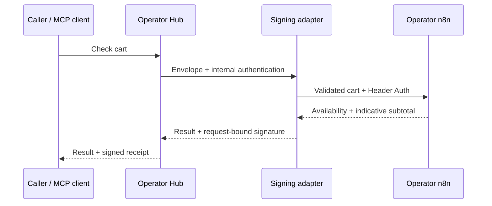

# An n8n order check on your own hub

[English workshop](../../docs/n8n-workshop.md) · [Русский](../../docs/n8n-workshop.ru.md) · [Español](../../docs/n8n-workshop.es.md) · [Français](../../docs/n8n-workshop.fr.md) · [中文](../../docs/n8n-workshop.zh.md)

An agent asks whether a basket can be fulfilled. An operator-owned n8n workflow checks
its catalogue and returns an indicative goods subtotal and shortages. This example uses
**synthetic inventory**, costs **$0 per call**, and never reserves stock, creates an order,
sends a message or charges a card. No LLM account is needed to run the lab.

n8n already provides [native MCP access](https://n8n.io/mcp/). This workshop explores an
additional operator-owned service catalogue, request-bound provider signatures and a path
to federation. The local lab does not announce itself to public hubs.

## Prerequisites

- Node.js 24.14.0 (the lab version) and npm; Python 3.11+ (tested with 3.11.15).
- A clone of this repository including `aimarket-hub/`.
- Three free loopback ports: n8n `15678`, adapter `13456`, Hub `19083`.
- Install time is outside the proposed 60-minute session. n8n has a large dependency tree.

From the repository root:

```bash
python3 -m venv examples/n8n-order-check/.venv
examples/n8n-order-check/.venv/bin/python -m pip install -e './aimarket-hub[pqc]'
cd examples/n8n-order-check
source .venv/bin/activate
npm install --prefix .runtime/npm n8n@2.43.7 --no-audit --no-fund
export PATH="$PWD/.runtime/npm/node_modules/.bin:$PATH"
python run.py init
python run.py n8n-import
```

`init` creates separate database, keys and random secrets in `.runtime/`, using Hub
`quickstart` and `add`. It is safe to rerun and preserves keys. It does not print tokens.
`n8n-import` imports a Header Auth credential and `workflow.json`, then publishes the
workflow. Use this only against the isolated workshop instance. Stop that instance before
re-importing and restart afterwards. Do not import generated credentials into a shared n8n.

In three terminals, from this example directory with the Python environment activated:

```bash
# Terminal 1: also repeat the PATH export above
python run.py n8n
# Terminal 2
python run.py adapter
# Terminal 3
python run.py hub
```

The editor is at `http://127.0.0.1:15678`. If asked, create a **local workshop** owner
account. No n8n Cloud account or paid feature is required by the example. The exported
workflow is initially inactive; the import command publishes it. In an existing n8n
instance, import via the editor, create your own Header Auth credential, select it on
the Webhook node, and publish. Reconfigure the adapter to your production webhook URL
and credential; that migration is outside the automatic launcher.

## Run the example

Wait for n8n to report that its editor is available and workflow indexing is complete.

```bash
curl --fail-with-body http://127.0.0.1:19083/ai-market/v2/invoke \
  -H 'Content-Type: application/json' --data-binary @request.json
python run.py check
node test_quote.cjs
```

The input requests two `BEANS-250` and one `MUG-BLUE`. The result must include:

```json
{
  "demo": true,
  "status": "ready",
  "can_fulfill": true,
  "currency": "USD",
  "subtotal_minor": 3430,
  "tax_minor": null,
  "shipping_minor": null,
  "grand_total_minor": null,
  "reservation_created": false,
  "order_created": false
}
```

3430 means **USD 34.30 for goods only**. `null` tax/shipping means not calculated, not zero.
`evaluated_at` is the execution time, not the freshness of live stock. The hub also returns
a signed receipt. The adapter signature binds the result to the product, capability and
input hash; it authenticates the provider's statement, not the truth of its stock.

Try `MUG-BLUE` quantity 4: `insufficient_stock`; unknown SKU: `unknown_items` with no subtotal;
negative or fractional quantities: rejection. Duplicate SKUs are aggregated before the
availability check. Errors from n8n fail the call; there is no fallback success result.

## Use through MCP

Connect a local Streamable HTTP MCP client to `http://127.0.0.1:19083/mcp`.
A cloud-only agent cannot reach your laptop's loopback address. For it, deploy a properly
secured public HTTPS hub first; never make the lab n8n editor public to solve this.

Prompt: “Find the workshop store order-check tool. Check two BEANS-250 and one MUG-BLUE.
Report shortages and the goods subtotal. State that this is demo data. Do not place an order.”

The agent should discover the capability/schema before invoking; it must not invent stock
or prices. MCP protocol invocation is included in the acceptance check;
an HTTP/MCP harness is not an independently validated end-user agent session.

## How the three pieces connect



`workflow.json` contains Webhook → Code → Respond to Webhook. Edit `quote.js`, then run
`python build_workflow.py` to regenerate the import file. `adapter.py` supplies protocol
mapping, timeout handling and signatures. Tokens and signing keys stay outside the workflow.
Successful/error execution payload saving is disabled in this lab.

## From fixture to a real independent operator

Replace the fixture stage with an authorised **read-only** data source (for example an
existing inventory API or a prepared spreadsheet). Map SKU, available quantity, currency,
integer minor-unit prices and the source observation time. Never assume spreadsheet freshness;
define and enforce a maximum age. Keep unknown products distinct from zero stock. Review
commercial visibility before making any catalogue public. Customer-specific prices need
caller authorization and tenant isolation; the lab has neither and must not serve them.

Update the adapter's demo-only output contract together with the workflow, then retest.
Preserve `reservation_created: false` and `order_created: false`. Order creation requires a
separate capability, authorization, idempotency and cancellation/refund handling.

Deploy Hub with persistent keys/database, public HTTPS and rate limits; keep n8n and the
adapter on a private network with authentication. Do not copy the lab's HTTP cookies and
loopback exceptions to a public installation. Run `aimarket doctor`, then choose whether
to announce to federation using the [operator guide](https://github.com/alexar76/aimarket-hub/blob/main/docs/operator-quickstart.md).
Admission is not automatic merely because the local lab passes.

Hub software is free to run; the operator supplies hosting. n8n has its own licence and
terms. No external buyer, sale or revenue is implied. Paid listing configuration is optional
and not part of this workshop.

## Troubleshooting and stopping

- `404` from n8n: import and publish the workflow, restart n8n, use `/webhook/`, not `/webhook-test/`.
- `401/403`: ensure the generated Header Auth credential is selected; re-import while stopped.
- `502`: check n8n/adapter logs; a normal webhook acknowledgement is not an order-check result.
- `504`: n8n exceeded the adapter's ten-second timeout; use short synchronous workflows here.
- Signature error: preserve `.runtime/provider_key` and rerun `init` to refresh the listing.
- Stop each server with Ctrl+C. `.runtime/` remains local and ignored by Git. Keep it private.

See [validation](VALIDATION.md) for the exact tested versions and remaining boundaries.

## Sources

- [n8n Webhook](https://docs.n8n.io/integrations/builtin/core-nodes/n8n-nodes-base.webhook/)
- [Respond to Webhook](https://docs.n8n.io/integrations/builtin/core-nodes/n8n-nodes-base.respondtowebhook/)
- [Webhook credentials](https://docs.n8n.io/integrations/builtin/credentials/webhook/)
- [Hub quickstart](https://github.com/alexar76/aimarket-hub/blob/main/docs/operator-quickstart.md)
