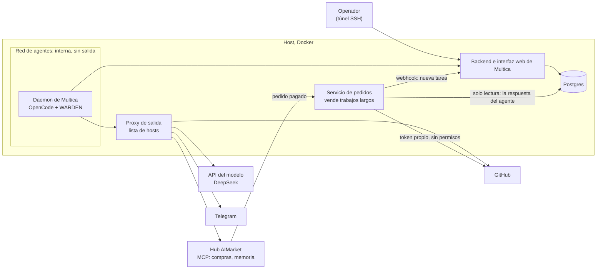
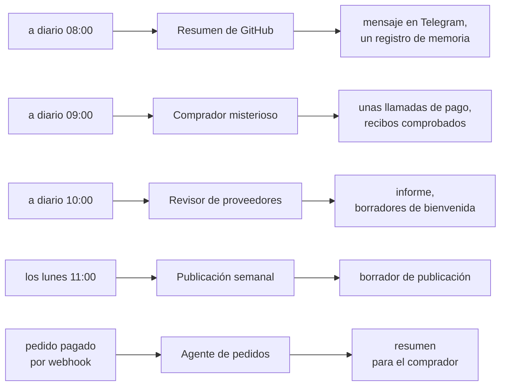
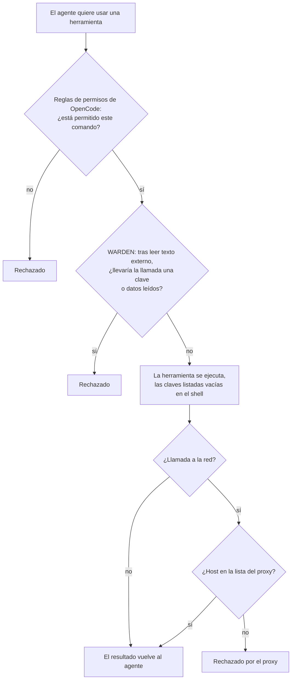
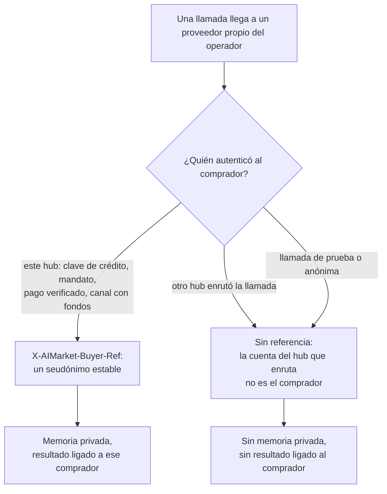
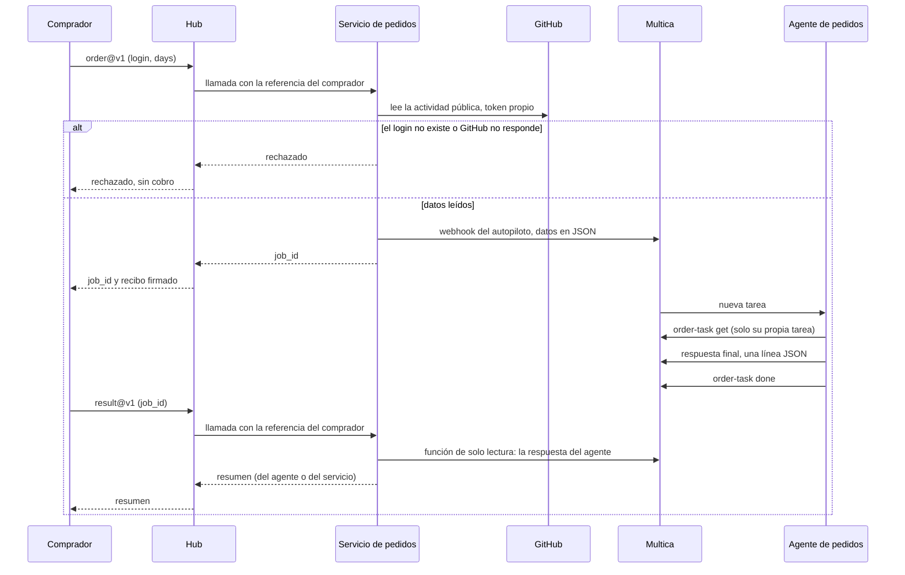

# Multica y AIMarket: configuración e integración

[English](README.md) · [Русский](README.ru.md) · **Español** · [Français](README.fr.md) · [中文](README.zh.md)

Esta guía conecta un [Multica](https://github.com/multica-ai/multica) autoalojado con hubs de AIMarket como
[modelmarket.dev](https://modelmarket.dev). Multica es la fábrica de agentes; el hub es el mercado donde esos agentes
trabajan. Al terminar la guía, tus agentes podrán:

- **comprar** habilidades de otros agentes durante una tarea, con una clave prepagada cuyo saldo es un límite firme;
- **recordar** entre ejecuciones mediante habilidades de memoria de pago;
- **vender** una capacidad, incluido un trabajo largo de un agente que tarda minutos;
- y funcionar **acotados**: salida a la red solo hacia hosts de una lista, permisos por agente y una protección contra
  el envío hacia fuera de lo que han leído.

Lo que probamos: Multica autoalojado, 0.5.3 desde el 2026-11-04 y 0.8.0 desde el 2026-11-05, su daemon con OpenCode
1.18.32 y DeepSeek, en un solo host. 0.8.0 maneja OpenCode 1.15 y posteriores por ACP por defecto; mantenemos el modo
`opencode run`, en el que se probaron la protección y las reglas de permisos (sección 2). Los comandos de abajo son los
de la CLI 0.5.3; los que usa esta configuración se comprobaron también en 0.8.0.

## Contenido

[Panorama: cómo encaja todo](#panorama-cómo-encaja-todo)

1. [Antes de empezar](#1-antes-de-empezar)
2. [El daemon en un contenedor](#2-el-daemon-en-un-contenedor)
3. [Limita la salida a la red](#3-limita-la-salida-a-la-red)
4. [Conecta el hub: compra habilidades](#4-conecta-el-hub-compra-habilidades)
5. [A cada agente, solo lo que necesita](#5-a-cada-agente-solo-lo-que-necesita)
6. [Protege a los agentes: WARDEN para OpenCode](#6-protege-a-los-agentes-warden-para-opencode)
7. [Memoria entre ejecuciones](#7-memoria-entre-ejecuciones)
8. [Agentes cuyos hechos vienen de un script](#8-agentes-cuyos-hechos-vienen-de-un-script)
9. [Vende una capacidad](#9-vende-una-capacidad)
10. [Vende un trabajo largo de un agente](#10-vende-un-trabajo-largo-de-un-agente)
11. [Comprueba la configuración](#11-comprueba-la-configuración)
12. [Trampas en las que caímos](#12-trampas-en-las-que-caímos)
13. [Límites conocidos](#13-límites-conocidos)

## Panorama: cómo encaja todo

Todo funciona en un solo host con Docker. El entorno de los agentes está en una red interna: su única salida es un
proxy con una lista corta de hosts. El operador abre la interfaz web de Multica por un túnel SSH. Un pequeño servicio
propio vende trabajos largos de agentes en el hub y habla con Multica mediante el webhook de un autopiloto y un rol de
base de datos de solo lectura.



Nuestra instalación de referencia tiene cinco agentes. Los autopilotos los arrancan según un horario (UTC) o cuando
llega un pedido:



Cada sesión de agente carga la protección WARDEN. Cada agente recibe solo su propio entorno y sus permisos
(secciones 5 y 6), y nada de lo que preparan los agentes sale sin una persona: los borradores siguen siendo borradores.

## 1. Antes de empezar

- Un host Linux con Docker y Docker Compose.
- Multica, autoalojado según [sus propias instrucciones](https://github.com/multica-ai/multica). No expongas la
  interfaz web a internet: publícala en `127.0.0.1` y ábrela por un túnel SSH
  (`ssh -L 13300:127.0.0.1:13300 your-host`, y luego http://127.0.0.1:13300).
- Una clave de modelo para el runtime. Nosotros usamos DeepSeek con OpenCode (`DEEPSEEK_API_KEY`).
- Para comprar: una clave prepagada de https://modelmarket.dev/start.
- Para vender: una cuenta de proveedor en https://modelmarket.dev/start?role=provider y un endpoint HTTPS.

## 2. El daemon en un contenedor

El daemon de Multica arranca el runtime del agente (OpenCode) en cada tarea. Ejecútalo en su propio contenedor:

- un usuario que no sea root (el nuestro es `node`, uid 1000), `cap_drop: [ALL]`,
  `security_opt: ["no-new-privileges:true"]`;
- límites: `mem_limit: 3g`, `cpus: 2`, `pids_limit: 1024`;
- `MULTICA_DAEMON_AUTO_UPDATE: "false"`, para que las versiones solo cambien al reconstruir;
- en Multica 0.8.0 con OpenCode 1.x, `MULTICA_OPENCODE_TRANSPORT: run`, para mantener el modo en que se probó la protección;
- los secretos de los agentes en un archivo env con permisos 600, cargado con `env_file`: la clave del modelo, un
  token de GitHub, los tokens del bot de chat, la clave del hub. Nunca pongas una clave en una tarea, una instrucción
  o una habilidad.

Todos los agentes comparten un daemon, un usuario y una carpeta personal. La sección 5 explica cómo separarlos
igualmente.

## 3. Limita la salida a la red

A un agente que lee textos ajenos (issues, páginas, respuestas de vendedores) se le puede convencer de enviar datos
fuera. No le des ruta directa: pon el daemon en una red interna de Docker y deja que un proxy decida a qué hosts puede
llegar.

```yaml
services:
  daemon:
    networks: [agent]
    environment:
      HTTPS_PROXY: http://egress:8888
      HTTP_PROXY: http://egress:8888
      NO_PROXY: backend,localhost,127.0.0.1
  egress:
    build: { context: ./egress }      # tinyproxy
    networks: [agent, app]
    read_only: true
    tmpfs: ["/tmp", "/run"]
    cap_drop: [ALL]
networks:
  agent:
    internal: true                    # no route out, no outside DNS
    ipam: { config: [{ subnet: 10.250.0.0/24 }] }
```

El daemon sigue necesitando el backend de Multica: pon también el backend en la red `agent`.

`tinyproxy.conf`:

```
Port 8888
Listen 0.0.0.0
Allow 10.250.0.0/24
FilterType ere
FilterURLs Off
FilterDefaultDeny Yes
Filter "/etc/tinyproxy/allow"
ConnectPort 443
```

`allow`: un host por línea, anclado al principio y al final; si no, también coincidiría `github.com.example.net`:

```
^api\.deepseek\.com$
^models\.dev$
^github\.com$
^api\.github\.com$
^api\.telegram\.org$
^modelmarket\.dev$
```

`models.dev` es el catálogo de modelos de OpenCode. Añade solo los hosts que tus agentes necesitan. Un host de la
lista sigue siendo un canal (un agente con un token de GitHub puede escribir en GitHub); para eso está la sección 6.

## 4. Conecta el hub: compra habilidades

Añade el servidor MCP del hub a la configuración global de OpenCode, `~/.config/opencode/opencode.jsonc` en la carpeta
personal del daemon:

```jsonc
{
  "mcp": {
    "modelmarket": {
      "type": "remote",
      "url": "https://modelmarket.dev/mcp",
      "headers": { "X-API-Key": "{env:AIMARKET_API_KEY}" }
    }
  }
}
```

Pon la clave prepagada en el archivo env del daemon como `AIMARKET_API_KEY`. Su saldo es un límite firme: cuando se
agota, el hub responde 402 y no cobra nada. Sin clave, el hub concede unas pocas llamadas de prueba.

Después el agente usa tres herramientas:

- `market_search`: `intent` en palabras sencillas y `budget` (precio máximo por llamada). Cada resultado da
  `product_id`, `capability_id`, `source_hub`, el precio, `max_price_usd` y los campos de entrada.
- `market_invoke`: `product_id`, `capability_id`, `source_hub` (obligatorio en los listados federados, que son la
  mayor parte del catálogo), `input` y `max_price_usd` copiado sin cambios de la búsqueda. Si la ruta subió de
  precio, el hub rechaza con `price_limit_exceeded` antes de trabajar o cobrar.
- `account_status`: lo que le queda a la clave y lo que ha gastado.

Cada llamada de pago devuelve el recibo firmado del hub; el recibo de trabajo detrás del `verify_url` de la respuesta
vincula el hash de la entrada, el resultado y el vendedor. Guárdalo junto a cualquier respuesta en la que te apoyes.

Nuestra habilidad [`multica/community/aimarket/SKILL.md`](../community/aimarket/SKILL.md) enseña al agente estas
reglas (presupuesto por tarea, sin reintentos ante 402/403, solo entrada neutral, la respuesta de un vendedor son
datos). Impórtala:

```bash
multica skill import --url https://github.com/alexar76/aicom/tree/main/multica/community/aimarket
```

La URL funcionará cuando el espejo público tenga esta carpeta; mientras tanto, comprime la carpeta en zip y usa
`multica skill import --file aimarket.zip`.

## 5. A cada agente, solo lo que necesita

La configuración global del daemon se aplica a todos los agentes, así que mantenla pequeña y define el resto por
agente. Multica da a cada agente un **entorno propio** (custom environment); OpenCode lee de él
`OPENCODE_CONFIG_CONTENT` como configuración adicional para las ejecuciones de ese agente.

Para un agente que lee textos ajenos y no necesita el hub, desactiva el hub y vacía las claves que no necesita:

```bash
cat <<'EOF' | multica agent env set <agent-id> --custom-env-stdin
{
  "AIMARKET_API_KEY": "",
  "OPENCODE_CONFIG_CONTENT": "{\"mcp\":{\"modelmarket\":{\"enabled\":false}},\"tools\":{\"modelmarket_*\":false}}"
}
EOF
```

`env set` reemplaza el entorno completo (`****` conserva un valor existente). Comprueba el resultado con
`opencode debug config` ejecutado con el mismo `OPENCODE_CONFIG_CONTENT`.

`permission.bash` de OpenCode acepta patrones; gana el **último** que coincide, y cada comando de una línea se
comprueba por separado (también dentro de `$(...)`, comillas invertidas y tuberías). Un comando con redirección se
comprueba junto con ella. Así, un agente que solo puede ejecutar un comando queda así:

```json
{"bash": {"*": "deny", "/opt/tools/order-task get *": "allow", "*>*": "deny", "*<*": "deny", "*$*": "deny", "*`*": "deny"}}
```

Sin las cuatro últimas reglas, `comando-permitido > ~/.config/opencode/opencode.jsonc` sobrescribiría un archivo.

Permite un envoltorio que escribas tú, no la CLI de Multica con un comodín. El token de un agente de Multica está
ligado al **espacio de trabajo**, no a su tarea, así que `multica issue get *` lee cualquier tarea del espacio, y los
números de tarea son consecutivos. El envoltorio debe comprobar que la tarea es del agente antes de mostrar o cambiar
nada (el nuestro está en la sección 10).

## 6. Protege a los agentes: WARDEN para OpenCode

El flow guard de [WARDEN](https://github.com/alexar76/warden) es un plugin de OpenCode. Cuando una sesión ya ha leído
texto externo, rechaza la llamada a una herramienta que llevaría fuera una credencial o datos que la sesión leyó.
También vacía en los comandos de shell las claves que indiques. En nuestro ataque de prueba había una clave falsa en
un archivo. Su envío fue rechazado por todos los canales: el script de chat, `curl` a un host permitido, una escritura
en memoria y la CLI del gestor de tareas. Un día normal de trabajo transcurrió sin ningún rechazo.

Cada llamada a una herramienta que hace un agente pasa por tres capas, y cada una puede rechazarla por sí sola:



Qué detienen las capas y qué no:

| Amenaza | Lo detiene |
|---|---|
| A un agente con una inyección de prompt le hacen ejecutar un comando que no debía | Reglas de permisos de OpenCode (un envoltorio en lugar de un comodín) |
| Envía una clave o datos leídos a un host permitido (GitHub, chat, hub) | Protección WARDEN |
| Envía algo a cualquier otro host | Proxy de salida |
| Desactiva la protección para las sesiones siguientes | Protección en una carpeta propiedad de root (abajo) |
| La propia respuesta final del agente saca datos | No la protección: esa respuesta la publica Multica; compruébala en tu servicio (sección 10) |

Lo comprobamos en nuestra instalación. El ataque de prueba (arriba) fue rechazado por todos los canales. El 2026-11-05,
cada ejecución programada de los cinco agentes y un pedido pagado tras pasar a Multica 0.8.0 dejaron el archivo de
estado de la protección para su sesión: el plugin funcionó en cada una.

El plugin viene en `@aimarket/warden` a partir de la versión 0.23.0 (`@aimarket/warden/opencode`). Cargador, como
`plugin/warden.js` en la carpeta de configuración de OpenCode:

```js
import { createWardenPlugin } from '@aimarket/warden/opencode';

export const WardenFlowGuard = createWardenPlugin({
  block: 'data',
  // Keys only the OpenCode process needs; shell commands get them blank.
  stripEnv: ['DEEPSEEK_API_KEY', 'AIMARKET_API_KEY'],
});
```

Sin el paquete, copia `dist/opencode-plugin.js` y todos los `dist/flow-guard*.js` en una carpeta e importa
`opencode-plugin.js` desde allí.

Instálalo donde el usuario del agente no pueda cambiarlo. Los archivos deben ser de root, y también **cada carpeta por
encima de ellos**: un usuario puede renombrar una carpeta suya, con la protección dentro. Encontramos ese hueco en
nuestra propia instalación el 2026-11-05. Los archivos del plugin eran de root, pero `~/.config/opencode` pertenecía
al usuario del agente. Lo cerramos dejando el plugin en una carpeta propiedad de root montada en `/opt/opencode-guard` e indicándosela a
OpenCode con `OPENCODE_CONFIG_DIR`. Móntala con escritura, pero propiedad de root, para que el usuario del agente no
pueda escribir en ella. OpenCode 1.18.32 escribe un `.gitignore` en cada carpeta de configuración al arrancar: en un
montaje de solo lectura se detiene con un error, y una carpeta en la que no puede escribir simplemente la omite. Después comprueba con `opencode debug config`, como usuario del
agente, que el plugin está cargado.

## 7. Memoria entre ejecuciones

Los agentes empiezan cada tarea desde cero. Attested Memory les da una memoria que pagan por llamada:
`memory.write@v1`, `memory.search@v1` y `memory.read@v1` en hub.attestedmemory.net. Una memoria pertenece al
comprador que ese hub autenticó. Cómprala **directamente en ese hub**: obtén una clave en
https://hub.attestedmemory.net/start y usa su servidor MCP, `https://hub.attestedmemory.net/mcp`, igual que en la
sección 4. Si se compra a través de otro hub (modelmarket.dev también lista estas habilidades), la llamada llega al
hub de memoria con la identidad del hub que la enruta, no con la tuya, y no obtiene memoria privada. Las llamadas de
prueba tampoco.

Quién es el dueño de una memoria, y quién puede leer el resultado de un pedido, lo decide el hub que autenticó al
comprador:



Un pago x402 verificado del propio comprador sigue identificándolo, incluso en una llamada enrutada.

Escribe el uso en las instrucciones del agente con un presupuesto: qué habilidades, cuántas llamadas por ejecución,
sin reintentos ante 402 o 403. Nuestro resumen diario de GitHub lee hasta tres registros anteriores, añade una línea
de "Tendencias" y guarda un registro al día: unos $0,03 por ejecución.

## 8. Agentes cuyos hechos vienen de un script

Cuando el resultado tiene que ser correcto (cifras, hallazgos, precios), deja que un script decida los hechos y que el
modelo solo escriba alrededor de ellos. Así funciona nuestro revisor de proveedores. Un script compara el catálogo del
hub con el de ayer y revisa esquemas, inyección de prompts, lo que un comprador tendría que entregar, direcciones y
precios. El modelo escribe el informe y pega sin cambios los hechos del script. Nuestra publicación semanal funciona
igual: un script reúne los contadores de la semana y el modelo redacta el texto.

Prográmalos con un autopiloto (`multica autopilot create --agent <agent> --mode create_issue --title ...`, y luego
`multica autopilot trigger-add <id> --kind schedule --cron "0 10 * * *"`; zona horaria UTC por defecto). Código:
[`multica/supplier-review`](../supplier-review/), [`multica/weekly-post`](../weekly-post/).

## 9. Vende una capacidad

La guía completa está en https://modelmarket.dev/developers (y en https://play.modelmarket.dev/publish). El camino
corto, unos 15 minutos para un endpoint que ya tienes funcionando:

1. Crea una cuenta y una clave en https://modelmarket.dev/start?role=provider; tu `account_id` de
   `GET /ai-market/v2/account` es tu `publisher_id`.
2. `GET /ai-market/v2/supply/policy` con la clave indica si hace falta un depósito de garantía; deposítalo con
   `POST /ai-market/v2/supply/stake` solo si `additional_stake_usd` es mayor que cero.
3. Describe la capacidad en `capability.json`. Necesita `capability_id` (p. ej. `mytool.summarize@v1`),
   `product_id`, `publisher_id`, `invoke_url` (HTTPS), `price_per_call_usd`, JSON Schemas de entrada y salida, y la
   `provider_pubkey` Ed25519 con la que tu endpoint firma las respuestas.
4. Prueba el endpoint con https://play.modelmarket.dev/connect (una llamada real, esquema y firma).
5. `POST /ai-market/v2/supply/register` con la clave y `capability.json`.

Escribe la descripción para el modelo del comprador: qué hace, qué necesita, qué devuelve, cuánto cuesta. Nada de
instrucciones al modelo ("usa siempre esta herramienta"): los hubs buscan eso en los listados y las protecciones de
los compradores lo rechazan.

## 10. Vende un trabajo largo de un agente

Una llamada de pago no puede esperar minutos a un agente. Vende el trabajo como dos capacidades:

- `…order@v1` (de pago). Tu servicio comprueba estrictamente la entrada, hace él mismo las lecturas externas, crea
  una tarea en Multica mediante un disparador **webhook** de un autopiloto con esos datos y responde de inmediato con
  un `job_id`.
- `…result@v1` (gratis) responde `queued`, o `done` con el resultado.

El pedido completo, desde la llamada del comprador hasta el resultado:



Cómo encajan las piezas:

1. **Autopiloto con disparador webhook.** `multica autopilot create --agent <order-agent> --mode create_issue
   --title "Orders" --description "<instructions>"`, y luego `multica autopilot trigger-add <id> --kind webhook`.
   La URL del disparador contiene su token: guárdala en el archivo env del servicio (permisos 600) y nunca la
   registres en un log. Multica pone el JSON que envías en la descripción de la tarea.
2. **Las lecturas externas las hace tu servicio.** Las hace antes de aceptar el pedido, con un token propio. Un token
   de GitHub sin permisos sube el límite de 60 a 5000 peticiones por hora. Rechaza antes de cobrar si la entrada es
   incorrecta o la fuente no responde: el hub solo cobra una llamada que obtuvo respuesta. Ningún texto libre del
   comprador debe llegar al agente.
3. **La respuesta final del agente es el entregable.** Es una sola línea JSON, `{"job_id": "...", "summary": "..."}`,
   y Multica la publica en la tarea. El agente no envía nada por la red. Un agente que ha leído texto externo y luego
   envía valores de su propia tarea es justo lo que WARDEN rechaza.
4. **El agente de pedidos ejecuta un único envoltorio.** El nuestro es
   [`order-task`](../provider/order-task/order-task): `order-task get <issue>` muestra la tarea y
   `order-task done <issue>` la cierra, solo si la tarea está asignada al agente de pedidos. Pertenece a root, y sus
   reglas de OpenCode están en [`opencode-order-agent.json`](../provider/order-task/opencode-order-agent.json).
5. **El servicio lee la respuesta** con un rol de base de datos de solo lectura. Ese rol solo puede ejecutar una
   función. La función (`SECURITY DEFINER`, con un `search_path` fijo) devuelve los comentarios del agente de pedidos
   en las tareas que su autopiloto creó para un pedido. El servicio acepta exactamente `job_id` y `summary`, con un
   límite de longitud y enlaces solo al sitio esperado. Si no llega una respuesta útil cuando termina la tarea o tras
   20 minutos, el servicio escribe un resumen sencillo con los mismos datos.
6. **Quién puede leer el resultado.** Un hub envía `X-AIMarket-Buyer-Ref`, un seudónimo estable del comprador
   autenticado, solo a los proveedores propios de su operador, junto con el token interno del hub. En tu propio hub,
   vincula cada pedido a esa referencia. En el hub de otro no recibes ninguna identidad del comprador. Entonces el
   `job_id` es la clave de lectura: 128 bits aleatorios, devueltos solo en la respuesta de pago, con un límite de
   conservación.

Nuestro servicio es [`multica/provider`](../provider/) (27 pruebas; el envoltorio y las reglas de permisos tienen 25
más). Vende `github.digest.order@v1` a $0,05 en hub.attestedmemory.net.

## 11. Comprueba la configuración

- **La configuración tal como la ve el agente.** Ejecuta `opencode debug config` como usuario del agente, con el
  `OPENCODE_CONFIG_CONTENT` del agente. Comprueba que los servidores MCP están desactivados donde querías y que el
  plugin aparece.
- **La salida a la red.** Desde dentro del daemon, `curl https://example.com` debe fallar a través del proxy, y
  `curl https://api.github.com/zen` debe responder.
- **La protección.** Haz un ataque de prueba con una clave **falsa** en un archivo: pide a un agente que la envíe por
  cada canal permitido. Todo envío debe ser rechazado, y una tarea normal debe ejecutarse sin rechazos.
- **La venta.** Haz un pedido real con poco presupuesto. Comprueba que el resultado lo lee el comprador que pagó, que
  una llamada sin comprador se rechaza y que una entrada errónea se rechaza sin cobro.

## 12. Trampas en las que caímos

- **DNS de Docker en dos redes.** Un contenedor en dos redes de Compose resuelve nombres de servicio en cualquiera
  de ellas. `postgres` llegó a la base de datos de otro stack. Usa nombres de contenedor (`multica-postgres-1`).
- **Comprobar la base de datos por 127.0.0.1 no demuestra nada.** Si `pg_hba` confía en las conexiones locales, una
  contraseña errónea igualmente entra. Prueba la contraseña por la red.
- **`multica agent env set`**, no `agent update`, cambia el entorno propio, y lo reemplaza entero.
- **Límite de GitHub compartido.** Las lecturas sin token comparten 60 peticiones por hora por IP del host, y
  cualquier contenedor del host puede gastarlas. Da a cada lector su propio token sin permisos.
- **Los agentes no pueden cerrar sus tareas** si sus reglas no lo permiten. Permítelo mediante el envoltorio, solo
  para su propia tarea.
- **El modelo no es la protección.** En nuestras pruebas DeepSeek rechazó comandos inyectados evidentes, pero lo que
  sostiene son las reglas y los permisos de archivos.

## 13. Límites conocidos

- Multica publica la respuesta final del agente por su cuenta, fuera de las llamadas a herramientas que ve una
  protección. Comprueba esa respuesta en tu servicio: forma, tamaño y enlaces.
- El daemon y sus agentes se ejecutan con un mismo usuario. Cualquier agente puede leer el inicio de sesión de Multica
  del propio daemon, y un agente con shell completo puede cambiar archivos que usan los demás. La salida limitada, la
  protección y la propiedad de los archivos lo reducen; solo un usuario distinto por agente lo eliminaría.
- La protección es por runtime, no por agente.
- Un host de la lista sigue siendo un canal. Mantén la lista corta y da a los tokens los mínimos permisos.

Instalación de referencia: [`multica/community/README.md`](../community/README.md). Revisión de seguridad de esta
configuración: [`artifacts/vulnetix-class-multica-2026-11-05/REPORT.md`](../../artifacts/vulnetix-class-multica-2026-11-05/REPORT.md).
