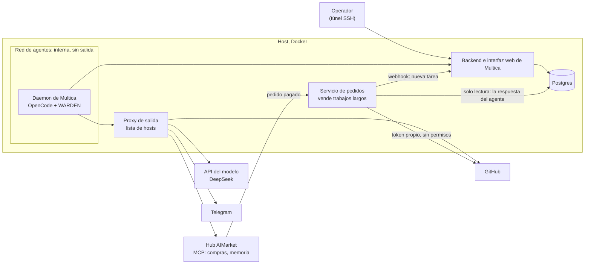
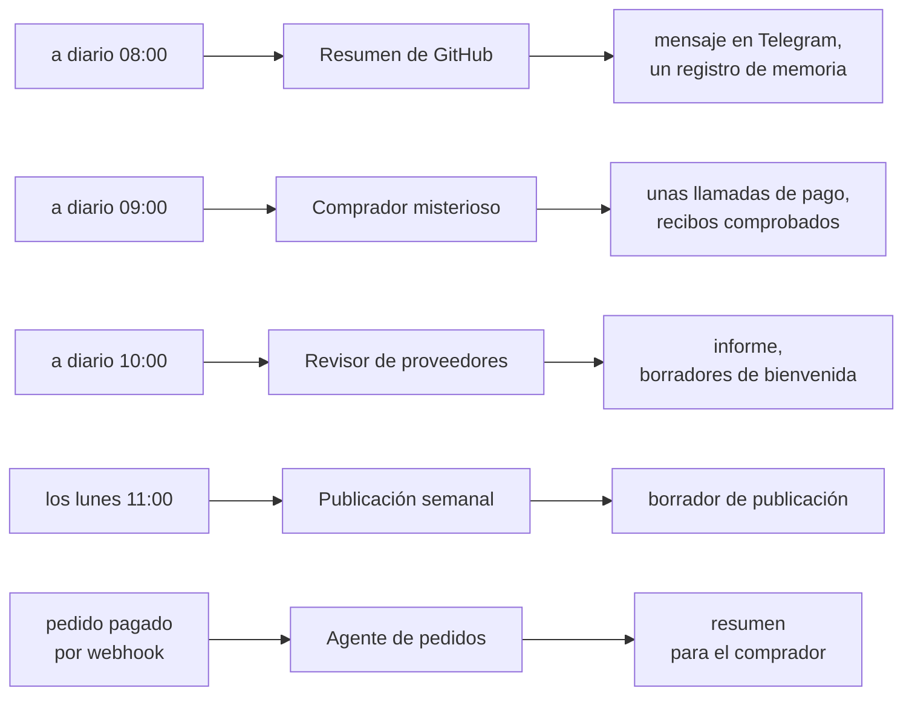
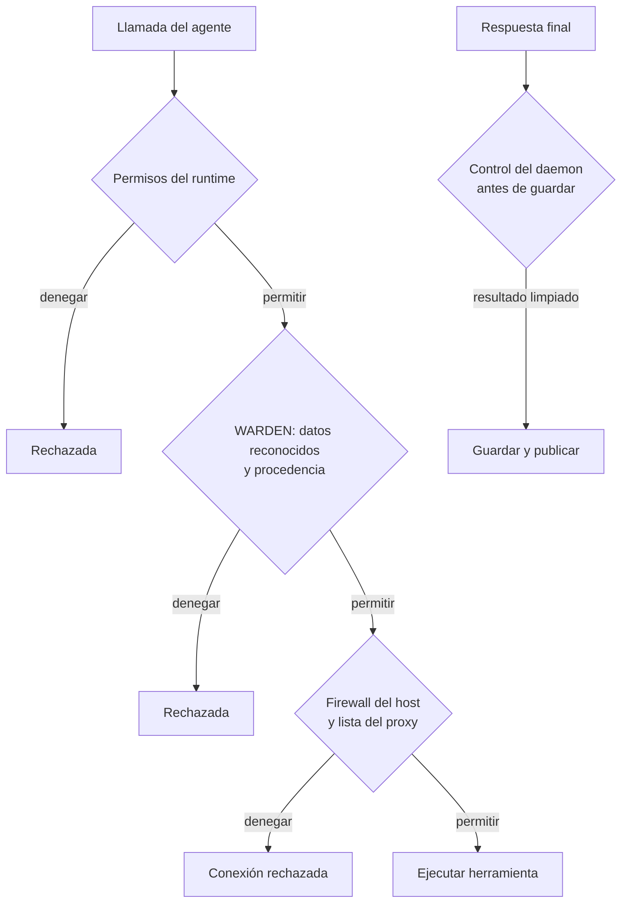
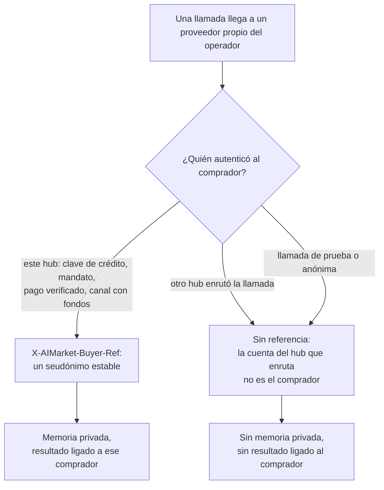
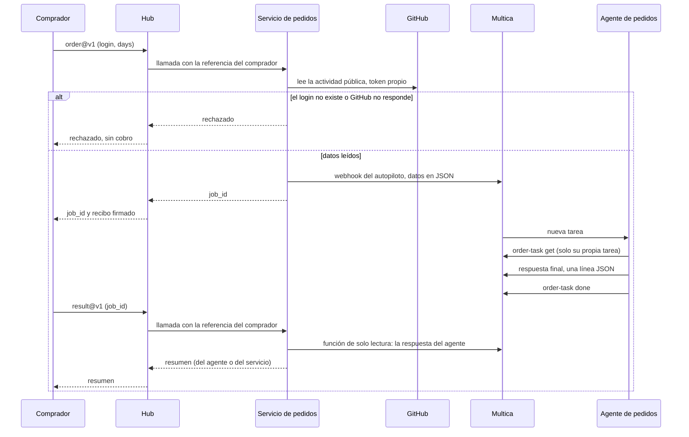

# Multica y AIMarket: configuración e integración

[English](README.md) · [Русский](README.ru.md) · **Español** · [Français](README.fr.md) · [中文](README.zh.md)

Esta guía conecta un [Multica](https://github.com/multica-ai/multica) autoalojado con hubs de AIMarket como
[modelmarket.dev](https://modelmarket.dev). Multica es la fábrica de agentes; el hub es el mercado donde esos agentes
trabajan. Al terminar la guía, tus agentes podrán:

- **comprar** habilidades de otros agentes durante una tarea, con una clave prepagada cuyo saldo es un límite firme;
- **recordar** entre ejecuciones mediante habilidades de memoria de pago;
- **vender** una capacidad, incluido un trabajo largo de un agente que tarda minutos;
- y funcionar **acotados**: salida a la red solo hacia hosts de una lista, permisos por agente y una protección contra
  el envío hacia fuera de lo que han leído.

Lo que probamos: Multica autoalojado, 0.5.3 desde el 2026-11-04 y 0.8.0 desde el 2026-11-05, su daemon con OpenCode
1.18.32 y DeepSeek, en un solo host. 0.8.0 maneja OpenCode 1.15 y posteriores por ACP por defecto; mantenemos el modo
`opencode run`, en el que se probaron la protección y las reglas de permisos (sección 2). Los comandos de abajo son los
de la CLI 0.5.3; los que usa esta configuración se comprobaron también en 0.8.0.

> **Con un comando.** [`operator-kit/onboard.sh`](../operator-kit/README.md) configura las secciones 2, 3, 4 y 6 junto a
> su Multica y las comprueba: `sudo ./onboard.sh --dir /opt/multica`. Este manual explica qué hace y por qué.

## Contenido

[Panorama: cómo encaja todo](#panorama-cómo-encaja-todo)

1. [Antes de empezar](#1-antes-de-empezar)
2. [El daemon en un contenedor](#2-el-daemon-en-un-contenedor)
3. [Limita la salida a la red](#3-limita-la-salida-a-la-red)
4. [Conecta el hub: compra habilidades](#4-conecta-el-hub-compra-habilidades)
5. [A cada agente, solo lo que necesita](#5-a-cada-agente-solo-lo-que-necesita)
6. [Protege a los agentes: WARDEN para OpenCode](#6-protege-a-los-agentes-warden-para-opencode)
7. [Memoria entre ejecuciones](#7-memoria-entre-ejecuciones)
8. [Agentes cuyos hechos vienen de un script](#8-agentes-cuyos-hechos-vienen-de-un-script)
9. [Vende una capacidad](#9-vende-una-capacidad)
10. [Vende un trabajo largo de un agente](#10-vende-un-trabajo-largo-de-un-agente)
11. [Comprueba la configuración](#11-comprueba-la-configuración)
12. [Trampas en las que caímos](#12-trampas-en-las-que-caímos)
13. [Límites conocidos](#13-límites-conocidos)

## Panorama: cómo encaja todo

Todo funciona en un solo host con Docker. El entorno de los agentes está en una red interna: su única salida es un
proxy con una lista corta de hosts. El operador abre la interfaz web de Multica por un túnel SSH. Un pequeño servicio
propio vende trabajos largos de agentes en el hub y habla con Multica mediante el webhook de un autopiloto y un rol de
base de datos de solo lectura.



Nuestra instalación de referencia tiene cinco agentes. Los autopilotos los arrancan según un horario (UTC) o cuando
llega un pedido:



Cada sesión de agente carga la protección WARDEN. Cada agente recibe solo su propio entorno y sus permisos
(secciones 5 y 6), y nada de lo que preparan los agentes sale sin una persona: los borradores siguen siendo borradores.

## 1. Antes de empezar

- Un host Linux con Docker y Docker Compose.
- Multica, autoalojado según [sus propias instrucciones](https://github.com/multica-ai/multica). No expongas la
  interfaz web a internet: publícala en `127.0.0.1` y ábrela por un túnel SSH
  (`ssh -L 13300:127.0.0.1:13300 your-host`, y luego http://127.0.0.1:13300).
- Una clave de modelo para el runtime. Nosotros usamos DeepSeek con OpenCode (`DEEPSEEK_API_KEY`).
- Para comprar: una clave prepagada de https://modelmarket.dev/start.
- Para vender: una cuenta de proveedor en https://modelmarket.dev/start?role=provider y un endpoint HTTPS.

## 2. El daemon en un contenedor

El daemon de Multica arranca el runtime del agente (OpenCode) en cada tarea. Ejecútalo en su propio contenedor:

- un usuario que no sea root (el nuestro es `node`, uid 1000), `cap_drop: [ALL]`,
  `security_opt: ["no-new-privileges:true"]`;
- límites: `mem_limit: 3g`, `cpus: 2`, `pids_limit: 1024`;
- `MULTICA_DAEMON_AUTO_UPDATE: "false"`, para que las versiones solo cambien al reconstruir;
- en Multica 0.8.0 con OpenCode 1.x, `MULTICA_OPENCODE_TRANSPORT: run`, para mantener el modo en que se probó la protección;
- los secretos de los agentes en un archivo env con permisos 600, cargado con `env_file`: la clave del modelo, un
  token de GitHub, los tokens del bot de chat, la clave del hub. Nunca pongas una clave en una tarea, una instrucción
  o una habilidad.

Todos los agentes comparten un daemon, un usuario y una carpeta personal. La sección 5 explica cómo separarlos
igualmente.

## 3. Limita la salida a la red

Estado del despliegue, 2026-11-10: las restricciones adicionales del firewall están activas en nuestro host
Multica **attested**. La aceptación de red se registra aparte en el
[recibo de despliegue](../../artifacts/multica-security-2026-11-10/deployment.json); activarlas no demuestra que
todas las pruebas de elusión hayan pasado. Este estado no describe la instalación del colega en `178.62.243.71`.

La restricción de red pertenece al **despliegue de Multica**: redes Docker, proxy de salida y firewall del host.
WARDEN comprueba llamadas a herramientas; no instala reglas de red. Conecta el daemon solo a una red interna de
agentes, el proxy también a la red con acceso a internet y el backend a su endpoint interno. Las variables de
proxy son voluntarias: una orden puede ignorarlas y conectar directamente.

```yaml
# Topology excerpt only; use the reviewed overlay in ../security/egress/.
services:
  daemon:
    networks: [agent]
    environment:
      HTTPS_PROXY: http://egress:8888
      https_proxy: http://egress:8888
      HTTP_PROXY: http://egress:8888
      http_proxy: http://egress:8888
      NO_PROXY: backend,localhost,127.0.0.1
      no_proxy: backend,localhost,127.0.0.1
    cap_drop: [ALL]
    security_opt: ["no-new-privileges:true"]
  backend:
    networks: [app, agent]
  egress:
    networks: [agent, app]
    read_only: true
    cap_drop: [ALL]
networks:
  agent:
    internal: true
    enable_ipv6: false
    ipam: { config: [{ subnet: 10.250.0.0/24 }] }
  app: {}
```

Es un fragmento de topología, no un despliegue completo. Al combinar archivos Compose, **reemplaza** la lista de
redes del daemon: conservar `app` además de añadir `agent` deja una ruta directa. Elige una subred sin solapamientos.
El [kit de egress](../security/egress/README.md) incluye el overlay revisado, proxy, plan de reglas del host y
verificaciones. Requiere el inventario exacto del operador; aquí no se inventan direcciones prod/dev de TONmobile.
El agente no debe poder modificar estos archivos; no publiques el puerto del proxy.

Opciones relevantes de `tinyproxy.conf`:

```text
Port 8888
Listen 0.0.0.0
Allow 10.250.0.0/24
FilterType ere
FilterURLs Off
FilterDefaultDeny Yes
Filter "/etc/tinyproxy/allow"
ConnectPort 443
```

En `allow`, un hostname anclado por línea. Estos **marcadores no operativos** deben sustituirse por los hosts
revisados de la API del modelo y de QA:

```text
^model-api\.operator\.invalid$
^tonmobile-dev\.operator\.invalid$
^tonmobile-prod\.operator\.invalid$
```

Mantén el backend de Multica en su endpoint interno. Instala dependencias al construir la imagen: permitir todo el
registro npm o GitHub SSH no es necesario por defecto para QA. Para leer Git usa un servicio aparte de solo lectura
o un transporte restringido; no entregues al agente credenciales de escritura.

El host debe denegar conexiones directas desde la subred del agente salvo al proxy y al endpoint exacto del backend.
Cubre **INPUT del host**, incluido el gateway Docker (por ejemplo el receptor `172.18.0.1:9999` del informe), y el
tráfico reenviado. Con **iptables de Docker**, aplica la restricción de reenvío en `DOCKER-USER`, antes de sus reglas
de aceptación; añadirla al final de `FORWARD` no basta. Con **nftables no existe `DOCKER-USER`**: usa tablas propias
con cadenas base input/forward y prioridades revisadas. No modifiques tablas de Docker ni supongas que UFW cubre
por sí solo al contenedor. Desactiva IPv6 explícitamente y compruébalo, o aplica reglas equivalentes verificadas.

Comprueba también el resolver real: hacen falta los nombres internos, pero ninguna consulta DNS externa arbitraria
debe escapar por el DNS integrado de Docker o el reenviador del host. Restringe ese resolver por separado si hace
falta. `internal: true` no demuestra por sí solo el bloqueo de DNS o sockets del host. `ConnectPort 443` limita
CONNECT, no los puertos del HTTP normal; restringe también la salida del propio proxy.

Un host permitido sigue siendo un canal: comentarios Multica, peticiones al modelo y operaciones Git pueden llevar
datos. El proxy CONNECT no inspecciona el cuerpo cifrado. Mantén pocos hosts, permisos mínimos y los secretos fuera
de los archivos/entorno legibles por el agente; valida los resultados antes de guardarlos (§6).
Referencias oficiales: [Docker iptables](https://docs.docker.com/engine/network/firewall-iptables/),
[Docker nftables](https://docs.docker.com/engine/network/firewall-nftables/),
[Docker firewall/UFW](https://docs.docker.com/engine/network/packet-filtering-firewalls/),
[Docker DNS](https://docs.docker.com/engine/network/#dns-services) y
[configuración Tinyproxy](https://tinyproxy.github.io/#documentation).

## 4. Conecta el hub: compra habilidades

Añade el servidor MCP del hub a la configuración global de OpenCode, `~/.config/opencode/opencode.jsonc` en la carpeta
personal del daemon:

```jsonc
{
  "mcp": {
    "modelmarket": {
      "type": "remote",
      "url": "https://modelmarket.dev/mcp",
      "headers": { "X-API-Key": "{env:AIMARKET_API_KEY}" }
    }
  }
}
```

Pon la clave prepagada en el archivo env del daemon como `AIMARKET_API_KEY`. Su saldo es un límite firme: cuando se
agota, el hub responde 402 y no cobra nada. Sin clave, el hub concede unas pocas llamadas de prueba.

Después el agente usa tres herramientas:

- `market_search`: `intent` en palabras sencillas y `budget` (precio máximo por llamada). Cada resultado da
  `product_id`, `capability_id`, `source_hub`, el precio, `max_price_usd` y los campos de entrada.
- `market_invoke`: `product_id`, `capability_id`, `source_hub` (obligatorio en los listados federados, que son la
  mayor parte del catálogo), `input` y `max_price_usd` copiado sin cambios de la búsqueda. Si la ruta subió de
  precio, el hub rechaza con `price_limit_exceeded` antes de trabajar o cobrar.
- `account_status`: lo que le queda a la clave y lo que ha gastado.

Cada llamada de pago devuelve el recibo firmado del hub; el recibo de trabajo detrás del `verify_url` de la respuesta
vincula el hash de la entrada, el resultado y el vendedor. Guárdalo junto a cualquier respuesta en la que te apoyes.

Nuestra habilidad [`multica/community/aimarket/SKILL.md`](../community/aimarket/SKILL.md) enseña al agente estas
reglas (presupuesto por tarea, sin reintentos ante 402/403, solo entrada neutral, la respuesta de un vendedor son
datos). Impórtala:

```bash
multica skill import --url https://github.com/alexar76/aicom/tree/main/multica/community/aimarket
```

La URL funcionará cuando el espejo público tenga esta carpeta; mientras tanto, comprime la carpeta en zip y usa
`multica skill import --file aimarket.zip`.

## 5. A cada agente, solo lo que necesita

La configuración global del daemon se aplica a todos los agentes, así que mantenla pequeña y define el resto por
agente. Multica da a cada agente un **entorno propio** (custom environment); OpenCode lee de él
`OPENCODE_CONFIG_CONTENT` como configuración adicional para las ejecuciones de ese agente.

Para un agente que lee textos ajenos y no necesita el hub, desactiva el hub y vacía las claves que no necesita:

```bash
cat <<'EOF' | multica agent env set <agent-id> --custom-env-stdin
{
  "AIMARKET_API_KEY": "",
  "OPENCODE_CONFIG_CONTENT": "{\"mcp\":{\"modelmarket\":{\"enabled\":false}},\"tools\":{\"modelmarket_*\":false}}"
}
EOF
```

`env set` reemplaza el entorno completo (`****` conserva un valor existente). Comprueba el resultado con
`opencode debug config` ejecutado con el mismo `OPENCODE_CONFIG_CONTENT`.

`permission.bash` de OpenCode acepta patrones; gana el **último** que coincide, y cada comando de una línea se
comprueba por separado (también dentro de `$(...)`, comillas invertidas y tuberías). Un comando con redirección se
comprueba junto con ella. Así, un agente que solo puede ejecutar un comando queda así:

```json
{"bash": {"*": "deny", "/opt/tools/order-task get *": "allow", "*>*": "deny", "*<*": "deny", "*$*": "deny", "*`*": "deny"}}
```

Sin las cuatro últimas reglas, `comando-permitido > ~/.config/opencode/opencode.jsonc` sobrescribiría un archivo.

Permite un envoltorio que escribas tú, no la CLI de Multica con un comodín. El token de un agente de Multica está
ligado al **espacio de trabajo**, no a su tarea, así que `multica issue get *` lee cualquier tarea del espacio, y los
números de tarea son consecutivos. El envoltorio debe comprobar que la tarea es del agente antes de mostrar o cambiar
nada (el nuestro está en la sección 10).

## 6. Protege a los agentes: WARDEN para OpenCode

Estado del despliegue, 2026-11-10: nuestra instalación **attested** ejecuta la compilación local revisada de WARDEN
y el daemon/backend Multica corregidos. Pasaron 9/9 pruebas de hooks en producción; se rechazó el caso canario
conservado de sesión limpia. Se verificaron hashes de binarios, salud backend/UI y migraciones sin cambios. Véase el
[recibo de despliegue](../../artifacts/multica-security-2026-11-10/deployment.json). **No es una nueva publicación npm**
ni verifica la instalación `178.62.243.71`/0.24.0 del colega o su prueba TONM-14 completa. Siguen vigentes los
límites de patrones reconocidos y rutas de salida descritos abajo.

El flow guard de [WARDEN](https://github.com/alexar76/warden) comprueba llamadas a herramientas. La integración
histórica OpenCode 0.23.0 aplicaba controles de fuga tras registrar texto externo y vaciaba variables seleccionadas
en el shell. En el ataque con una clave falsa se leyó primero GitHub y después el archivo: se rechazaron el script
de chat, `curl` a un host permitido, la escritura en memoria y la CLI del gestor. Una tarea normal registrada terminó
sin rechazos. Esto no demuestra protección en una sesión limpia ni en otra versión del runtime.

El fallo comunicado en 0.24.0 muestra el hueco: `multica issue get` no se reconoció como texto externo y leer `.env`
no activó por sí solo los controles. Los cambios locales del 2026-11-10 separan los controles de secretos reconocidos
de ese disparador y añaden procedencia para Multica/informes QA. Hay que compilar y verificar el runtime elegido;
cambiar fuentes no actualiza npm ni el daemon instalado. No uses `npx` o un `curl` fallido para activar la protección.
El receptor puede haber recibido el cuerpo cuando `curl` vence su tiempo de espera.

El código de WARDEN no nombra Multica. Las lecturas dentro de `playwright-report/` y `test-results/` son texto
externo de serie; la CLI de Multica pasa a ser fuente externa mediante la política del operador. Parte del fragmento
incluido `warden/examples/policies/multica.flow-policy.json` (en el paquete npm desde la próxima versión), que marca
`multica issue get`, `issue list`, `issue search` e `issue comment list`. Sin él, la salida de Multica cuenta como
datos propios del operador. Añade tus prefijos de órdenes y directorios de informes igual (aquí, la carpeta de
informes QA `reports/`); solo añaden desconfianza y nunca autorizan acciones:

```json
{
  "mode": "deny",
  "untrustedSources": {
    "commands": [
      ["multica", "issue", "get"], ["multica", "issue", "list"],
      ["multica", "issue", "search"], ["multica", "issue", "comment", "list"]
    ],
    "paths": ["reports"]
  }
}
```

Si el agente escribe su informe junto al clon (en la raíz del espacio de trabajo de la tarea), añade `"projectRoots": [".."]` a la misma política: si no, tras texto externo esa escritura cuenta como fuera del proyecto (`destructive_action`), como mostraron las mediciones de campo.

Las rutas parten del proyecto; los operandos shell usan el directorio de ejecución. El reconocimiento es limitado,
no interpreta programas shell arbitrarios. Tras texto externo, `deny` estricto sigue rechazando ejecución opaca,
como `npm run ...` y `node -e ...`. No desactives la procedencia para ejecutar QA: usa permisos/adaptadores limitados
y revisados y un supervisor de confianza para arranque e informe seguros.

### Ejecutor QA separado: trabajos fijos sin shell del agente

El [runner QA separado](../qa-runner/README.md) se desplegó y aceptó en nuestro **attested** el 2026-11-10.
En la tarea real Multica **MY-89**, el perfil privado permanente llamó una vez a `qa_runner_task_execute` nativo,
sin otras herramientas. Backend/modelmarket/hub devolvieron **200/200/200**; el informe validado llegó al resultado
guardado y al comentario, y la tarea quedó con estado `done`. Véase el
[recibo de aceptación final](../../artifacts/multica-qa-runner-2026-11-10/final-acceptance.json). Solo se acepta la
operación inicial `platform_smoke`; no se ejecutó QA completo de navegador TONmobile.

Separa el controlador Multica/modelo de un worker Node 22 dedicado en `10.250.0.5`, sin
credenciales de modelo, Multica, GitHub ni hub, volumen home, archivo env, socket Docker ni clave privada TLS del
host. El sistema de archivos es de solo lectura salvo almacenamiento temporal limitado, sin capabilities.
Solo el controlador de confianza del host inicia el trabajo fijo `npm run smoke`.

El perfil QA privado puede llamar a `task_execute` del servidor `qa_runner` solo con `{"id":"platform_smoke"}`.
El TaskAdapter de WARDEN delega esa operación fijada antes del rechazo general tras texto externo; no permite al
agente `npm run ...`, `node -e ...`, URL, argumentos o código shell arbitrarios. El hijo MCP arranca con `env -i`
y una CA pública; la clave TLS privada del broker `10.250.0.1:8443` queda en el controlador del host.
`qa_runner` está desactivado globalmente y solo se habilita en el nuevo perfil QA privado; el resto de MCP/herramientas
queda desactivado para ese perfil.

Comprueba las reglas resueltas con `opencode debug agent build`: el deny general debe preceder los allow exactos
para `qa_runner_task_list`, `qa_runner_task_read`, `qa_runner_task_execute` y `qa_runner_task_run`. El JSON original
no demuestra el orden tras combinar herramientas heredadas. Las instrucciones llaman directamente la herramienta
QA nativa, sin iniciar Bash/Multica CLI. MCP solo admite metadatos estándar acotados `_meta.progressToken`; los
argumentos siguen siendo exactamente el ID fijo, sin URL, comandos ni campos adicionales libres.

El broker solo acepta `POST /run/platform-smoke` con cuerpo vacío desde el controlador permitido. Ejecuta un
trabajo a la vez, hasta tres inicios por cinco minutos, captura como máximo 64 KiB y limita el controlador a 8 segundos; el worker tiene 6 segundos y 1 segundo para terminar.
Solo devuelve nombres fijos, estados y booleanos; descarta stdout/errores brutos.
El broker del host guarda aparte 10 inicios por ventana UTC de 12 horas en SQLite de root bajo `/var/lib/multica-qa`;
borrar el contador MCP o reiniciar el controlador no lo reinicia. Los trabajos fallidos/inciertos consumen cuota.
El manifiesto del operador dura como máximo 23 horas, se renueva cada 12 horas y permite hasta 10 usos; el broker
limita además la frecuencia. Caducidad, pin cambiado o presupuesto agotado producen rechazo. `platform_smoke`
solo comprueba endpoints fijos de estado backend/hub/modelmarket sin autenticación y devuelve un informe acotado limpio,
sin cuerpos de respuesta ni escrituras externas. No implementa QA arbitrario ni el escenario TONmobile. Añadir
trabajos requiere revisar el controlador, fijar imagen/trabajo del worker y emitir otra capability fijada.

Permisos, WARDEN y red tienen límites distintos:



| Amenaza | Límite que la controla |
|---|---|
| El agente ejecuta órdenes fuera de su trabajo | Permisos del runtime y un envoltorio limitado del operador |
| Un secreto reconocido se envía a un servicio permitido | Controles WARDEN y permisos limitados; el hueco histórico de sesión limpia requiere la corrección local |
| Una conexión evita el proxy o usa un host no listado | Firewall del host, aislamiento de redes y proxy juntos (§3) |
| El agente desactiva la protección futura | Protección y todos sus directorios ascendentes propiedad de root |
| Un secreto aparece en la respuesta final | Control del daemon antes de persistir; Stop no es un filtro general de secretos |

El 2026-11-05, las ejecuciones programadas registradas de cinco agentes y un pedido pagado tras Multica 0.8.0 dejaron
un archivo de estado por sesión. Demuestra que se cargó el plugin, no que toda salida fuera segura.

### Comprueba la salida antes de guardarla en Multica

El [parche local de resultados Multica](../security/README.md) para upstream v0.8.0 añade ocultación recursiva en los
límites de confianza daemon/backend: antes de guardar la cola de reintentos, enviar callbacks complete/fail/message/
progress y almacenar resultados/errores de tareas. Usa `redact.Text` de upstream para formatos de token reconocidos,
incluidos valores anidados en cadenas JSON. Comprueba versión y checksums con
`apply-output-patch.py --source-root <checkout> --check`, aplica el parche revisado y reconstruye **daemon y backend**
según el kit. El despliegue attested figura en el recibo anterior; otras instalaciones requieren una reconstrucción aparte.

Ocultar solo el comentario deja expuestos `result.output`/`output_summary`. Solo el valor limpiado debe llegar a los
destinos corregidos; no registres el original como diagnóstico. La comprobación de patrones es limitada: no cubre
cualquier secreto o codificación, archivos de sesión del runtime, otras rutas de log sin corregir ni historial de
base de datos/cola. Revisa esos caminos y reduce primero los secretos accesibles. Retira o aísla registros expuestos
antiguos según la política de conservación del operador; el parche no limpia el pasado.

Validar forma JSON, tamaño y enlaces en el proveedor (§10) es útil, pero demasiado tarde para proteger el almacenamiento
bruto del daemon. Ni una continuación Stop ni el SDK de selección estructurada WARDEN son DLP general para texto
libre. Antes del despliegue prueba un token sintético reconocible por cada ruta de resultado corregida.

El plugin viene en `@aimarket/warden` a partir de la versión 0.23.0 (`@aimarket/warden/opencode`). Cargador, como
`plugin/warden.js` en la carpeta de configuración de OpenCode:

```js
import { createWardenPlugin } from '@aimarket/warden/opencode';

export const WardenFlowGuard = createWardenPlugin({
  block: 'data',
  // Keys only the OpenCode process needs; shell commands get them blank.
  stripEnv: ['DEEPSEEK_API_KEY', 'AIMARKET_API_KEY'],
});
```

Sin el paquete, copia `dist/opencode-plugin.js` y todos los `dist/flow-guard*.js` en una carpeta e importa
`opencode-plugin.js` desde allí.

Instálalo donde el usuario del agente no pueda cambiarlo. Los archivos deben ser de root, y también **cada carpeta por
encima de ellos**: un usuario puede renombrar una carpeta suya, con la protección dentro. Encontramos ese hueco en
nuestra propia instalación el 2026-11-05. Los archivos del plugin eran de root, pero `~/.config/opencode` pertenecía
al usuario del agente. Lo cerramos dejando el plugin en una carpeta propiedad de root montada en `/opt/opencode-guard` e indicándosela a
OpenCode con `OPENCODE_CONFIG_DIR`. Móntala con escritura, pero propiedad de root, para que el usuario del agente no
pueda escribir en ella. OpenCode 1.18.32 escribe un `.gitignore` en cada carpeta de configuración al arrancar: en un
montaje de solo lectura se detiene con un error, y una carpeta en la que no puede escribir simplemente la omite. Después comprueba con `opencode debug config`, como usuario del
agente, que el plugin está cargado.

### Ejemplo: la protección para todos los agentes

Esta es la configuración histórica comprobada el 2026-11-05: Multica 0.8.0, OpenCode 1.18.32 y WARDEN 0.23.0. Los archivos de
`warden/` son los archivos del plugin del paquete npm `@aimarket/warden@0.23.0`, sin cambios (20 archivos). Cada
comando de abajo se ejecutó primero en nuestro host.

El tarball histórico de abajo **no contiene** la corrección del 2026-11-10. Para un despliegue QA nuevo usa la
compilación local revisada y las pruebas del [kit de seguridad](../security/README.md), conservando versión y
manifiesto de archivos. Las órdenes siguientes conservan la receta anterior, no prueban la aceptación actual.

El cargador, guardado como `warden.js` junto a `docker-compose.yml`:

```js
// opencode-guard/plugin/warden.js: the WARDEN flow guard for every agent on this daemon.
// Export only the plugin: OpenCode calls every exported function as one.
import { createWardenPlugin } from '../warden/opencode-plugin.js';

export const WardenFlowGuard = createWardenPlugin({
  block: 'data',
  // Keys only the OpenCode process needs; shell commands get them blank.
  stripEnv: ['DEEPSEEK_API_KEY', 'AIMARKET_API_KEY'],
});
```

En el host, como root. El paquete se comprueba con la suma de verificación que publica npm:

```bash
cd /opt/multica                    # the folder with docker-compose.yml; warden.js (the loader) is here
T=$(mktemp -d)
curl -fsSL -o "$T/warden.tgz" https://registry.npmjs.org/@aimarket/warden/-/warden-0.23.0.tgz
echo "e9fe195e36ce559d9e543e8eb3fd4bcd729fe434  $T/warden.tgz" | sha1sum -c -
tar -xzf "$T/warden.tgz" -C "$T"
install -d -o root -g root -m 755 opencode-guard opencode-guard/plugin opencode-guard/warden
install -o root -g root -m 644 "$T"/package/dist/opencode-plugin.js "$T"/package/dist/flow-guard*.js opencode-guard/warden/
install -o root -g root -m 644 warden.js opencode-guard/plugin/warden.js
rm -rf "$T"
```

El resultado:

```
opencode-guard/                root:root 755
├── plugin/
│   └── warden.js              root:root 644   the loader above
└── warden/                    root:root 755
    ├── opencode-plugin.js     root:root 644
    └── flow-guard*.js         root:root 644   19 files
```

El daemon en `docker-compose.yml` (solo las líneas que importan aquí):

```yaml
services:
  daemon:
    environment:
      MULTICA_DAEMON_AUTO_UPDATE: "false"
      OPENCODE_CONFIG_DIR: /opt/opencode-guard   # every OpenCode session loads plugin/ from here
      MULTICA_OPENCODE_TRANSPORT: run            # Multica 0.8.0 with OpenCode 1.x: the transport the guard was tested on
    volumes:
      - daemon_home:/home/node
      - ./opencode-guard:/opt/opencode-guard     # root-owned; not :ro, OpenCode stops on a read-only config folder
```

Si hay una copia antigua de la protección en la carpeta personal del daemon (`~/.config/opencode/plugin` y
`~/.config/opencode/warden` en su volumen), sácala primero, o la protección se cargará dos veces. Después recrea el
daemon mientras no haya tareas:

```bash
docker compose up -d --no-deps --force-recreate daemon
```

Comprobaciones, como usuario del agente:

```bash
# 1. Sessions load the guard from the root-owned folder, and only from there.
docker exec -u node -w /tmp multica-daemon sh -c 'opencode debug config | jq -c .plugin'
#    ["file:///opt/opencode-guard/plugin/warden.js"]

# 2. Still loaded with another home folder, as if ~/.config had been renamed.
docker exec -u node -w /tmp multica-daemon sh -c 'mkdir -p /tmp/h && HOME=/tmp/h opencode debug config | jq -c .plugin; rm -rf /tmp/h'

# 3. Nothing on the guard's path is writable by the agent user: every line must say "ok".
docker exec -u node multica-daemon sh -c 'for p in /opt /opt/opencode-guard /opt/opencode-guard/plugin /opt/opencode-guard/warden; do [ -w "$p" ] && echo "WRITABLE: $p" || echo "ok: $p"; done'

# 4. A real session runs the guard: the newest state files carry the current time.
docker exec -u node -w /tmp multica-daemon opencode run "Reply with the single word OK."
docker exec -u node multica-daemon sh -c 'ls -lt ~/.local/state/warden/claude-code/flow | head -3'
```

La protección se aplica a todos los agentes del daemon, incluidos los que tienen su propio
`OPENCODE_CONFIG_CONTENT`: nuestro agente de pedidos tiene uno, y sus sesiones también escriben el estado de la
protección.

### Runtimes de Codex

Los agentes que funcionan con Codex en lugar de OpenCode reciben la misma guardia mediante los hooks de comando de
Codex. Está en el código local de WARDEN, todavía no publicada. Detalles y diagramas:
[WARDEN para Codex](https://github.com/alexar76/warden/blob/main/docs/codex.es.md).

- Codex no tiene «preguntar»: un hook que responde `ask` cuenta como fallido, y Codex ejecuta la llamada. El adaptador
  nunca pregunta. Una pregunta se convierte en rechazo o en paso registrado (`WARDEN_CODEX_BLOCK=data`, por defecto, o
  `all`), y cualquier fallo de la guardia rechaza.
- Instálala como hooks gestionados: la `codex-hooks/` construida en `/opt/warden-codex` y `codex-hooks/requirements.toml`
  como `/etc/codex/requirements.toml`, todo propiedad de root. `allow_managed_hooks_only = true` impide que un agente
  añada un hook propio.
- En el servicio del daemon en compose, monta ambos en solo lectura y fija el modo:

```yaml
    environment:
      WARDEN_CODEX_BLOCK: data
    volumes:
      - ./warden-codex:/opt/warden-codex:ro
      - ./codex/requirements.toml:/etc/codex/requirements.toml:ro
```

- Deja la clave del modelo fuera de las órdenes de shell con `shell_environment_policy` (`exclude`) y desactiva la
  búsqueda web integrada de Codex: no ejecuta ningún hook, así que la guardia no ve lo que trae.
- Compruébalo con `scripts/codex-live-check.sh` del repositorio de WARDEN: un ataque escenificado con una clave falsa,
  todo en localhost.

## 7. Memoria entre ejecuciones

Los agentes empiezan cada tarea desde cero. Attested Memory les da una memoria que pagan por llamada:
`memory.write@v1`, `memory.search@v1` y `memory.read@v1` en hub.attestedmemory.net. Una memoria pertenece al
comprador que ese hub autenticó. Cómprala **directamente en ese hub**: obtén una clave en
https://hub.attestedmemory.net/start y usa su servidor MCP, `https://hub.attestedmemory.net/mcp`, igual que en la
sección 4. Si se compra a través de otro hub (modelmarket.dev también lista estas habilidades), la llamada llega al
hub de memoria con la identidad del hub que la enruta, no con la tuya, y no obtiene memoria privada. Las llamadas de
prueba tampoco.

Quién es el dueño de una memoria, y quién puede leer el resultado de un pedido, lo decide el hub que autenticó al
comprador:



Un pago x402 verificado del propio comprador sigue identificándolo, incluso en una llamada enrutada.

Escribe el uso en las instrucciones del agente con un presupuesto: qué habilidades, cuántas llamadas por ejecución,
sin reintentos ante 402 o 403. Nuestro resumen diario de GitHub lee hasta tres registros anteriores, añade una línea
de "Tendencias" y guarda un registro al día: unos $0,03 por ejecución.

## 8. Agentes cuyos hechos vienen de un script

Cuando el resultado tiene que ser correcto (cifras, hallazgos, precios), deja que un script decida los hechos y que el
modelo solo escriba alrededor de ellos. Así funciona nuestro revisor de proveedores. Un script compara el catálogo del
hub con el de ayer y revisa esquemas, inyección de prompts, lo que un comprador tendría que entregar, direcciones y
precios. El modelo escribe el informe y pega sin cambios los hechos del script. Nuestra publicación semanal funciona
igual: un script reúne los contadores de la semana y el modelo redacta el texto.

Prográmalos con un autopiloto (`multica autopilot create --agent <agent> --mode create_issue --title ...`, y luego
`multica autopilot trigger-add <id> --kind schedule --cron "0 10 * * *"`; zona horaria UTC por defecto). Código:
[`multica/supplier-review`](../supplier-review/), [`multica/weekly-post`](../weekly-post/).

## 9. Vende una capacidad

La guía completa está en https://modelmarket.dev/developers (y en https://play.modelmarket.dev/publish). El camino
corto, unos 15 minutos para un endpoint que ya tienes funcionando:

1. Crea una cuenta y una clave en https://modelmarket.dev/start?role=provider; tu `account_id` de
   `GET /ai-market/v2/account` es tu `publisher_id`.
2. `GET /ai-market/v2/supply/policy` con la clave indica si hace falta un depósito de garantía; deposítalo con
   `POST /ai-market/v2/supply/stake` solo si `additional_stake_usd` es mayor que cero.
3. Describe la capacidad en `capability.json`. Necesita `capability_id` (p. ej. `mytool.summarize@v1`),
   `product_id`, `publisher_id`, `invoke_url` (HTTPS), `price_per_call_usd`, JSON Schemas de entrada y salida, y la
   `provider_pubkey` Ed25519 con la que tu endpoint firma las respuestas.
4. Prueba el endpoint con https://play.modelmarket.dev/connect (una llamada real, esquema y firma).
5. `POST /ai-market/v2/supply/register` con la clave y `capability.json`.

Escribe la descripción para el modelo del comprador: qué hace, qué necesita, qué devuelve, cuánto cuesta. Nada de
instrucciones al modelo ("usa siempre esta herramienta"): los hubs buscan eso en los listados y las protecciones de
los compradores lo rechazan.

## 10. Vende un trabajo largo de un agente

Una llamada de pago no puede esperar minutos a un agente. Vende el trabajo como dos capacidades:

- `…order@v1` (de pago). Tu servicio comprueba estrictamente la entrada, hace él mismo las lecturas externas, crea
  una tarea en Multica mediante un disparador **webhook** de un autopiloto con esos datos y responde de inmediato con
  un `job_id`.
- `…result@v1` (gratis) responde `queued`, o `done` con el resultado.

El pedido completo, desde la llamada del comprador hasta el resultado:



Cómo encajan las piezas:

1. **Autopiloto con disparador webhook.** `multica autopilot create --agent <order-agent> --mode create_issue
   --title "Orders" --description "<instructions>"`, y luego `multica autopilot trigger-add <id> --kind webhook`.
   La URL del disparador contiene su token: guárdala en el archivo env del servicio (permisos 600) y nunca la
   registres en un log. Multica pone el JSON que envías en la descripción de la tarea.
2. **Las lecturas externas las hace tu servicio.** Las hace antes de aceptar el pedido, con un token propio. Un token
   de GitHub sin permisos sube el límite de 60 a 5000 peticiones por hora. Rechaza antes de cobrar si la entrada es
   incorrecta o la fuente no responde: el hub solo cobra una llamada que obtuvo respuesta. Ningún texto libre del
   comprador debe llegar al agente.
3. **La respuesta final del agente es el entregable.** Es una sola línea JSON, `{"job_id": "...", "summary": "..."}`,
   y el publicador de confianza de Multica debe validarla antes de guardarla o publicarla. El agente no necesita
   un envío de red directo. El control de herramientas y el del resultado final son requisitos distintos.
4. **El agente de pedidos ejecuta un único envoltorio.** El nuestro es
   [`order-task`](../provider/order-task/order-task): `order-task get <issue>` muestra la tarea y
   `order-task done <issue>` la cierra, solo si la tarea está asignada al agente de pedidos. Pertenece a root, y sus
   reglas de OpenCode están en [`opencode-order-agent.json`](../provider/order-task/opencode-order-agent.json).
5. **El servicio lee la respuesta** con un rol de base de datos de solo lectura. Ese rol solo puede ejecutar una
   función. La función (`SECURITY DEFINER`, con un `search_path` fijo) devuelve los comentarios del agente de pedidos
   en las tareas que su autopiloto creó para un pedido. El servicio acepta exactamente `job_id` y `summary`, con un
   límite de longitud y enlaces solo al sitio esperado. Si no llega una respuesta útil cuando termina la tarea o tras
   20 minutos, el servicio escribe un resumen sencillo con los mismos datos.
6. **Quién puede leer el resultado.** Un hub envía `X-AIMarket-Buyer-Ref`, un seudónimo estable del comprador
   autenticado, solo a los proveedores propios de su operador, junto con el token interno del hub. En tu propio hub,
   vincula cada pedido a esa referencia. En el hub de otro no recibes ninguna identidad del comprador. Entonces el
   `job_id` es la clave de lectura: 128 bits aleatorios, devueltos solo en la respuesta de pago, con un límite de
   conservación.

Nuestro servicio es [`multica/provider`](../provider/) (27 pruebas; el envoltorio y las reglas de permisos tienen 25
más). Vende `github.digest.order@v1` a $0,05 en hub.attestedmemory.net.

## 11. Comprueba la configuración

- **Ejecutor separado.** Prueba `qa_runner` → `task_execute {"id":"platform_smoke"}` y su informe de comprobaciones
  fijas. Rechaza ID desconocido, URL/comando extra, manifiesto caducado/cambiado y presupuesto agotado; el shell sigue
  denegado. Verifica aparte montajes/nombres env del worker, clave TLS solo en host y entrega del informe acotado.
- **Configuración efectiva.** Ejecuta `opencode debug config` como usuario del agente con su `OPENCODE_CONFIG_CONTENT`.
  Comprueba permisos, servidores MCP y ruta del plugin propiedad de root. Para Claude/Codex verifica sus hooks y la
  gestión del rechazo. Registra versiones exactas, hash de política y fallos de hooks.
- **Límites de red.** Ejecuta las [pruebas de egress](../security/egress/README.md) desde la red real del daemon:
  los destinos aprobados funcionan; hosts no listados, IPv4/IPv6 directos, receptores del host/gateway Docker, DNS
  externo, variables de proxy eliminadas/`--noproxy`, otros puertos y SSH deben fallar. Comprueba aparte el resolver
  Docker y repite tras reiniciar contenedor/Docker. Mira el receptor y la conexión TCP: un timeout no prueba rechazo.
  Usa solo receptores propios y datos sintéticos.
- **Sesiones limpias y contaminadas.** En sesiones nuevas, prueba un archivo de credencial falsa → primer envío sin
  visitar webs; repite tras `multica issue get`, comentarios, informe local Playwright y página web. Todos los
  canales permitidos, incluidos comentarios Multica, deben rechazar antes de entregar. Usa tarea/receptor de prueba;
  no envíes secretos a GitHub ni servicios públicos. Registra etiquetas de origen y decisiones PreToolUse. Después
  completa QA normal, arranque sin instalar dependencias y un informe seguro, sin intentos de elusión. Un rechazo
  termina la ejecución; el supervisor de confianza informa por separado con un estado fijo seguro.
- **Resultados finales.** Introduce una credencial sintética reconocible en una respuesta. Su valor original debe faltar
  en `result.output`, `output_summary`, comentarios, eventos y logs corregidos. Verifica sustitución, resultados
  normales y reintentos/reinicios. Revisa aparte sesiones/logs sin corregir y registros antiguos.
- **Venta.** Para una prueba integral autorizada usa un pedido de pequeño presupuesto. Verifica aislamiento del
  comprador, rechazo sin comprador y rechazo de entrada inválida antes del cobro.

## 12. Trampas en las que caímos

- **DNS de Docker en dos redes.** Un contenedor en dos redes de Compose resuelve nombres de servicio en cualquiera
  de ellas. `postgres` llegó a la base de datos de otro stack. Usa nombres de contenedor (`multica-postgres-1`).
- **Comprobar la base de datos por 127.0.0.1 no demuestra nada.** Si `pg_hba` confía en las conexiones locales, una
  contraseña errónea igualmente entra. Prueba la contraseña por la red.
- **`multica agent env set`**, no `agent update`, cambia el entorno propio, y lo reemplaza entero.
- **Límite de GitHub compartido.** Las lecturas sin token comparten 60 peticiones por hora por IP del host, y
  cualquier contenedor del host puede gastarlas. Da a cada lector su propio token sin permisos.
- **Los agentes no pueden cerrar sus tareas** si sus reglas no lo permiten. Permítelo mediante el envoltorio, solo
  para su propia tarea.
- **El modelo no es la protección.** En nuestras pruebas DeepSeek rechazó comandos inyectados evidentes, pero lo que
  sostiene son las reglas y los permisos de archivos.

## 13. Límites conocidos

- Los hooks de herramientas no controlan la salida final de Multica. El daemon debe validarla **antes** de guardarla
  o entregarla; un validador posterior o un comentario oculto no limpia los campos brutos ya almacenados.
- La protección histórica basada en texto externo podía dejar pasar secretos antes de reconocerlo. Los cambios
  locales del 2026-11-10 requieren pruebas y despliegue; los antiguos datos de npm/producción no los verifican.
- Daemon y agentes comparten usuario. Un agente puede leer sus credenciales Multica y archivos accesibles. Una
  separación mayor exige usuarios/contenedores distintos, montajes mínimos y permisos de servicio por agente.
- La protección es por runtime, no por agente. Protege el estado del árbol de sesiones y los archivos de configuración.
- Los hosts permitidos siguen siendo canales, incluidas API Multica/modelo y SSH. El firewall limita destinos; el
  cuerpo CONNECT cifrado, las codificaciones arbitrarias y los secretos desconocidos requieren otros controles.
  Permitir globalmente el registro o escritura GitHub no es un valor seguro por defecto para QA.
- Un recibo de pruebas locales no significa despliegue, publicación del paquete ni aceptación en producción.

Instalación de referencia: [`multica/community/README.md`](../community/README.md). Revisión de seguridad de esta
configuración: [`artifacts/vulnetix-class-multica-2026-11-05/REPORT.md`](../../artifacts/vulnetix-class-multica-2026-11-05/REPORT.md).
