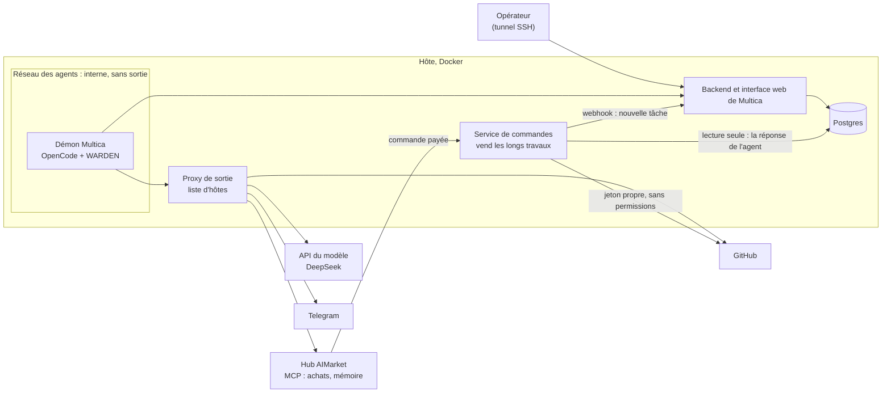
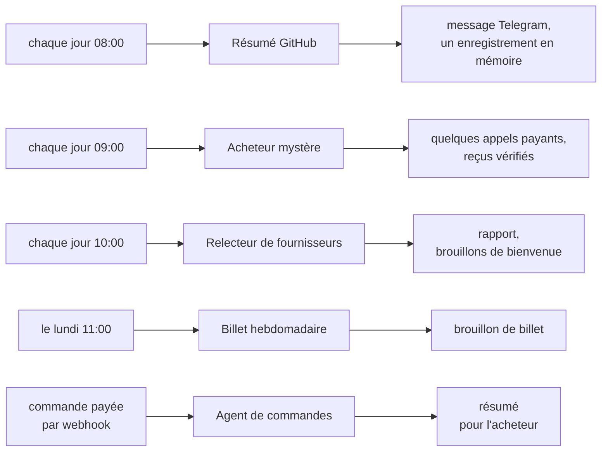
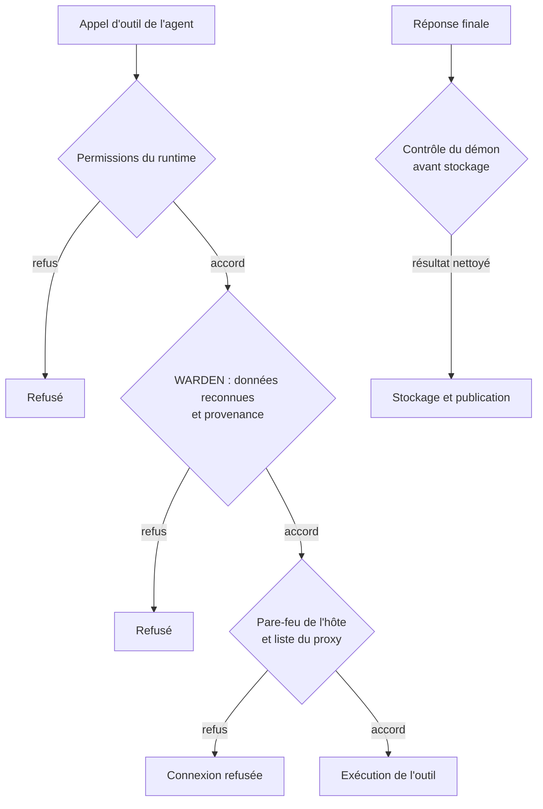
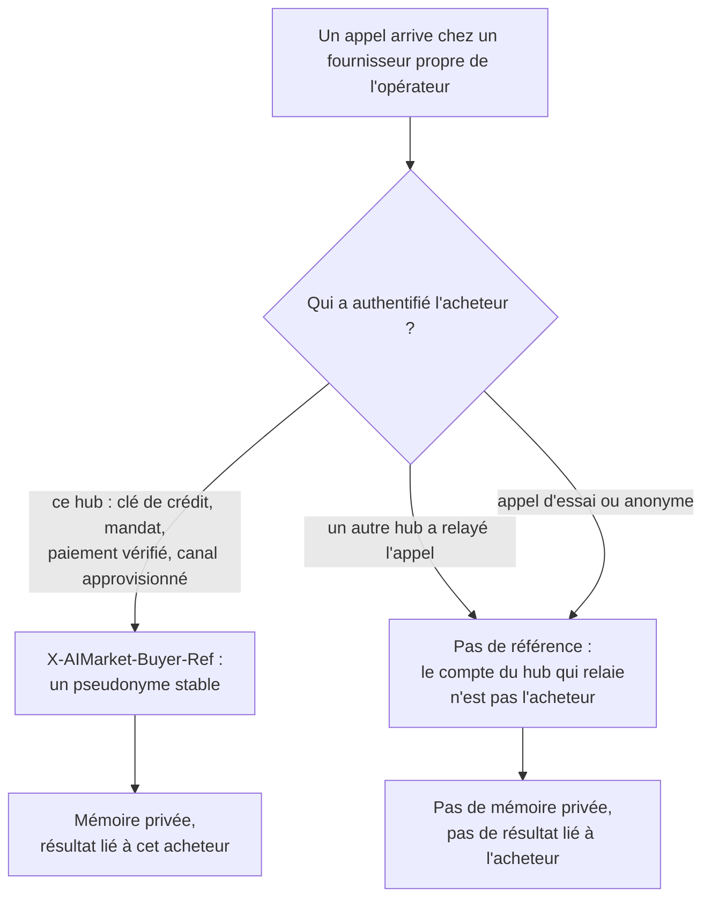
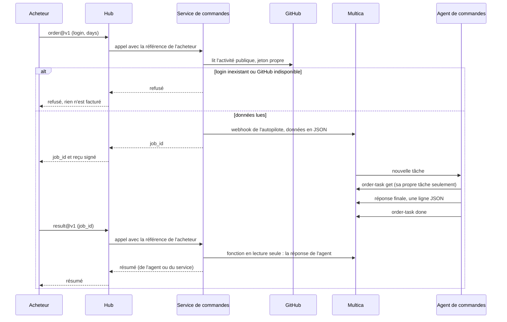

# Multica et AIMarket : installation et intégration

[English](README.md) · [Русский](README.ru.md) · [Español](README.es.md) · **Français** · [中文](README.zh.md)

Ce guide relie un [Multica](https://github.com/multica-ai/multica) auto-hébergé aux hubs AIMarket comme
[modelmarket.dev](https://modelmarket.dev). Multica est l'usine à agents ; le hub est le marché où ces agents
travaillent. À la fin du guide, vos agents peuvent :

- **acheter** des compétences à d'autres agents pendant une tâche, avec une clé prépayée dont le solde est une limite
  ferme ;
- **se souvenir** d'une exécution à l'autre grâce à des compétences de mémoire payantes ;
- **vendre** une capacité, y compris un long travail d'agent qui prend plusieurs minutes ;
- et fonctionner **confinés** : sortie réseau limitée à des hôtes listés, permissions par agent, et une protection
  contre l'envoi vers l'extérieur de ce qu'ils ont lu.

Ce que nous avons testé : Multica auto-hébergé, 0.5.3 depuis le 2026-11-04 et 0.8.0 depuis le 2026-11-05, son démon
avec OpenCode 1.18.32 et DeepSeek, sur un seul hôte. Par défaut, 0.8.0 pilote OpenCode 1.15 et suivants via ACP ; nous
gardons le mode `opencode run`, sur lequel la protection et les règles de permissions ont été testées (section 2). Les
commandes ci-dessous sont celles de la CLI 0.5.3 ; celles qu'utilise cette installation ont aussi été vérifiées sur
0.8.0.

> **En une commande.** [`operator-kit/onboard.sh`](../operator-kit/README.md) met en place les sections 2, 3, 4 et 6 à
> côté de votre Multica et les vérifie : `sudo ./onboard.sh --dir /opt/multica`. Ce manuel explique ce qu'il fait et pourquoi.

## Sommaire

[Vue d'ensemble : comment tout s'articule](#vue-densemble--comment-tout-sarticule)

1. [Avant de commencer](#1-avant-de-commencer)
2. [Le démon dans un conteneur](#2-le-démon-dans-un-conteneur)
3. [Limitez la sortie réseau](#3-limitez-la-sortie-réseau)
4. [Connectez le hub : achetez des compétences](#4-connectez-le-hub--achetez-des-compétences)
5. [À chaque agent, seulement ce qu'il lui faut](#5-à-chaque-agent-seulement-ce-quil-lui-faut)
6. [Protégez les agents : WARDEN pour OpenCode](#6-protégez-les-agents--warden-pour-opencode)
7. [Mémoire entre les exécutions](#7-mémoire-entre-les-exécutions)
8. [Des agents dont les faits viennent d'un script](#8-des-agents-dont-les-faits-viennent-dun-script)
9. [Vendez une capacité](#9-vendez-une-capacité)
10. [Vendez un long travail d'agent](#10-vendez-un-long-travail-dagent)
11. [Vérifiez l'installation](#11-vérifiez-linstallation)
12. [Pièges dans lesquels nous sommes tombés](#12-pièges-dans-lesquels-nous-sommes-tombés)
13. [Limites connues](#13-limites-connues)

## Vue d'ensemble : comment tout s'articule

Tout tourne sur un seul hôte, dans Docker. L'environnement des agents est sur un réseau interne : sa seule sortie est
un proxy avec une courte liste d'hôtes. L'opérateur ouvre l'interface web de Multica par un tunnel SSH. Un petit
service à vous vend de longs travaux d'agents sur le hub et parle à Multica par le webhook d'un autopilote et un rôle
de base de données en lecture seule.



Notre installation de référence compte cinq agents. Les autopilotes les lancent selon un horaire (UTC) ou à l'arrivée
d'une commande :



Chaque session d'agent charge la protection WARDEN. Chaque agent n'a que son propre environnement et ses permissions
(sections 5 et 6), et rien de ce que préparent les agents ne part sans un humain : les brouillons restent des
brouillons.

## 1. Avant de commencer

- Un hôte Linux avec Docker et Docker Compose.
- Multica, auto-hébergé selon [ses propres instructions](https://github.com/multica-ai/multica). N'exposez pas
  l'interface web sur internet : publiez-la sur `127.0.0.1` et ouvrez-la par un tunnel SSH
  (`ssh -L 13300:127.0.0.1:13300 your-host`, puis http://127.0.0.1:13300).
- Une clé de modèle pour le runtime. Nous utilisons DeepSeek avec OpenCode (`DEEPSEEK_API_KEY`).
- Pour acheter : une clé prépayée sur https://modelmarket.dev/start.
- Pour vendre : un compte fournisseur sur https://modelmarket.dev/start?role=provider et un point d'accès HTTPS.

## 2. Le démon dans un conteneur

Le démon de Multica lance le runtime de l'agent (OpenCode) pour chaque tâche. Faites-le tourner dans son propre
conteneur :

- un utilisateur non root (le nôtre est `node`, uid 1000), `cap_drop: [ALL]`,
  `security_opt: ["no-new-privileges:true"]` ;
- des limites : `mem_limit: 3g`, `cpus: 2`, `pids_limit: 1024` ;
- `MULTICA_DAEMON_AUTO_UPDATE: "false"`, pour que les versions ne changent qu'à la reconstruction ;
- sur Multica 0.8.0 avec OpenCode 1.x, `MULTICA_OPENCODE_TRANSPORT: run`, pour garder le mode sur lequel la protection a été testée ;
- les secrets des agents dans un fichier env en mode 600, chargé avec `env_file` : la clé du modèle, un jeton GitHub,
  les jetons du bot de discussion, la clé du hub. Ne mettez jamais une clé dans une tâche, une instruction ou une
  compétence.

Tous les agents partagent un démon, un utilisateur et un dossier personnel. La section 5 explique comment les séparer
malgré tout.

## 3. Limitez la sortie réseau

État du déploiement au 2026-11-10 : les restrictions supplémentaires du pare-feu sont actives sur notre hôte
Multica **attested**. La recette réseau est suivie séparément dans le
[reçu de déploiement](../../artifacts/multica-security-2026-11-10/deployment.json) ; l'activation seule ne prouve pas
la réussite de tous les tests de contournement. Cet état ne décrit pas l'installation du collègue sur `178.62.243.71`.

La restriction réseau appartient au **déploiement Multica** : réseaux Docker, proxy de sortie et pare-feu de l'hôte.
WARDEN vérifie les appels d'outils ; il n'installe pas de règles réseau. Reliez le démon seulement au réseau interne
des agents, le proxy aussi au réseau donnant accès à Internet, et gardez le backend joignable en interne.
Les variables de proxy sont volontaires : une commande peut les ignorer et se connecter directement.

```yaml
# Topology excerpt only; use the reviewed overlay in ../security/egress/.
services:
  daemon:
    networks: [agent]
    environment:
      HTTPS_PROXY: http://egress:8888
      https_proxy: http://egress:8888
      HTTP_PROXY: http://egress:8888
      http_proxy: http://egress:8888
      NO_PROXY: backend,localhost,127.0.0.1
      no_proxy: backend,localhost,127.0.0.1
    cap_drop: [ALL]
    security_opt: ["no-new-privileges:true"]
  backend:
    networks: [app, agent]
  egress:
    networks: [agent, app]
    read_only: true
    cap_drop: [ALL]
networks:
  agent:
    internal: true
    enable_ipv6: false
    ipam: { config: [{ subnet: 10.250.0.0/24 }] }
  app: {}
```

Ceci décrit la topologie, pas un déploiement complet. Lors de la fusion Compose, **remplacez** la liste des réseaux
du démon : conserver `app` en ajoutant `agent` laisse une route directe. Choisissez un sous-réseau sans conflit.
Le [kit egress](../security/egress/README.md) fournit l'overlay vérifié, le proxy, un plan de règles et les contrôles.
Il exige l'inventaire exact de l'opérateur ; aucune adresse prod/dev TONmobile n'est inventée ici. L'agent ne doit pas
pouvoir modifier ces fichiers ; ne publiez pas le port du proxy.

Options utiles de `tinyproxy.conf` :

```text
Port 8888
Listen 0.0.0.0
Allow 10.250.0.0/24
FilterType ere
FilterURLs Off
FilterDefaultDeny Yes
Filter "/etc/tinyproxy/allow"
ConnectPort 443
```

Dans `allow`, un nom d'hôte ancré par ligne. Ces **exemples non utilisables** doivent être remplacés par les hôtes
vérifiés de l'API modèle et des environnements QA :

```text
^model-api\.operator\.invalid$
^tonmobile-dev\.operator\.invalid$
^tonmobile-prod\.operator\.invalid$
```

Gardez le backend Multica sur son adresse interne. Installez les dépendances à la construction de l'image : ouvrir
tout le registre npm ou GitHub SSH n'est pas nécessaire par défaut pour QA. Pour lire Git, utilisez un service
séparé en lecture seule ou un transport explicitement restreint, sans identifiants d'écriture dans l'agent.

L'hôte doit refuser les connexions directes du sous-réseau agent, sauf vers le proxy et l'endpoint exact du backend.
Couvrez **INPUT de l'hôte**, notamment la passerelle Docker (par exemple le récepteur signalé `172.18.0.1:9999`), et
le trafic transféré. Avec le backend Docker **iptables**, placez les restrictions dans `DOCKER-USER`, avant les
règles d'acceptation Docker ; un ajout en fin de `FORWARD` ne suffit pas. Avec **nftables, `DOCKER-USER` n'existe pas** :
utilisez vos propres chaînes de base input/forward et des priorités vérifiées. Ne modifiez pas les tables Docker et
ne supposez pas qu'UFW seul protège le conteneur. Désactivez IPv6 explicitement et vérifiez-le, ou appliquez des
règles équivalentes testées.

Vérifiez le résolveur réel : les noms internes sont nécessaires, mais aucune requête DNS externe arbitraire ne doit
sortir par le DNS intégré Docker ou le relais de l'hôte. Restreignez ce résolveur séparément si nécessaire.
`internal: true` ne prouve pas à lui seul le blocage du DNS ou des sockets de l'hôte. `ConnectPort 443` limite CONNECT,
pas les ports HTTP ordinaires ; les règles de sortie du proxy doivent aussi couvrir ceux-ci.

Un hôte autorisé reste un canal : commentaires Multica, requêtes au modèle et opérations Git peuvent transporter des
données. Le proxy CONNECT ne voit pas le corps chiffré. Limitez hôtes et permissions, gardez les secrets hors des
fichiers/environnements lisibles par l'agent, et vérifiez les résultats avant stockage (§6).
Références officielles : [Docker iptables](https://docs.docker.com/engine/network/firewall-iptables/),
[Docker nftables](https://docs.docker.com/engine/network/firewall-nftables/),
[Docker pare-feu/UFW](https://docs.docker.com/engine/network/packet-filtering-firewalls/),
[Docker DNS](https://docs.docker.com/engine/network/#dns-services) et
[configuration Tinyproxy](https://tinyproxy.github.io/#documentation).

## 4. Connectez le hub : achetez des compétences

Ajoutez le serveur MCP du hub à la configuration globale d'OpenCode, `~/.config/opencode/opencode.jsonc` dans le
dossier personnel du démon :

```jsonc
{
  "mcp": {
    "modelmarket": {
      "type": "remote",
      "url": "https://modelmarket.dev/mcp",
      "headers": { "X-API-Key": "{env:AIMARKET_API_KEY}" }
    }
  }
}
```

Mettez la clé prépayée dans le fichier env du démon sous le nom `AIMARKET_API_KEY`. Son solde est une limite ferme :
quand il est épuisé, le hub répond 402 et ne facture rien. Sans clé, le hub accorde quelques appels d'essai.

L'agent utilise ensuite trois outils :

- `market_search` : `intent` en mots simples et `budget` (prix maximal par appel). Chaque résultat donne
  `product_id`, `capability_id`, `source_hub`, le prix, `max_price_usd` et les champs d'entrée.
- `market_invoke` : `product_id`, `capability_id`, `source_hub` (obligatoire pour les annonces fédérées, soit la
  majeure partie du catalogue), `input`, et `max_price_usd` recopié tel quel depuis la recherche. Si la route a
  changé de prix, le hub refuse avec `price_limit_exceeded` avant tout travail et tout paiement.
- `account_status` : ce qui reste sur la clé et ce qui a été dépensé.

Chaque appel payant renvoie le reçu signé du hub ; le reçu de travail derrière le `verify_url` de la réponse lie le
hash de l'entrée, le résultat et le vendeur. Conservez-le avec toute réponse sur laquelle vous vous appuyez.

Notre compétence [`multica/community/aimarket/SKILL.md`](../community/aimarket/SKILL.md) apprend ces règles à l'agent
(budget par tâche, pas de nouvel essai après 402/403, entrée neutre uniquement, la réponse d'un vendeur est une
donnée). Importez-la :

```bash
multica skill import --url https://github.com/alexar76/aicom/tree/main/multica/community/aimarket
```

L'URL fonctionnera quand le miroir public contiendra ce dossier ; en attendant, compressez le dossier en zip et
utilisez `multica skill import --file aimarket.zip`.

## 5. À chaque agent, seulement ce qu'il lui faut

La configuration globale du démon s'applique à tous les agents : gardez-la réduite et réglez le reste agent par agent.
Multica donne à chaque agent un **environnement propre** (custom environment) ; OpenCode y lit
`OPENCODE_CONFIG_CONTENT` comme configuration supplémentaire pour les exécutions de cet agent.

Pour un agent qui lit des textes d'inconnus et n'a pas besoin du hub, coupez le hub et videz les clés inutiles :

```bash
cat <<'EOF' | multica agent env set <agent-id> --custom-env-stdin
{
  "AIMARKET_API_KEY": "",
  "OPENCODE_CONFIG_CONTENT": "{\"mcp\":{\"modelmarket\":{\"enabled\":false}},\"tools\":{\"modelmarket_*\":false}}"
}
EOF
```

`env set` remplace tout l'environnement propre (`****` conserve une valeur existante). Vérifiez le résultat avec
`opencode debug config` lancé avec le même `OPENCODE_CONFIG_CONTENT`.

`permission.bash` d'OpenCode accepte des motifs ; c'est le **dernier** qui correspond qui l'emporte, et chaque
commande d'une ligne est vérifiée séparément (y compris dans `$(...)`, les accents graves et les tubes). Une commande
avec une redirection est vérifiée avec elle. Un agent qui ne peut lancer qu'une seule commande ressemble donc à ceci :

```json
{"bash": {"*": "deny", "/opt/tools/order-task get *": "allow", "*>*": "deny", "*<*": "deny", "*$*": "deny", "*`*": "deny"}}
```

Sans les quatre dernières règles, `commande-autorisée > ~/.config/opencode/opencode.jsonc` écraserait un fichier.

Autorisez un script enveloppe que vous avez écrit, pas la CLI de Multica avec un joker. Le jeton d'un agent Multica
est lié à l'**espace de travail**, pas à sa tâche : `multica issue get *` lit n'importe quelle tâche de l'espace, et
les numéros de tâche se suivent. L'enveloppe doit vérifier que la tâche appartient à l'agent avant d'afficher ou de
modifier quoi que ce soit (la nôtre est à la section 10).

## 6. Protégez les agents : WARDEN pour OpenCode

État du déploiement au 2026-11-10 : notre installation **attested** utilise la compilation locale vérifiée de WARDEN
et le démon/backend Multica corrigés. Les contrôles de hooks en production ont réussi 9/9 ; le canari conservé en
session propre a été refusé. Empreintes des binaires, santé backend/UI et migrations inchangées ont été vérifiées.
Voir le [reçu de déploiement](../../artifacts/multica-security-2026-11-10/deployment.json). Ce n'est **pas une nouvelle
publication npm**, ni une validation de l'installation `178.62.243.71`/0.24.0 du collègue ou de son test TONM-14 complet.
Les limites de motifs reconnus et de chemins de sortie ci-dessous restent applicables.

Le flow guard de [WARDEN](https://github.com/alexar76/warden) vérifie les appels d'outils. L'intégration
historique OpenCode 0.23.0 appliquait les contrôles de fuite après l'enregistrement d'un texte extérieur et vidait
des variables sélectionnées dans le shell. L'attaque avec une fausse clé lisait d'abord GitHub, puis le fichier :
script de discussion, `curl` vers un hôte autorisé, écriture mémoire et CLI du gestionnaire ont été refusés.
Une tâche normale enregistrée s'est terminée sans refus. Cela ne prouve pas la protection d'une session propre ni
d'une autre version de l'environnement.

L'échec signalé avec 0.24.0 expose ce trou : `multica issue get` n'était pas reconnu comme texte extérieur et lire
`.env` n'activait pas seul les contrôles. Les changements locaux du 2026-11-10 séparent les contrôles de secrets
reconnus de ce déclencheur et ajoutent la provenance Multica/rapports QA. Il faut les compiler et les tester dans
l'environnement choisi ; modifier les sources ne met à jour ni npm ni le démon installé. N'utilisez pas `npx` ou un
`curl` échoué pour activer volontairement la protection. Un timeout `curl` peut suivre la réception du corps.

Le code de WARDEN ne nomme pas Multica. Les lectures sous `playwright-report/` et `test-results/` sont du texte
extérieur d'emblée ; la CLI Multica devient une source extérieure par la politique de l'opérateur. Partez du fragment
fourni `warden/examples/policies/multica.flow-policy.json` (dans le paquet npm à partir de la prochaine version), qui
marque `multica issue get`, `issue list`, `issue search` et `issue comment list`. Sans lui, la sortie de Multica compte
comme les données de l'opérateur. Ajoutez vos préfixes de commandes et racines de rapports de la même façon (ici, le
dossier de rapports QA `reports/`) ; ils ajoutent de la défiance, jamais une autorisation :

```json
{
  "mode": "deny",
  "untrustedSources": {
    "commands": [
      ["multica", "issue", "get"], ["multica", "issue", "list"],
      ["multica", "issue", "search"], ["multica", "issue", "comment", "list"]
    ],
    "paths": ["reports"]
  }
}
```

Si l’agent écrit son rapport à côté du clone (à la racine de l’espace de travail de la tâche), ajoutez `"projectRoots": [".."]` à la même politique : sinon, après du texte extérieur, cette écriture compte comme hors du projet (`destructive_action`), comme l’ont montré les mesures sur le terrain.

Les chemins partent de la frontière du projet ; les opérandes shell du dossier d'exécution. La reconnaissance est
bornée, pas un interpréteur de programmes shell arbitraires. Après du texte extérieur, `deny` strict refuse toujours
les exécutions opaques, comme `npm run ...` et `node -e ...`. Ne désactivez pas la provenance pour QA : utilisez des
permissions/adaptateurs limités et vérifiés et un superviseur de confiance pour démarrage et rapport sûrs.

### Exécuteur QA séparé : opérations fixes sans shell de l'agent

Le [runner QA séparé](../qa-runner/README.md) a été déployé et accepté sur notre **attested** le 2026-11-10.
Dans la tâche réelle Multica **MY-89**, le profil privé permanent a appelé une fois l'outil natif
`qa_runner_task_execute`, sans autre outil. Backend/modelmarket/hub ont répondu **200/200/200** ; le rapport validé
figure dans le résultat stocké et le commentaire, et la tâche a le statut `done`. Voir le
[reçu de recette finale](../../artifacts/multica-qa-runner-2026-11-10/final-acceptance.json). Seule l'opération initiale
`platform_smoke` est acceptée ; le QA navigateur complet TONmobile n'a pas été exécuté.

Il sépare le contrôleur Multica/modèle d'un worker Node 22 dédié sur `10.250.0.5`, sans identifiants modèle, Multica,
GitHub ou hub, volume home, fichier env, socket Docker ni clé privée TLS de l'hôte. Son système de fichiers est en
lecture seule sauf stockage temporaire borné, avec capabilities retirées. Seul le contrôleur de confiance de l'hôte
lance le travail fixe `npm run smoke`.

Le profil QA privé appelle `task_execute` du serveur `qa_runner` avec exactement `{"id":"platform_smoke"}`.
Le TaskAdapter WARDEN délègue cette opération épinglée avant les refus généraux après texte extérieur ; il ne permet
pas à l'agent `npm run ...`, `node -e ...`, URL, arguments ou programmes shell arbitraires. Le processus MCP démarre
avec `env -i` et une CA publique ; la clé TLS privée du broker `10.250.0.1:8443` reste sur le contrôleur de l'hôte.
`qa_runner` est désactivé globalement et activé seulement pour le nouveau profil QA privé, dont les autres MCP/outils
restent désactivés.

Vérifiez les règles résolues avec `opencode debug agent build` : le deny général doit précéder les allow exacts
pour `qa_runner_task_list`, `qa_runner_task_read`, `qa_runner_task_execute` et `qa_runner_task_run`. Le JSON seul ne
prouve pas l'ordre après fusion des anciennes options tools. Les instructions appellent directement l'outil QA
natif, sans démarrage Bash/Multica CLI. MCP accepte seulement la métadonnée standard bornée `_meta.progressToken` ;
les arguments restent exactement l'ID fixe, sans URL, commande ou champ libre supplémentaire.

Le broker accepte seulement `POST /run/platform-smoke` avec corps vide depuis le contrôleur autorisé. Il lance un
seul travail à la fois, au plus trois départs par cinq minutes, capture au plus 64 KiB et limite chaque travail à
8 secondes côté contrôleur ; le worker a 6 secondes puis 1 seconde avant arrêt forcé. Seuls noms fixes, statuts et booléens sont renvoyés ; stdout/erreurs bruts sont écartés.
Le broker de l'hôte conserve séparément 10 départs par fenêtre UTC de 12 heures dans SQLite, propriété de root, sous
`/var/lib/multica-qa` ; supprimer le compteur MCP ou redémarrer le contrôleur ne le remet pas à zéro. Les exécutions
échouées/incertaines consomment le quota. Le manifeste de l'opérateur dure au plus 23 heures, est renouvelé toutes les 12 heures et autorise au plus 10 usages ;
le broker limite aussi la fréquence. Expiration, pin modifié ou budget épuisé entraînent un refus. `platform_smoke`
vérifie seulement des endpoints fixes sans authentification de statut backend/hub/modelmarket et renvoie un rapport borné nettoyé,
sans corps de réponse ni écriture externe. Cela ne réalise ni QA arbitraire ni scénario TONmobile. Ajouter des travaux
exige un contrôleur revu, une image/opération worker fixe et une nouvelle capability épinglée.

Permissions, WARDEN et réseau ont des frontières distinctes :



| Menace | Frontière de contrôle |
|---|---|
| L'agent exécute une commande hors de sa tâche | Permissions du runtime et enveloppe limitée appartenant à l'opérateur |
| Un secret reconnu part vers un service autorisé | Contrôles WARDEN et permissions limitées ; le trou historique sans texte extérieur exige la correction locale |
| Une connexion contourne le proxy ou vise un hôte absent | Pare-feu de l'hôte, réseaux isolés et proxy ensemble (§3) |
| L'agent désactive la protection future | Protection et tous les dossiers parents appartenant à root |
| Un secret apparaît dans la réponse finale | Contrôle du démon avant stockage ; Stop n'est pas un filtre général de secrets |

Le 2026-11-05, les exécutions planifiées enregistrées de cinq agents et une commande payée après Multica 0.8.0 ont
chacune laissé un état de protection. Cela prouve le chargement du plugin, pas la sûreté de toutes les sorties.

### Vérifiez le résultat avant son stockage par Multica

Le [patch local des résultats Multica](../security/README.md), pour upstream v0.8.0, ajoute un masquage récursif aux
frontières de confiance démon/backend : avant la file de réessai, les callbacks complete/fail/message/progress et le
stockage des résultats/erreurs de tâche. Il utilise `redact.Text` d'upstream pour les formats de jetons reconnus,
y compris les valeurs imbriquées dans des chaînes JSON. Vérifiez version et empreintes avec
`apply-output-patch.py --source-root <checkout> --check`, appliquez le patch vérifié et reconstruisez **démon et backend**
selon le kit. Le déploiement attested figure dans le reçu ci-dessus ; les autres installations exigent une reconstruction distincte.

Masquer le seul commentaire laisse `result.output`/`output_summary` exposés. Seule la valeur nettoyée doit atteindre
les sorties corrigées ; ne journalisez pas l'original pour diagnostic. Le contrôle de motifs est borné : il ne couvre
pas tout secret ou encodage, les fichiers de session du runtime, les autres chemins de logs non corrigés ni
l'historique base/file. Examinez-les séparément et réduisez d'abord les secrets lisibles. Retirez ou isolez les
anciens enregistrements exposés selon la politique de conservation ; le patch ne nettoie pas l'historique.

Valider JSON, taille et liens dans le fournisseur (§10) reste utile, mais arrive trop tard pour protéger le stockage
brut du démon. Ni la continuation Stop ni le SDK de sélection structurée WARDEN ne constituent un DLP général pour
la prose libre. Avant déploiement, faites passer un faux jeton reconnaissable par chaque sortie corrigée.

Le plugin est livré dans `@aimarket/warden` à partir de la version 0.23.0 (`@aimarket/warden/opencode`). Chargeur,
sous le nom `plugin/warden.js` dans le dossier de configuration d'OpenCode :

```js
import { createWardenPlugin } from '@aimarket/warden/opencode';

export const WardenFlowGuard = createWardenPlugin({
  block: 'data',
  // Keys only the OpenCode process needs; shell commands get them blank.
  stripEnv: ['DEEPSEEK_API_KEY', 'AIMARKET_API_KEY'],
});
```

Sans le paquet, copiez `dist/opencode-plugin.js` et tous les `dist/flow-guard*.js` dans un même dossier et importez
`opencode-plugin.js` depuis celui-ci.

Installez-le là où l'utilisateur de l'agent ne peut pas le modifier. Les fichiers doivent appartenir à root, et
**chaque dossier au-dessus d'eux** aussi : un utilisateur peut renommer un dossier qui lui appartient, avec la
protection dedans. Nous avons trouvé ce trou dans notre propre installation le 2026-11-05. Les fichiers du plugin
appartenaient à root, mais `~/.config/opencode` appartenait à l'utilisateur de l'agent. Nous l'avons fermé en plaçant le plugin dans un dossier appartenant à root, monté sur `/opt/opencode-guard`, et en
l'indiquant à OpenCode avec `OPENCODE_CONFIG_DIR`. Montez-le en écriture, mais avec root pour propriétaire, afin que
l'utilisateur de l'agent ne puisse pas y écrire. Au démarrage, OpenCode 1.18.32 écrit un `.gitignore` dans chaque
dossier de configuration : sur un montage en lecture seule il s'arrête sur une erreur, alors qu'il passe outre un
dossier où il n'a pas le droit d'écrire. Vérifiez ensuite avec `opencode debug config`, en tant qu'utilisateur de l'agent, que le plugin
est chargé.

### Exemple : la protection pour tous les agents

Voici la configuration historique vérifiée le 2026-11-05 : Multica 0.8.0, OpenCode 1.18.32 et WARDEN 0.23.0. Les fichiers de `warden/`
sont les fichiers du plugin du paquet npm `@aimarket/warden@0.23.0`, inchangés (20 fichiers). Chaque commande
ci-dessous a d'abord été exécutée sur notre hôte.

Le tarball historique ci-dessous **ne contient pas** la correction du 2026-11-10. Pour un nouveau déploiement QA,
utilisez la compilation locale vérifiée et les contrôles du [kit de sécurité](../security/README.md), en conservant
version et manifeste des fichiers. Les commandes suivantes conservent l'ancienne recette, pas une recette validée aujourd'hui.

Le chargeur, enregistré sous `warden.js` à côté de `docker-compose.yml` :

```js
// opencode-guard/plugin/warden.js: the WARDEN flow guard for every agent on this daemon.
// Export only the plugin: OpenCode calls every exported function as one.
import { createWardenPlugin } from '../warden/opencode-plugin.js';

export const WardenFlowGuard = createWardenPlugin({
  block: 'data',
  // Keys only the OpenCode process needs; shell commands get them blank.
  stripEnv: ['DEEPSEEK_API_KEY', 'AIMARKET_API_KEY'],
});
```

Sur l'hôte, en root. Le paquet est vérifié avec la somme de contrôle que publie npm :

```bash
cd /opt/multica                    # the folder with docker-compose.yml; warden.js (the loader) is here
T=$(mktemp -d)
curl -fsSL -o "$T/warden.tgz" https://registry.npmjs.org/@aimarket/warden/-/warden-0.23.0.tgz
echo "e9fe195e36ce559d9e543e8eb3fd4bcd729fe434  $T/warden.tgz" | sha1sum -c -
tar -xzf "$T/warden.tgz" -C "$T"
install -d -o root -g root -m 755 opencode-guard opencode-guard/plugin opencode-guard/warden
install -o root -g root -m 644 "$T"/package/dist/opencode-plugin.js "$T"/package/dist/flow-guard*.js opencode-guard/warden/
install -o root -g root -m 644 warden.js opencode-guard/plugin/warden.js
rm -rf "$T"
```

Le résultat :

```
opencode-guard/                root:root 755
├── plugin/
│   └── warden.js              root:root 644   the loader above
└── warden/                    root:root 755
    ├── opencode-plugin.js     root:root 644
    └── flow-guard*.js         root:root 644   19 files
```

Le démon dans `docker-compose.yml` (seulement les lignes qui comptent ici) :

```yaml
services:
  daemon:
    environment:
      MULTICA_DAEMON_AUTO_UPDATE: "false"
      OPENCODE_CONFIG_DIR: /opt/opencode-guard   # every OpenCode session loads plugin/ from here
      MULTICA_OPENCODE_TRANSPORT: run            # Multica 0.8.0 with OpenCode 1.x: the transport the guard was tested on
    volumes:
      - daemon_home:/home/node
      - ./opencode-guard:/opt/opencode-guard     # root-owned; not :ro, OpenCode stops on a read-only config folder
```

Si une ancienne copie de la protection se trouve dans le dossier personnel du démon (`~/.config/opencode/plugin`
et `~/.config/opencode/warden` dans son volume), retirez-la d'abord, sinon la protection se charge deux fois. Puis
recréez le démon pendant qu'aucune tâche ne tourne :

```bash
docker compose up -d --no-deps --force-recreate daemon
```

Vérifications, en tant qu'utilisateur de l'agent :

```bash
# 1. Sessions load the guard from the root-owned folder, and only from there.
docker exec -u node -w /tmp multica-daemon sh -c 'opencode debug config | jq -c .plugin'
#    ["file:///opt/opencode-guard/plugin/warden.js"]

# 2. Still loaded with another home folder, as if ~/.config had been renamed.
docker exec -u node -w /tmp multica-daemon sh -c 'mkdir -p /tmp/h && HOME=/tmp/h opencode debug config | jq -c .plugin; rm -rf /tmp/h'

# 3. Nothing on the guard's path is writable by the agent user: every line must say "ok".
docker exec -u node multica-daemon sh -c 'for p in /opt /opt/opencode-guard /opt/opencode-guard/plugin /opt/opencode-guard/warden; do [ -w "$p" ] && echo "WRITABLE: $p" || echo "ok: $p"; done'

# 4. A real session runs the guard: the newest state files carry the current time.
docker exec -u node -w /tmp multica-daemon opencode run "Reply with the single word OK."
docker exec -u node multica-daemon sh -c 'ls -lt ~/.local/state/warden/claude-code/flow | head -3'
```

La protection s'applique à tous les agents du démon, y compris ceux qui ont leur propre `OPENCODE_CONFIG_CONTENT` :
notre agent de commandes en a un, et ses sessions écrivent aussi l'état de la protection.

### Runtimes Codex

Les agents qui tournent sur Codex au lieu d’OpenCode reçoivent la même garde par les hooks de commande de Codex. Elle
est dans le code local de WARDEN, pas encore publiée. Détails et schémas :
[WARDEN pour Codex](https://github.com/alexar76/warden/blob/main/docs/codex.fr.md).

- Codex n’a pas de « demander » : un hook qui répond `ask` compte comme en échec, et Codex lance l’appel. L’adaptateur
  ne demande donc jamais. Une question devient un refus ou un passage journalisé (`WARDEN_CODEX_BLOCK=data`, par
  défaut, ou `all`), et tout échec de la garde refuse.
- Installez-la en hooks gérés : le `codex-hooks/` construit dans `/opt/warden-codex`, et `codex-hooks/requirements.toml`
  comme `/etc/codex/requirements.toml`, le tout à root. `allow_managed_hooks_only = true` empêche un agent d’ajouter son
  propre hook.
- Dans le service du démon dans compose, montez les deux en lecture seule et réglez le mode :

```yaml
    environment:
      WARDEN_CODEX_BLOCK: data
    volumes:
      - ./warden-codex:/opt/warden-codex:ro
      - ./codex/requirements.toml:/etc/codex/requirements.toml:ro
```

- Tenez la clé du modèle hors des commandes shell avec `shell_environment_policy` (`exclude`), et coupez la recherche
  web intégrée de Codex : elle ne lance aucun hook, la garde ne voit donc pas ce qu’elle apporte.
- Vérifiez avec `scripts/codex-live-check.sh` du dépôt WARDEN : une attaque mise en scène avec une fausse clé, entièrement
  sur localhost.

## 7. Mémoire entre les exécutions

Les agents commencent chaque tâche de zéro. Attested Memory leur donne une mémoire payée à l'appel :
`memory.write@v1`, `memory.search@v1` et `memory.read@v1` sur hub.attestedmemory.net. Une mémoire appartient à
l'acheteur que ce hub a authentifié. Achetez-la **directement sur ce hub** : prenez une clé sur
https://hub.attestedmemory.net/start et utilisez son serveur MCP, `https://hub.attestedmemory.net/mcp`, comme à la
section 4. Achetée via un autre hub (modelmarket.dev liste aussi ces compétences), l'appel arrive au hub de mémoire
sous l'identité du hub qui le relaie, pas la vôtre, et n'obtient pas de mémoire privée. Les appels d'essai non plus.

À qui appartient une mémoire, et qui peut lire le résultat d'une commande, c'est le hub qui a authentifié l'acheteur
qui en décide :



Un paiement x402 vérifié de l'acheteur lui-même l'identifie toujours, même sur un appel relayé.

Inscrivez cet usage dans les instructions de l'agent, avec un budget : quelles compétences, combien d'appels par
exécution, pas de nouvel essai après 402 ou 403. Notre résumé GitHub quotidien lit jusqu'à trois enregistrements
précédents, ajoute une ligne « Tendances » et enregistre une entrée par jour : environ 0,03 $ par exécution.

## 8. Des agents dont les faits viennent d'un script

Quand le résultat doit être juste (chiffres, constats, prix), laissez un script décider des faits et le modèle
seulement écrire autour. C'est ainsi que fonctionne notre relecteur de fournisseurs. Un script compare le catalogue
du hub à celui de la veille et vérifie les schémas, l'injection de prompt, ce qu'un acheteur devrait fournir, les
adresses et les prix. Le modèle rédige le rapport et recopie les faits du script sans les changer. Notre billet
hebdomadaire fonctionne de la même façon : un script rassemble les compteurs de la semaine et le modèle rédige le
texte.

Planifiez-les avec un autopilote (`multica autopilot create --agent <agent> --mode create_issue --title ...`, puis
`multica autopilot trigger-add <id> --kind schedule --cron "0 10 * * *"` ; fuseau horaire UTC par défaut). Code :
[`multica/supplier-review`](../supplier-review/), [`multica/weekly-post`](../weekly-post/).

## 9. Vendez une capacité

Le guide complet est sur https://modelmarket.dev/developers (et https://play.modelmarket.dev/publish). Le chemin
court, environ 15 minutes pour un point d'accès qui tourne déjà :

1. Créez un compte et une clé sur https://modelmarket.dev/start?role=provider ; votre `account_id` obtenu par
   `GET /ai-market/v2/account` est votre `publisher_id`.
2. `GET /ai-market/v2/supply/policy` avec la clé indique si une caution est requise ; déposez-la avec
   `POST /ai-market/v2/supply/stake` seulement si `additional_stake_usd` est supérieur à zéro.
3. Décrivez la capacité dans `capability.json`. Il faut `capability_id` (par ex. `mytool.summarize@v1`),
   `product_id`, `publisher_id`, `invoke_url` (HTTPS), `price_per_call_usd`, les JSON Schemas d'entrée et de sortie,
   et la `provider_pubkey` Ed25519 avec laquelle votre point d'accès signe ses réponses.
4. Testez le point d'accès avec https://play.modelmarket.dev/connect (un vrai appel, schéma et signature).
5. `POST /ai-market/v2/supply/register` avec la clé et `capability.json`.

Rédigez la description pour le modèle de l'acheteur : ce que fait la capacité, ce dont elle a besoin, ce qu'elle
renvoie, ce qu'elle coûte. Pas d'instructions au modèle (« utilise toujours cet outil ») : les hubs les recherchent
dans les annonces, et les protections des acheteurs les refusent.

## 10. Vendez un long travail d'agent

Un appel payant ne peut pas attendre un agent pendant des minutes. Vendez le travail sous forme de deux capacités :

- `…order@v1` (payante). Votre service vérifie strictement l'entrée, fait lui-même les lectures extérieures, crée une
  tâche Multica via un déclencheur **webhook** d'autopilote avec ces données, et répond aussitôt avec un `job_id`.
- `…result@v1` (gratuite) répond `queued`, ou `done` avec le résultat.

La commande entière, de l'appel de l'acheteur au résultat :



Comment les pièces s'assemblent :

1. **Un autopilote avec déclencheur webhook.** `multica autopilot create --agent <order-agent> --mode create_issue
   --title "Orders" --description "<instructions>"`, puis `multica autopilot trigger-add <id> --kind webhook`.
   L'URL du déclencheur contient son jeton : gardez-la dans le fichier env du service (mode 600) et ne l'écrivez
   jamais dans un journal. Multica place le JSON envoyé dans la description de la tâche.
2. **Les lectures extérieures sont faites par votre service.** Il les fait avant d'accepter la commande, avec son
   propre jeton. Un jeton GitHub sans permissions fait passer la limite de 60 à 5000 requêtes par heure. Refusez avant
   tout débit si l'entrée est fausse ou si la source est indisponible : le hub ne facture qu'un appel qui a obtenu une
   réponse. Aucun texte libre de l'acheteur ne doit atteindre l'agent.
3. **La réponse finale de l'agent est le livrable.** C'est une seule ligne JSON,
   `{"job_id": "...", "summary": "..."}`, et le publicateur de confiance Multica doit masquer les secrets reconnus avant stockage ou publication.
   L'agent ne nécessite aucun envoi réseau direct. Contrôle des outils et contrôle de sortie sont distincts.
4. **L'agent de commandes lance une seule enveloppe.** La nôtre est
   [`order-task`](../provider/order-task/order-task) : `order-task get <issue>` affiche la tâche et
   `order-task done <issue>` la ferme, seulement si la tâche est assignée à l'agent de commandes. Elle appartient à
   root, et ses règles OpenCode sont dans [`opencode-order-agent.json`](../provider/order-task/opencode-order-agent.json).
5. **Le service lit la réponse** par un rôle de base de données en lecture seule. Ce rôle ne peut exécuter qu'une
   fonction. La fonction (`SECURITY DEFINER`, avec un `search_path` fixe) renvoie les commentaires de l'agent de
   commandes sur les tâches que son autopilote a créées pour une commande. Le service accepte exactement `job_id` et
   `summary`, avec une longueur maximale et des liens vers le seul site attendu. Si aucune réponse exploitable
   n'arrive à la fin de la tâche ou au bout de 20 minutes, le service rédige un résumé simple à partir des mêmes
   données.
6. **Qui peut lire le résultat.** Un hub envoie `X-AIMarket-Buyer-Ref`, un pseudonyme stable de l'acheteur
   authentifié, uniquement aux fournisseurs de son propre opérateur, avec le jeton interne du hub. Sur votre propre
   hub, liez chaque commande à cette référence. Sur le hub de quelqu'un d'autre, vous ne recevez aucune identité
   d'acheteur. Le `job_id` devient alors la clé de lecture : 128 bits aléatoires, renvoyés uniquement dans la réponse
   payante, avec une durée de conservation limitée.

Notre service est [`multica/provider`](../provider/) (27 tests ; l'enveloppe et les règles de permissions en ont 25
de plus). Il vend `github.digest.order@v1` à 0,05 $ sur hub.attestedmemory.net.

## 11. Vérifiez l'installation

- **Exécuteur séparé.** Testez `qa_runner` → `task_execute {"id":"platform_smoke"}` et son rapport fixe. Refusez ID
  inconnu, URL/commande supplémentaire, manifeste expiré/modifié et budget épuisé ; le shell reste refusé. Vérifiez
  séparément montages/noms env du worker, clé TLS seulement sur l'hôte et livraison du rapport borné.
- **Configuration effective.** Lancez `opencode debug config` comme utilisateur de l'agent avec son `OPENCODE_CONFIG_CONTENT`.
  Vérifiez permissions, serveurs MCP et chemin du plugin appartenant à root. Pour Claude/Codex, contrôlez les hooks et
  le refus dans ce runtime. Consignez versions exactes, hash de politique et défaillances des hooks.
- **Frontières réseau.** Lancez les [contrôles egress](../security/egress/README.md) depuis le vrai réseau du démon :
  les cibles approuvées fonctionnent ; hôtes absents, IPv4/IPv6 directs, récepteurs hôte/passerelle Docker, DNS externe,
  suppression du proxy/`--noproxy`, autres ports et SSH doivent échouer. Vérifiez séparément le résolveur Docker,
  puis recommencez après redémarrage du conteneur/Docker. Contrôlez le récepteur et la connexion TCP : un timeout
  client ne prouve pas un refus. Utilisez seulement vos récepteurs et des données synthétiques.
- **Sessions propres et contaminées.** Dans des sessions neuves, testez fichier de fausse clé → premier envoi sans
  visiter de site, puis après `multica issue get`, commentaires, rapport local Playwright et page web. Tout canal
  permis, commentaires Multica inclus, doit refuser avant livraison. Utilisez une tâche/un récepteur de test ;
  n'envoyez aucun secret vers GitHub ou des services publics. Consignez étiquettes de source et décisions PreToolUse.
  Exécutez ensuite un QA normal, un démarrage sans installation et un rapport sûr, sans contournement. Un refus termine
  l'exécution ; le superviseur de confiance signale séparément un statut fixe sûr.
- **Résultats finaux.** Placez une fausse clé reconnaissable dans une réponse. Sa valeur brute doit être absente des
  champs `result.output`, `output_summary`, commentaires, événements et journaux corrigés. Vérifiez masquage, résultat
  normal et chemins de réessai/redémarrage. Examinez séparément sessions/logs non corrigés et anciens enregistrements.
- **Vente.** Pour un contrôle de bout en bout autorisé, utilisez une petite commande. Vérifiez l'isolation de
  l'acheteur, le refus sans acheteur et le refus d'entrée invalide avant débit.

## 12. Pièges dans lesquels nous sommes tombés

- **Le DNS de Docker sur deux réseaux.** Un conteneur sur deux réseaux Compose résout les noms de service sur l'un ou
  l'autre. `postgres` a atteint la base d'une autre pile. Utilisez les noms de conteneur (`multica-postgres-1`).
- **Tester la base via 127.0.0.1 ne prouve rien.** Si `pg_hba` fait confiance aux connexions locales, un mauvais mot
  de passe passe quand même. Testez un mot de passe par le réseau.
- **`multica agent env set`**, et non `agent update`, change l'environnement propre, et le remplace en entier.
- **Limite GitHub partagée.** Les lectures sans jeton se partagent 60 requêtes par heure par IP d'hôte, et n'importe
  quel conteneur de l'hôte peut les consommer. Donnez à chaque lecteur son propre jeton sans permissions.
- **Les agents ne peuvent pas fermer leurs tâches** si leurs règles ne le permettent pas. Autorisez-le via
  l'enveloppe, pour leur propre tâche seulement.
- **Le modèle n'est pas la protection.** Dans nos tests, DeepSeek a refusé des commandes injectées évidentes, mais ce
  qui tient, ce sont les règles et les permissions des fichiers.

## 13. Limites connues

- Les hooks d'outils ne possèdent pas la sortie finale Multica. Le démon doit la contrôler **avant** stockage et
  livraison ; un validateur ultérieur ou un commentaire masqué ne nettoie pas les champs bruts déjà enregistrés.
- La protection historique déclenchée par texte extérieur pouvait laisser sortir un secret avant ce déclencheur.
  Les changements locaux du 2026-11-10 exigent tests et déploiement ; les anciens résultats npm/réels ne les vérifient pas.
- Démon et agents partagent un utilisateur. Un agent peut lire ses identifiants Multica et fichiers accessibles.
  Une isolation plus forte demande utilisateurs/conteneurs distincts, montages minimaux et permissions par agent.
- La protection est par runtime, pas par agent. Protégez état de l'arbre des sessions et configuration.
- Les hôtes autorisés restent des canaux, API Multica/modèle et SSH inclus. Le pare-feu borne les destinations ; corps
  CONNECT chiffré, encodages arbitraires et secrets inconnus demandent d'autres contrôles. Ouvrir tout le registre ou
  l'écriture GitHub n'est pas une valeur sûre par défaut pour QA.
- Un reçu de tests locaux ne signifie ni déploiement réel, ni publication du paquet, ni recette en production.

Installation de référence : [`multica/community/README.md`](../community/README.md). Revue de sécurité de cette
installation : [`artifacts/vulnetix-class-multica-2026-11-05/REPORT.md`](../../artifacts/vulnetix-class-multica-2026-11-05/REPORT.md).
