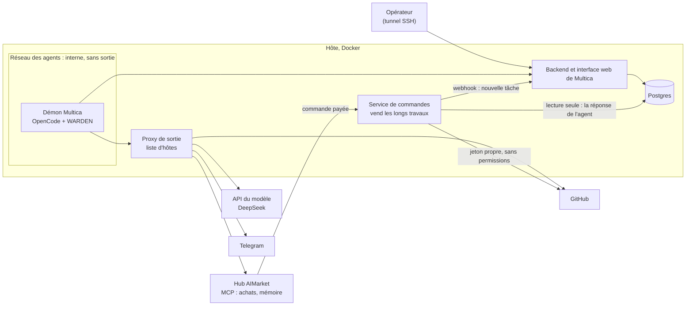
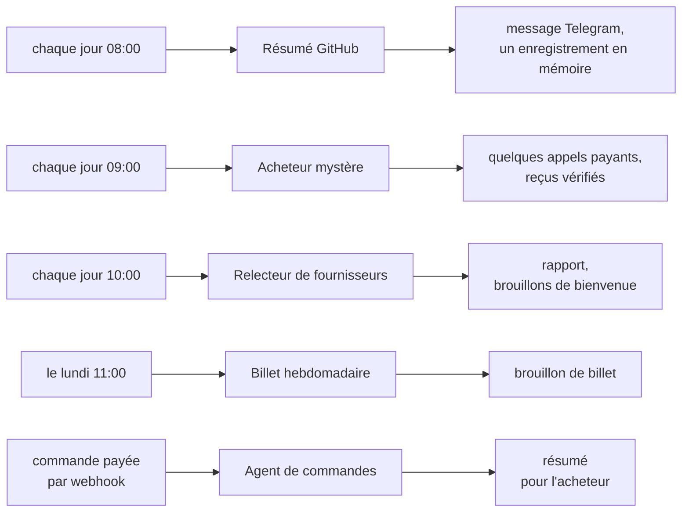
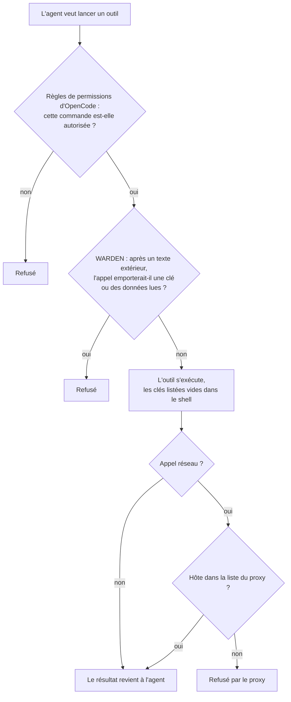
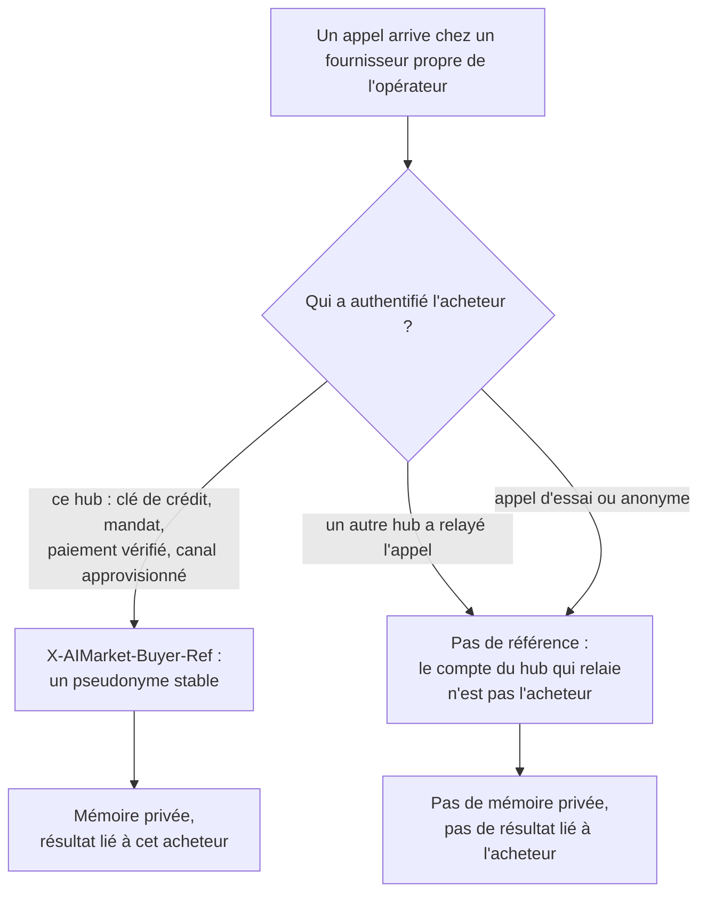
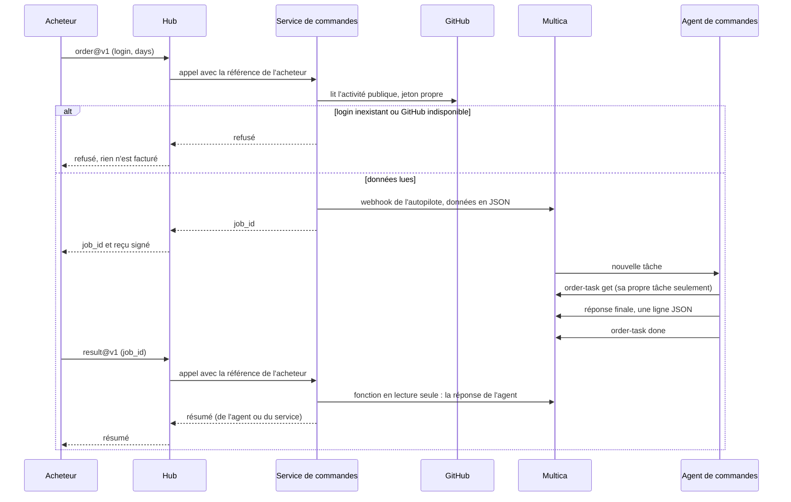

# Multica et AIMarket : installation et intégration

[English](README.md) · [Русский](README.ru.md) · [Español](README.es.md) · **Français** · [中文](README.zh.md)

Ce guide relie un [Multica](https://github.com/multica-ai/multica) auto-hébergé aux hubs AIMarket comme
[modelmarket.dev](https://modelmarket.dev). Multica est l'usine à agents ; le hub est le marché où ces agents
travaillent. À la fin du guide, vos agents peuvent :

- **acheter** des compétences à d'autres agents pendant une tâche, avec une clé prépayée dont le solde est une limite
  ferme ;
- **se souvenir** d'une exécution à l'autre grâce à des compétences de mémoire payantes ;
- **vendre** une capacité, y compris un long travail d'agent qui prend plusieurs minutes ;
- et fonctionner **confinés** : sortie réseau limitée à des hôtes listés, permissions par agent, et une protection
  contre l'envoi vers l'extérieur de ce qu'ils ont lu.

Ce que nous avons testé : Multica auto-hébergé, 0.5.3 depuis le 2026-11-04 et 0.8.0 depuis le 2026-11-05, son démon
avec OpenCode 1.18.32 et DeepSeek, sur un seul hôte. Par défaut, 0.8.0 pilote OpenCode 1.15 et suivants via ACP ; nous
gardons le mode `opencode run`, sur lequel la protection et les règles de permissions ont été testées (section 2). Les
commandes ci-dessous sont celles de la CLI 0.5.3 ; celles qu'utilise cette installation ont aussi été vérifiées sur
0.8.0.

## Sommaire

[Vue d'ensemble : comment tout s'articule](#vue-densemble--comment-tout-sarticule)

1. [Avant de commencer](#1-avant-de-commencer)
2. [Le démon dans un conteneur](#2-le-démon-dans-un-conteneur)
3. [Limitez la sortie réseau](#3-limitez-la-sortie-réseau)
4. [Connectez le hub : achetez des compétences](#4-connectez-le-hub--achetez-des-compétences)
5. [À chaque agent, seulement ce qu'il lui faut](#5-à-chaque-agent-seulement-ce-quil-lui-faut)
6. [Protégez les agents : WARDEN pour OpenCode](#6-protégez-les-agents--warden-pour-opencode)
7. [Mémoire entre les exécutions](#7-mémoire-entre-les-exécutions)
8. [Des agents dont les faits viennent d'un script](#8-des-agents-dont-les-faits-viennent-dun-script)
9. [Vendez une capacité](#9-vendez-une-capacité)
10. [Vendez un long travail d'agent](#10-vendez-un-long-travail-dagent)
11. [Vérifiez l'installation](#11-vérifiez-linstallation)
12. [Pièges dans lesquels nous sommes tombés](#12-pièges-dans-lesquels-nous-sommes-tombés)
13. [Limites connues](#13-limites-connues)

## Vue d'ensemble : comment tout s'articule

Tout tourne sur un seul hôte, dans Docker. L'environnement des agents est sur un réseau interne : sa seule sortie est
un proxy avec une courte liste d'hôtes. L'opérateur ouvre l'interface web de Multica par un tunnel SSH. Un petit
service à vous vend de longs travaux d'agents sur le hub et parle à Multica par le webhook d'un autopilote et un rôle
de base de données en lecture seule.



Notre installation de référence compte cinq agents. Les autopilotes les lancent selon un horaire (UTC) ou à l'arrivée
d'une commande :



Chaque session d'agent charge la protection WARDEN. Chaque agent n'a que son propre environnement et ses permissions
(sections 5 et 6), et rien de ce que préparent les agents ne part sans un humain : les brouillons restent des
brouillons.

## 1. Avant de commencer

- Un hôte Linux avec Docker et Docker Compose.
- Multica, auto-hébergé selon [ses propres instructions](https://github.com/multica-ai/multica). N'exposez pas
  l'interface web sur internet : publiez-la sur `127.0.0.1` et ouvrez-la par un tunnel SSH
  (`ssh -L 13300:127.0.0.1:13300 your-host`, puis http://127.0.0.1:13300).
- Une clé de modèle pour le runtime. Nous utilisons DeepSeek avec OpenCode (`DEEPSEEK_API_KEY`).
- Pour acheter : une clé prépayée sur https://modelmarket.dev/start.
- Pour vendre : un compte fournisseur sur https://modelmarket.dev/start?role=provider et un point d'accès HTTPS.

## 2. Le démon dans un conteneur

Le démon de Multica lance le runtime de l'agent (OpenCode) pour chaque tâche. Faites-le tourner dans son propre
conteneur :

- un utilisateur non root (le nôtre est `node`, uid 1000), `cap_drop: [ALL]`,
  `security_opt: ["no-new-privileges:true"]` ;
- des limites : `mem_limit: 3g`, `cpus: 2`, `pids_limit: 1024` ;
- `MULTICA_DAEMON_AUTO_UPDATE: "false"`, pour que les versions ne changent qu'à la reconstruction ;
- sur Multica 0.8.0 avec OpenCode 1.x, `MULTICA_OPENCODE_TRANSPORT: run`, pour garder le mode sur lequel la protection a été testée ;
- les secrets des agents dans un fichier env en mode 600, chargé avec `env_file` : la clé du modèle, un jeton GitHub,
  les jetons du bot de discussion, la clé du hub. Ne mettez jamais une clé dans une tâche, une instruction ou une
  compétence.

Tous les agents partagent un démon, un utilisateur et un dossier personnel. La section 5 explique comment les séparer
malgré tout.

## 3. Limitez la sortie réseau

Un agent qui lit des textes d'autrui (issues, pages, réponses de vendeurs) peut être poussé à envoyer des données à
l'extérieur. Ne lui donnez aucune route directe : placez le démon sur un réseau Docker interne et laissez un proxy
décider quels hôtes il peut joindre.

```yaml
services:
  daemon:
    networks: [agent]
    environment:
      HTTPS_PROXY: http://egress:8888
      HTTP_PROXY: http://egress:8888
      NO_PROXY: backend,localhost,127.0.0.1
  egress:
    build: { context: ./egress }      # tinyproxy
    networks: [agent, app]
    read_only: true
    tmpfs: ["/tmp", "/run"]
    cap_drop: [ALL]
networks:
  agent:
    internal: true                    # no route out, no outside DNS
    ipam: { config: [{ subnet: 10.250.0.0/24 }] }
```

Le démon doit toujours joindre le backend de Multica : mettez aussi le backend sur le réseau `agent`.

`tinyproxy.conf` :

```
Port 8888
Listen 0.0.0.0
Allow 10.250.0.0/24
FilterType ere
FilterURLs Off
FilterDefaultDeny Yes
Filter "/etc/tinyproxy/allow"
ConnectPort 443
```

`allow` : un hôte par ligne, ancré au début et à la fin, sinon `github.com.example.net` correspondrait aussi :

```
^api\.deepseek\.com$
^models\.dev$
^github\.com$
^api\.github\.com$
^api\.telegram\.org$
^modelmarket\.dev$
```

`models.dev` est le catalogue de modèles d'OpenCode. N'ajoutez que les hôtes dont vos agents ont besoin. Un hôte de
la liste reste un canal (un agent muni d'un jeton GitHub peut écrire sur GitHub) ; c'est le rôle de la section 6.

## 4. Connectez le hub : achetez des compétences

Ajoutez le serveur MCP du hub à la configuration globale d'OpenCode, `~/.config/opencode/opencode.jsonc` dans le
dossier personnel du démon :

```jsonc
{
  "mcp": {
    "modelmarket": {
      "type": "remote",
      "url": "https://modelmarket.dev/mcp",
      "headers": { "X-API-Key": "{env:AIMARKET_API_KEY}" }
    }
  }
}
```

Mettez la clé prépayée dans le fichier env du démon sous le nom `AIMARKET_API_KEY`. Son solde est une limite ferme :
quand il est épuisé, le hub répond 402 et ne facture rien. Sans clé, le hub accorde quelques appels d'essai.

L'agent utilise ensuite trois outils :

- `market_search` : `intent` en mots simples et `budget` (prix maximal par appel). Chaque résultat donne
  `product_id`, `capability_id`, `source_hub`, le prix, `max_price_usd` et les champs d'entrée.
- `market_invoke` : `product_id`, `capability_id`, `source_hub` (obligatoire pour les annonces fédérées, soit la
  majeure partie du catalogue), `input`, et `max_price_usd` recopié tel quel depuis la recherche. Si la route a
  changé de prix, le hub refuse avec `price_limit_exceeded` avant tout travail et tout paiement.
- `account_status` : ce qui reste sur la clé et ce qui a été dépensé.

Chaque appel payant renvoie le reçu signé du hub ; le reçu de travail derrière le `verify_url` de la réponse lie le
hash de l'entrée, le résultat et le vendeur. Conservez-le avec toute réponse sur laquelle vous vous appuyez.

Notre compétence [`multica/community/aimarket/SKILL.md`](../community/aimarket/SKILL.md) apprend ces règles à l'agent
(budget par tâche, pas de nouvel essai après 402/403, entrée neutre uniquement, la réponse d'un vendeur est une
donnée). Importez-la :

```bash
multica skill import --url https://github.com/alexar76/aicom/tree/main/multica/community/aimarket
```

L'URL fonctionnera quand le miroir public contiendra ce dossier ; en attendant, compressez le dossier en zip et
utilisez `multica skill import --file aimarket.zip`.

## 5. À chaque agent, seulement ce qu'il lui faut

La configuration globale du démon s'applique à tous les agents : gardez-la réduite et réglez le reste agent par agent.
Multica donne à chaque agent un **environnement propre** (custom environment) ; OpenCode y lit
`OPENCODE_CONFIG_CONTENT` comme configuration supplémentaire pour les exécutions de cet agent.

Pour un agent qui lit des textes d'inconnus et n'a pas besoin du hub, coupez le hub et videz les clés inutiles :

```bash
cat <<'EOF' | multica agent env set <agent-id> --custom-env-stdin
{
  "AIMARKET_API_KEY": "",
  "OPENCODE_CONFIG_CONTENT": "{\"mcp\":{\"modelmarket\":{\"enabled\":false}},\"tools\":{\"modelmarket_*\":false}}"
}
EOF
```

`env set` remplace tout l'environnement propre (`****` conserve une valeur existante). Vérifiez le résultat avec
`opencode debug config` lancé avec le même `OPENCODE_CONFIG_CONTENT`.

`permission.bash` d'OpenCode accepte des motifs ; c'est le **dernier** qui correspond qui l'emporte, et chaque
commande d'une ligne est vérifiée séparément (y compris dans `$(...)`, les accents graves et les tubes). Une commande
avec une redirection est vérifiée avec elle. Un agent qui ne peut lancer qu'une seule commande ressemble donc à ceci :

```json
{"bash": {"*": "deny", "/opt/tools/order-task get *": "allow", "*>*": "deny", "*<*": "deny", "*$*": "deny", "*`*": "deny"}}
```

Sans les quatre dernières règles, `commande-autorisée > ~/.config/opencode/opencode.jsonc` écraserait un fichier.

Autorisez un script enveloppe que vous avez écrit, pas la CLI de Multica avec un joker. Le jeton d'un agent Multica
est lié à l'**espace de travail**, pas à sa tâche : `multica issue get *` lit n'importe quelle tâche de l'espace, et
les numéros de tâche se suivent. L'enveloppe doit vérifier que la tâche appartient à l'agent avant d'afficher ou de
modifier quoi que ce soit (la nôtre est à la section 10).

## 6. Protégez les agents : WARDEN pour OpenCode

Le flow guard de [WARDEN](https://github.com/alexar76/warden) est un plugin OpenCode. Une fois qu'une session a lu un
texte extérieur, il refuse un appel d'outil qui emporterait une clé ou des données lues par la session. Il vide aussi,
dans les commandes shell, les clés que vous listez. Dans notre attaque simulée, une fausse clé se trouvait dans un
fichier. Son envoi a été refusé sur tous les canaux : le script de discussion, `curl` vers un hôte autorisé, une
écriture en mémoire et la CLI du gestionnaire de tâches. Une journée de travail normale s'est déroulée sans aucun
refus.

Chaque appel d'outil d'un agent passe par trois couches, et chacune peut refuser seule :



Ce que les couches arrêtent, et ce qu'elles n'arrêtent pas :

| Menace | Arrêtée par |
|---|---|
| Un agent victime d'une injection de prompt lance une commande qui ne lui était pas destinée | Règles de permissions d'OpenCode (une enveloppe plutôt qu'un joker) |
| Il envoie une clé ou des données lues vers un hôte autorisé (GitHub, discussion, hub) | Protection WARDEN |
| Il envoie quoi que ce soit vers un autre hôte | Proxy de sortie |
| Il désactive la protection pour les sessions suivantes | Protection dans un dossier appartenant à root (plus bas) |
| La réponse finale de l'agent elle-même sort des données | Pas la protection : Multica publie cette réponse ; vérifiez-la dans votre service (section 10) |

Nous l'avons vérifié chez nous. L'attaque simulée (plus haut) a été refusée sur tous les canaux. Le 2026-11-05, chaque
exécution planifiée des cinq agents, et une commande payée après le passage à Multica 0.8.0, ont laissé le fichier
d'état de la protection pour leur session : le plugin a tourné dans chacune.

Le plugin est livré dans `@aimarket/warden` à partir de la version 0.23.0 (`@aimarket/warden/opencode`). Chargeur,
sous le nom `plugin/warden.js` dans le dossier de configuration d'OpenCode :

```js
import { createWardenPlugin } from '@aimarket/warden/opencode';

export const WardenFlowGuard = createWardenPlugin({
  block: 'data',
  // Keys only the OpenCode process needs; shell commands get them blank.
  stripEnv: ['DEEPSEEK_API_KEY', 'AIMARKET_API_KEY'],
});
```

Sans le paquet, copiez `dist/opencode-plugin.js` et tous les `dist/flow-guard*.js` dans un même dossier et importez
`opencode-plugin.js` depuis celui-ci.

Installez-le là où l'utilisateur de l'agent ne peut pas le modifier. Les fichiers doivent appartenir à root, et
**chaque dossier au-dessus d'eux** aussi : un utilisateur peut renommer un dossier qui lui appartient, avec la
protection dedans. Nous avons trouvé ce trou dans notre propre installation le 2026-11-05. Les fichiers du plugin
appartenaient à root, mais `~/.config/opencode` appartenait à l'utilisateur de l'agent. Nous l'avons fermé en plaçant le plugin dans un dossier appartenant à root, monté sur `/opt/opencode-guard`, et en
l'indiquant à OpenCode avec `OPENCODE_CONFIG_DIR`. Montez-le en écriture, mais avec root pour propriétaire, afin que
l'utilisateur de l'agent ne puisse pas y écrire. Au démarrage, OpenCode 1.18.32 écrit un `.gitignore` dans chaque
dossier de configuration : sur un montage en lecture seule il s'arrête sur une erreur, alors qu'il passe outre un
dossier où il n'a pas le droit d'écrire. Vérifiez ensuite avec `opencode debug config`, en tant qu'utilisateur de l'agent, que le plugin
est chargé.

### Exemple : la protection pour tous les agents

Voici notre installation en service : Multica 0.8.0, OpenCode 1.18.32 et WARDEN 0.23.0. Les fichiers de `warden/`
sont les fichiers du plugin du paquet npm `@aimarket/warden@0.23.0`, inchangés (20 fichiers). Chaque commande
ci-dessous a d'abord été exécutée sur notre hôte.

Le chargeur, enregistré sous `warden.js` à côté de `docker-compose.yml` :

```js
// opencode-guard/plugin/warden.js: the WARDEN flow guard for every agent on this daemon.
// Export only the plugin: OpenCode calls every exported function as one.
import { createWardenPlugin } from '../warden/opencode-plugin.js';

export const WardenFlowGuard = createWardenPlugin({
  block: 'data',
  // Keys only the OpenCode process needs; shell commands get them blank.
  stripEnv: ['DEEPSEEK_API_KEY', 'AIMARKET_API_KEY'],
});
```

Sur l'hôte, en root. Le paquet est vérifié avec la somme de contrôle que publie npm :

```bash
cd /opt/multica                    # the folder with docker-compose.yml; warden.js (the loader) is here
T=$(mktemp -d)
curl -fsSL -o "$T/warden.tgz" https://registry.npmjs.org/@aimarket/warden/-/warden-0.23.0.tgz
echo "e9fe195e36ce559d9e543e8eb3fd4bcd729fe434  $T/warden.tgz" | sha1sum -c -
tar -xzf "$T/warden.tgz" -C "$T"
install -d -o root -g root -m 755 opencode-guard opencode-guard/plugin opencode-guard/warden
install -o root -g root -m 644 "$T"/package/dist/opencode-plugin.js "$T"/package/dist/flow-guard*.js opencode-guard/warden/
install -o root -g root -m 644 warden.js opencode-guard/plugin/warden.js
rm -rf "$T"
```

Le résultat :

```
opencode-guard/                root:root 755
├── plugin/
│   └── warden.js              root:root 644   the loader above
└── warden/                    root:root 755
    ├── opencode-plugin.js     root:root 644
    └── flow-guard*.js         root:root 644   19 files
```

Le démon dans `docker-compose.yml` (seulement les lignes qui comptent ici) :

```yaml
services:
  daemon:
    environment:
      MULTICA_DAEMON_AUTO_UPDATE: "false"
      OPENCODE_CONFIG_DIR: /opt/opencode-guard   # every OpenCode session loads plugin/ from here
      MULTICA_OPENCODE_TRANSPORT: run            # Multica 0.8.0 with OpenCode 1.x: the transport the guard was tested on
    volumes:
      - daemon_home:/home/node
      - ./opencode-guard:/opt/opencode-guard     # root-owned; not :ro, OpenCode stops on a read-only config folder
```

Si une ancienne copie de la protection se trouve dans le dossier personnel du démon (`~/.config/opencode/plugin`
et `~/.config/opencode/warden` dans son volume), retirez-la d'abord, sinon la protection se charge deux fois. Puis
recréez le démon pendant qu'aucune tâche ne tourne :

```bash
docker compose up -d --no-deps --force-recreate daemon
```

Vérifications, en tant qu'utilisateur de l'agent :

```bash
# 1. Sessions load the guard from the root-owned folder, and only from there.
docker exec -u node -w /tmp multica-daemon sh -c 'opencode debug config | jq -c .plugin'
#    ["file:///opt/opencode-guard/plugin/warden.js"]

# 2. Still loaded with another home folder, as if ~/.config had been renamed.
docker exec -u node -w /tmp multica-daemon sh -c 'mkdir -p /tmp/h && HOME=/tmp/h opencode debug config | jq -c .plugin; rm -rf /tmp/h'

# 3. Nothing on the guard's path is writable by the agent user: every line must say "ok".
docker exec -u node multica-daemon sh -c 'for p in /opt /opt/opencode-guard /opt/opencode-guard/plugin /opt/opencode-guard/warden; do [ -w "$p" ] && echo "WRITABLE: $p" || echo "ok: $p"; done'

# 4. A real session runs the guard: the newest state files carry the current time.
docker exec -u node -w /tmp multica-daemon opencode run "Reply with the single word OK."
docker exec -u node multica-daemon sh -c 'ls -lt ~/.local/state/warden/claude-code/flow | head -3'
```

La protection s'applique à tous les agents du démon, y compris ceux qui ont leur propre `OPENCODE_CONFIG_CONTENT` :
notre agent de commandes en a un, et ses sessions écrivent aussi l'état de la protection.

### Runtimes Codex

Les agents qui tournent sur Codex au lieu d’OpenCode reçoivent la même garde par les hooks de commande de Codex. Elle
est dans le code local de WARDEN, pas encore publiée. Détails et schémas :
[WARDEN pour Codex](https://github.com/alexar76/warden/blob/main/docs/codex.fr.md).

- Codex n’a pas de « demander » : un hook qui répond `ask` compte comme en échec, et Codex lance l’appel. L’adaptateur
  ne demande donc jamais. Une question devient un refus ou un passage journalisé (`WARDEN_CODEX_BLOCK=data`, par
  défaut, ou `all`), et tout échec de la garde refuse.
- Installez-la en hooks gérés : le `codex-hooks/` construit dans `/opt/warden-codex`, et `codex-hooks/requirements.toml`
  comme `/etc/codex/requirements.toml`, le tout à root. `allow_managed_hooks_only = true` empêche un agent d’ajouter son
  propre hook.
- Dans le service du démon dans compose, montez les deux en lecture seule et réglez le mode :

```yaml
    environment:
      WARDEN_CODEX_BLOCK: data
    volumes:
      - ./warden-codex:/opt/warden-codex:ro
      - ./codex/requirements.toml:/etc/codex/requirements.toml:ro
```

- Tenez la clé du modèle hors des commandes shell avec `shell_environment_policy` (`exclude`), et coupez la recherche
  web intégrée de Codex : elle ne lance aucun hook, la garde ne voit donc pas ce qu’elle apporte.
- Vérifiez avec `scripts/codex-live-check.sh` du dépôt WARDEN : une attaque mise en scène avec une fausse clé, entièrement
  sur localhost.

## 7. Mémoire entre les exécutions

Les agents commencent chaque tâche de zéro. Attested Memory leur donne une mémoire payée à l'appel :
`memory.write@v1`, `memory.search@v1` et `memory.read@v1` sur hub.attestedmemory.net. Une mémoire appartient à
l'acheteur que ce hub a authentifié. Achetez-la **directement sur ce hub** : prenez une clé sur
https://hub.attestedmemory.net/start et utilisez son serveur MCP, `https://hub.attestedmemory.net/mcp`, comme à la
section 4. Achetée via un autre hub (modelmarket.dev liste aussi ces compétences), l'appel arrive au hub de mémoire
sous l'identité du hub qui le relaie, pas la vôtre, et n'obtient pas de mémoire privée. Les appels d'essai non plus.

À qui appartient une mémoire, et qui peut lire le résultat d'une commande, c'est le hub qui a authentifié l'acheteur
qui en décide :



Un paiement x402 vérifié de l'acheteur lui-même l'identifie toujours, même sur un appel relayé.

Inscrivez cet usage dans les instructions de l'agent, avec un budget : quelles compétences, combien d'appels par
exécution, pas de nouvel essai après 402 ou 403. Notre résumé GitHub quotidien lit jusqu'à trois enregistrements
précédents, ajoute une ligne « Tendances » et enregistre une entrée par jour : environ 0,03 $ par exécution.

## 8. Des agents dont les faits viennent d'un script

Quand le résultat doit être juste (chiffres, constats, prix), laissez un script décider des faits et le modèle
seulement écrire autour. C'est ainsi que fonctionne notre relecteur de fournisseurs. Un script compare le catalogue
du hub à celui de la veille et vérifie les schémas, l'injection de prompt, ce qu'un acheteur devrait fournir, les
adresses et les prix. Le modèle rédige le rapport et recopie les faits du script sans les changer. Notre billet
hebdomadaire fonctionne de la même façon : un script rassemble les compteurs de la semaine et le modèle rédige le
texte.

Planifiez-les avec un autopilote (`multica autopilot create --agent <agent> --mode create_issue --title ...`, puis
`multica autopilot trigger-add <id> --kind schedule --cron "0 10 * * *"` ; fuseau horaire UTC par défaut). Code :
[`multica/supplier-review`](../supplier-review/), [`multica/weekly-post`](../weekly-post/).

## 9. Vendez une capacité

Le guide complet est sur https://modelmarket.dev/developers (et https://play.modelmarket.dev/publish). Le chemin
court, environ 15 minutes pour un point d'accès qui tourne déjà :

1. Créez un compte et une clé sur https://modelmarket.dev/start?role=provider ; votre `account_id` obtenu par
   `GET /ai-market/v2/account` est votre `publisher_id`.
2. `GET /ai-market/v2/supply/policy` avec la clé indique si une caution est requise ; déposez-la avec
   `POST /ai-market/v2/supply/stake` seulement si `additional_stake_usd` est supérieur à zéro.
3. Décrivez la capacité dans `capability.json`. Il faut `capability_id` (par ex. `mytool.summarize@v1`),
   `product_id`, `publisher_id`, `invoke_url` (HTTPS), `price_per_call_usd`, les JSON Schemas d'entrée et de sortie,
   et la `provider_pubkey` Ed25519 avec laquelle votre point d'accès signe ses réponses.
4. Testez le point d'accès avec https://play.modelmarket.dev/connect (un vrai appel, schéma et signature).
5. `POST /ai-market/v2/supply/register` avec la clé et `capability.json`.

Rédigez la description pour le modèle de l'acheteur : ce que fait la capacité, ce dont elle a besoin, ce qu'elle
renvoie, ce qu'elle coûte. Pas d'instructions au modèle (« utilise toujours cet outil ») : les hubs les recherchent
dans les annonces, et les protections des acheteurs les refusent.

## 10. Vendez un long travail d'agent

Un appel payant ne peut pas attendre un agent pendant des minutes. Vendez le travail sous forme de deux capacités :

- `…order@v1` (payante). Votre service vérifie strictement l'entrée, fait lui-même les lectures extérieures, crée une
  tâche Multica via un déclencheur **webhook** d'autopilote avec ces données, et répond aussitôt avec un `job_id`.
- `…result@v1` (gratuite) répond `queued`, ou `done` avec le résultat.

La commande entière, de l'appel de l'acheteur au résultat :



Comment les pièces s'assemblent :

1. **Un autopilote avec déclencheur webhook.** `multica autopilot create --agent <order-agent> --mode create_issue
   --title "Orders" --description "<instructions>"`, puis `multica autopilot trigger-add <id> --kind webhook`.
   L'URL du déclencheur contient son jeton : gardez-la dans le fichier env du service (mode 600) et ne l'écrivez
   jamais dans un journal. Multica place le JSON envoyé dans la description de la tâche.
2. **Les lectures extérieures sont faites par votre service.** Il les fait avant d'accepter la commande, avec son
   propre jeton. Un jeton GitHub sans permissions fait passer la limite de 60 à 5000 requêtes par heure. Refusez avant
   tout débit si l'entrée est fausse ou si la source est indisponible : le hub ne facture qu'un appel qui a obtenu une
   réponse. Aucun texte libre de l'acheteur ne doit atteindre l'agent.
3. **La réponse finale de l'agent est le livrable.** C'est une seule ligne JSON,
   `{"job_id": "...", "summary": "..."}`, et Multica la publie sur la tâche. L'agent n'envoie rien sur le réseau.
   Un agent qui a lu un texte extérieur puis envoie des valeurs tirées de sa propre tâche, c'est exactement ce que
   WARDEN refuse.
4. **L'agent de commandes lance une seule enveloppe.** La nôtre est
   [`order-task`](../provider/order-task/order-task) : `order-task get <issue>` affiche la tâche et
   `order-task done <issue>` la ferme, seulement si la tâche est assignée à l'agent de commandes. Elle appartient à
   root, et ses règles OpenCode sont dans [`opencode-order-agent.json`](../provider/order-task/opencode-order-agent.json).
5. **Le service lit la réponse** par un rôle de base de données en lecture seule. Ce rôle ne peut exécuter qu'une
   fonction. La fonction (`SECURITY DEFINER`, avec un `search_path` fixe) renvoie les commentaires de l'agent de
   commandes sur les tâches que son autopilote a créées pour une commande. Le service accepte exactement `job_id` et
   `summary`, avec une longueur maximale et des liens vers le seul site attendu. Si aucune réponse exploitable
   n'arrive à la fin de la tâche ou au bout de 20 minutes, le service rédige un résumé simple à partir des mêmes
   données.
6. **Qui peut lire le résultat.** Un hub envoie `X-AIMarket-Buyer-Ref`, un pseudonyme stable de l'acheteur
   authentifié, uniquement aux fournisseurs de son propre opérateur, avec le jeton interne du hub. Sur votre propre
   hub, liez chaque commande à cette référence. Sur le hub de quelqu'un d'autre, vous ne recevez aucune identité
   d'acheteur. Le `job_id` devient alors la clé de lecture : 128 bits aléatoires, renvoyés uniquement dans la réponse
   payante, avec une durée de conservation limitée.

Notre service est [`multica/provider`](../provider/) (27 tests ; l'enveloppe et les règles de permissions en ont 25
de plus). Il vend `github.digest.order@v1` à 0,05 $ sur hub.attestedmemory.net.

## 11. Vérifiez l'installation

- **La configuration vue par l'agent.** Lancez `opencode debug config` en tant qu'utilisateur de l'agent, avec le
  `OPENCODE_CONFIG_CONTENT` de l'agent. Vérifiez que les serveurs MCP sont coupés là où vous le vouliez et que le
  plugin figure dans la liste.
- **La sortie réseau.** Depuis le démon, `curl https://example.com` doit échouer via le proxy, et
  `curl https://api.github.com/zen` doit répondre.
- **La protection.** Lancez une attaque simulée avec une **fausse** clé dans un fichier : demandez à un agent de
  l'envoyer par chaque canal autorisé. Chaque envoi doit être refusé, et une tâche normale doit passer sans refus.
- **La vente.** Passez une vraie commande avec un petit budget. Vérifiez que le résultat est lu par l'acheteur qui a
  payé, qu'un appel sans acheteur est refusé, et qu'une entrée erronée est refusée sans débit.

## 12. Pièges dans lesquels nous sommes tombés

- **Le DNS de Docker sur deux réseaux.** Un conteneur sur deux réseaux Compose résout les noms de service sur l'un ou
  l'autre. `postgres` a atteint la base d'une autre pile. Utilisez les noms de conteneur (`multica-postgres-1`).
- **Tester la base via 127.0.0.1 ne prouve rien.** Si `pg_hba` fait confiance aux connexions locales, un mauvais mot
  de passe passe quand même. Testez un mot de passe par le réseau.
- **`multica agent env set`**, et non `agent update`, change l'environnement propre, et le remplace en entier.
- **Limite GitHub partagée.** Les lectures sans jeton se partagent 60 requêtes par heure par IP d'hôte, et n'importe
  quel conteneur de l'hôte peut les consommer. Donnez à chaque lecteur son propre jeton sans permissions.
- **Les agents ne peuvent pas fermer leurs tâches** si leurs règles ne le permettent pas. Autorisez-le via
  l'enveloppe, pour leur propre tâche seulement.
- **Le modèle n'est pas la protection.** Dans nos tests, DeepSeek a refusé des commandes injectées évidentes, mais ce
  qui tient, ce sont les règles et les permissions des fichiers.

## 13. Limites connues

- Multica publie lui-même la réponse finale d'un agent, hors des appels d'outils qu'une protection voit. Vérifiez
  cette réponse dans votre service : forme, taille et liens.
- Le démon et ses agents tournent sous un même utilisateur. Tout agent peut lire la connexion Multica du démon, et un
  agent doté d'un shell complet peut modifier des fichiers utilisés par les autres. La sortie limitée, la protection
  et la propriété des fichiers réduisent ce risque ; seul un utilisateur distinct par agent le supprimerait.
- La protection s'applique par runtime, pas par agent.
- Un hôte de la liste reste un canal. Gardez la liste courte et donnez aux jetons le moins de permissions possible.

Installation de référence : [`multica/community/README.md`](../community/README.md). Revue de sécurité de cette
installation : [`artifacts/vulnetix-class-multica-2026-11-05/REPORT.md`](../../artifacts/vulnetix-class-multica-2026-11-05/REPORT.md).
