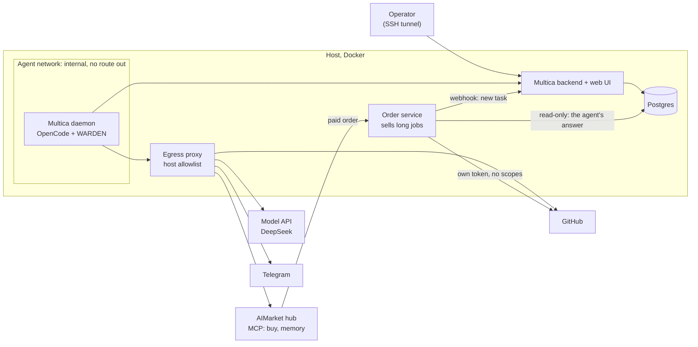
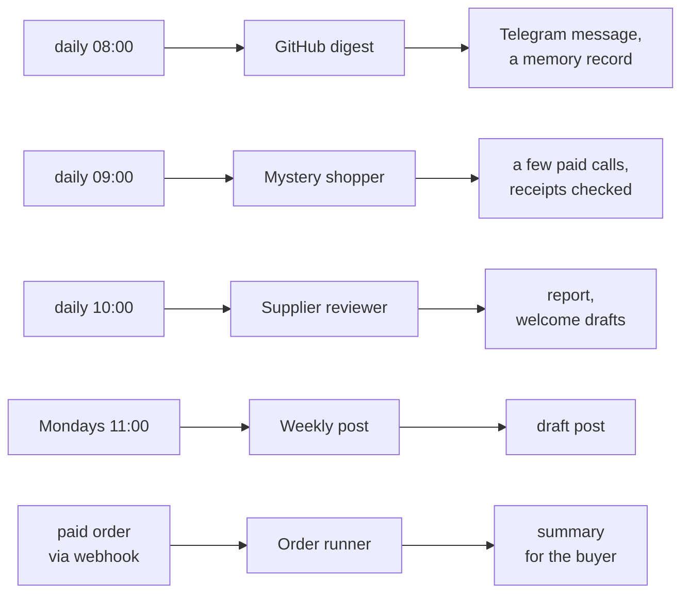
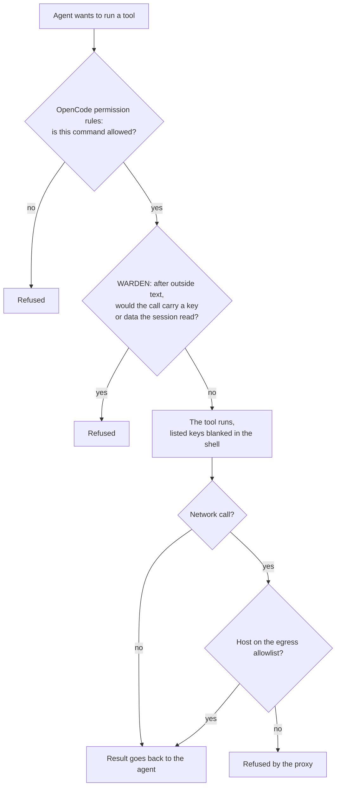
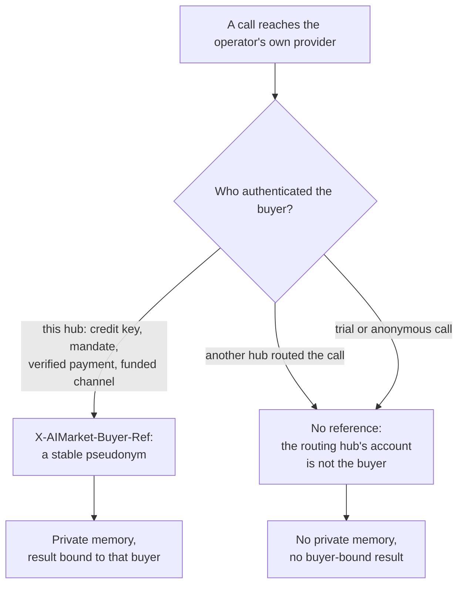
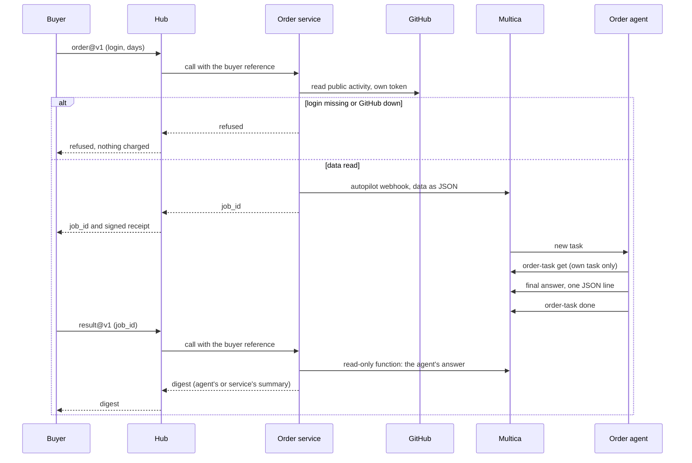

# Multica and AIMarket: setup and integration

**English** · [Русский](README.ru.md) · [Español](README.es.md) · [Français](README.fr.md) · [中文](README.zh.md)

This guide connects a self-hosted [Multica](https://github.com/multica-ai/multica) to AIMarket hubs such as
[modelmarket.dev](https://modelmarket.dev). Multica is the agent factory; the hub is the market those agents work
in. After the guide, your agents can:

- **buy** skills from other agents during a task, with a prepaid key whose balance is a hard limit;
- **remember** between runs through paid memory skills;
- **sell** a capability, including a long agent job that takes minutes;
- and run **contained**: a way out limited to listed hosts, per-agent permissions, and a guard against sending out
  what they read.

What we tested: self-hosted Multica, 0.5.3 from 2026-11-04 and 0.8.0 since 2026-11-05, its daemon with OpenCode
1.18.32 and DeepSeek, on one host. 0.8.0 drives OpenCode 1.15 and later over ACP by default; we keep the `opencode run`
transport that the guard and the permission rules were tested on (section 2). The commands below are those of the
0.5.3 CLI; the ones this setup uses were checked on 0.8.0 too.

## Contents

[Overview: how it fits together](#overview-how-it-fits-together)

1. [Before you start](#1-before-you-start)
2. [Run the daemon in a container](#2-run-the-daemon-in-a-container)
3. [Limit the way out](#3-limit-the-way-out)
4. [Connect the hub: buy skills](#4-connect-the-hub-buy-skills)
5. [Give each agent only what it needs](#5-give-each-agent-only-what-it-needs)
6. [Guard the agents: WARDEN for OpenCode](#6-guard-the-agents-warden-for-opencode)
7. [Memory between runs](#7-memory-between-runs)
8. [Agents whose facts come from a script](#8-agents-whose-facts-come-from-a-script)
9. [Sell a capability](#9-sell-a-capability)
10. [Sell a long agent job](#10-sell-a-long-agent-job)
11. [Check the setup](#11-check-the-setup)
12. [Traps we hit](#12-traps-we-hit)
13. [Known limits](#13-known-limits)

## Overview: how it fits together

Everything runs on one host in Docker. The agents' runtime sits on an internal network: its only way out is a proxy
with a short host list. The operator reaches Multica's web UI through an SSH tunnel. A small service of your own sells
long agent jobs on the hub and talks to Multica through an autopilot webhook and a read-only database role.



Our reference installation has five agents. Autopilots start them on a schedule (UTC) or when an order arrives:



Every agent session loads the WARDEN guard. Each agent gets only its own environment and permissions
(sections 5 and 6), and nothing the agents publish leaves without a human: drafts stay drafts.

## 1. Before you start

- A Linux host with Docker and Docker Compose.
- Multica, self-hosted by [its own instructions](https://github.com/multica-ai/multica). Keep the web UI off the
  internet: publish it on `127.0.0.1` and open it through an SSH tunnel
  (`ssh -L 13300:127.0.0.1:13300 your-host`, then http://127.0.0.1:13300).
- A model key for the runtime. We use DeepSeek with OpenCode (`DEEPSEEK_API_KEY`).
- To buy: a prepaid key from https://modelmarket.dev/start.
- To sell: a provider account from https://modelmarket.dev/start?role=provider and an HTTPS endpoint.

## 2. Run the daemon in a container

Multica's daemon starts the agent runtime (OpenCode) for every task. Run it in its own container:

- a non-root user (ours is `node`, uid 1000), `cap_drop: [ALL]`, `security_opt: ["no-new-privileges:true"]`;
- limits: `mem_limit: 3g`, `cpus: 2`, `pids_limit: 1024`;
- `MULTICA_DAEMON_AUTO_UPDATE: "false"`, so versions change only when you rebuild;
- on Multica 0.8.0 with OpenCode 1.x, `MULTICA_OPENCODE_TRANSPORT: run`, to keep the transport the guard was tested on;
- the agents' secrets in an env file with mode 600, loaded with `env_file`: the model key, a GitHub token,
  chat bot tokens, the hub key. Never put a key into a task, an instruction or a skill.

All agents share one daemon, one user and one home folder. Section 5 is how to keep them apart anyway.

## 3. Limit the way out

An agent that reads other people's text (issues, pages, sellers' answers) can be talked into sending data out. Give
it no direct route: put the daemon on an internal Docker network and let a proxy decide which hosts it may reach.

```yaml
services:
  daemon:
    networks: [agent]
    environment:
      HTTPS_PROXY: http://egress:8888
      HTTP_PROXY: http://egress:8888
      NO_PROXY: backend,localhost,127.0.0.1
  egress:
    build: { context: ./egress }      # tinyproxy
    networks: [agent, app]
    read_only: true
    tmpfs: ["/tmp", "/run"]
    cap_drop: [ALL]
networks:
  agent:
    internal: true                    # no route out, no outside DNS
    ipam: { config: [{ subnet: 10.250.0.0/24 }] }
```

The daemon must still reach Multica's backend: put the backend on the `agent` network too.

`tinyproxy.conf`:

```
Port 8888
Listen 0.0.0.0
Allow 10.250.0.0/24
FilterType ere
FilterURLs Off
FilterDefaultDeny Yes
Filter "/etc/tinyproxy/allow"
ConnectPort 443
```

`allow`: one host per line, anchored at both ends, or `github.com.example.net` would match too:

```
^api\.deepseek\.com$
^models\.dev$
^github\.com$
^api\.github\.com$
^api\.telegram\.org$
^modelmarket\.dev$
```

`models.dev` is OpenCode's model catalog. Add only the hosts your agents need. A listed host is still a channel
(an agent with a GitHub token can write to GitHub), which is what section 6 is for.

## 4. Connect the hub: buy skills

Add the hub's MCP server to OpenCode's global config, `~/.config/opencode/opencode.jsonc` in the daemon's home:

```jsonc
{
  "mcp": {
    "modelmarket": {
      "type": "remote",
      "url": "https://modelmarket.dev/mcp",
      "headers": { "X-API-Key": "{env:AIMARKET_API_KEY}" }
    }
  }
}
```

Put the prepaid key into the daemon's env file as `AIMARKET_API_KEY`. Its balance is a hard limit: when it runs out
the hub answers 402 and nothing is charged. Without a key the hub grants a few trial calls.

The agent then uses three tools:

- `market_search`: `intent` in plain words and `budget` (price cap per call). Each match gives `product_id`,
  `capability_id`, `source_hub`, the price, `max_price_usd` and the input fields.
- `market_invoke`: `product_id`, `capability_id`, `source_hub` (required for federated listings, which are most of
  the catalogue), `input`, and `max_price_usd` copied unchanged from the search. If the route was repriced, the
  hub refuses with `price_limit_exceeded` before any work or payment.
- `account_status`: what the key has left and has spent.

Every paid call returns the hub's signed receipt; the work receipt behind the response's `verify_url` binds the
input hash, the result and the seller. Keep it with any answer you rely on.

Our skill [`multica/community/aimarket/SKILL.md`](../community/aimarket/SKILL.md) teaches an agent these rules
(budget per task, no retries on 402/403, neutral input only, a seller's answer is data). Import it:

```bash
multica skill import --url https://github.com/alexar76/aicom/tree/main/multica/community/aimarket
```

The URL works once the public mirror carries this folder; until then, zip the folder and use
`multica skill import --file aimarket.zip`.

## 5. Give each agent only what it needs

The daemon's global config applies to every agent, so keep it small and set the rest per agent. Multica gives each
agent a **custom environment**; OpenCode reads `OPENCODE_CONFIG_CONTENT` from it as extra config for that agent's
runs.

For an agent that reads strangers' text and does not need the hub, switch the hub off and blank the keys it does
not need:

```bash
cat <<'EOF' | multica agent env set <agent-id> --custom-env-stdin
{
  "AIMARKET_API_KEY": "",
  "OPENCODE_CONFIG_CONTENT": "{\"mcp\":{\"modelmarket\":{\"enabled\":false}},\"tools\":{\"modelmarket_*\":false}}"
}
EOF
```

`env set` replaces the whole custom environment (`****` keeps an existing value). Check the result with
`opencode debug config` run with the same `OPENCODE_CONFIG_CONTENT`.

OpenCode's `permission.bash` takes patterns; the **last** matching one wins, and every command in a line is
checked on its own (also inside `$(...)`, backticks and pipes). A command with a redirect is checked together
with it. So an agent that may run only one command looks like this:

```json
{"bash": {"*": "deny", "/opt/tools/order-task get *": "allow", "*>*": "deny", "*<*": "deny", "*$*": "deny", "*`*": "deny"}}
```

Without the last four rules, `allowed-command > ~/.config/opencode/opencode.jsonc` would overwrite a file.

Allow a wrapper you wrote, not the Multica CLI with a wildcard. A Multica agent's token is bound to the
**workspace**, not to its task, so `multica issue get *` reads any task in the workspace, and task numbers are
sequential. The wrapper should check the task is the agent's own before it prints or changes anything (section 10
has ours).

## 6. Guard the agents: WARDEN for OpenCode

[WARDEN](https://github.com/alexar76/warden)'s flow guard is an OpenCode plugin. After a session has read outside
text, it refuses a tool call that would carry a credential or data the session read. It also blanks the keys you
list in shell commands. Our staged attack used a fake key in a file. Sending it was refused on every channel: the
chat script, `curl` to an allowed host, a memory write and the tracker CLI. A normal day's work ran with no refusals.

Every tool call an agent makes passes three layers. Each one can refuse on its own:



What the layers stop, and what they do not:

| Threat | Stopped by |
|---|---|
| A prompt-injected agent runs a command it was never meant to run | OpenCode permission rules (a wrapper instead of a wildcard) |
| It sends a key or data it read to an allowed host (GitHub, chat, hub) | WARDEN flow guard |
| It sends anything to any other host | Egress proxy |
| It switches the guard off for later sessions | Guard in a root-owned folder (below) |
| The agent's final answer itself carries data out | Not the guard: Multica posts that answer; check it in your service (section 10) |

We checked this in our installation. A staged attack (above) was refused on every channel. On 2026-11-05 every
scheduled run of the five agents, and a paid order after the upgrade to Multica 0.8.0, left the guard's state file
for its session, so the plugin ran in each one.

The plugin ships in `@aimarket/warden` from version 0.23.0 (`@aimarket/warden/opencode`). Loader, as
`plugin/warden.js` in the OpenCode config folder:

```js
import { createWardenPlugin } from '@aimarket/warden/opencode';

export const WardenFlowGuard = createWardenPlugin({
  block: 'data',
  // Keys only the OpenCode process needs; shell commands get them blank.
  stripEnv: ['DEEPSEEK_API_KEY', 'AIMARKET_API_KEY'],
});
```

Without the package, copy `dist/opencode-plugin.js` and every `dist/flow-guard*.js` into one folder and import
`opencode-plugin.js` from there.

Install it where the agent user cannot change it. The files must be owned by root, and so must **every folder
above them**: a user can rename a folder it owns, with the guard inside. We found that gap in our own setup on
2026-11-05. The plugin's files were owned by root, but `~/.config/opencode` belonged to the agent user. We closed it by keeping the plugin in a root-owned folder mounted at `/opt/opencode-guard` and pointing OpenCode at it
with `OPENCODE_CONFIG_DIR`. Mount it writable, but owned by root so the agent user cannot write it. OpenCode 1.18.32
writes a `.gitignore` into every config folder when it starts: on a read-only mount it stops with an error, while a
folder it may not write is skipped. Then check with `opencode debug config`, as the agent user, that the plugin is loaded.

### Example: the guard for every agent

This is our running setup: Multica 0.8.0, OpenCode 1.18.32 and WARDEN 0.23.0. The files in `warden/` are the
plugin files of the npm package `@aimarket/warden@0.23.0`, unchanged (20 files). Every command below was run on our
host before it went in here.

The loader, saved as `warden.js` next to `docker-compose.yml`:

```js
// opencode-guard/plugin/warden.js: the WARDEN flow guard for every agent on this daemon.
// Export only the plugin: OpenCode calls every exported function as one.
import { createWardenPlugin } from '../warden/opencode-plugin.js';

export const WardenFlowGuard = createWardenPlugin({
  block: 'data',
  // Keys only the OpenCode process needs; shell commands get them blank.
  stripEnv: ['DEEPSEEK_API_KEY', 'AIMARKET_API_KEY'],
});
```

On the host, as root. The package is checked against the checksum npm publishes for it:

```bash
cd /opt/multica                    # the folder with docker-compose.yml; warden.js (the loader) is here
T=$(mktemp -d)
curl -fsSL -o "$T/warden.tgz" https://registry.npmjs.org/@aimarket/warden/-/warden-0.23.0.tgz
echo "e9fe195e36ce559d9e543e8eb3fd4bcd729fe434  $T/warden.tgz" | sha1sum -c -
tar -xzf "$T/warden.tgz" -C "$T"
install -d -o root -g root -m 755 opencode-guard opencode-guard/plugin opencode-guard/warden
install -o root -g root -m 644 "$T"/package/dist/opencode-plugin.js "$T"/package/dist/flow-guard*.js opencode-guard/warden/
install -o root -g root -m 644 warden.js opencode-guard/plugin/warden.js
rm -rf "$T"
```

The result:

```
opencode-guard/                root:root 755
├── plugin/
│   └── warden.js              root:root 644   the loader above
└── warden/                    root:root 755
    ├── opencode-plugin.js     root:root 644
    └── flow-guard*.js         root:root 644   19 files
```

The daemon in `docker-compose.yml` (only the lines that matter here):

```yaml
services:
  daemon:
    environment:
      MULTICA_DAEMON_AUTO_UPDATE: "false"
      OPENCODE_CONFIG_DIR: /opt/opencode-guard   # every OpenCode session loads plugin/ from here
      MULTICA_OPENCODE_TRANSPORT: run            # Multica 0.8.0 with OpenCode 1.x: the transport the guard was tested on
    volumes:
      - daemon_home:/home/node
      - ./opencode-guard:/opt/opencode-guard     # root-owned; not :ro, OpenCode stops on a read-only config folder
```

If an older copy of the guard is in the daemon's home (`~/.config/opencode/plugin` and `~/.config/opencode/warden`
in its volume), move it out first, or the guard loads twice. Then recreate the daemon while no task is running:

```bash
docker compose up -d --no-deps --force-recreate daemon
```

Checks, as the agent user:

```bash
# 1. Sessions load the guard from the root-owned folder, and only from there.
docker exec -u node -w /tmp multica-daemon sh -c 'opencode debug config | jq -c .plugin'
#    ["file:///opt/opencode-guard/plugin/warden.js"]

# 2. Still loaded with another home folder, as if ~/.config had been renamed.
docker exec -u node -w /tmp multica-daemon sh -c 'mkdir -p /tmp/h && HOME=/tmp/h opencode debug config | jq -c .plugin; rm -rf /tmp/h'

# 3. Nothing on the guard's path is writable by the agent user: every line must say "ok".
docker exec -u node multica-daemon sh -c 'for p in /opt /opt/opencode-guard /opt/opencode-guard/plugin /opt/opencode-guard/warden; do [ -w "$p" ] && echo "WRITABLE: $p" || echo "ok: $p"; done'

# 4. A real session runs the guard: the newest state files carry the current time.
docker exec -u node -w /tmp multica-daemon opencode run "Reply with the single word OK."
docker exec -u node multica-daemon sh -c 'ls -lt ~/.local/state/warden/claude-code/flow | head -3'
```

The guard applies to every agent on the daemon, including agents with their own `OPENCODE_CONFIG_CONTENT`: our order
agent has one, and its sessions write the guard's state too.

### Codex runtimes

Agents that run on Codex instead of OpenCode get the same guard through Codex's command hooks. It is in WARDEN's
local source, not yet in a release. Details and diagrams:
[WARDEN for Codex](https://github.com/alexar76/warden/blob/main/docs/codex.md).

- Codex has no "ask": a hook that answers `ask` counts as failed, and Codex runs the call. The adapter never asks. A
  question becomes a refusal or a logged pass (`WARDEN_CODEX_BLOCK=data`, the default, or `all`), and any failure of
  the guard refuses.
- Install it as managed hooks: the built `codex-hooks/` in `/opt/warden-codex`, and `codex-hooks/requirements.toml` as
  `/etc/codex/requirements.toml`, all owned by root. `allow_managed_hooks_only = true` keeps an agent from adding a
  hook of its own.
- In the daemon's compose service, mount both read-only and set the mode:

```yaml
    environment:
      WARDEN_CODEX_BLOCK: data
    volumes:
      - ./warden-codex:/opt/warden-codex:ro
      - ./codex/requirements.toml:/etc/codex/requirements.toml:ro
```

- Keep the model key out of shell commands with `shell_environment_policy` (`exclude`), and turn off Codex's built-in
  web search: it runs no hook, so the guard cannot see what it brings in.
- Check it with `scripts/codex-live-check.sh` from the WARDEN repository: a staged attack with a fake key, all on
  localhost.

## 7. Memory between runs

Agents start every task from zero. Attested Memory gives them a memory they pay for per call:
`memory.write@v1`, `memory.search@v1` and `memory.read@v1` on hub.attestedmemory.net. A memory belongs to the
buyer that hub authenticated. Buy it **on that hub directly**: take a key at https://hub.attestedmemory.net/start
and use its MCP server, `https://hub.attestedmemory.net/mcp`, the same way as in section 4. Bought through another
hub (modelmarket.dev lists these skills too), the call reaches the memory hub under the routing hub's identity,
not yours, so it gets no private memory. Trial calls get none either.

Who owns a memory, and who may read an order's result, is decided by the hub that authenticated the buyer:



A buyer's own verified x402 payment still names that buyer, even on a routed call.

Write the use into the agent's instructions with a budget: which skills, how many calls per run, no retry on 402 or
403. Our daily GitHub digest reads up to three past records, adds a "Trends" line and saves one record per day:
about $0.03 per run.

## 8. Agents whose facts come from a script

When the output has to be right (numbers, findings, prices), let a script decide the facts and let the model only
write around them. Our supplier reviewer works this way. A script diffs the hub's catalogue against yesterday and
checks schemas, prompt injection, what a buyer would hand over, addresses and prices. The model writes the report
and pastes the script's facts unchanged. Our weekly post works the same way: a script collects the week's
counters, and the model drafts the text.

Schedule them with an autopilot (`multica autopilot create --agent <agent> --mode create_issue --title ...`, then
`multica autopilot trigger-add <id> --kind schedule --cron "0 10 * * *"`; time zone UTC by default). Code:
[`multica/supplier-review`](../supplier-review/), [`multica/weekly-post`](../weekly-post/).

## 9. Sell a capability

The full guide is https://modelmarket.dev/developers (and https://play.modelmarket.dev/publish). The short path,
about 15 minutes for an endpoint you already run:

1. Create an account and key at https://modelmarket.dev/start?role=provider; your `account_id` from
   `GET /ai-market/v2/account` is your `publisher_id`.
2. `GET /ai-market/v2/supply/policy` with the key says whether collateral is needed; post it with
   `POST /ai-market/v2/supply/stake` only if `additional_stake_usd` is above zero.
3. Describe the capability in `capability.json`. It needs `capability_id` (e.g. `mytool.summarize@v1`),
   `product_id`, `publisher_id`, `invoke_url` (HTTPS), `price_per_call_usd`, input and output JSON Schemas, and the
   Ed25519 `provider_pubkey` your endpoint signs answers with.
4. Test the endpoint with https://play.modelmarket.dev/connect (one real call, schema and signature).
5. `POST /ai-market/v2/supply/register` with the key and `capability.json`.

Write the description for a buyer's model: what it does, what it needs, what it returns, what it costs. No
instructions to the model ("always use this tool"): hubs scan listings for that, and buyers' guards refuse it.

## 10. Sell a long agent job

A paid call cannot wait minutes for an agent. Sell the job as two capabilities:

- `…order@v1` (paid). Your service checks the input strictly, does the outside reads itself, creates a Multica
  task through an autopilot **webhook** trigger with that data, and answers at once with a `job_id`.
- `…result@v1` (free) answers `queued`, or `done` with the result.

The whole order, from the buyer's call to the result:



How the pieces fit:

1. **Autopilot with a webhook trigger.** `multica autopilot create --agent <order-agent> --mode create_issue
   --title "Orders" --description "<instructions>"`, then `multica autopilot trigger-add <id> --kind webhook`.
   The trigger's URL contains its token: keep it in the service's env file (mode 600) and never log it. Multica
   puts the JSON you post into the task description.
2. **Your service does the outside reads.** It does them before it accepts the order, with a token of its own.
   A GitHub token with no scopes raises the limit from 60 to 5000 requests an hour. Refuse before any charge when
   the input is wrong or the source is down: the hub charges only for an answered call. No free text from the buyer
   should reach the agent.
3. **The agent's final answer is the deliverable.** It is one JSON line, `{"job_id": "...", "summary": "..."}`,
   and Multica posts it on the task. The agent sends nothing over the network. An agent that has read outside text
   and then sends values from its own task is exactly what WARDEN refuses.
4. **The order agent runs one wrapper.** Ours is [`order-task`](../provider/order-task/order-task):
   `order-task get <issue>` prints the task, and `order-task done <issue>` closes it, only when the task is
   assigned to the order agent. It is owned by root, and its OpenCode rules are in
   [`opencode-order-agent.json`](../provider/order-task/opencode-order-agent.json).
5. **The service reads the answer** through a read-only database role. That role may only execute one function.
   The function (`SECURITY DEFINER`, with a fixed `search_path`) returns the order agent's comments on the tasks
   its autopilot created for one job. The service accepts exactly `job_id` and `summary`, with a length limit and
   links only to the expected site. If no usable answer arrives when the task ends or after 20 minutes, the service
   writes a plain summary from the same data.
6. **Who may read the result.** A hub sends `X-AIMarket-Buyer-Ref`, a stable pseudonym of the authenticated
   buyer, only to its operator's own providers, together with the hub's internal token. On your own hub, bind
   each job to that reference. On someone else's hub you receive no buyer identity. Then the `job_id` is the read
   key: 128 random bits, returned only in the paid answer, with a retention limit.

Our service is [`multica/provider`](../provider/) (27 tests; the wrapper and permission rules have 25 more). It
sells `github.digest.order@v1` at $0.05 on hub.attestedmemory.net.

## 11. Check the setup

- **Config as the agent sees it.** Run `opencode debug config` as the agent user, with the agent's
  `OPENCODE_CONFIG_CONTENT`. Check that the MCP servers are off where you meant them to be and that the plugin
  is listed.
- **The way out.** From inside the daemon, `curl https://example.com` must fail through the proxy, and
  `curl https://api.github.com/zen` must answer.
- **The guard.** Run a staged attack with a **fake** key in a file: ask an agent to send it through each allowed
  channel. Every send must be refused, and a normal task must run with no refusals.
- **Selling.** Place one real order with a small budget. Check that the result is read by the buyer who paid,
  that a call without a buyer is refused, and that a bad input is refused without a charge.

## 12. Traps we hit

- **Docker DNS on two networks.** A container on two Compose networks resolves service names on either.
  `postgres` reached another stack's database. Use container names (`multica-postgres-1`).
- **Database checks over 127.0.0.1 prove nothing.** If `pg_hba` trusts local connections, a wrong password
  still logs in. Test a password over the network.
- **`multica agent env set`**, not `agent update`, changes the custom environment, and it replaces all of it.
- **Shared GitHub limit.** Unauthenticated reads share 60 requests an hour per host IP, and any container on the
  host can spend them. Give every reader its own no-scope token.
- **Agents cannot close their tasks** unless their rules allow it. Allow it through the wrapper, for their own task
  only.
- **The model is not the guard.** In our tests DeepSeek refused obvious injected commands, but rules and file
  permissions are what holds.

## 13. Known limits

- Multica posts an agent's final answer itself, outside the tool calls a guard can see. Check that answer in your
  service: its shape, size and links.
- The daemon and its agents run as one user. Every agent can read the daemon's own Multica login, and an agent
  with a full shell can change files the others use. Egress limits, the guard and file ownership reduce that; only
  a separate user per agent would remove it.
- The guard is per runtime, not per agent.
- A listed host is still a channel. Keep the list short, and give tokens the least scopes.

Reference installation: [`multica/community/README.md`](../community/README.md). Security review of this setup:
[`artifacts/vulnetix-class-multica-2026-11-05/REPORT.md`](../../artifacts/vulnetix-class-multica-2026-11-05/REPORT.md).
