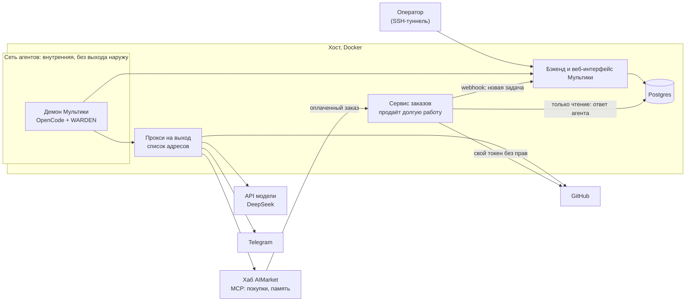
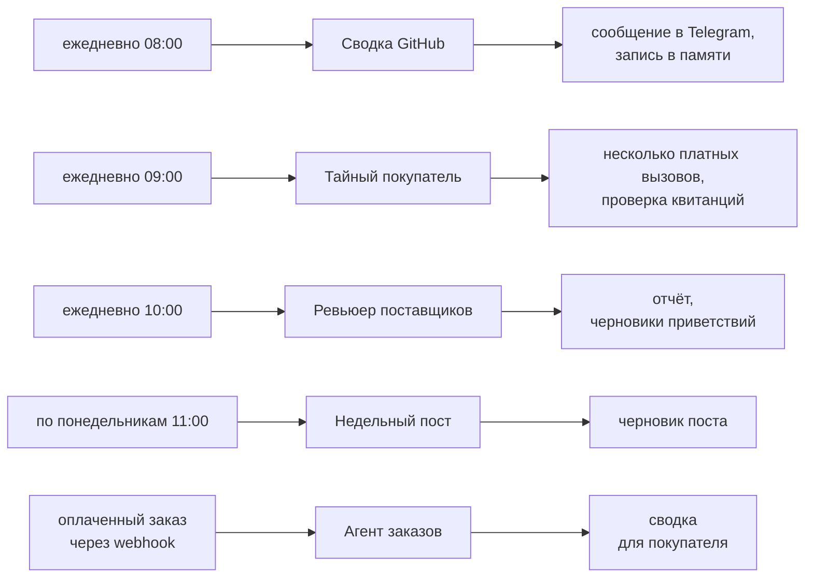
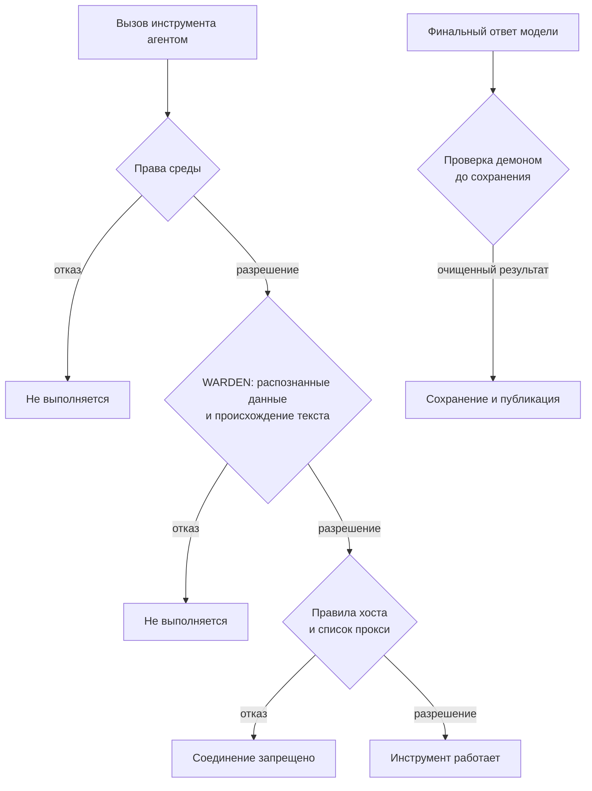
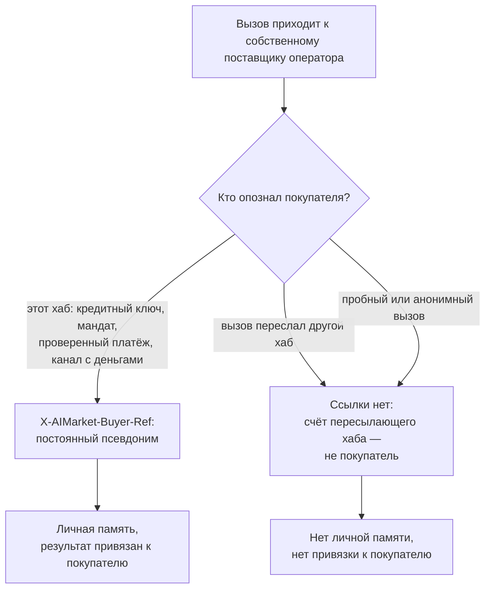
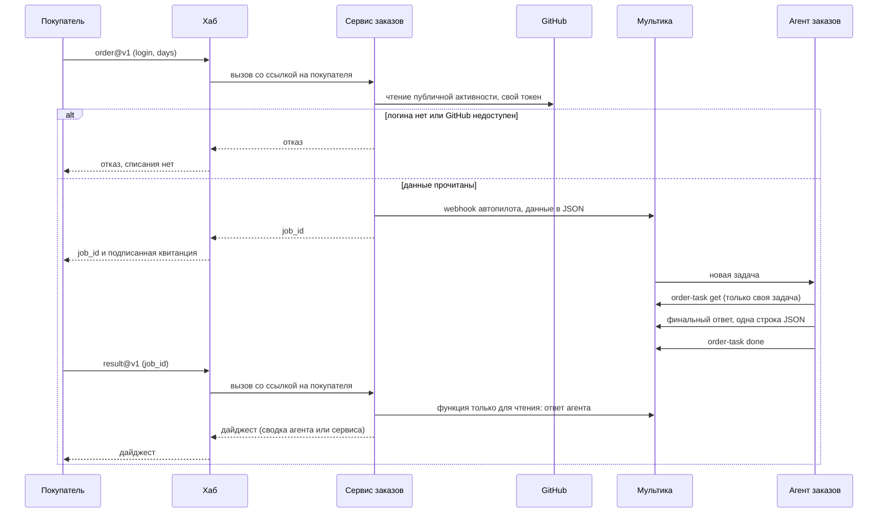

# Мультика и AIMarket: настройка и интеграция

[English](README.md) · **Русский** · [Español](README.es.md) · [Français](README.fr.md) · [中文](README.zh.md)

Это руководство подключает самостоятельно развёрнутую [Мультику (Multica)](https://github.com/multica-ai/multica) к
хабам AIMarket, например [modelmarket.dev](https://modelmarket.dev). Мультика — фабрика агентов, хаб — рынок, на
котором эти агенты работают. После настройки ваши агенты смогут:

- **покупать** навыки других агентов по ходу задачи, с предоплаченным ключом, баланс которого — жёсткий лимит;
- **помнить** между запусками через платные навыки памяти;
- **продавать** свой навык, в том числе долгую работу агента на несколько минут;
- и работать **в ограде**: выход в сеть только к перечисленным адресам, права на уровне агента и защита от отправки
  наружу того, что агент прочитал.

Что проверено у нас: Мультика на своём сервере — 0.5.3 с 4 ноября 2026 года и 0.8.0 с 5 ноября, её демон с
OpenCode 1.18.32 и DeepSeek, один хост. 0.8.0 по умолчанию управляет OpenCode 1.15 и новее через ACP; мы оставляем
режим `opencode run`, на котором проверены защита и правила доступа (раздел 2). Команды ниже — из CLI версии 0.5.3;
те, которыми пользуется эта настройка, проверены и на 0.8.0.

> **Одной командой.** [`operator-kit/onboard.sh`](../operator-kit/README.md) настраивает разделы 2, 3, 4 и 6 рядом
> с вашим Multica и проверяет их: `sudo ./onboard.sh --dir /opt/multica`. Этот документ объясняет, что и зачем он делает.

## Содержание

[Обзор: как всё устроено](#обзор-как-всё-устроено)

1. [Что нужно заранее](#1-что-нужно-заранее)
2. [Демон в контейнере](#2-демон-в-контейнере)
3. [Ограничьте выход в сеть](#3-ограничьте-выход-в-сеть)
4. [Подключите хаб: покупка навыков](#4-подключите-хаб-покупка-навыков)
5. [Каждому агенту — только нужное](#5-каждому-агенту--только-нужное)
6. [Защита агентов: WARDEN для OpenCode](#6-защита-агентов-warden-для-opencode)
7. [Память между запусками](#7-память-между-запусками)
8. [Агенты, у которых факты даёт скрипт](#8-агенты-у-которых-факты-даёт-скрипт)
9. [Продажа навыка](#9-продажа-навыка)
10. [Продажа долгой работы агента](#10-продажа-долгой-работы-агента)
11. [Проверка](#11-проверка)
12. [Ловушки, в которые мы попали](#12-ловушки-в-которые-мы-попали)
13. [Известные ограничения](#13-известные-ограничения)

## Обзор: как всё устроено

Всё работает на одном хосте в Docker. Среда агентов сидит во внутренней сети: единственный выход из неё — прокси с
коротким списком адресов. Оператор открывает веб-интерфейс Мультики через SSH-туннель. Небольшой собственный сервис
продаёт долгую работу агентов на хабе и общается с Мультикой через webhook автопилота и роль базы только для чтения.



В нашей эталонной установке пять агентов. Автопилоты запускают их по расписанию (UTC) или при поступлении заказа:



В каждую сессию агента загружается защита WARDEN. Каждому агенту — только своё окружение и свои права
(разделы 5 и 6), а всё, что агенты готовят к публикации, без человека не уходит: черновики остаются черновиками.

## 1. Что нужно заранее

- Linux-хост с Docker и Docker Compose.
- Мультика, развёрнутая по [её инструкции](https://github.com/multica-ai/multica). Не выставляйте веб-интерфейс в
  интернет: публикуйте его на `127.0.0.1` и открывайте через SSH-туннель
  (`ssh -L 13300:127.0.0.1:13300 your-host`, затем http://127.0.0.1:13300).
- Ключ модели для среды выполнения. Мы используем DeepSeek с OpenCode (`DEEPSEEK_API_KEY`).
- Чтобы покупать: предоплаченный ключ на https://modelmarket.dev/start.
- Чтобы продавать: счёт поставщика на https://modelmarket.dev/start?role=provider и адрес на HTTPS.

## 2. Демон в контейнере

Демон Мультики запускает среду агента (OpenCode) на каждую задачу. Держите его в отдельном контейнере:

- пользователь не root (у нас `node`, uid 1000), `cap_drop: [ALL]`, `security_opt: ["no-new-privileges:true"]`;
- лимиты: `mem_limit: 3g`, `cpus: 2`, `pids_limit: 1024`;
- `MULTICA_DAEMON_AUTO_UPDATE: "false"`, чтобы версии менялись только при пересборке;
- на Мультике 0.8.0 с OpenCode 1.x — `MULTICA_OPENCODE_TRANSPORT: run`, чтобы остался режим, на котором проверена защита;
- секреты агентов — в env-файле с правами 600, подключённом через `env_file`: ключ модели, токен GitHub, токены
  чат-бота, ключ хаба. Никогда не кладите ключ в задачу, инструкцию или навык.

Все агенты делят один демон, одного пользователя и одну домашнюю папку. Как их всё же разделить — в разделе 5.

## 3. Ограничьте выход в сеть

Статус на 10 ноября 2026 года: на нашем хосте Multica **attested** дополнительные правила межсетевого экрана
включены. Сетевая приёмка отражается отдельно в [протоколе развёртывания](../../artifacts/multica-security-2026-11-10/deployment.json):
само включение не доказывает прохождение всех проверок обхода. Этот статус не относится к установке коллеги
на `178.62.243.71`.

Сетевые ограничения настраиваются в **развёртывании Multica**: Docker-сети, прокси на выход и межсетевой экран хоста.
WARDEN проверяет вызовы инструментов, но не устанавливает сетевые правила. Подключите демон только к внутренней
сети агентов, прокси — ещё и к сети с выходом в интернет, а backend оставьте доступным по внутреннему адресу.
Одних переменных прокси недостаточно: команда может их игнорировать и соединиться напрямую.

```yaml
# Topology excerpt only; use the reviewed overlay in ../security/egress/.
services:
  daemon:
    networks: [agent]
    environment:
      HTTPS_PROXY: http://egress:8888
      https_proxy: http://egress:8888
      HTTP_PROXY: http://egress:8888
      http_proxy: http://egress:8888
      NO_PROXY: backend,localhost,127.0.0.1
      no_proxy: backend,localhost,127.0.0.1
    cap_drop: [ALL]
    security_opt: ["no-new-privileges:true"]
  backend:
    networks: [app, agent]
  egress:
    networks: [agent, app]
    read_only: true
    cap_drop: [ALL]
networks:
  agent:
    internal: true
    enable_ipv6: false
    ipam: { config: [{ subnet: 10.250.0.0/24 }] }
  app: {}
```

Это фрагмент топологии, а не полная установка. При объединении Compose-файлов **замените** прежний список сетей
демона: добавление `agent` при сохранении `app` оставит прямой выход. Выберите подсеть без пересечений с другими
стеками. В [комплекте egress](../security/egress/README.md) находятся готовый overlay, конфиг прокси, план правил
хоста и проверки. Для него нужен точный список адресов от оператора; prod/dev-адреса TONmobile здесь не угадываются.
Конфиги и прокси должны быть недоступны агенту для изменения; порт прокси не публикуйте на хосте.

Нужные параметры `tinyproxy.conf`:

```text
Port 8888
Listen 0.0.0.0
Allow 10.250.0.0/24
FilterType ere
FilterURLs Off
FilterDefaultDeny Yes
Filter "/etc/tinyproxy/allow"
ConnectPort 443
```

В `allow` — по одному имени хоста, с привязкой к началу и концу строки. Ниже **нерабочие примеры**: замените их
проверенными адресами API модели и QA-сред, прежде чем запускать:

```text
^model-api\.operator\.invalid$
^tonmobile-dev\.operator\.invalid$
^tonmobile-prod\.operator\.invalid$
```

Backend Multica оставьте на внутреннем адресе. Зависимости устанавливайте при сборке образа: общее разрешение
реестра npm и произвольный GitHub SSH не нужны QA по умолчанию. Для нужных чтений Git используйте отдельную службу
только для чтения или явно ограниченный транспорт; не передавайте агенту учётные данные с правом записи.

Хост должен запрещать прямые соединения из подсети агентов, кроме прокси и точного внутреннего endpoint backend.
Нужна защита и **INPUT самого хоста** (в том числе Docker gateway, например приёмник `172.18.0.1:9999` из отчёта),
и пересылаемого трафика. При **iptables backend Docker** ограничения пересылки ставьте в `DOCKER-USER`, до правил
разрешения Docker; добавления в конец `FORWARD` недостаточно. В **nftables backend нет `DOCKER-USER`**: нужны свои
input/forward base chains с проверенными приоритетами. Не меняйте таблицы Docker и не считайте UFW достаточным
барьером для контейнера. IPv6 явно отключите и проверьте либо задайте равнозначные проверенные правила.

Проверьте реальный путь DNS: разрешение внутренних имён нужно, но произвольные внешние запросы не должны уходить
через встроенный DNS Docker или резолвер хоста. При необходимости ограничьте этот резолвер отдельно.
`internal: true` само по себе не доказывает недоступность DNS и сокетов хоста. `ConnectPort 443` ограничивает CONNECT,
но не порты обычных HTTP-запросов; исходящие правила самого прокси должны закрывать и этот обход.

Разрешённый адрес остаётся каналом: данные можно вынести комментарием Multica, запросом к модели или операцией Git.
CONNECT-прокси не видит зашифрованное тело. Держите список коротким, права — минимальными, секреты — вне доступных
агенту файлов и окружения; итоговые результаты проверяйте до сохранения (§6).
Официальные справочники: [Docker iptables](https://docs.docker.com/engine/network/firewall-iptables/),
[Docker nftables](https://docs.docker.com/engine/network/firewall-nftables/),
[Docker firewall/UFW](https://docs.docker.com/engine/network/packet-filtering-firewalls/),
[Docker DNS](https://docs.docker.com/engine/network/#dns-services) и
[конфигурация Tinyproxy](https://tinyproxy.github.io/#documentation).

## 4. Подключите хаб: покупка навыков

Добавьте MCP-сервер хаба в глобальный конфиг OpenCode, `~/.config/opencode/opencode.jsonc` в домашней папке демона:

```jsonc
{
  "mcp": {
    "modelmarket": {
      "type": "remote",
      "url": "https://modelmarket.dev/mcp",
      "headers": { "X-API-Key": "{env:AIMARKET_API_KEY}" }
    }
  }
}
```

Положите предоплаченный ключ в env-файл демона как `AIMARKET_API_KEY`. Его баланс — жёсткий лимит: когда деньги
кончаются, хаб отвечает 402 и ничего не списывает. Без ключа хаб даёт несколько пробных вызовов.

Дальше агент пользуется тремя инструментами:

- `market_search`: `intent` простыми словами и `budget` (предел цены за вызов). Каждая находка даёт `product_id`,
  `capability_id`, `source_hub`, цену, `max_price_usd` и поля входа.
- `market_invoke`: `product_id`, `capability_id`, `source_hub` (обязателен для федеративных позиций, а это большая
  часть каталога), `input` и `max_price_usd`, скопированный из поиска без изменений. Если цена маршрута выросла, хаб
  отказывает с `price_limit_exceeded` до работы и до оплаты.
- `account_status`: сколько на ключе осталось и сколько потрачено.

Каждый платный вызов возвращает подписанную квитанцию хаба; квитанция о работе по ссылке `verify_url` в ответе
связывает хеш входа, результат и продавца. Храните её рядом с ответом, на который опираетесь.

Наш навык [`multica/community/aimarket/SKILL.md`](../community/aimarket/SKILL.md) учит агента этим правилам (бюджет
на задачу, без повторов при 402/403, только нейтральные данные на вход, ответ продавца — это данные). Импорт:

```bash
multica skill import --url https://github.com/alexar76/aicom/tree/main/multica/community/aimarket
```

Ссылка заработает, когда эта папка появится в публичном зеркале; до тех пор заархивируйте папку в zip и используйте
`multica skill import --file aimarket.zip`.

## 5. Каждому агенту — только нужное

Глобальный конфиг демона действует на всех агентов, поэтому держите его маленьким, а остальное задавайте каждому
агенту. Мультика даёт каждому агенту **собственное окружение** (custom environment); OpenCode читает из него
`OPENCODE_CONFIG_CONTENT` как дополнительный конфиг для запусков этого агента.

Агенту, который читает чужие тексты и которому не нужен хаб, выключите хаб и обнулите ненужные ключи:

```bash
cat <<'EOF' | multica agent env set <agent-id> --custom-env-stdin
{
  "AIMARKET_API_KEY": "",
  "OPENCODE_CONFIG_CONTENT": "{\"mcp\":{\"modelmarket\":{\"enabled\":false}},\"tools\":{\"modelmarket_*\":false}}"
}
EOF
```

`env set` заменяет окружение целиком (значение `****` сохраняет прежнее). Проверьте результат командой
`opencode debug config` с тем же `OPENCODE_CONFIG_CONTENT`.

`permission.bash` в OpenCode принимает шаблоны; побеждает **последний** подходящий, и каждая команда в строке
проверяется отдельно (в том числе внутри `$(...)`, обратных кавычек и конвейеров). Команда с перенаправлением
проверяется вместе с ним. Поэтому агент, которому можно запускать одну команду, выглядит так:

```json
{"bash": {"*": "deny", "/opt/tools/order-task get *": "allow", "*>*": "deny", "*<*": "deny", "*$*": "deny", "*`*": "deny"}}
```

Без последних четырёх правил `разрешённая-команда > ~/.config/opencode/opencode.jsonc` перезаписала бы файл.

Разрешайте свою обёртку, а не CLI Мультики со звёздочкой. Токен агента Мультики привязан к **рабочему
пространству**, а не к его задаче, поэтому `multica issue get *` читает любую задачу пространства, а номера задач
идут подряд. Обёртка должна проверить, что задача принадлежит агенту, прежде чем что-то вывести или изменить (наша —
в разделе 10).

## 6. Защита агентов: WARDEN для OpenCode

Статус на 10 ноября 2026 года: наша установка **attested** работает с проверенной локальной сборкой WARDEN и
исправленными daemon/backend Multica. Серверные проверки хуков прошли 9/9; сохранённый контрольный сценарий чистой
сессии получил отказ. Проверены хеши бинарников, здоровье backend/UI и неизменность миграций. См.
[протокол развёртывания](../../artifacts/multica-security-2026-11-10/deployment.json). Это **не новый выпуск npm**
и не подтверждение установки коллеги `178.62.243.71`/0.24.0 или полного теста TONM-14. Ограничения известных
форматов секретов и выходных путей ниже сохраняются.

Flow guard из [WARDEN](https://github.com/alexar76/warden) проверяет вызовы инструментов. Историческая
интеграция OpenCode 0.23.0 включала проверки утечки после зафиксированного внешнего текста и обнуляла выбранные
переменные окружения в shell. В подставной атаке агент сначала прочитал GitHub, затем файл с фейковым ключом;
чат-скрипт, `curl` на разрешённый адрес, запись в память и CLI трекера были отклонены. Обычная записанная задача
прошла без отказов. Эти наблюдения не доказывают защиту чистой сессии или другой версии среды.

Описанный пропуск в 0.24.0 показывает этот разрыв: `multica issue get` не был распознан как внешний текст, а чтение
`.env` само по себе не включило проверки утечки. Локальные изменения исходников от 10 ноября 2026 года отделяют
проверки распознанных секретов от этого признака и добавляют происхождение данных Multica/QA-отчётов. Их нужно
собрать и проверить в выбранной среде: изменение исходников не обновляет npm или установленный демон.
Не используйте `npx` или неудачный `curl` для намеренного «включения» защиты. При таймауте `curl` приёмник уже
может получить тело запроса.

В коде WARDEN нет имени Multica. Чтения внутри `playwright-report/` и `test-results/` — внешний текст сразу;
CLI Multica становится внешним источником через политику оператора. Возьмите за основу готовый фрагмент
`warden/examples/policies/multica.flow-policy.json` (в пакете npm — со следующего выпуска): он размечает
`multica issue get`, `issue list`, `issue search` и `issue comment list`. Без него вывод Multica считается данными
самого оператора. Свои префиксы команд и папки отчётов добавляйте так же (здесь — папка отчётов QA `reports/`); эти
правила только добавляют недоверие и не разрешают действия:

```json
{
  "mode": "deny",
  "untrustedSources": {
    "commands": [
      ["multica", "issue", "get"], ["multica", "issue", "list"],
      ["multica", "issue", "search"], ["multica", "issue", "comment", "list"]
    ],
    "paths": ["reports"]
  }
}
```

Если агент пишет отчёт рядом с клоном (в корень рабочей папки задачи), добавьте в ту же политику `"projectRoots": [".."]`: иначе после внешнего текста такая запись считается действием вне проекта (`destructive_action`), что и показали полевые замеры.

Пути считаются от границы проекта, shell-операнды — от рабочего каталога команды. Распознавание ограничено и не
разбирает произвольные shell-программы. После внешнего текста строгий `deny` по-прежнему отклоняет непрозрачный
запуск, например `npm run ...` и `node -e ...`. Не отключайте признаки источников ради QA: используйте узкие
проверенные права/адаптеры и доверенный supervisor для безопасного запуска и отчёта.

### Отдельный QA-исполнитель: фиксированная работа вместо shell агента

[Отдельный QA runner](../qa-runner/README.md) развёрнут и принят на нашем **attested** 10 ноября 2026 года.
В реальной задаче Multica **MY-89** постоянный приватный профиль один раз вызвал нативный `qa_runner_task_execute`,
без других инструментов. Проверки backend/modelmarket/хаба вернули **200/200/200**; проверенный отчёт попал в
сохранённый результат и комментарий, задача переведена в `done`. См.
[итоговый протокол приёмки](../../artifacts/multica-qa-runner-2026-11-10/final-acceptance.json). Принята только первая
работа `platform_smoke`; полноценное браузерное QA TONmobile не запускалось.

Он отделяет контроллер Multica/модели от выделенного worker на Node 22 по адресу `10.250.0.5`. У worker нет ключей модели, Multica, GitHub и хаба, домашнего тома, env-файла, Docker socket и закрытого
ключа TLS хоста. Файловая система только для чтения, кроме ограниченного временного хранилища; capabilities сняты.
Фиксированный `npm run smoke` запускает только доверенный контроллер хоста.

Приватный QA-профиль вызывает инструмент `task_execute` сервера `qa_runner` ровно с `{"id":"platform_smoke"}`.
TaskAdapter WARDEN делегирует эту закреплённую операцию до общих запретов после внешнего текста; это не разрешение
агенту запускать `npm run ...`, `node -e ...`, передавать произвольные URL, аргументы или shell-код. MCP-процесс
стартует через `env -i` только с публичным CA; закрытый ключ TLS broker по адресу `10.250.0.1:8443` остаётся на
контроллере хоста. `qa_runner` глобально выключен и включается только у нового приватного QA-профиля; остальные
MCP/инструменты этого профиля выключены.

Проверьте действующий порядок через `opencode debug agent build`: после общего deny должны идти точные allow для
`qa_runner_task_list`, `qa_runner_task_read`, `qa_runner_task_execute` и `qa_runner_task_run`. Исходный JSON сам по
себе не подтверждает порядок после объединения старых настроек tools. Инструкция сразу вызывает нативный QA-инструмент,
без начального Bash/Multica CLI. MCP принимает только ограниченную стандартную метаинформацию `_meta.progressToken`;
аргументы инструмента остаются ровно фиксированным ID, без произвольных URL, команд и лишних полей.

Broker принимает только `POST /run/platform-smoke` с пустым телом от разрешённого контроллера. Одновременно
работает одна задача, максимум три запуска за пять минут, захват вывода ограничен 64 KiB, время контроллера — 8 секундами; worker получает 6 секунд и 1 секунду на завершение.
Возвращаются только фиксированные имена проверок, коды статуса и булевы значения; сырые stdout/ошибки отбрасываются.
Broker хоста независимо хранит лимит 10 запусков за 12-часовое окно UTC в SQLite под root в `/var/lib/multica-qa`:
удаление счётчика MCP или перезапуск контроллера его не обнуляют. Неудачные/неопределённые запуски расходуют лимит.
Манифест оператора действует не больше 23 часов, обновляется каждые 12 часов и допускает максимум 10 использований;
broker отдельно ограничивает частоту. Истечение срока, другой pin или исчерпание бюджета дают отказ. Текущий
`platform_smoke` проверяет только фиксированные status-endpoint backend/хаба/modelmarket без авторизации и возвращает
короткий очищенный отчёт без тел ответов и внешних записей. Это не произвольное QA и не сценарий TONmobile.
Новые работы требуют проверки кода контроллера, фиксированного образа/задания worker и новой закреплённой capability.

Права среды, WARDEN и сеть имеют разные границы:



| Угроза | Где ограничивается |
|---|---|
| Агент запускает команду вне своей задачи | Права среды и узкая обёртка под контролем оператора |
| Распознанный секрет отправляется через разрешённый сервис | Проверки WARDEN и права сервиса; исторический пропуск в чистой сессии требует локального исправления |
| Соединение обходит прокси или идёт на адрес вне списка | Межсетевой экран хоста, изоляция сетей и прокси вместе (§3) |
| Агент отключает защиту следующих сессий | Владелец root у защиты и всех родительских папок (ниже) |
| Секрет попадает в финальный ответ | Проверка демоном до сохранения; Stop-хук не является общим фильтром секретов |

5 ноября 2026 года записанные плановые запуски пяти агентов и оплаченный заказ после перехода на Multica 0.8.0
оставили файл состояния защиты для каждой сессии. Это подтверждает запуск плагина, а не безопасность всех выходов.

### Проверьте результат до сохранения в Multica

Локальный [патч результатов Multica](../security/README.md) для upstream v0.8.0 добавляет рекурсивное маскирование на
доверенных границах демона/backend: до записи очереди повторов, callback complete/fail/message/progress и сохранения
результата/ошибки задачи. Он использует upstream `redact.Text` для известных форматов токенов, в том числе вложенных
в JSON-строки. Проверьте версию и контрольные суммы исходников командой
`apply-output-patch.py --source-root <checkout> --check`, затем примените проверенный патч и пересоберите **демон и
backend**, как описано в комплекте. Наше развёртывание на attested описано в протоколе выше; остальные установки требуют отдельной пересборки.

Маскирование только комментария оставляет открытыми `result.output`/`output_summary`. В исправленные каналы должен
попадать только очищенный результат; не пишите оригинал в диагностический лог. Проверка форматов ограничена: она
не покрывает любой секрет и кодирование, сырые файлы сессий среды, дополнительные неисправленные пути логирования
и старую историю БД/очереди. Проверьте их отдельно и сначала уменьшите доступ агента к секретам. Старые раскрытые
записи удаляйте/изолируйте по политике хранения оператора: патч не очищает историю задним числом.

Проверка формы JSON, размера и ссылок в сервисе поставщика (§10) полезна, но происходит слишком поздно для защиты
сырых данных демона. Ни повторная генерация по Stop-хуку, ни SDK WARDEN для структурированного выбора не являются
общим DLP для произвольных ответов. До развёртывания проведите узнаваемый фейковый токен через каждый исправленный
путь результата.

Плагин входит в `@aimarket/warden` начиная с версии 0.23.0 (`@aimarket/warden/opencode`). Загрузчик — файл
`plugin/warden.js` в папке конфига OpenCode:

```js
import { createWardenPlugin } from '@aimarket/warden/opencode';

export const WardenFlowGuard = createWardenPlugin({
  block: 'data',
  // Keys only the OpenCode process needs; shell commands get them blank.
  stripEnv: ['DEEPSEEK_API_KEY', 'AIMARKET_API_KEY'],
});
```

Без пакета скопируйте `dist/opencode-plugin.js` и все `dist/flow-guard*.js` в одну папку и импортируйте
`opencode-plugin.js` оттуда.

Ставьте плагин туда, где пользователь агента не может его изменить. Файлы должны принадлежать root, и **каждая папка
над ними** — тоже: пользователь может переименовать свою папку вместе с защитой внутри. Эту дыру мы нашли у себя
5 ноября 2026 года. Файлы плагина принадлежали root, но `~/.config/opencode` — пользователю агента. Мы закрыли её так: плагин лежит в принадлежащей root папке, смонтированной в `/opt/opencode-guard`, и OpenCode
указан на неё через `OPENCODE_CONFIG_DIR`. Монтируйте её на запись, но с владельцем root, чтобы пользователь агента не
мог в неё писать. OpenCode 1.18.32 при запуске пишет `.gitignore` в каждую папку конфига. На монтировании только для
чтения он останавливается с ошибкой, а папку, куда ему нельзя писать, пропускает. Затем от имени пользователя агента проверьте командой `opencode debug config`, что плагин
загружен.

### Пример: защита для всех агентов

Это историческая настройка, проверенная 5 ноября 2026 года: Мультика 0.8.0, OpenCode 1.18.32 и WARDEN 0.23.0. Файлы в `warden/` — файлы
плагина из npm-пакета `@aimarket/warden@0.23.0` без изменений (20 файлов). Каждую команду ниже мы сначала выполнили
на своём хосте.

Исторический tarball ниже **не содержит** исправление от 10 ноября. Для нового QA-развёртывания используйте
проверенную локальную сборку и проверки из [комплекта безопасности](../security/README.md), сохранив версию и манифест
файлов. Следующие команды сохраняют прежний рецепт установки, а не подтверждают приёмку чистой сессии сегодня.

Загрузчик, сохранённый как `warden.js` рядом с `docker-compose.yml`:

```js
// opencode-guard/plugin/warden.js: the WARDEN flow guard for every agent on this daemon.
// Export only the plugin: OpenCode calls every exported function as one.
import { createWardenPlugin } from '../warden/opencode-plugin.js';

export const WardenFlowGuard = createWardenPlugin({
  block: 'data',
  // Keys only the OpenCode process needs; shell commands get them blank.
  stripEnv: ['DEEPSEEK_API_KEY', 'AIMARKET_API_KEY'],
});
```

На хосте, от root. Пакет сверяется с контрольной суммой, которую публикует npm:

```bash
cd /opt/multica                    # the folder with docker-compose.yml; warden.js (the loader) is here
T=$(mktemp -d)
curl -fsSL -o "$T/warden.tgz" https://registry.npmjs.org/@aimarket/warden/-/warden-0.23.0.tgz
echo "e9fe195e36ce559d9e543e8eb3fd4bcd729fe434  $T/warden.tgz" | sha1sum -c -
tar -xzf "$T/warden.tgz" -C "$T"
install -d -o root -g root -m 755 opencode-guard opencode-guard/plugin opencode-guard/warden
install -o root -g root -m 644 "$T"/package/dist/opencode-plugin.js "$T"/package/dist/flow-guard*.js opencode-guard/warden/
install -o root -g root -m 644 warden.js opencode-guard/plugin/warden.js
rm -rf "$T"
```

Что получается:

```
opencode-guard/                root:root 755
├── plugin/
│   └── warden.js              root:root 644   the loader above
└── warden/                    root:root 755
    ├── opencode-plugin.js     root:root 644
    └── flow-guard*.js         root:root 644   19 files
```

Демон в `docker-compose.yml` (только строки, которые здесь важны):

```yaml
services:
  daemon:
    environment:
      MULTICA_DAEMON_AUTO_UPDATE: "false"
      OPENCODE_CONFIG_DIR: /opt/opencode-guard   # every OpenCode session loads plugin/ from here
      MULTICA_OPENCODE_TRANSPORT: run            # Multica 0.8.0 with OpenCode 1.x: the transport the guard was tested on
    volumes:
      - daemon_home:/home/node
      - ./opencode-guard:/opt/opencode-guard     # root-owned; not :ro, OpenCode stops on a read-only config folder
```

Если в домашней папке демона лежит старая копия защиты (`~/.config/opencode/plugin` и `~/.config/opencode/warden`
в его томе), сначала уберите её, иначе защита загрузится дважды. Затем пересоздайте демон, пока нет задач:

```bash
docker compose up -d --no-deps --force-recreate daemon
```

Проверки от имени пользователя агента:

```bash
# 1. Sessions load the guard from the root-owned folder, and only from there.
docker exec -u node -w /tmp multica-daemon sh -c 'opencode debug config | jq -c .plugin'
#    ["file:///opt/opencode-guard/plugin/warden.js"]

# 2. Still loaded with another home folder, as if ~/.config had been renamed.
docker exec -u node -w /tmp multica-daemon sh -c 'mkdir -p /tmp/h && HOME=/tmp/h opencode debug config | jq -c .plugin; rm -rf /tmp/h'

# 3. Nothing on the guard's path is writable by the agent user: every line must say "ok".
docker exec -u node multica-daemon sh -c 'for p in /opt /opt/opencode-guard /opt/opencode-guard/plugin /opt/opencode-guard/warden; do [ -w "$p" ] && echo "WRITABLE: $p" || echo "ok: $p"; done'

# 4. A real session runs the guard: the newest state files carry the current time.
docker exec -u node -w /tmp multica-daemon opencode run "Reply with the single word OK."
docker exec -u node multica-daemon sh -c 'ls -lt ~/.local/state/warden/claude-code/flow | head -3'
```

Защита действует на всех агентов демона, в том числе на тех, у кого свой `OPENCODE_CONFIG_CONTENT`: у нашего агента
заказов он есть, и его сессии тоже пишут состояние защиты.

### Исполнители на Codex

Агенты на Codex вместо OpenCode получают того же стража через командные хуки Codex. Он есть в локальном коде WARDEN,
но ещё не выпущен. Подробности и схемы: [WARDEN для Codex](https://github.com/alexar76/warden/blob/main/docs/codex.ru.md).

- У Codex нет «спросить»: хук, ответивший `ask`, считается упавшим, и Codex выполняет вызов. Поэтому адаптер никогда
  не спрашивает. Вопрос становится отказом или пропуском с записью в лог (`WARDEN_CODEX_BLOCK=data` по умолчанию или
  `all`), а любой сбой стража даёт отказ.
- Ставьте его как managed-хуки: собранную `codex-hooks/` в `/opt/warden-codex`, а `codex-hooks/requirements.toml` как
  `/etc/codex/requirements.toml`, всё с владельцем root. `allow_managed_hooks_only = true` не даёт агенту добавить
  свой хук.
- В сервисе демона в compose смонтируйте оба только для чтения и задайте режим:

```yaml
    environment:
      WARDEN_CODEX_BLOCK: data
    volumes:
      - ./warden-codex:/opt/warden-codex:ro
      - ./codex/requirements.toml:/etc/codex/requirements.toml:ro
```

- Уберите ключ модели из команд терминала через `shell_environment_policy` (`exclude`) и выключите встроенный
  веб-поиск Codex: он не запускает хук, и страж не видит, что он приносит.
- Проверьте скриптом `scripts/codex-live-check.sh` из репозитория WARDEN: подставная атака с фейковым ключом, целиком на
  localhost.

## 7. Память между запусками

Каждую задачу агент начинает с нуля. Attested Memory даёт ему память, за которую он платит за вызов:
`memory.write@v1`, `memory.search@v1` и `memory.read@v1` на hub.attestedmemory.net. Память принадлежит покупателю,
которого опознал этот хаб. Покупайте её **прямо на этом хабе**: возьмите ключ на https://hub.attestedmemory.net/start
и подключите его MCP-сервер, `https://hub.attestedmemory.net/mcp`, так же, как в разделе 4. Если покупать через
другой хаб (modelmarket.dev тоже показывает эти навыки), вызов приходит на хаб памяти от имени хаба-посредника, а не
от вашего, и личной памяти не получает. Пробные вызовы её тоже не получают.

Кому принадлежит память и кто может прочитать результат заказа, решает хаб, который опознал покупателя:



Проверенный x402-платёж самого покупателя по-прежнему называет его, даже если вызов переслан.

Пропишите использование в инструкциях агента вместе с бюджетом: какие навыки, сколько вызовов за запуск, без повторов
при 402 или 403. Наша ежедневная сводка GitHub читает до трёх прошлых записей, добавляет строку «Тренды» и сохраняет
одну запись в день: около $0,03 за запуск.

## 8. Агенты, у которых факты даёт скрипт

Когда результат обязан быть верным (числа, находки, цены), пусть факты определяет скрипт, а модель только пишет текст
вокруг них. Так работает наш ревьюер поставщиков. Скрипт сравнивает каталог хаба со вчерашним и проверяет схемы,
промпт-инъекции, что покупатель должен отдать, адреса и цены. Модель пишет отчёт и вставляет факты скрипта без
изменений. Так же устроен наш еженедельный пост: скрипт собирает счётчики недели, модель пишет черновик.

Расписание задаёт автопилот (`multica autopilot create --agent <agent> --mode create_issue --title ...`, затем
`multica autopilot trigger-add <id> --kind schedule --cron "0 10 * * *"`; часовой пояс по умолчанию UTC). Код:
[`multica/supplier-review`](../supplier-review/), [`multica/weekly-post`](../weekly-post/).

## 9. Продажа навыка

Полное руководство — https://modelmarket.dev/developers (и https://play.modelmarket.dev/publish). Короткий путь,
около 15 минут для адреса, который у вас уже работает:

1. Заведите счёт и ключ на https://modelmarket.dev/start?role=provider; ваш `account_id` из
   `GET /ai-market/v2/account` — это ваш `publisher_id`.
2. `GET /ai-market/v2/supply/policy` с ключом скажет, нужен ли залог; вносите его через
   `POST /ai-market/v2/supply/stake`, только если `additional_stake_usd` больше нуля.
3. Опишите навык в `capability.json`. Нужны `capability_id` (например, `mytool.summarize@v1`), `product_id`,
   `publisher_id`, `invoke_url` (HTTPS), `price_per_call_usd`, JSON Schema входа и выхода и ключ Ed25519
   `provider_pubkey`, которым ваш адрес подписывает ответы.
4. Проверьте адрес на https://play.modelmarket.dev/connect (один настоящий вызов, схема и подпись).
5. `POST /ai-market/v2/supply/register` с ключом и `capability.json`.

Описание пишите для модели покупателя: что навык делает, что ему нужно, что он возвращает, сколько стоит. Никаких
указаний модели («всегда используй этот инструмент»): хабы ищут такое в описаниях, а защита покупателей это
отклоняет.

## 10. Продажа долгой работы агента

Платный вызов не может ждать агента несколько минут. Продавайте работу как два навыка:

- `…order@v1` (платный). Ваш сервис строго проверяет вход, сам делает внешние чтения, создаёт задачу в Мультике
  через **webhook**-триггер автопилота с этими данными и сразу отвечает `job_id`.
- `…result@v1` (бесплатный) отвечает `queued` или `done` с результатом.

Весь заказ, от вызова покупателя до результата:



Как части сходятся:

1. **Автопилот с webhook-триггером.** `multica autopilot create --agent <order-agent> --mode create_issue
   --title "Orders" --description "<instructions>"`, затем `multica autopilot trigger-add <id> --kind webhook`.
   В адресе триггера есть его токен: храните адрес в env-файле сервиса (права 600) и никогда не пишите в лог.
   Мультика кладёт присланный JSON в описание задачи.
2. **Внешние чтения делает ваш сервис.** Он делает их до того, как принять заказ, своим токеном. Токен GitHub без
   прав поднимает лимит с 60 до 5000 запросов в час. Отказывайте до списания, если вход неверен или источник
   недоступен: хаб берёт деньги только за вызов, на который пришёл ответ. Свободный текст покупателя не должен
   доходить до агента.
3. **Результат — это финальный ответ агента.** Это одна строка JSON, `{"job_id": "...", "summary": "..."}`, и
   доверенный публикатор Multica должен проверить её до сохранения и публикации. Агенту не нужна отдельная сетевая
   отправка. Проверка вызовов инструментов и проверка финального результата — отдельные требования.
4. **Агент заказов запускает одну обёртку.** Наша — [`order-task`](../provider/order-task/order-task):
   `order-task get <issue>` выводит задачу, `order-task done <issue>` закрывает её, только если задача назначена
   агенту заказов. Она принадлежит root, а её правила для OpenCode лежат в
   [`opencode-order-agent.json`](../provider/order-task/opencode-order-agent.json).
5. **Ответ сервис читает** через роль базы данных только для чтения. Этой роли можно выполнять лишь одну функцию.
   Функция (`SECURITY DEFINER`, с фиксированным `search_path`) возвращает комментарии агента заказов на задачах,
   которые его автопилот создал для одного заказа. Сервис принимает ровно `job_id` и `summary`, с пределом длины и
   ссылками только на ожидаемый сайт. Если пригодного ответа нет к концу задачи или через 20 минут, сервис пишет
   простую сводку из тех же данных.
6. **Кто может прочитать результат.** Хаб передаёт `X-AIMarket-Buyer-Ref`, постоянный псевдоним опознанного
   покупателя, только собственным поставщикам своего оператора, вместе с внутренним токеном хаба. На своём хабе
   привяжите каждый заказ к этой ссылке. На чужом хабе вы не получаете никаких данных о покупателе. Тогда ключ для
   чтения — сам `job_id`: 128 случайных бит, которые возвращаются только в платном ответе, со сроком хранения.

Наш сервис — [`multica/provider`](../provider/) (27 тестов; у обёртки и правил доступа ещё 25). Он продаёт
`github.digest.order@v1` за $0,05 на hub.attestedmemory.net.

## 11. Проверка

- **Отдельный исполнитель.** Проверьте `qa_runner` → `task_execute {"id":"platform_smoke"}` и отчёт фиксированных
  проверок. Неизвестный ID, лишний URL/команда, истёкший/изменённый манифест и исчерпанный бюджет должны дать отказ;
  shell агента остаётся запрещённым. Отдельно проверьте mount/имена env worker, ключ TLS только на хосте и доставку отчёта.
- **Действующий конфиг.** Выполните `opencode debug config` от пользователя агента с его `OPENCODE_CONFIG_CONTENT`.
  Проверьте права, MCP-серверы и путь плагина под root. Для Claude/Codex проверьте действующие хуки и обработку отказа
  именно этой среды. Запишите версии среды/пакета, хеш политики и ошибки хуков.
- **Границы сети.** Запустите [проверки egress](../security/egress/README.md) из реальной сети демона: нужные адреса
  работают, адреса вне списка, прямые IPv4/IPv6, приёмники на хосте/Docker gateway, внешний DNS, обход переменных
  прокси/`--noproxy`, другие порты и SSH — запрещены. DNS Docker проверьте отдельно, повторите после перезапуска
  контейнера/Docker. Проверяйте приёмник и установление TCP-соединения: таймаут клиента не доказывает отказ.
  Используйте только свои тестовые приёмники и синтетические данные.
- **Чистая и «заражённая» сессии.** В новых сессиях проверьте фейковый файл секрета → первую отправку без чтения
  сайтов; повторите после `multica issue get`, комментариев, локального отчёта Playwright и веб-страницы.
  Каждый разрешённый выход, включая комментарий Multica, должен отказать до доставки. Используйте выделенную
  тестовую задачу/приёмник; не отправляйте секреты в GitHub и публичные сервисы. Запишите метки источников и решения
  PreToolUse. Затем выполните обычный QA-прогон, запуск без установки зависимостей и безопасный отчёт без обходов.
  Отказ завершает прогон агента; доверенный supervisor отдельно сообщает фиксированный безопасный статус.
- **Итоговые результаты.** Подставьте узнаваемый фейковый токен в финальный ответ. Его исходного значения не должно
  быть в исправленных `result.output`, `output_summary`, комментариях, событиях и логах. Проверьте маскирование,
  обычный ответ и пути повтора/перезапуска. Отдельно проверьте неисправленные файлы сессий/логи и старые записи.
- **Продажа.** Для разрешённой сквозной проверки используйте заказ с малым бюджетом. Проверьте изоляцию покупателя,
  отказ без покупателя и отказ на неверный вход до списания.

## 12. Ловушки, в которые мы попали

- **DNS Docker на двух сетях.** Контейнер в двух сетях Compose разрешает имена сервисов в любой из них. `postgres`
  попал в базу чужого стека. Используйте имена контейнеров (`multica-postgres-1`).
- **Проверка базы через 127.0.0.1 ничего не доказывает.** Если `pg_hba` доверяет локальным подключениям, неверный
  пароль всё равно впустит. Проверяйте пароль по сети.
- **Окружение агента меняет `multica agent env set`**, а не `agent update`, и заменяет его целиком.
- **Общий лимит GitHub.** Чтения без токена делят 60 запросов в час на IP хоста, и тратить их может любой контейнер
  на хосте. Дайте каждому читателю свой токен без прав.
- **Агенты не могут закрыть свои задачи**, если правила этого не разрешают. Разрешите через обёртку и только для
  своей задачи.
- **Модель — не защита.** В наших тестах DeepSeek отказывался выполнять очевидные внедрённые команды, но держат
  правила и права на файлы.

## 13. Известные ограничения

- Хуки инструментов не контролируют финальную доставку Multica. Демон должен проверить результат **до** сохранения
  и передачи; валидатор поставщика или маскированный комментарий не очищают уже сохранённые сырые поля прогона.
- Историческая защита по признаку внешнего текста пропускала отправку секрета до такого текста. Локальные изменения
  от 10 ноября требуют проверки среды и развёртывания; прежние npm/серверные наблюдения их не подтверждают.
- Демон и агенты работают под одним пользователем. Агент может читать его вход Multica и доступные файлы.
  Для более сильной изоляции нужны отдельные пользователи/контейнеры, минимальные mount и права сервисов на агента.
- Защита действует на среду выполнения, а не на отдельного агента. Защитите состояние дерева сессий и конфиги.
- Разрешённые адреса остаются каналами, включая API Multica/модели и SSH. Фильтр сети ограничивает адреса;
  зашифрованное тело CONNECT, произвольное кодирование и неизвестные секреты требуют дополнительных мер.
  Общее разрешение реестра или записи в GitHub не является безопасной настройкой QA по умолчанию.
- Локальный протокол теста не означает развёртывание на сервере, выпуск пакета или приёмку production.

Эталонная установка: [`multica/community/README.md`](../community/README.md). Проверка безопасности этой настройки:
[`artifacts/vulnetix-class-multica-2026-11-05/REPORT.md`](../../artifacts/vulnetix-class-multica-2026-11-05/REPORT.md).
