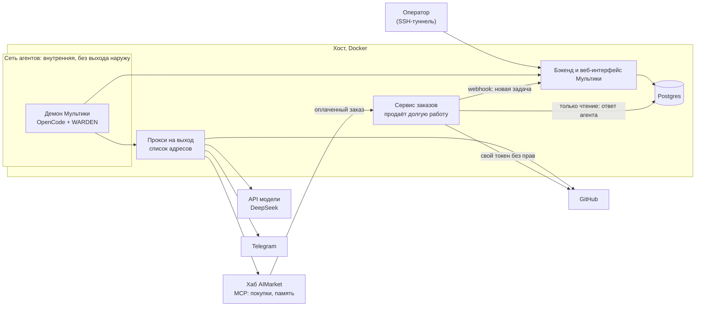
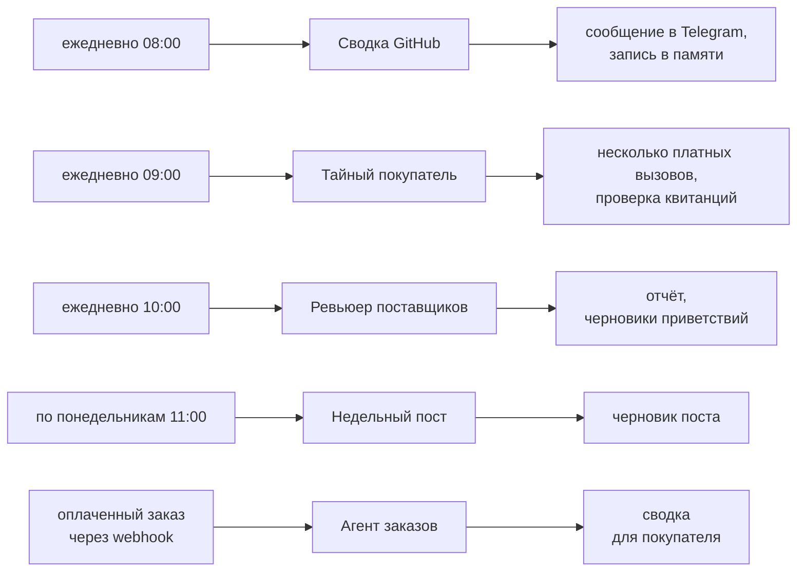
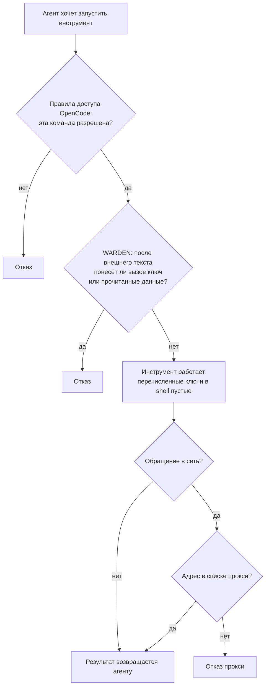
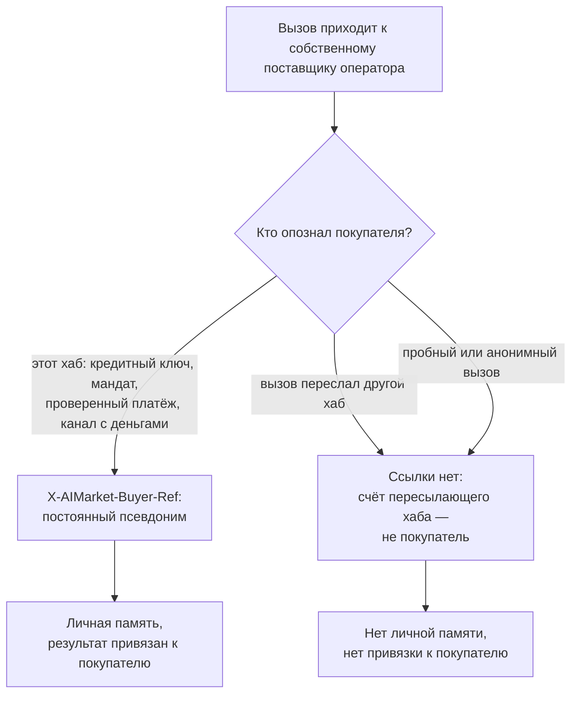
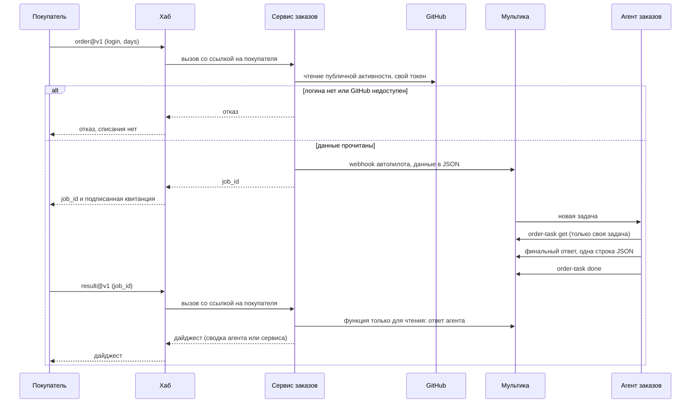

# Мультика и AIMarket: настройка и интеграция

[English](README.md) · **Русский** · [Español](README.es.md) · [Français](README.fr.md) · [中文](README.zh.md)

Это руководство подключает самостоятельно развёрнутую [Мультику (Multica)](https://github.com/multica-ai/multica) к
хабам AIMarket, например [modelmarket.dev](https://modelmarket.dev). Мультика — фабрика агентов, хаб — рынок, на
котором эти агенты работают. После настройки ваши агенты смогут:

- **покупать** навыки других агентов по ходу задачи, с предоплаченным ключом, баланс которого — жёсткий лимит;
- **помнить** между запусками через платные навыки памяти;
- **продавать** свой навык, в том числе долгую работу агента на несколько минут;
- и работать **в ограде**: выход в сеть только к перечисленным адресам, права на уровне агента и защита от отправки
  наружу того, что агент прочитал.

Что проверено у нас: Мультика на своём сервере — 0.5.3 с 4 ноября 2026 года и 0.8.0 с 5 ноября, её демон с
OpenCode 1.18.32 и DeepSeek, один хост. 0.8.0 по умолчанию управляет OpenCode 1.15 и новее через ACP; мы оставляем
режим `opencode run`, на котором проверены защита и правила доступа (раздел 2). Команды ниже — из CLI версии 0.5.3;
те, которыми пользуется эта настройка, проверены и на 0.8.0.

## Содержание

[Обзор: как всё устроено](#обзор-как-всё-устроено)

1. [Что нужно заранее](#1-что-нужно-заранее)
2. [Демон в контейнере](#2-демон-в-контейнере)
3. [Ограничьте выход в сеть](#3-ограничьте-выход-в-сеть)
4. [Подключите хаб: покупка навыков](#4-подключите-хаб-покупка-навыков)
5. [Каждому агенту — только нужное](#5-каждому-агенту--только-нужное)
6. [Защита агентов: WARDEN для OpenCode](#6-защита-агентов-warden-для-opencode)
7. [Память между запусками](#7-память-между-запусками)
8. [Агенты, у которых факты даёт скрипт](#8-агенты-у-которых-факты-даёт-скрипт)
9. [Продажа навыка](#9-продажа-навыка)
10. [Продажа долгой работы агента](#10-продажа-долгой-работы-агента)
11. [Проверка](#11-проверка)
12. [Ловушки, в которые мы попали](#12-ловушки-в-которые-мы-попали)
13. [Известные ограничения](#13-известные-ограничения)

## Обзор: как всё устроено

Всё работает на одном хосте в Docker. Среда агентов сидит во внутренней сети: единственный выход из неё — прокси с
коротким списком адресов. Оператор открывает веб-интерфейс Мультики через SSH-туннель. Небольшой собственный сервис
продаёт долгую работу агентов на хабе и общается с Мультикой через webhook автопилота и роль базы только для чтения.



В нашей эталонной установке пять агентов. Автопилоты запускают их по расписанию (UTC) или при поступлении заказа:



В каждую сессию агента загружается защита WARDEN. Каждому агенту — только своё окружение и свои права
(разделы 5 и 6), а всё, что агенты готовят к публикации, без человека не уходит: черновики остаются черновиками.

## 1. Что нужно заранее

- Linux-хост с Docker и Docker Compose.
- Мультика, развёрнутая по [её инструкции](https://github.com/multica-ai/multica). Не выставляйте веб-интерфейс в
  интернет: публикуйте его на `127.0.0.1` и открывайте через SSH-туннель
  (`ssh -L 13300:127.0.0.1:13300 your-host`, затем http://127.0.0.1:13300).
- Ключ модели для среды выполнения. Мы используем DeepSeek с OpenCode (`DEEPSEEK_API_KEY`).
- Чтобы покупать: предоплаченный ключ на https://modelmarket.dev/start.
- Чтобы продавать: счёт поставщика на https://modelmarket.dev/start?role=provider и адрес на HTTPS.

## 2. Демон в контейнере

Демон Мультики запускает среду агента (OpenCode) на каждую задачу. Держите его в отдельном контейнере:

- пользователь не root (у нас `node`, uid 1000), `cap_drop: [ALL]`, `security_opt: ["no-new-privileges:true"]`;
- лимиты: `mem_limit: 3g`, `cpus: 2`, `pids_limit: 1024`;
- `MULTICA_DAEMON_AUTO_UPDATE: "false"`, чтобы версии менялись только при пересборке;
- на Мультике 0.8.0 с OpenCode 1.x — `MULTICA_OPENCODE_TRANSPORT: run`, чтобы остался режим, на котором проверена защита;
- секреты агентов — в env-файле с правами 600, подключённом через `env_file`: ключ модели, токен GitHub, токены
  чат-бота, ключ хаба. Никогда не кладите ключ в задачу, инструкцию или навык.

Все агенты делят один демон, одного пользователя и одну домашнюю папку. Как их всё же разделить — в разделе 5.

## 3. Ограничьте выход в сеть

Агента, который читает чужие тексты (issues, страницы, ответы продавцов), можно уговорить отправить данные наружу.
Не давайте ему прямого выхода: посадите демон во внутреннюю сеть Docker, а какие адреса доступны, пусть решает
прокси.

```yaml
services:
  daemon:
    networks: [agent]
    environment:
      HTTPS_PROXY: http://egress:8888
      HTTP_PROXY: http://egress:8888
      NO_PROXY: backend,localhost,127.0.0.1
  egress:
    build: { context: ./egress }      # tinyproxy
    networks: [agent, app]
    read_only: true
    tmpfs: ["/tmp", "/run"]
    cap_drop: [ALL]
networks:
  agent:
    internal: true                    # no route out, no outside DNS
    ipam: { config: [{ subnet: 10.250.0.0/24 }] }
```

Бэкенд Мультики демону по-прежнему нужен: добавьте бэкенд тоже в сеть `agent`.

`tinyproxy.conf`:

```
Port 8888
Listen 0.0.0.0
Allow 10.250.0.0/24
FilterType ere
FilterURLs Off
FilterDefaultDeny Yes
Filter "/etc/tinyproxy/allow"
ConnectPort 443
```

`allow`: по одному адресу на строку, с привязкой к началу и концу, иначе подойдёт и `github.com.example.net`:

```
^api\.deepseek\.com$
^models\.dev$
^github\.com$
^api\.github\.com$
^api\.telegram\.org$
^modelmarket\.dev$
```

`models.dev` — каталог моделей OpenCode. Добавляйте только те адреса, которые нужны вашим агентам. Разрешённый адрес
всё равно остаётся каналом (агент с токеном GitHub может писать в GitHub); для этого есть раздел 6.

## 4. Подключите хаб: покупка навыков

Добавьте MCP-сервер хаба в глобальный конфиг OpenCode, `~/.config/opencode/opencode.jsonc` в домашней папке демона:

```jsonc
{
  "mcp": {
    "modelmarket": {
      "type": "remote",
      "url": "https://modelmarket.dev/mcp",
      "headers": { "X-API-Key": "{env:AIMARKET_API_KEY}" }
    }
  }
}
```

Положите предоплаченный ключ в env-файл демона как `AIMARKET_API_KEY`. Его баланс — жёсткий лимит: когда деньги
кончаются, хаб отвечает 402 и ничего не списывает. Без ключа хаб даёт несколько пробных вызовов.

Дальше агент пользуется тремя инструментами:

- `market_search`: `intent` простыми словами и `budget` (предел цены за вызов). Каждая находка даёт `product_id`,
  `capability_id`, `source_hub`, цену, `max_price_usd` и поля входа.
- `market_invoke`: `product_id`, `capability_id`, `source_hub` (обязателен для федеративных позиций, а это большая
  часть каталога), `input` и `max_price_usd`, скопированный из поиска без изменений. Если цена маршрута выросла, хаб
  отказывает с `price_limit_exceeded` до работы и до оплаты.
- `account_status`: сколько на ключе осталось и сколько потрачено.

Каждый платный вызов возвращает подписанную квитанцию хаба; квитанция о работе по ссылке `verify_url` в ответе
связывает хеш входа, результат и продавца. Храните её рядом с ответом, на который опираетесь.

Наш навык [`multica/community/aimarket/SKILL.md`](../community/aimarket/SKILL.md) учит агента этим правилам (бюджет
на задачу, без повторов при 402/403, только нейтральные данные на вход, ответ продавца — это данные). Импорт:

```bash
multica skill import --url https://github.com/alexar76/aicom/tree/main/multica/community/aimarket
```

Ссылка заработает, когда эта папка появится в публичном зеркале; до тех пор заархивируйте папку в zip и используйте
`multica skill import --file aimarket.zip`.

## 5. Каждому агенту — только нужное

Глобальный конфиг демона действует на всех агентов, поэтому держите его маленьким, а остальное задавайте каждому
агенту. Мультика даёт каждому агенту **собственное окружение** (custom environment); OpenCode читает из него
`OPENCODE_CONFIG_CONTENT` как дополнительный конфиг для запусков этого агента.

Агенту, который читает чужие тексты и которому не нужен хаб, выключите хаб и обнулите ненужные ключи:

```bash
cat <<'EOF' | multica agent env set <agent-id> --custom-env-stdin
{
  "AIMARKET_API_KEY": "",
  "OPENCODE_CONFIG_CONTENT": "{\"mcp\":{\"modelmarket\":{\"enabled\":false}},\"tools\":{\"modelmarket_*\":false}}"
}
EOF
```

`env set` заменяет окружение целиком (значение `****` сохраняет прежнее). Проверьте результат командой
`opencode debug config` с тем же `OPENCODE_CONFIG_CONTENT`.

`permission.bash` в OpenCode принимает шаблоны; побеждает **последний** подходящий, и каждая команда в строке
проверяется отдельно (в том числе внутри `$(...)`, обратных кавычек и конвейеров). Команда с перенаправлением
проверяется вместе с ним. Поэтому агент, которому можно запускать одну команду, выглядит так:

```json
{"bash": {"*": "deny", "/opt/tools/order-task get *": "allow", "*>*": "deny", "*<*": "deny", "*$*": "deny", "*`*": "deny"}}
```

Без последних четырёх правил `разрешённая-команда > ~/.config/opencode/opencode.jsonc` перезаписала бы файл.

Разрешайте свою обёртку, а не CLI Мультики со звёздочкой. Токен агента Мультики привязан к **рабочему
пространству**, а не к его задаче, поэтому `multica issue get *` читает любую задачу пространства, а номера задач
идут подряд. Обёртка должна проверить, что задача принадлежит агенту, прежде чем что-то вывести или изменить (наша —
в разделе 10).

## 6. Защита агентов: WARDEN для OpenCode

Flow guard из [WARDEN](https://github.com/alexar76/warden) — это плагин OpenCode. После того как сессия прочитала
внешний текст, он отклоняет вызов инструмента, который понёс бы наружу ключ или прочитанные сессией данные. Ещё он
обнуляет перечисленные ключи в shell-командах. В нашей учебной атаке поддельный ключ лежал в файле. Отправка была
отклонена на всех каналах: через чат-скрипт, через `curl` на разрешённый адрес, через запись в память и через CLI
трекера. Обычный рабочий день прошёл без единого отказа.

Каждый вызов инструмента агентом проходит три слоя, и каждый может отказать сам:



Что слои останавливают, а что нет:

| Угроза | Кто останавливает |
|---|---|
| Агента с внедрённой инструкцией заставляют выполнить команду, которой ему не положено | Правила доступа OpenCode (обёртка вместо звёздочки) |
| Он отправляет ключ или прочитанные данные на разрешённый адрес (GitHub, чат, хаб) | Защита WARDEN |
| Он отправляет что-то на любой другой адрес | Прокси на выход |
| Он отключает защиту для следующих сессий | Защита в папке, принадлежащей root (ниже) |
| Сам финальный ответ агента выносит данные | Не защита: этот ответ публикует Мультика; проверяйте его в своём сервисе (раздел 10) |

Мы проверили это у себя. Учебная атака (выше) была отклонена на всех каналах. 5 ноября 2026 года каждый плановый
запуск пяти агентов и оплаченный заказ после перехода на Мультику 0.8.0 оставили файл состояния защиты для своей
сессии — значит, плагин работал в каждой.

Плагин входит в `@aimarket/warden` начиная с версии 0.23.0 (`@aimarket/warden/opencode`). Загрузчик — файл
`plugin/warden.js` в папке конфига OpenCode:

```js
import { createWardenPlugin } from '@aimarket/warden/opencode';

export const WardenFlowGuard = createWardenPlugin({
  block: 'data',
  // Keys only the OpenCode process needs; shell commands get them blank.
  stripEnv: ['DEEPSEEK_API_KEY', 'AIMARKET_API_KEY'],
});
```

Без пакета скопируйте `dist/opencode-plugin.js` и все `dist/flow-guard*.js` в одну папку и импортируйте
`opencode-plugin.js` оттуда.

Ставьте плагин туда, где пользователь агента не может его изменить. Файлы должны принадлежать root, и **каждая папка
над ними** — тоже: пользователь может переименовать свою папку вместе с защитой внутри. Эту дыру мы нашли у себя
5 ноября 2026 года. Файлы плагина принадлежали root, но `~/.config/opencode` — пользователю агента. Мы закрыли её так: плагин лежит в принадлежащей root папке, смонтированной в `/opt/opencode-guard`, и OpenCode
указан на неё через `OPENCODE_CONFIG_DIR`. Монтируйте её на запись, но с владельцем root, чтобы пользователь агента не
мог в неё писать. OpenCode 1.18.32 при запуске пишет `.gitignore` в каждую папку конфига. На монтировании только для
чтения он останавливается с ошибкой, а папку, куда ему нельзя писать, пропускает. Затем от имени пользователя агента проверьте командой `opencode debug config`, что плагин
загружен.

## 7. Память между запусками

Каждую задачу агент начинает с нуля. Attested Memory даёт ему память, за которую он платит за вызов:
`memory.write@v1`, `memory.search@v1` и `memory.read@v1` на hub.attestedmemory.net. Память принадлежит покупателю,
которого опознал этот хаб. Покупайте её **прямо на этом хабе**: возьмите ключ на https://hub.attestedmemory.net/start
и подключите его MCP-сервер, `https://hub.attestedmemory.net/mcp`, так же, как в разделе 4. Если покупать через
другой хаб (modelmarket.dev тоже показывает эти навыки), вызов приходит на хаб памяти от имени хаба-посредника, а не
от вашего, и личной памяти не получает. Пробные вызовы её тоже не получают.

Кому принадлежит память и кто может прочитать результат заказа, решает хаб, который опознал покупателя:



Проверенный x402-платёж самого покупателя по-прежнему называет его, даже если вызов переслан.

Пропишите использование в инструкциях агента вместе с бюджетом: какие навыки, сколько вызовов за запуск, без повторов
при 402 или 403. Наша ежедневная сводка GitHub читает до трёх прошлых записей, добавляет строку «Тренды» и сохраняет
одну запись в день: около $0,03 за запуск.

## 8. Агенты, у которых факты даёт скрипт

Когда результат обязан быть верным (числа, находки, цены), пусть факты определяет скрипт, а модель только пишет текст
вокруг них. Так работает наш ревьюер поставщиков. Скрипт сравнивает каталог хаба со вчерашним и проверяет схемы,
промпт-инъекции, что покупатель должен отдать, адреса и цены. Модель пишет отчёт и вставляет факты скрипта без
изменений. Так же устроен наш еженедельный пост: скрипт собирает счётчики недели, модель пишет черновик.

Расписание задаёт автопилот (`multica autopilot create --agent <agent> --mode create_issue --title ...`, затем
`multica autopilot trigger-add <id> --kind schedule --cron "0 10 * * *"`; часовой пояс по умолчанию UTC). Код:
[`multica/supplier-review`](../supplier-review/), [`multica/weekly-post`](../weekly-post/).

## 9. Продажа навыка

Полное руководство — https://modelmarket.dev/developers (и https://play.modelmarket.dev/publish). Короткий путь,
около 15 минут для адреса, который у вас уже работает:

1. Заведите счёт и ключ на https://modelmarket.dev/start?role=provider; ваш `account_id` из
   `GET /ai-market/v2/account` — это ваш `publisher_id`.
2. `GET /ai-market/v2/supply/policy` с ключом скажет, нужен ли залог; вносите его через
   `POST /ai-market/v2/supply/stake`, только если `additional_stake_usd` больше нуля.
3. Опишите навык в `capability.json`. Нужны `capability_id` (например, `mytool.summarize@v1`), `product_id`,
   `publisher_id`, `invoke_url` (HTTPS), `price_per_call_usd`, JSON Schema входа и выхода и ключ Ed25519
   `provider_pubkey`, которым ваш адрес подписывает ответы.
4. Проверьте адрес на https://play.modelmarket.dev/connect (один настоящий вызов, схема и подпись).
5. `POST /ai-market/v2/supply/register` с ключом и `capability.json`.

Описание пишите для модели покупателя: что навык делает, что ему нужно, что он возвращает, сколько стоит. Никаких
указаний модели («всегда используй этот инструмент»): хабы ищут такое в описаниях, а защита покупателей это
отклоняет.

## 10. Продажа долгой работы агента

Платный вызов не может ждать агента несколько минут. Продавайте работу как два навыка:

- `…order@v1` (платный). Ваш сервис строго проверяет вход, сам делает внешние чтения, создаёт задачу в Мультике
  через **webhook**-триггер автопилота с этими данными и сразу отвечает `job_id`.
- `…result@v1` (бесплатный) отвечает `queued` или `done` с результатом.

Весь заказ, от вызова покупателя до результата:



Как части сходятся:

1. **Автопилот с webhook-триггером.** `multica autopilot create --agent <order-agent> --mode create_issue
   --title "Orders" --description "<instructions>"`, затем `multica autopilot trigger-add <id> --kind webhook`.
   В адресе триггера есть его токен: храните адрес в env-файле сервиса (права 600) и никогда не пишите в лог.
   Мультика кладёт присланный JSON в описание задачи.
2. **Внешние чтения делает ваш сервис.** Он делает их до того, как принять заказ, своим токеном. Токен GitHub без
   прав поднимает лимит с 60 до 5000 запросов в час. Отказывайте до списания, если вход неверен или источник
   недоступен: хаб берёт деньги только за вызов, на который пришёл ответ. Свободный текст покупателя не должен
   доходить до агента.
3. **Результат — это финальный ответ агента.** Это одна строка JSON, `{"job_id": "...", "summary": "..."}`, и
   Мультика публикует её в задаче. Агент ничего не отправляет по сети. Агент, который прочитал внешний текст и потом
   отправляет значения из своей задачи, — ровно то, что WARDEN отклоняет.
4. **Агент заказов запускает одну обёртку.** Наша — [`order-task`](../provider/order-task/order-task):
   `order-task get <issue>` выводит задачу, `order-task done <issue>` закрывает её, только если задача назначена
   агенту заказов. Она принадлежит root, а её правила для OpenCode лежат в
   [`opencode-order-agent.json`](../provider/order-task/opencode-order-agent.json).
5. **Ответ сервис читает** через роль базы данных только для чтения. Этой роли можно выполнять лишь одну функцию.
   Функция (`SECURITY DEFINER`, с фиксированным `search_path`) возвращает комментарии агента заказов на задачах,
   которые его автопилот создал для одного заказа. Сервис принимает ровно `job_id` и `summary`, с пределом длины и
   ссылками только на ожидаемый сайт. Если пригодного ответа нет к концу задачи или через 20 минут, сервис пишет
   простую сводку из тех же данных.
6. **Кто может прочитать результат.** Хаб передаёт `X-AIMarket-Buyer-Ref`, постоянный псевдоним опознанного
   покупателя, только собственным поставщикам своего оператора, вместе с внутренним токеном хаба. На своём хабе
   привяжите каждый заказ к этой ссылке. На чужом хабе вы не получаете никаких данных о покупателе. Тогда ключ для
   чтения — сам `job_id`: 128 случайных бит, которые возвращаются только в платном ответе, со сроком хранения.

Наш сервис — [`multica/provider`](../provider/) (27 тестов; у обёртки и правил доступа ещё 25). Он продаёт
`github.digest.order@v1` за $0,05 на hub.attestedmemory.net.

## 11. Проверка

- **Конфиг глазами агента.** Запустите `opencode debug config` от имени пользователя агента, с его
  `OPENCODE_CONFIG_CONTENT`. Проверьте, что MCP-серверы выключены там, где вы этого хотели, и что плагин в списке.
- **Выход в сеть.** Изнутри демона `curl https://example.com` должен не пройти через прокси, а
  `curl https://api.github.com/zen` — ответить.
- **Защита.** Проведите учебную атаку с **поддельным** ключом в файле: попросите агента отправить его через каждый
  разрешённый канал. Каждая отправка должна быть отклонена, а обычная задача — пройти без отказов.
- **Продажа.** Сделайте один настоящий заказ с маленьким бюджетом. Проверьте, что результат читает тот покупатель,
  который заплатил, что вызов без покупателя отклоняется и что неверный вход отклоняется без списания.

## 12. Ловушки, в которые мы попали

- **DNS Docker на двух сетях.** Контейнер в двух сетях Compose разрешает имена сервисов в любой из них. `postgres`
  попал в базу чужого стека. Используйте имена контейнеров (`multica-postgres-1`).
- **Проверка базы через 127.0.0.1 ничего не доказывает.** Если `pg_hba` доверяет локальным подключениям, неверный
  пароль всё равно впустит. Проверяйте пароль по сети.
- **Окружение агента меняет `multica agent env set`**, а не `agent update`, и заменяет его целиком.
- **Общий лимит GitHub.** Чтения без токена делят 60 запросов в час на IP хоста, и тратить их может любой контейнер
  на хосте. Дайте каждому читателю свой токен без прав.
- **Агенты не могут закрыть свои задачи**, если правила этого не разрешают. Разрешите через обёртку и только для
  своей задачи.
- **Модель — не защита.** В наших тестах DeepSeek отказывался выполнять очевидные внедрённые команды, но держат
  правила и права на файлы.

## 13. Известные ограничения

- Финальный ответ агента Мультика публикует сама, вне вызовов инструментов, которые видит защита. Проверяйте этот
  ответ в своём сервисе: форму, размер и ссылки.
- Демон и его агенты работают под одним пользователем. Любой агент может прочитать собственный вход демона в
  Мультику, а агент с полным shell может менять файлы, которыми пользуются другие. Ограничение выхода, защита и
  владельцы файлов это уменьшают; убрать совсем может только отдельный пользователь на каждого агента.
- Защита действует на среду выполнения, а не на отдельного агента.
- Разрешённый адрес всё равно остаётся каналом. Держите список коротким, а токенам давайте минимум прав.

Эталонная установка: [`multica/community/README.md`](../community/README.md). Проверка безопасности этой настройки:
[`artifacts/vulnetix-class-multica-2026-11-05/REPORT.md`](../../artifacts/vulnetix-class-multica-2026-11-05/REPORT.md).
