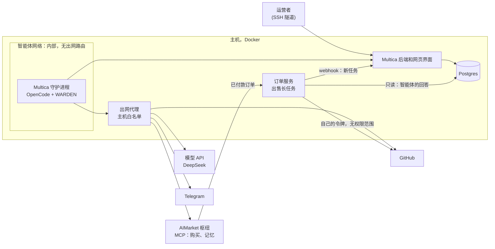
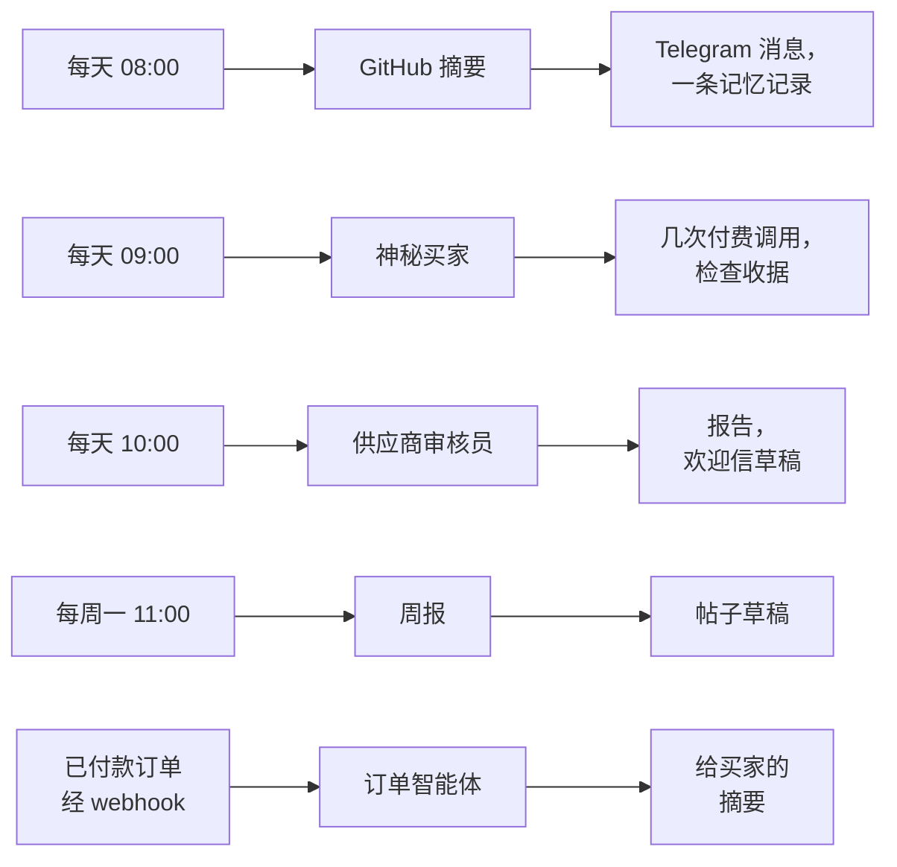
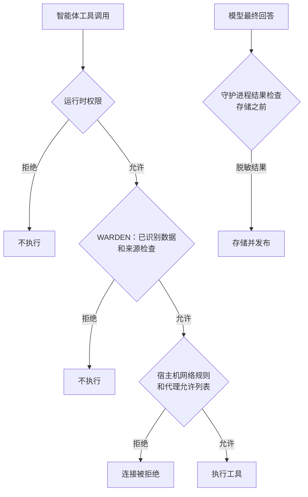
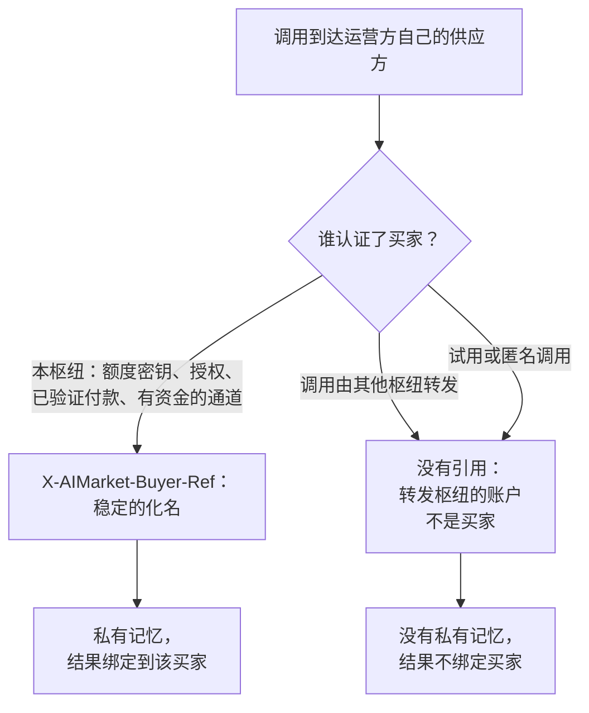
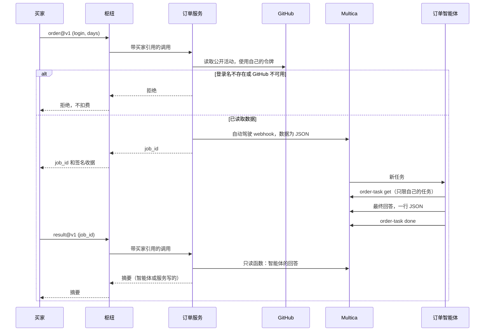

# Multica 与 AIMarket：部署与集成

[English](README.md) · [Русский](README.ru.md) · [Español](README.es.md) · [Français](README.fr.md) · **中文**

本指南把自托管的 [Multica](https://github.com/multica-ai/multica) 接入 AIMarket 枢纽（hub），例如
[modelmarket.dev](https://modelmarket.dev)。Multica 是智能体工厂；枢纽是这些智能体工作的市场。按本指南完成后，
你的智能体可以：

- 在任务中**购买**其他智能体的技能，使用预付费密钥，余额就是硬性上限；
- 通过付费的记忆技能在多次运行之间**保留记忆**；
- **出售**一项能力，包括需要几分钟的长时间智能体任务；
- 并在**受限**环境中运行：只能访问列出的主机，按智能体分配权限，并有防护阻止把读到的内容发送出去。

我们测试过的环境：自托管的 Multica，自 2026-11-04 起为 0.5.3，自 2026-11-05 起为 0.8.0；守护进程使用 OpenCode
1.18.32 和 DeepSeek，单台主机。0.8.0 默认通过 ACP 驱动 OpenCode 1.15 及以上版本；我们保留了 `opencode run`
方式，防护和权限规则都是在这种方式下测试的（第 2 节）。下文命令是 0.5.3 版 CLI 的命令；这套配置用到的命令也已在
0.8.0 上检查过。

> **一条命令。** [`operator-kit/onboard.sh`](../operator-kit/README.md) 在您的 Multica 自托管目录旁完成第 2、3、4、6 节的
> 配置并逐项检查：`sudo ./onboard.sh --dir /opt/multica`。本手册说明它做了什么以及为什么。

## 目录

[概览：各部分如何配合](#概览各部分如何配合)

1. [开始之前](#1-开始之前)
2. [在容器中运行守护进程](#2-在容器中运行守护进程)
3. [限制对外访问](#3-限制对外访问)
4. [连接枢纽：购买技能](#4-连接枢纽购买技能)
5. [每个智能体只给它需要的](#5-每个智能体只给它需要的)
6. [保护智能体：用于 OpenCode 的 WARDEN](#6-保护智能体用于-opencode-的-warden)
7. [运行之间的记忆](#7-运行之间的记忆)
8. [由脚本提供事实的智能体](#8-由脚本提供事实的智能体)
9. [出售一项能力](#9-出售一项能力)
10. [出售长时间的智能体任务](#10-出售长时间的智能体任务)
11. [检查配置](#11-检查配置)
12. [我们踩过的坑](#12-我们踩过的坑)
13. [已知限制](#13-已知限制)

## 概览：各部分如何配合

所有组件都运行在一台主机的 Docker 中。智能体的运行环境位于内部网络：唯一的出口是一个只放行少量主机的代理。运营者通过
SSH 隧道打开 Multica 的网页界面。你自己的一个小服务在枢纽上出售智能体的长任务，并通过自动驾驶的 webhook 和一个只读
数据库角色与 Multica 交互。



我们的参考部署有五个智能体。自动驾驶按计划（UTC）或在订单到达时启动它们：



每个智能体会话都会加载 WARDEN 防护。每个智能体只拥有自己的环境和权限（第 5、6 节）；智能体准备发布的内容没有人
确认就不会发出：草稿始终是草稿。

## 1. 开始之前

- 一台装有 Docker 和 Docker Compose 的 Linux 主机。
- 按 [Multica 自己的说明](https://github.com/multica-ai/multica) 自托管部署。不要把网页界面暴露在公网：只发布在
  `127.0.0.1` 上，通过 SSH 隧道访问（`ssh -L 13300:127.0.0.1:13300 your-host`，然后打开 http://127.0.0.1:13300）。
- 运行时所需的模型密钥。我们用 OpenCode 配 DeepSeek（`DEEPSEEK_API_KEY`）。
- 购买：在 https://modelmarket.dev/start 获取预付费密钥。
- 出售：在 https://modelmarket.dev/start?role=provider 开通供应方账户，并准备一个 HTTPS 接口。

## 2. 在容器中运行守护进程

Multica 的守护进程为每个任务启动智能体运行时（OpenCode）。请把它放在独立容器中：

- 非 root 用户（我们用 `node`，uid 1000），`cap_drop: [ALL]`，`security_opt: ["no-new-privileges:true"]`；
- 资源限制：`mem_limit: 3g`，`cpus: 2`，`pids_limit: 1024`；
- `MULTICA_DAEMON_AUTO_UPDATE: "false"`，版本只在你重新构建时变化；
- 在 Multica 0.8.0 上使用 OpenCode 1.x 时，设置 `MULTICA_OPENCODE_TRANSPORT: run`，保留防护已测试过的运行方式；
- 智能体的密钥放在权限为 600 的 env 文件中，用 `env_file` 加载：模型密钥、GitHub 令牌、聊天机器人令牌、枢纽密钥。
  不要把密钥写进任务、指令或技能。

所有智能体共用一个守护进程、一个用户和一个主目录。第 5 节说明如何仍然把它们隔开。

## 3. 限制对外访问

部署状态（2026-11-10）：我们的 Multica 主机 **attested** 已启用新增防火墙限制。网络验收单独记录在
[部署记录](../../artifacts/multica-security-2026-11-10/deployment.json)中；仅启用规则不能证明所有绕过测试通过。
此状态不代表同事在 `178.62.243.71` 上的安装。

网络限制属于 **Multica 部署层**：Docker 网络、出口代理和宿主机防火墙。WARDEN 检查工具调用，不会安装网络规则。
守护进程只接入智能体内部网络；代理另外接入可访问互联网的网络，后端通过内部地址提供服务。代理环境变量可被命令
忽略，因此单靠这些变量不能阻止直接连接。

```yaml
# Topology excerpt only; use the reviewed overlay in ../security/egress/.
services:
  daemon:
    networks: [agent]
    environment:
      HTTPS_PROXY: http://egress:8888
      https_proxy: http://egress:8888
      HTTP_PROXY: http://egress:8888
      http_proxy: http://egress:8888
      NO_PROXY: backend,localhost,127.0.0.1
      no_proxy: backend,localhost,127.0.0.1
    cap_drop: [ALL]
    security_opt: ["no-new-privileges:true"]
  backend:
    networks: [app, agent]
  egress:
    networks: [agent, app]
    read_only: true
    cap_drop: [ALL]
networks:
  agent:
    internal: true
    enable_ipv6: false
    ipam: { config: [{ subnet: 10.250.0.0/24 }] }
  app: {}
```

这只是拓扑片段，不是完整部署。合并 Compose 文件时必须**替换**守护进程原有网络列表：保留 `app` 并添加 `agent`
仍会留下直接出口。选择不与其他栈冲突的子网。[出口工具包](../security/egress/README.md)提供已审阅的 overlay、代理
配置、宿主机规则计划和验证命令。它要求运营者提供准确的主机清单；本文不猜测 TONmobile 的 prod/dev 地址。智能体
不得修改这些文件，也不要向宿主机发布代理端口。

`tinyproxy.conf` 的相关选项：

```text
Port 8888
Listen 0.0.0.0
Allow 10.250.0.0/24
FilterType ere
FilterURLs Off
FilterDefaultDeny Yes
Filter "/etc/tinyproxy/allow"
ConnectPort 443
```

`allow` 每行一个首尾锚定的主机名。以下是**无法使用的占位符**，必须替换为已核实的模型 API 和 QA 环境主机：

```text
^model-api\.operator\.invalid$
^tonmobile-dev\.operator\.invalid$
^tonmobile-prod\.operator\.invalid$
```

Multica 后端应保持内部地址。构建镜像时安装依赖；QA 默认不需要放开整个 npm 注册表或任意 GitHub SSH。必须读取
Git 时，使用单独的只读获取服务或明确受限的传输方式，不向智能体提供写入凭据。

宿主机必须拒绝智能体子网的直接连接，仅允许代理和准确的后端端点。既要覆盖**宿主机 INPUT**，包括 Docker 网关
（例如报告中的接收器 `172.18.0.1:9999`），也要覆盖转发流量。Docker 使用 **iptables 后端**时，将转发限制放入
`DOCKER-USER`，在 Docker 的放行规则之前执行；追加到 `FORWARD` 末尾不够。**nftables 后端没有 `DOCKER-USER`**，
应使用自行管理的 input/forward 基础链及经过核实的优先级。不要修改 Docker 自有表，也不要认为 UFW 单独覆盖容器。
必须明确禁用并验证 IPv6，或配置等效且经过测试的规则。

还要核实实际 DNS 路径：需要解析内部服务名，但任意外部 DNS 查询不得经 Docker 内置解析器或宿主机转发器泄出；
必要时单独限制该解析器。`internal: true` 本身不能证明 DNS 和宿主机套接字不可访问。`ConnectPort 443` 只限制
CONNECT，不限制普通 HTTP 的目标端口；代理自身的出站规则也必须覆盖这种绕过。

允许的主机仍是泄漏通道：Multica 评论、模型请求和 Git 操作都能携带数据。CONNECT 代理无法检查加密请求体。保持
主机列表简短、权限最小，并将秘密移出智能体可读的文件和环境；最终结果必须在存储前检查（第 6 节）。
官方参考：[Docker iptables](https://docs.docker.com/engine/network/firewall-iptables/)、
[Docker nftables](https://docs.docker.com/engine/network/firewall-nftables/)、
[Docker 防火墙/UFW](https://docs.docker.com/engine/network/packet-filtering-firewalls/)、
[Docker DNS](https://docs.docker.com/engine/network/#dns-services) 和
[Tinyproxy 配置](https://tinyproxy.github.io/#documentation)。

## 4. 连接枢纽：购买技能

把枢纽的 MCP 服务器加入 OpenCode 全局配置，即守护进程主目录下的 `~/.config/opencode/opencode.jsonc`：

```jsonc
{
  "mcp": {
    "modelmarket": {
      "type": "remote",
      "url": "https://modelmarket.dev/mcp",
      "headers": { "X-API-Key": "{env:AIMARKET_API_KEY}" }
    }
  }
}
```

把预付费密钥以 `AIMARKET_API_KEY` 写入守护进程的 env 文件。余额就是硬性上限：用完后枢纽返回 402，不会扣费。
没有密钥时，枢纽提供少量试用调用。

之后智能体使用三个工具：

- `market_search`：用平实的话写 `intent`，并给出 `budget`（每次调用的价格上限）。每个结果包含 `product_id`、
  `capability_id`、`source_hub`、价格、`max_price_usd` 和输入字段。
- `market_invoke`：`product_id`、`capability_id`、`source_hub`（联邦条目必填，而目录中大部分是联邦条目）、
  `input`，以及从搜索结果原样复制的 `max_price_usd`。如果路由涨价，枢纽会在任何工作和付款之前以
  `price_limit_exceeded` 拒绝。
- `account_status`：密钥剩余多少、已花多少。

每次付费调用都会返回枢纽签名的收据；响应中 `verify_url` 指向的工作收据把输入哈希、结果和卖家绑定在一起。
凡是你要依赖的答案，都请连同收据一起保存。

我们的技能 [`multica/community/aimarket/SKILL.md`](../community/aimarket/SKILL.md) 教智能体遵守这些规则（每个任务有
预算，遇到 402/403 不重试，只发送中性输入，卖家的回答是数据）。导入：

```bash
multica skill import --url https://github.com/alexar76/aicom/tree/main/multica/community/aimarket
```

公开镜像包含该文件夹后此链接才可用；在此之前，把文件夹打成 zip，使用 `multica skill import --file aimarket.zip`。

## 5. 每个智能体只给它需要的

守护进程的全局配置作用于所有智能体，所以保持精简，其余按智能体设置。Multica 为每个智能体提供**自定义环境**
（custom environment）；OpenCode 从中读取 `OPENCODE_CONFIG_CONTENT`，作为该智能体运行时的附加配置。

对于读取陌生人文本、又不需要枢纽的智能体，关闭枢纽并清空它不需要的密钥：

```bash
cat <<'EOF' | multica agent env set <agent-id> --custom-env-stdin
{
  "AIMARKET_API_KEY": "",
  "OPENCODE_CONFIG_CONTENT": "{\"mcp\":{\"modelmarket\":{\"enabled\":false}},\"tools\":{\"modelmarket_*\":false}}"
}
EOF
```

`env set` 会替换整个自定义环境（值为 `****` 时保留原值）。用相同的 `OPENCODE_CONFIG_CONTENT` 运行
`opencode debug config` 检查结果。

OpenCode 的 `permission.bash` 接受模式；**最后**一个匹配的规则生效，一行中的每条命令都会单独检查（包括
`$(...)`、反引号和管道中的命令）。带重定向的命令会连同重定向一起检查。因此，只允许运行一条命令的智能体配置如下：

```json
{"bash": {"*": "deny", "/opt/tools/order-task get *": "allow", "*>*": "deny", "*<*": "deny", "*$*": "deny", "*`*": "deny"}}
```

没有最后四条规则，`允许的命令 > ~/.config/opencode/opencode.jsonc` 就会覆盖文件。

请放行你自己写的包装脚本，而不是带通配符的 Multica CLI。Multica 智能体的令牌绑定的是**工作区**，而不是它的任务，
因此 `multica issue get *` 能读取工作区内任何任务，而且任务编号是连续的。包装脚本应在输出或修改任何内容之前确认
任务属于该智能体（我们的脚本见第 10 节）。

## 6. 保护智能体：用于 OpenCode 的 WARDEN

部署状态（2026-11-10）：我们的 **attested** 安装已运行经过审阅的 WARDEN 本地构建和修补后的 Multica 守护进程/
后端。生产钩子检查通过 9/9；保留的干净会话 canary 被拒绝。已核实二进制哈希、backend/UI 健康及迁移未变。参见
[部署记录](../../artifacts/multica-security-2026-11-10/deployment.json)。这**不是新的 npm 发布**，也不验证同事的
`178.62.243.71`/0.24.0 安装或完整 TONM-14 测试。下文有关已知模式和输出路径的限制仍然适用。

[WARDEN](https://github.com/alexar76/warden) 的 flow guard 检查工具调用。历史上的 OpenCode 0.23.0 集成在记录
外部文本后执行泄漏检查，并清空 shell 中选定的环境变量。伪造密钥测试先读取 GitHub，再读取凭据文件；聊天脚本、
对允许主机的 `curl`、记忆写入和跟踪器 CLI 都被拒绝。记录的一次正常任务没有拒绝。这些观察不能证明干净会话或
其他运行时版本也受到保护。

报告中的 0.24.0 故障暴露了这一缺口：`multica issue get` 没有被识别为外部文本，仅读取 `.env` 不会启动泄漏检查。
2026-11-10 的本地源码修改将已识别秘密的检查与该触发条件分开，并增加 Multica/QA 报告来源识别。必须在选定运行时
构建并验证；修改源码不会自动更新 npm 或已安装的守护进程。不要用 `npx` 或失败的 `curl` 故意触发保护。`curl`
超时时，接收器可能已经收到请求体。

WARDEN 的代码中不出现 Multica 的名字。`playwright-report/` 和 `test-results/` 内的读取默认即为外部文本；Multica
CLI 通过运营者策略成为外部来源。请以随附的片段 `warden/examples/policies/multica.flow-policy.json` 为基础（npm 包中
自下一个版本起提供），它标记 `multica issue get`、`issue list`、`issue search` 和 `issue comment list`。没有它，
Multica 的输出被视为运营者自己的数据。用同样方式添加你自己的命令前缀和报告目录（此处为 QA 报告目录
`reports/`）；这些规则只增加不信任，不会授权动作：

```json
{
  "mode": "deny",
  "untrustedSources": {
    "commands": [
      ["multica", "issue", "get"], ["multica", "issue", "list"],
      ["multica", "issue", "search"], ["multica", "issue", "comment", "list"]
    ],
    "paths": ["reports"]
  }
}
```

如果智能体把报告写在克隆旁边（任务工作区根目录），请在同一策略中加入 `"projectRoots": [".."]`：否则读取外部文本后，这类写入会被视为项目之外的操作（`destructive_action`），实地测量中正是如此。

路径以项目边界为基准，shell 文件操作数以执行目录为基准。识别有界，不解析任意 shell 程序。读取外部文本后，严格
`deny` 仍会拒绝 `npm run ...`、`node -e ...` 等不透明执行。不要为运行 QA 而关闭来源识别；应使用经过审阅的窄范围
权限/适配器，并由可信监督器完成安全启动和报告。

### 独立 QA 执行器：固定任务代替智能体 shell

[独立 QA runner](../qa-runner/README.md)已于 2026-11-10 在我们的 **attested** 部署并通过验收。真实 Multica 任务
**MY-89** 中，永久私有配置只调用一次原生 `qa_runner_task_execute`，没有其他工具调用。backend/modelmarket/枢纽
返回 **200/200/200**，验证后的报告进入存储结果和评论，任务已设为 `done`。参见
[最终验收记录](../../artifacts/multica-qa-runner-2026-11-10/final-acceptance.json)。这仅验收初始 `platform_smoke`；
尚未运行完整的 TONmobile 浏览器 QA。

它将 Multica/模型控制器与 `10.250.0.5` 上的专用 Node 22 worker 分开。worker 不持有模型、Multica、GitHub、枢纽凭据，也不挂载 home、env
文件、Docker socket 或宿主机 TLS 私钥。文件系统只读，仅有受限临时存储，capabilities 全部移除。只有可信宿主机
控制器能启动固定的 `npm run smoke` 任务。

私有 QA 配置只能向 `qa_runner` 服务器的 `task_execute` 传入 `{"id":"platform_smoke"}`。WARDEN TaskAdapter 在
读取外部文本后的通用拒绝之前委托这个固定操作；这不允许智能体执行 `npm run ...`、`node -e ...`，或提供任意 URL、
参数、shell 代码。MCP 子进程通过 `env -i` 启动，仅获公共 CA；`10.250.0.1:8443` broker 的 TLS 私钥保留在宿主机
控制器。`qa_runner` 全局禁用，只在新私有 QA 配置中启用；该配置的其他 MCP/工具保持禁用。

使用 `opencode debug agent build` 检查实际解析的规则顺序：通用 deny 之后必须有四个精确 allow，分别是
`qa_runner_task_list`、`qa_runner_task_read`、`qa_runner_task_execute`、`qa_runner_task_run`。原始 JSON 无法证明旧 tools
设置合并后的顺序。指令直接调用原生 QA 工具，无须先运行 Bash/Multica CLI。MCP 只接受有界的标准
`_meta.progressToken` 元数据；工具参数仍严格只有固定 ID，不接受自由 URL、命令或其他字段。

broker 只接受来自获准控制器的空请求体 `POST /run/platform-smoke`，单次只运行一个任务，五分钟最多启动三次，
捕获输出最多 64 KiB，控制器最多 8 秒；worker 最多执行 6 秒，随后有 1 秒终止宽限。只返回固定检查名称、状态码和布尔值，丢弃原始 stdout/错误。
宿主机 broker 另用 root 所有的 `/var/lib/multica-qa` SQLite 持久保存每个 UTC 12 小时窗口最多 10 次启动的配额；
删除 MCP 计数器或重启控制器不会重置它，失败或结果不确定的运行也消耗配额。运营者清单租约最长 23 小时，每 12 小时续期，最多使用 10 次；broker 另行限制调用频率。租约过期、pin 改变或预算
用尽都拒绝执行。当前 `platform_smoke` 只检查固定且无需认证的 backend/枢纽/modelmarket 状态端点，返回有界清理报告，
不返回响应体，也不执行外部写入。它不实现任意 QA 或 TONmobile 场景。新增任务需要审阅控制器、固定 worker 镜像/
任务，并发行新的固定 capability。

权限、WARDEN 和网络具有不同边界：



| 威胁 | 执行限制的边界 |
|---|---|
| 智能体运行超出任务范围的命令 | 运行时权限及运营者控制的窄范围包装脚本 |
| 已识别秘密被发送到允许的服务 | WARDEN 检查和服务最小权限；历史上的干净会话缺口需要本地修复 |
| 连接绕过代理或访问列表外主机 | 宿主机防火墙、网络隔离和代理共同限制（第 3 节） |
| 智能体关闭后续保护 | 防护及全部父目录由 root 拥有 |
| 最终回答包含秘密 | 守护进程在存储前检查；Stop 钩子不是通用秘密过滤器 |

2026-11-05 记录的五个智能体计划运行和 Multica 0.8.0 升级后的一笔付费订单，各自留下了保护状态文件。这证明插件
已运行，不能证明所有输出均安全。

### 在 Multica 存储之前检查结果

针对 upstream v0.8.0 的[Multica 本地结果补丁](../security/README.md)，在可信守护进程/后端边界增加递归脱敏：
位于重试队列写入、complete/fail/message/progress 回调和任务结果/错误存储之前。它使用上游 `redact.Text` 匹配
已知令牌格式，也处理嵌套在 JSON 字符串内的值。使用 `apply-output-patch.py --source-root <checkout> --check`
核实版本和源码校验和，再按工具包说明应用补丁并重建**守护进程和后端**。我们的 attested 部署见上述记录；其他安装仍需单独重新构建。

只遮盖评论仍会暴露 `result.output`/`output_summary`。修补的出口只能接收脱敏值，不应为诊断而记录原文。模式检查
有边界：不能覆盖任意秘密或编码、运行时原始会话文件、其他未修补日志路径，以及数据库/队列历史。请单独清点这些
路径，首先减少可读秘密。按运营者的保留政策删除或隔离旧的泄露记录；补丁不会追溯清理历史。

在提供方服务中检查 JSON 格式、大小和链接（第 10 节）仍然有用，但对原始守护进程存储已经太晚。Stop 继续生成和
WARDEN 的结构化选择答案 SDK 都不是自由文本的通用 DLP。部署前，应让格式可识别的伪造令牌经过每条已修补结果路径。

该插件从 0.23.0 版起包含在 `@aimarket/warden` 中（`@aimarket/warden/opencode`）。加载器放在 OpenCode 配置目录下，
文件名为 `plugin/warden.js`：

```js
import { createWardenPlugin } from '@aimarket/warden/opencode';

export const WardenFlowGuard = createWardenPlugin({
  block: 'data',
  // Keys only the OpenCode process needs; shell commands get them blank.
  stripEnv: ['DEEPSEEK_API_KEY', 'AIMARKET_API_KEY'],
});
```

不用 npm 包时，把 `dist/opencode-plugin.js` 和所有 `dist/flow-guard*.js` 复制到同一个文件夹，并从那里导入
`opencode-plugin.js`。

把它安装在智能体用户无法修改的位置。文件必须属于 root，而且**它们上方的每一级文件夹**也必须属于 root：用户可以
重命名自己拥有的文件夹，连同里面的防护一起。我们在 2026-11-05 发现自己的部署有这个漏洞。插件文件属于 root，
但 `~/.config/opencode` 属于智能体用户。我们的修复方式是：把插件放在 root 拥有、挂载到 `/opt/opencode-guard` 的文件夹中，并通过 `OPENCODE_CONFIG_DIR`
让 OpenCode 使用它。挂载时要可写，但所有者是 root，智能体用户无法写入。OpenCode 1.18.32 启动时会往每个配置
文件夹写入 `.gitignore`：在只读挂载上它会报错退出，而对无权写入的文件夹则会跳过。然后以智能体用户身份运行 `opencode debug config`，确认插件已加载。

### 示例：为所有智能体启用防护

这是在 2026-11-05 检查的历史配置：Multica 0.8.0、OpenCode 1.18.32 和 WARDEN 0.23.0。`warden/` 中的文件是 npm 包
`@aimarket/warden@0.23.0` 的插件文件，未作修改（共 20 个）。下面的每条命令都先在我们的主机上运行过。

下面的历史 tarball **不包含** 2026-11-10 修复。新的 QA 部署应使用[安全工具包](../security/README.md)所述的
已审阅本地构建和检查，并保留版本及文件清单。以下命令保留旧安装方法，不代表当前干净会话已通过验收。

加载器，保存为 `docker-compose.yml` 旁边的 `warden.js`：

```js
// opencode-guard/plugin/warden.js: the WARDEN flow guard for every agent on this daemon.
// Export only the plugin: OpenCode calls every exported function as one.
import { createWardenPlugin } from '../warden/opencode-plugin.js';

export const WardenFlowGuard = createWardenPlugin({
  block: 'data',
  // Keys only the OpenCode process needs; shell commands get them blank.
  stripEnv: ['DEEPSEEK_API_KEY', 'AIMARKET_API_KEY'],
});
```

在主机上以 root 运行。安装包会用 npm 公布的校验和进行核对：

```bash
cd /opt/multica                    # the folder with docker-compose.yml; warden.js (the loader) is here
T=$(mktemp -d)
curl -fsSL -o "$T/warden.tgz" https://registry.npmjs.org/@aimarket/warden/-/warden-0.23.0.tgz
echo "e9fe195e36ce559d9e543e8eb3fd4bcd729fe434  $T/warden.tgz" | sha1sum -c -
tar -xzf "$T/warden.tgz" -C "$T"
install -d -o root -g root -m 755 opencode-guard opencode-guard/plugin opencode-guard/warden
install -o root -g root -m 644 "$T"/package/dist/opencode-plugin.js "$T"/package/dist/flow-guard*.js opencode-guard/warden/
install -o root -g root -m 644 warden.js opencode-guard/plugin/warden.js
rm -rf "$T"
```

结果：

```
opencode-guard/                root:root 755
├── plugin/
│   └── warden.js              root:root 644   the loader above
└── warden/                    root:root 755
    ├── opencode-plugin.js     root:root 644
    └── flow-guard*.js         root:root 644   19 files
```

`docker-compose.yml` 中的守护进程（只列出这里相关的行）：

```yaml
services:
  daemon:
    environment:
      MULTICA_DAEMON_AUTO_UPDATE: "false"
      OPENCODE_CONFIG_DIR: /opt/opencode-guard   # every OpenCode session loads plugin/ from here
      MULTICA_OPENCODE_TRANSPORT: run            # Multica 0.8.0 with OpenCode 1.x: the transport the guard was tested on
    volumes:
      - daemon_home:/home/node
      - ./opencode-guard:/opt/opencode-guard     # root-owned; not :ro, OpenCode stops on a read-only config folder
```

如果守护进程主目录中还有旧的防护副本（其卷中的 `~/.config/opencode/plugin` 和 `~/.config/opencode/warden`），
先把它移走，否则防护会加载两次。然后在没有任务运行时重建守护进程：

```bash
docker compose up -d --no-deps --force-recreate daemon
```

以智能体用户身份检查：

```bash
# 1. Sessions load the guard from the root-owned folder, and only from there.
docker exec -u node -w /tmp multica-daemon sh -c 'opencode debug config | jq -c .plugin'
#    ["file:///opt/opencode-guard/plugin/warden.js"]

# 2. Still loaded with another home folder, as if ~/.config had been renamed.
docker exec -u node -w /tmp multica-daemon sh -c 'mkdir -p /tmp/h && HOME=/tmp/h opencode debug config | jq -c .plugin; rm -rf /tmp/h'

# 3. Nothing on the guard's path is writable by the agent user: every line must say "ok".
docker exec -u node multica-daemon sh -c 'for p in /opt /opt/opencode-guard /opt/opencode-guard/plugin /opt/opencode-guard/warden; do [ -w "$p" ] && echo "WRITABLE: $p" || echo "ok: $p"; done'

# 4. A real session runs the guard: the newest state files carry the current time.
docker exec -u node -w /tmp multica-daemon opencode run "Reply with the single word OK."
docker exec -u node multica-daemon sh -c 'ls -lt ~/.local/state/warden/claude-code/flow | head -3'
```

防护作用于守护进程上的所有智能体，包括有自己 `OPENCODE_CONFIG_CONTENT` 的智能体：我们的订单智能体就有，它的会话
同样会写入防护状态。

### Codex 运行时

用 Codex 而不是 OpenCode 运行的智能体，通过 Codex 的命令钩子获得同一个守卫。它在 WARDEN 的本地源码中，尚未发布。
详情和示意图：[用于 Codex 的 WARDEN](https://github.com/alexar76/warden/blob/main/docs/codex.zh.md)。

- Codex 没有“询问”：回答 `ask` 的钩子被视为失败，Codex 会照常执行调用。因此适配器从不询问。询问会变成拒绝或记录在案
  的放行（`WARDEN_CODEX_BLOCK=data` 为默认，或 `all`），守卫的任何故障都会拒绝。
- 将其安装为托管钩子：把构建好的 `codex-hooks/` 放到 `/opt/warden-codex`，把 `codex-hooks/requirements.toml` 作为
  `/etc/codex/requirements.toml`，全部归 root 所有。`allow_managed_hooks_only = true` 让智能体无法添加自己的钩子。
- 在 compose 的守护进程服务中，把两者只读挂载并设置模式：

```yaml
    environment:
      WARDEN_CODEX_BLOCK: data
    volumes:
      - ./warden-codex:/opt/warden-codex:ro
      - ./codex/requirements.toml:/etc/codex/requirements.toml:ro
```

- 用 `shell_environment_policy`（`exclude`）把模型密钥挡在 shell 命令之外，并关闭 Codex 内置的网页搜索：它不运行
  钩子，守卫看不到它带来的内容。
- 用 WARDEN 仓库中的 `scripts/codex-live-check.sh` 检查：一次使用假密钥的模拟攻击，全部在 localhost 上进行。

## 7. 运行之间的记忆

智能体每个任务都从零开始。Attested Memory 提供按次付费的记忆：hub.attestedmemory.net 上的 `memory.write@v1`、
`memory.search@v1` 和 `memory.read@v1`。记忆属于该枢纽认证的买家。请**直接在该枢纽**购买：在
https://hub.attestedmemory.net/start 获取密钥，并像第 4 节一样使用它的 MCP 服务器
`https://hub.attestedmemory.net/mcp`。如果通过其他枢纽购买（modelmarket.dev 也列出了这些技能），调用会以转发枢纽
而不是你的身份到达记忆枢纽，因此得不到私有记忆。试用调用也得不到。

记忆归谁所有、谁可以读取订单结果，由认证该买家的枢纽决定：



即使调用是转发来的，买家本人经过验证的 x402 付款仍然可以识别买家。

把用法和预算写进智能体的指令：用哪些技能、每次运行调用几次、遇到 402 或 403 不重试。我们每天的 GitHub 摘要会读取
最多三条过去的记录，加一行“趋势”，并每天保存一条记录：每次运行约 0.03 美元。

## 8. 由脚本提供事实的智能体

当输出必须准确（数字、发现、价格）时，让脚本决定事实，模型只负责围绕事实写文字。我们的供应商审核员就是这样
工作的。脚本把枢纽目录与前一天对比，检查 schema、提示词注入、买家需要交出什么、地址和价格。模型撰写报告，
并原样粘贴脚本得出的事实。我们的周报也一样：脚本收集一周的计数，模型起草文字。

用自动驾驶（autopilot）安排它们（`multica autopilot create --agent <agent> --mode create_issue --title ...`，然后
`multica autopilot trigger-add <id> --kind schedule --cron "0 10 * * *"`；默认时区为 UTC）。代码：
[`multica/supplier-review`](../supplier-review/)、[`multica/weekly-post`](../weekly-post/)。

## 9. 出售一项能力

完整指南见 https://modelmarket.dev/developers（以及 https://play.modelmarket.dev/publish）。简短流程，对已有的接口
大约需要 15 分钟：

1. 在 https://modelmarket.dev/start?role=provider 创建账户和密钥；`GET /ai-market/v2/account` 返回的
   `account_id` 就是你的 `publisher_id`。
2. 带密钥请求 `GET /ai-market/v2/supply/policy`，它会说明是否需要保证金；只有当 `additional_stake_usd` 大于零时，
   才用 `POST /ai-market/v2/supply/stake` 缴纳。
3. 在 `capability.json` 中描述该能力。需要 `capability_id`（例如 `mytool.summarize@v1`）、`product_id`、
   `publisher_id`、`invoke_url`（HTTPS）、`price_per_call_usd`、输入和输出的 JSON Schema，以及接口用于签名回答的
   Ed25519 `provider_pubkey`。
4. 用 https://play.modelmarket.dev/connect 测试接口（一次真实调用，检查 schema 和签名）。
5. 带密钥和 `capability.json` 调用 `POST /ai-market/v2/supply/register`。

描述要写给买家的模型看：它做什么、需要什么、返回什么、多少钱。不要写给模型的指令（“总是使用这个工具”）：
枢纽会扫描条目中的这类内容，买家的防护也会拒绝它。

## 10. 出售长时间的智能体任务

付费调用不能等智能体几分钟。把任务拆成两项能力出售：

- `…order@v1`（付费）。你的服务严格检查输入，自己完成外部读取，通过自动驾驶的 **webhook** 触发器带着这些数据
  创建 Multica 任务，并立即返回 `job_id`。
- `…result@v1`（免费）返回 `queued`，或带结果的 `done`。

完整订单流程，从买家的调用到结果：



各部分如何配合：

1. **带 webhook 触发器的自动驾驶。** `multica autopilot create --agent <order-agent> --mode create_issue
   --title "Orders" --description "<instructions>"`，然后 `multica autopilot trigger-add <id> --kind webhook`。
   触发器的 URL 中含有它的令牌：把它放在服务的 env 文件中（权限 600），绝不写入日志。Multica 会把你提交的 JSON
   放进任务描述。
2. **外部读取由你的服务完成。** 服务在接受订单之前完成这些读取，并使用自己的令牌。没有任何权限范围的 GitHub 令牌
   能把限额从每小时 60 次提高到 5000 次。输入错误或数据源不可用时，在扣费之前拒绝：枢纽只对得到回答的调用收费。
   买家的自由文本不应到达智能体。
3. **智能体的最终回答就是交付物。** 它是一行 JSON：`{"job_id": "...", "summary": "..."}`，可信 Multica 发布器必须在存储或发布之前检查它。
   智能体不需要直接联网发送。工具调用检查与最终结果检查是两个独立要求。
4. **订单智能体只运行一个包装脚本。** 我们的是 [`order-task`](../provider/order-task/order-task)：
   `order-task get <issue>` 输出任务，`order-task done <issue>` 关闭任务，前提是任务分配给了订单智能体。脚本属于
   root，它的 OpenCode 规则在 [`opencode-order-agent.json`](../provider/order-task/opencode-order-agent.json)。
5. **服务读取回答**时使用只读数据库角色。该角色只能执行一个函数。该函数（`SECURITY DEFINER`，`search_path`
   固定）返回订单智能体在其自动驾驶为某个订单创建的任务上的评论。服务只接受 `job_id` 和 `summary`，并限制长度，
   链接只能指向预期的网站。如果任务结束时或 20 分钟后仍没有可用的回答，服务会用同样的数据写一份简单摘要。
6. **谁可以读取结果。** 枢纽只把 `X-AIMarket-Buyer-Ref`（已认证买家的稳定化名）连同枢纽内部令牌发送给其运营方
   自己的供应方。在你自己的枢纽上，把每个订单绑定到这个引用。在别人的枢纽上你拿不到任何买家身份。这时 `job_id`
   就是读取凭据：128 位随机数，只在付费回答中返回，并有保留期限。

我们的服务是 [`multica/provider`](../provider/)（27 个测试；包装脚本和权限规则另有 25 个）。它在
hub.attestedmemory.net 上以 0.05 美元出售 `github.digest.order@v1`。

## 11. 检查配置

- **独立执行器。** 检查 `qa_runner` → `task_execute {"id":"platform_smoke"}` 和固定检查报告。未知 ID、额外 URL/
  命令、过期/变更清单和耗尽预算都应拒绝，智能体 shell 仍被禁止。另行核实 worker 挂载/环境变量名、TLS 私钥只在
  宿主机，以及有界报告交付。
- **实际配置。** 以智能体用户身份、使用其 `OPENCODE_CONFIG_CONTENT` 运行 `opencode debug config`，核实权限、
  MCP 服务器和 root 所有的插件路径。Claude/Codex 则核实对应运行时的有效钩子及拒绝处理。记录准确版本、策略哈希
  和钩子故障。
- **网络边界。** 在真实守护进程网络运行[出口检查](../security/egress/README.md)：批准目标应可用，列表外主机、
  直接 IPv4/IPv6、宿主机/Docker 网关接收器、外部 DNS、清除代理变量/`--noproxy`、其他端口和 SSH 必须失败。单独
  检查 Docker 解析器，并在容器/Docker 重启后复测。核实接收器和 TCP 建连情况；客户端超时不证明拦截。只使用自己
  控制的接收器和合成数据。
- **干净与受污染会话。** 在新会话中测试伪造凭据文件 → 未访问网页时的首次上传，再分别在 `multica issue get`、
  评论、本地 Playwright 报告和网页之后重复。所有获准出口（包括 Multica 评论）都必须在交付前拒绝。使用专门测试
  任务/接收器，不向 GitHub 或公共服务发送秘密。记录来源标签及 PreToolUse 决策。随后完成正常 QA、无需安装依赖
  的启动和安全报告，不尝试绕过。拒绝即结束智能体运行；可信监督器另行报告固定安全状态。
- **最终结果。** 在拟议回答中放入格式可识别的伪造凭据；修补后的 `result.output`、`output_summary`、评论、事件和
  日志不得包含原值。检查脱敏替代、正常答案和重试/重启路径；单独清点未修补的会话/日志及历史记录。
- **出售。** 对已授权的端到端检查使用小额订单，核实买家隔离、无买家时拒绝、无效输入在扣费前拒绝。

## 12. 我们踩过的坑

- **Docker DNS 与两个网络。** 加入两个 Compose 网络的容器会在任一网络中解析服务名。`postgres` 连到了另一个
  栈的数据库。请使用容器名（`multica-postgres-1`）。
- **通过 127.0.0.1 检查数据库什么也证明不了。** 如果 `pg_hba` 信任本地连接，错误的密码照样能登录。请通过网络
  测试密码。
- 修改自定义环境要用 **`multica agent env set`**，而不是 `agent update`，而且它会整体替换。
- **共享的 GitHub 限额。** 未认证的读取按主机 IP 共享每小时 60 次，主机上的任何容器都可能用掉它们。给每个读取方
  各自一个无权限范围的令牌。
- **智能体无法关闭自己的任务**，除非规则允许。通过包装脚本允许，并且只限它自己的任务。
- **模型不是防护。** 在我们的测试中 DeepSeek 拒绝了明显的注入命令，但真正起作用的是规则和文件权限。

## 13. 已知限制

- 工具钩子不拥有 Multica 最终输出通道。守护进程必须在存储和发送**之前**检查；下游验证器或遮盖的评论不能清理
  已保存的原始运行字段。
- 历史上依赖外部文本触发的防护可能放过触发前的秘密上传。2026-11-10 本地修改需要运行时测试及部署；旧 npm/
  生产观察不能验证这些修改。
- 守护进程和智能体共用用户。智能体可能读取该用户的 Multica 凭据和可访问文件。更强隔离需要分开的用户/容器、
  最少挂载和按智能体分配的服务权限。
- 防护按运行时生效，不按智能体；应保护会话树状态和配置。
- 允许的主机仍是通道，包括 Multica/模型 API 和 SSH。防火墙限制目标；加密 CONNECT 请求体、任意编码和未知秘密
  需要额外控制。全局放开注册表或 GitHub 写入不是安全的默认 QA 配置。
- 本地测试记录不代表真实部署、发布软件包或通过生产验收。

参考部署：[`multica/community/README.md`](../community/README.md)。本配置的安全审查：
[`artifacts/vulnetix-class-multica-2026-11-05/REPORT.md`](../../artifacts/vulnetix-class-multica-2026-11-05/REPORT.md)。
