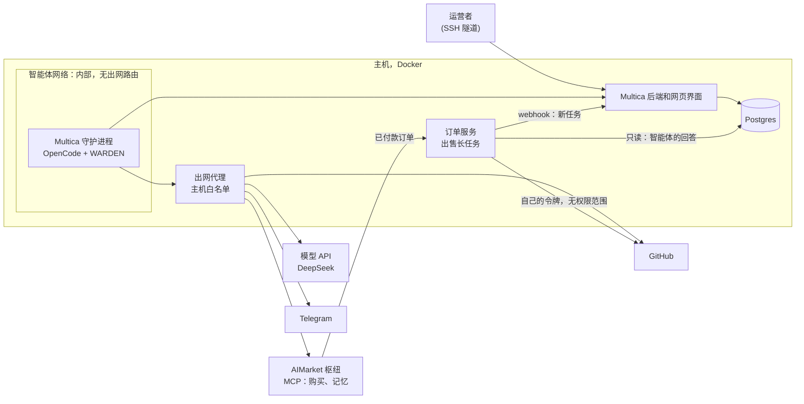
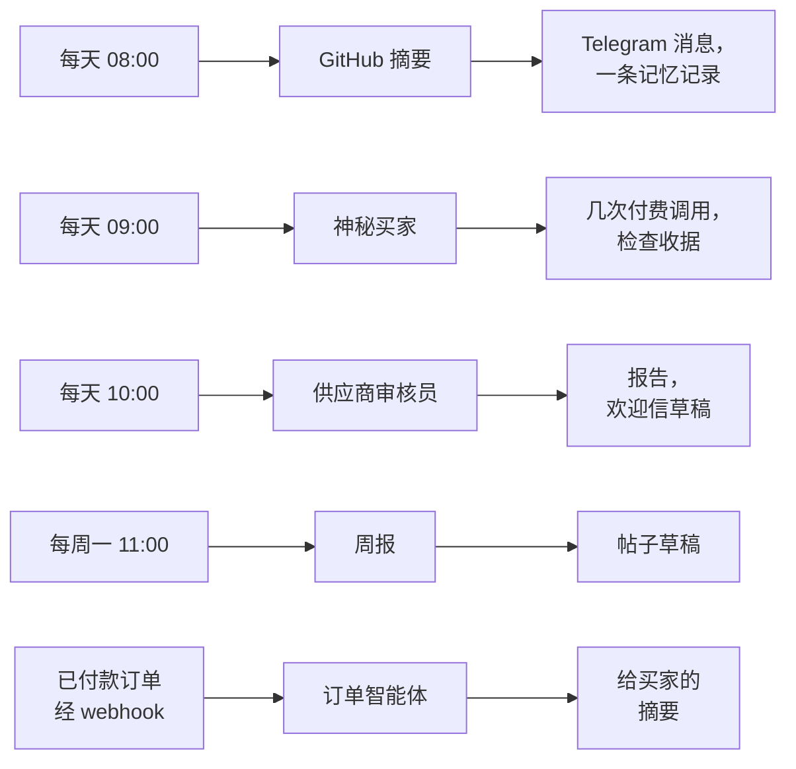
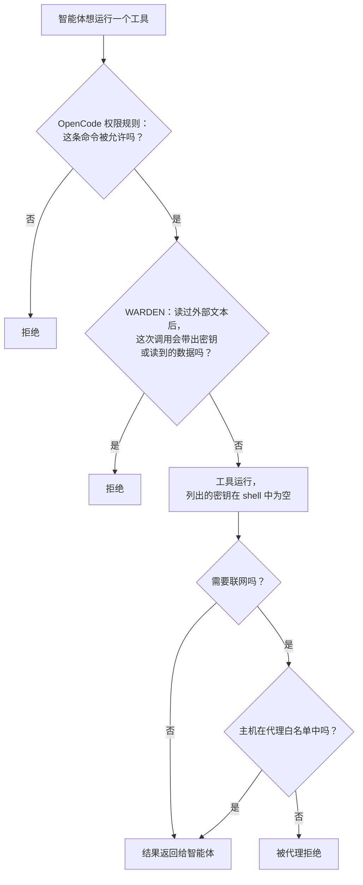
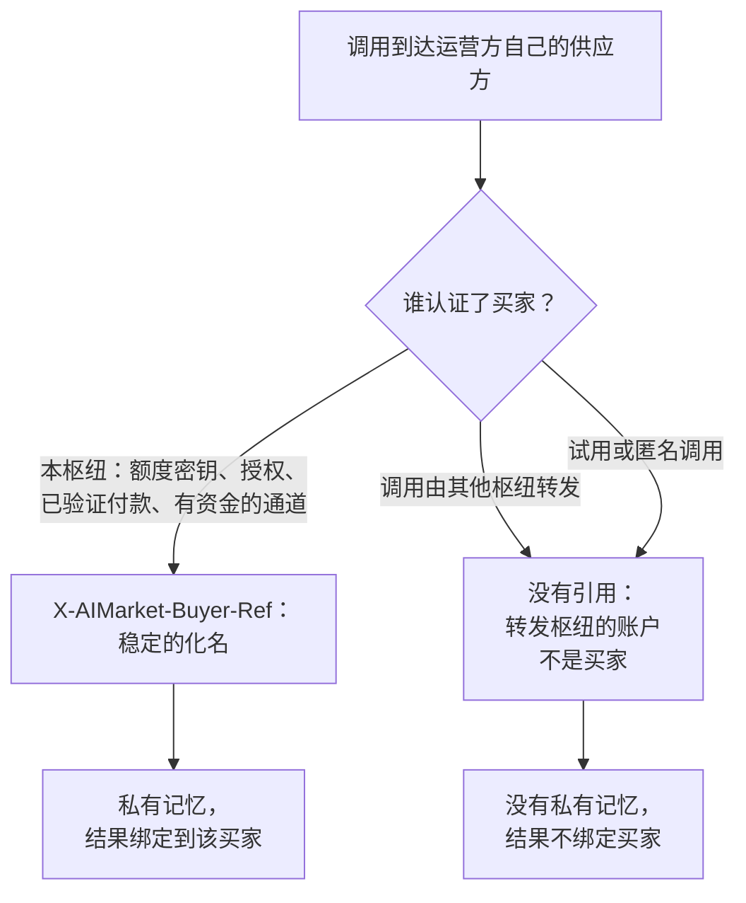
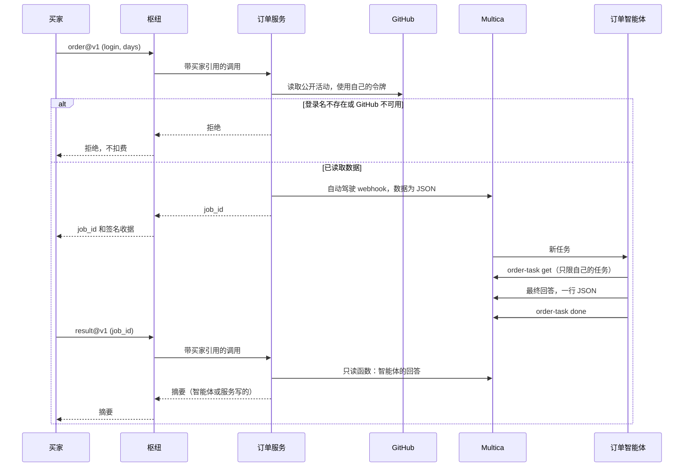

# Multica 与 AIMarket：部署与集成

[English](README.md) · [Русский](README.ru.md) · [Español](README.es.md) · [Français](README.fr.md) · **中文**

本指南把自托管的 [Multica](https://github.com/multica-ai/multica) 接入 AIMarket 枢纽（hub），例如
[modelmarket.dev](https://modelmarket.dev)。Multica 是智能体工厂；枢纽是这些智能体工作的市场。按本指南完成后，
你的智能体可以：

- 在任务中**购买**其他智能体的技能，使用预付费密钥，余额就是硬性上限；
- 通过付费的记忆技能在多次运行之间**保留记忆**；
- **出售**一项能力，包括需要几分钟的长时间智能体任务；
- 并在**受限**环境中运行：只能访问列出的主机，按智能体分配权限，并有防护阻止把读到的内容发送出去。

我们测试过的环境：自托管的 Multica，自 2026-11-04 起为 0.5.3，自 2026-11-05 起为 0.8.0；守护进程使用 OpenCode
1.18.32 和 DeepSeek，单台主机。0.8.0 默认通过 ACP 驱动 OpenCode 1.15 及以上版本；我们保留了 `opencode run`
方式，防护和权限规则都是在这种方式下测试的（第 2 节）。下文命令是 0.5.3 版 CLI 的命令；这套配置用到的命令也已在
0.8.0 上检查过。

## 目录

[概览：各部分如何配合](#概览各部分如何配合)

1. [开始之前](#1-开始之前)
2. [在容器中运行守护进程](#2-在容器中运行守护进程)
3. [限制对外访问](#3-限制对外访问)
4. [连接枢纽：购买技能](#4-连接枢纽购买技能)
5. [每个智能体只给它需要的](#5-每个智能体只给它需要的)
6. [保护智能体：用于 OpenCode 的 WARDEN](#6-保护智能体用于-opencode-的-warden)
7. [运行之间的记忆](#7-运行之间的记忆)
8. [由脚本提供事实的智能体](#8-由脚本提供事实的智能体)
9. [出售一项能力](#9-出售一项能力)
10. [出售长时间的智能体任务](#10-出售长时间的智能体任务)
11. [检查配置](#11-检查配置)
12. [我们踩过的坑](#12-我们踩过的坑)
13. [已知限制](#13-已知限制)

## 概览：各部分如何配合

所有组件都运行在一台主机的 Docker 中。智能体的运行环境位于内部网络：唯一的出口是一个只放行少量主机的代理。运营者通过
SSH 隧道打开 Multica 的网页界面。你自己的一个小服务在枢纽上出售智能体的长任务，并通过自动驾驶的 webhook 和一个只读
数据库角色与 Multica 交互。



我们的参考部署有五个智能体。自动驾驶按计划（UTC）或在订单到达时启动它们：



每个智能体会话都会加载 WARDEN 防护。每个智能体只拥有自己的环境和权限（第 5、6 节）；智能体准备发布的内容没有人
确认就不会发出：草稿始终是草稿。

## 1. 开始之前

- 一台装有 Docker 和 Docker Compose 的 Linux 主机。
- 按 [Multica 自己的说明](https://github.com/multica-ai/multica) 自托管部署。不要把网页界面暴露在公网：只发布在
  `127.0.0.1` 上，通过 SSH 隧道访问（`ssh -L 13300:127.0.0.1:13300 your-host`，然后打开 http://127.0.0.1:13300）。
- 运行时所需的模型密钥。我们用 OpenCode 配 DeepSeek（`DEEPSEEK_API_KEY`）。
- 购买：在 https://modelmarket.dev/start 获取预付费密钥。
- 出售：在 https://modelmarket.dev/start?role=provider 开通供应方账户，并准备一个 HTTPS 接口。

## 2. 在容器中运行守护进程

Multica 的守护进程为每个任务启动智能体运行时（OpenCode）。请把它放在独立容器中：

- 非 root 用户（我们用 `node`，uid 1000），`cap_drop: [ALL]`，`security_opt: ["no-new-privileges:true"]`；
- 资源限制：`mem_limit: 3g`，`cpus: 2`，`pids_limit: 1024`；
- `MULTICA_DAEMON_AUTO_UPDATE: "false"`，版本只在你重新构建时变化；
- 在 Multica 0.8.0 上使用 OpenCode 1.x 时，设置 `MULTICA_OPENCODE_TRANSPORT: run`，保留防护已测试过的运行方式；
- 智能体的密钥放在权限为 600 的 env 文件中，用 `env_file` 加载：模型密钥、GitHub 令牌、聊天机器人令牌、枢纽密钥。
  不要把密钥写进任务、指令或技能。

所有智能体共用一个守护进程、一个用户和一个主目录。第 5 节说明如何仍然把它们隔开。

## 3. 限制对外访问

读取他人文本（issue、网页、卖家回复）的智能体可能被诱导把数据发出去。不要给它直接出网的路由：把守护进程放进
Docker 内部网络，由代理决定它能访问哪些主机。

```yaml
services:
  daemon:
    networks: [agent]
    environment:
      HTTPS_PROXY: http://egress:8888
      HTTP_PROXY: http://egress:8888
      NO_PROXY: backend,localhost,127.0.0.1
  egress:
    build: { context: ./egress }      # tinyproxy
    networks: [agent, app]
    read_only: true
    tmpfs: ["/tmp", "/run"]
    cap_drop: [ALL]
networks:
  agent:
    internal: true                    # no route out, no outside DNS
    ipam: { config: [{ subnet: 10.250.0.0/24 }] }
```

守护进程仍需访问 Multica 后端：把后端也加入 `agent` 网络。

`tinyproxy.conf`：

```
Port 8888
Listen 0.0.0.0
Allow 10.250.0.0/24
FilterType ere
FilterURLs Off
FilterDefaultDeny Yes
Filter "/etc/tinyproxy/allow"
ConnectPort 443
```

`allow`：每行一个主机，首尾都要锚定，否则 `github.com.example.net` 也会匹配：

```
^api\.deepseek\.com$
^models\.dev$
^github\.com$
^api\.github\.com$
^api\.telegram\.org$
^modelmarket\.dev$
```

`models.dev` 是 OpenCode 的模型目录。只添加智能体需要的主机。列表中的主机仍然是一条通道（持有 GitHub 令牌的智能体
可以往 GitHub 写入），这正是第 6 节要解决的。

## 4. 连接枢纽：购买技能

把枢纽的 MCP 服务器加入 OpenCode 全局配置，即守护进程主目录下的 `~/.config/opencode/opencode.jsonc`：

```jsonc
{
  "mcp": {
    "modelmarket": {
      "type": "remote",
      "url": "https://modelmarket.dev/mcp",
      "headers": { "X-API-Key": "{env:AIMARKET_API_KEY}" }
    }
  }
}
```

把预付费密钥以 `AIMARKET_API_KEY` 写入守护进程的 env 文件。余额就是硬性上限：用完后枢纽返回 402，不会扣费。
没有密钥时，枢纽提供少量试用调用。

之后智能体使用三个工具：

- `market_search`：用平实的话写 `intent`，并给出 `budget`（每次调用的价格上限）。每个结果包含 `product_id`、
  `capability_id`、`source_hub`、价格、`max_price_usd` 和输入字段。
- `market_invoke`：`product_id`、`capability_id`、`source_hub`（联邦条目必填，而目录中大部分是联邦条目）、
  `input`，以及从搜索结果原样复制的 `max_price_usd`。如果路由涨价，枢纽会在任何工作和付款之前以
  `price_limit_exceeded` 拒绝。
- `account_status`：密钥剩余多少、已花多少。

每次付费调用都会返回枢纽签名的收据；响应中 `verify_url` 指向的工作收据把输入哈希、结果和卖家绑定在一起。
凡是你要依赖的答案，都请连同收据一起保存。

我们的技能 [`multica/community/aimarket/SKILL.md`](../community/aimarket/SKILL.md) 教智能体遵守这些规则（每个任务有
预算，遇到 402/403 不重试，只发送中性输入，卖家的回答是数据）。导入：

```bash
multica skill import --url https://github.com/alexar76/aicom/tree/main/multica/community/aimarket
```

公开镜像包含该文件夹后此链接才可用；在此之前，把文件夹打成 zip，使用 `multica skill import --file aimarket.zip`。

## 5. 每个智能体只给它需要的

守护进程的全局配置作用于所有智能体，所以保持精简，其余按智能体设置。Multica 为每个智能体提供**自定义环境**
（custom environment）；OpenCode 从中读取 `OPENCODE_CONFIG_CONTENT`，作为该智能体运行时的附加配置。

对于读取陌生人文本、又不需要枢纽的智能体，关闭枢纽并清空它不需要的密钥：

```bash
cat <<'EOF' | multica agent env set <agent-id> --custom-env-stdin
{
  "AIMARKET_API_KEY": "",
  "OPENCODE_CONFIG_CONTENT": "{\"mcp\":{\"modelmarket\":{\"enabled\":false}},\"tools\":{\"modelmarket_*\":false}}"
}
EOF
```

`env set` 会替换整个自定义环境（值为 `****` 时保留原值）。用相同的 `OPENCODE_CONFIG_CONTENT` 运行
`opencode debug config` 检查结果。

OpenCode 的 `permission.bash` 接受模式；**最后**一个匹配的规则生效，一行中的每条命令都会单独检查（包括
`$(...)`、反引号和管道中的命令）。带重定向的命令会连同重定向一起检查。因此，只允许运行一条命令的智能体配置如下：

```json
{"bash": {"*": "deny", "/opt/tools/order-task get *": "allow", "*>*": "deny", "*<*": "deny", "*$*": "deny", "*`*": "deny"}}
```

没有最后四条规则，`允许的命令 > ~/.config/opencode/opencode.jsonc` 就会覆盖文件。

请放行你自己写的包装脚本，而不是带通配符的 Multica CLI。Multica 智能体的令牌绑定的是**工作区**，而不是它的任务，
因此 `multica issue get *` 能读取工作区内任何任务，而且任务编号是连续的。包装脚本应在输出或修改任何内容之前确认
任务属于该智能体（我们的脚本见第 10 节）。

## 6. 保护智能体：用于 OpenCode 的 WARDEN

[WARDEN](https://github.com/alexar76/warden) 的 flow guard 是一个 OpenCode 插件。会话读过外部文本后，如果某个工具
调用会带出密钥或会话读到的数据，它会拒绝该调用。它还会在 shell 命令中清空你列出的密钥。在我们的模拟攻击中，
一个伪造密钥放在文件里。通过所有通道发送它都被拒绝了：聊天脚本、对允许主机的 `curl`、写入记忆，以及任务跟踪
CLI。正常的一天工作没有出现任何拒绝。

智能体的每次工具调用都要经过三层检查，每一层都可以单独拒绝：



各层能拦住什么、拦不住什么：

| 威胁 | 由谁拦住 |
|---|---|
| 被提示词注入的智能体运行了本不该运行的命令 | OpenCode 权限规则（用包装脚本代替通配符） |
| 它把密钥或读到的数据发往允许的主机（GitHub、聊天、枢纽） | WARDEN 防护 |
| 它把任何内容发往其他主机 | 出网代理 |
| 它为后续会话关闭防护 | 防护放在 root 拥有的文件夹中（见下文） |
| 智能体的最终回答本身带出数据 | 不由防护拦截：这个回答由 Multica 发布；请在你的服务中检查（第 10 节） |

我们在自己的部署中检查过。模拟攻击（见上文）在所有通道上都被拒绝。2026-11-05，五个智能体的每次计划运行，以及升级到
Multica 0.8.0 后的一笔付费订单，都为各自的会话留下了防护的状态文件：插件在每个会话中都运行了。

该插件从 0.23.0 版起包含在 `@aimarket/warden` 中（`@aimarket/warden/opencode`）。加载器放在 OpenCode 配置目录下，
文件名为 `plugin/warden.js`：

```js
import { createWardenPlugin } from '@aimarket/warden/opencode';

export const WardenFlowGuard = createWardenPlugin({
  block: 'data',
  // Keys only the OpenCode process needs; shell commands get them blank.
  stripEnv: ['DEEPSEEK_API_KEY', 'AIMARKET_API_KEY'],
});
```

不用 npm 包时，把 `dist/opencode-plugin.js` 和所有 `dist/flow-guard*.js` 复制到同一个文件夹，并从那里导入
`opencode-plugin.js`。

把它安装在智能体用户无法修改的位置。文件必须属于 root，而且**它们上方的每一级文件夹**也必须属于 root：用户可以
重命名自己拥有的文件夹，连同里面的防护一起。我们在 2026-11-05 发现自己的部署有这个漏洞。插件文件属于 root，
但 `~/.config/opencode` 属于智能体用户。我们的修复方式是：把插件放在 root 拥有、挂载到 `/opt/opencode-guard` 的文件夹中，并通过 `OPENCODE_CONFIG_DIR`
让 OpenCode 使用它。挂载时要可写，但所有者是 root，智能体用户无法写入。OpenCode 1.18.32 启动时会往每个配置
文件夹写入 `.gitignore`：在只读挂载上它会报错退出，而对无权写入的文件夹则会跳过。然后以智能体用户身份运行 `opencode debug config`，确认插件已加载。

## 7. 运行之间的记忆

智能体每个任务都从零开始。Attested Memory 提供按次付费的记忆：hub.attestedmemory.net 上的 `memory.write@v1`、
`memory.search@v1` 和 `memory.read@v1`。记忆属于该枢纽认证的买家。请**直接在该枢纽**购买：在
https://hub.attestedmemory.net/start 获取密钥，并像第 4 节一样使用它的 MCP 服务器
`https://hub.attestedmemory.net/mcp`。如果通过其他枢纽购买（modelmarket.dev 也列出了这些技能），调用会以转发枢纽
而不是你的身份到达记忆枢纽，因此得不到私有记忆。试用调用也得不到。

记忆归谁所有、谁可以读取订单结果，由认证该买家的枢纽决定：



即使调用是转发来的，买家本人经过验证的 x402 付款仍然可以识别买家。

把用法和预算写进智能体的指令：用哪些技能、每次运行调用几次、遇到 402 或 403 不重试。我们每天的 GitHub 摘要会读取
最多三条过去的记录，加一行“趋势”，并每天保存一条记录：每次运行约 0.03 美元。

## 8. 由脚本提供事实的智能体

当输出必须准确（数字、发现、价格）时，让脚本决定事实，模型只负责围绕事实写文字。我们的供应商审核员就是这样
工作的。脚本把枢纽目录与前一天对比，检查 schema、提示词注入、买家需要交出什么、地址和价格。模型撰写报告，
并原样粘贴脚本得出的事实。我们的周报也一样：脚本收集一周的计数，模型起草文字。

用自动驾驶（autopilot）安排它们（`multica autopilot create --agent <agent> --mode create_issue --title ...`，然后
`multica autopilot trigger-add <id> --kind schedule --cron "0 10 * * *"`；默认时区为 UTC）。代码：
[`multica/supplier-review`](../supplier-review/)、[`multica/weekly-post`](../weekly-post/)。

## 9. 出售一项能力

完整指南见 https://modelmarket.dev/developers（以及 https://play.modelmarket.dev/publish）。简短流程，对已有的接口
大约需要 15 分钟：

1. 在 https://modelmarket.dev/start?role=provider 创建账户和密钥；`GET /ai-market/v2/account` 返回的
   `account_id` 就是你的 `publisher_id`。
2. 带密钥请求 `GET /ai-market/v2/supply/policy`，它会说明是否需要保证金；只有当 `additional_stake_usd` 大于零时，
   才用 `POST /ai-market/v2/supply/stake` 缴纳。
3. 在 `capability.json` 中描述该能力。需要 `capability_id`（例如 `mytool.summarize@v1`）、`product_id`、
   `publisher_id`、`invoke_url`（HTTPS）、`price_per_call_usd`、输入和输出的 JSON Schema，以及接口用于签名回答的
   Ed25519 `provider_pubkey`。
4. 用 https://play.modelmarket.dev/connect 测试接口（一次真实调用，检查 schema 和签名）。
5. 带密钥和 `capability.json` 调用 `POST /ai-market/v2/supply/register`。

描述要写给买家的模型看：它做什么、需要什么、返回什么、多少钱。不要写给模型的指令（“总是使用这个工具”）：
枢纽会扫描条目中的这类内容，买家的防护也会拒绝它。

## 10. 出售长时间的智能体任务

付费调用不能等智能体几分钟。把任务拆成两项能力出售：

- `…order@v1`（付费）。你的服务严格检查输入，自己完成外部读取，通过自动驾驶的 **webhook** 触发器带着这些数据
  创建 Multica 任务，并立即返回 `job_id`。
- `…result@v1`（免费）返回 `queued`，或带结果的 `done`。

完整订单流程，从买家的调用到结果：



各部分如何配合：

1. **带 webhook 触发器的自动驾驶。** `multica autopilot create --agent <order-agent> --mode create_issue
   --title "Orders" --description "<instructions>"`，然后 `multica autopilot trigger-add <id> --kind webhook`。
   触发器的 URL 中含有它的令牌：把它放在服务的 env 文件中（权限 600），绝不写入日志。Multica 会把你提交的 JSON
   放进任务描述。
2. **外部读取由你的服务完成。** 服务在接受订单之前完成这些读取，并使用自己的令牌。没有任何权限范围的 GitHub 令牌
   能把限额从每小时 60 次提高到 5000 次。输入错误或数据源不可用时，在扣费之前拒绝：枢纽只对得到回答的调用收费。
   买家的自由文本不应到达智能体。
3. **智能体的最终回答就是交付物。** 它是一行 JSON：`{"job_id": "...", "summary": "..."}`，由 Multica 发布在
   任务上。智能体不通过网络发送任何东西。读过外部文本、随后又发送自己任务中数值的智能体，正是 WARDEN 要拒绝的。
4. **订单智能体只运行一个包装脚本。** 我们的是 [`order-task`](../provider/order-task/order-task)：
   `order-task get <issue>` 输出任务，`order-task done <issue>` 关闭任务，前提是任务分配给了订单智能体。脚本属于
   root，它的 OpenCode 规则在 [`opencode-order-agent.json`](../provider/order-task/opencode-order-agent.json)。
5. **服务读取回答**时使用只读数据库角色。该角色只能执行一个函数。该函数（`SECURITY DEFINER`，`search_path`
   固定）返回订单智能体在其自动驾驶为某个订单创建的任务上的评论。服务只接受 `job_id` 和 `summary`，并限制长度，
   链接只能指向预期的网站。如果任务结束时或 20 分钟后仍没有可用的回答，服务会用同样的数据写一份简单摘要。
6. **谁可以读取结果。** 枢纽只把 `X-AIMarket-Buyer-Ref`（已认证买家的稳定化名）连同枢纽内部令牌发送给其运营方
   自己的供应方。在你自己的枢纽上，把每个订单绑定到这个引用。在别人的枢纽上你拿不到任何买家身份。这时 `job_id`
   就是读取凭据：128 位随机数，只在付费回答中返回，并有保留期限。

我们的服务是 [`multica/provider`](../provider/)（27 个测试；包装脚本和权限规则另有 25 个）。它在
hub.attestedmemory.net 上以 0.05 美元出售 `github.digest.order@v1`。

## 11. 检查配置

- **智能体看到的配置。** 以智能体用户身份、使用该智能体的 `OPENCODE_CONFIG_CONTENT` 运行
  `opencode debug config`。确认 MCP 服务器在你想关闭的地方已关闭，并且插件在列表中。
- **对外访问。** 在守护进程内部，`curl https://example.com` 经代理必须失败，`curl https://api.github.com/zen`
  必须有响应。
- **防护。** 用文件中的**伪造**密钥做一次模拟攻击：让智能体通过每个允许的通道发送它。每次发送都必须被拒绝，而
  普通任务必须在没有拒绝的情况下完成。
- **出售。** 用少量预算下一笔真实订单。检查结果只能由付款的买家读取，没有买家的调用会被拒绝，错误输入被拒绝且
  不扣费。

## 12. 我们踩过的坑

- **Docker DNS 与两个网络。** 加入两个 Compose 网络的容器会在任一网络中解析服务名。`postgres` 连到了另一个
  栈的数据库。请使用容器名（`multica-postgres-1`）。
- **通过 127.0.0.1 检查数据库什么也证明不了。** 如果 `pg_hba` 信任本地连接，错误的密码照样能登录。请通过网络
  测试密码。
- 修改自定义环境要用 **`multica agent env set`**，而不是 `agent update`，而且它会整体替换。
- **共享的 GitHub 限额。** 未认证的读取按主机 IP 共享每小时 60 次，主机上的任何容器都可能用掉它们。给每个读取方
  各自一个无权限范围的令牌。
- **智能体无法关闭自己的任务**，除非规则允许。通过包装脚本允许，并且只限它自己的任务。
- **模型不是防护。** 在我们的测试中 DeepSeek 拒绝了明显的注入命令，但真正起作用的是规则和文件权限。

## 13. 已知限制

- Multica 自己发布智能体的最终回答，这不在防护能看到的工具调用之内。请在你的服务中检查这个回答：格式、大小和
  链接。
- 守护进程和它的智能体以同一个用户运行。任何智能体都能读取守护进程自己的 Multica 登录信息，拥有完整 shell 的
  智能体能修改其他智能体使用的文件。出网限制、防护和文件所有权可以降低风险；只有为每个智能体使用单独的用户才能
  消除它。
- 防护按运行时生效，而不是按智能体。
- 列表中的主机仍然是一条通道。保持列表简短，并给令牌最少的权限。

参考部署：[`multica/community/README.md`](../community/README.md)。本配置的安全审查：
[`artifacts/vulnetix-class-multica-2026-11-05/REPORT.md`](../../artifacts/vulnetix-class-multica-2026-11-05/REPORT.md)。
