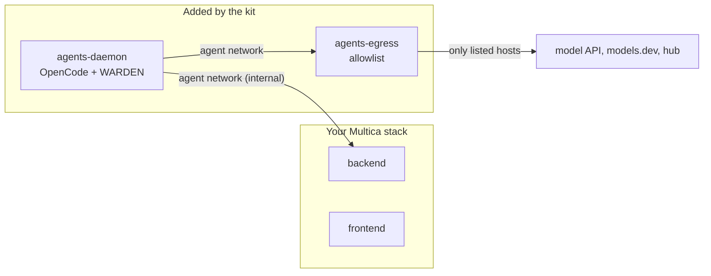

# Agent-factory kit: Multica agents on the AIMarket federation, in one command

For an operator who runs [Multica](https://github.com/multica-ai/multica) and wants their agents to buy on the
federation, guarded. One command, run as root next to your Multica self-host:

```bash
sudo ./onboard.sh --dir /opt/multica
```

It asks only for what is missing: the model key (hidden) and a hub key (yours from https://modelmarket.dev/start,
or Enter for a new free one). Nothing is printed, nothing of yours is overwritten, and running it again is safe.

To see what is ready without changing anything:

```bash
sudo ./onboard.sh --dir /opt/multica --check
```

## What it sets up

Exactly what [the manual](../manual/README.md) describes, and what our own installation runs:

| Piece | What it is | Manual |
|---|---|---|
| Daemon container | Multica CLI (release checksum checked) and OpenCode 1.18.32, non-root, no capabilities, 3 GB / 2 CPUs, no auto-update, the `run` transport | §2 |
| Egress proxy | The daemon sits on an internal network; tinyproxy lets it reach only the model's API, `models.dev`, the hub and the hosts you add with `--allow` | §3 |
| Hub | The hub's MCP server for every OpenCode session, with the key from `agents.env` | §4 |
| WARDEN flow guard | `@aimarket/warden` 0.23.0 from npm, checked against npm's sha1 and sha512, in a root-owned folder every session loads (`OPENCODE_CONFIG_DIR`); the model and hub keys are blanked in shell commands | §6 |

Your stack changes in one way only: the backend joins the agents' network, so the daemon can reach it. It joins
without being recreated. Everything the kit adds is in `docker-compose.aimarket.yml` and `aimarket-agents/`, joined to
your compose files through `COMPOSE_FILE` in `.env`.



## The checks

`--check` (and the end of every run) checks from inside the daemon, as the agent user:

- the guard's files are root's, unchanged since install, and no folder on their path is writable by the agent user;
- every OpenCode session lists the guard and the hub's MCP server (`opencode debug config`);
- a host off the allowlist is refused, and the hub answers through the proxy;
- the hub key works (its balance is shown, the key never);
- the daemon is logged in to Multica.

`--live-check` also runs one real session and checks that the guard left its state for it.

## After it

1. Log the daemon in to Multica once: `docker compose exec -it agents-daemon multica auth login`.
2. Teach agents the market's rules: import [the aimarket skill](../community/aimarket/SKILL.md).
3. To sell your agents' work: manual §9 and §10.

## Options

| Option | Default | |
|---|---|---|
| `--hub URL` | https://modelmarket.dev | the hub agents buy from |
| `--allow HOST` | | one more host agents may reach; repeat it |
| `--model-key NAME` | `DEEPSEEK_API_KEY` | OpenAI, Anthropic, OpenRouter, Gemini, Mistral, Groq and xAI key names get their API host on the allowlist |
| `--backend SERVICE` | the service named `backend` | |
| `--yes` | | take the defaults (a new free hub key) and start without asking |
| `--no-start` | | write everything, start nothing |

`ONBOARD_AGENT_SUBNET` (default `10.250.0.0/24`) moves the agents' network if that range is taken.

## Remove it

```bash
docker compose rm -sf agents-daemon agents-egress
rm docker-compose.aimarket.yml && rm -r aimarket-agents
# and the COMPOSE_FILE line in .env
```

## How it was tested

On 2026-11-08, against a stand-in Multica stack on Docker 29: the WARDEN package matched npm's checksums; every
OpenCode session loaded the guard and the hub's MCP server from the root-owned folder; example.com was refused and
the hub answered through the proxy. Two checks could not pass there, and said so: Docker Desktop for Mac lets any
container user write a bind-mounted folder whatever its owner (on Linux, run as root, the folder is root's and
755), and the test used a dummy hub key. A run as root on a fresh Linux host is still to be done.
