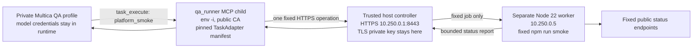

# Separate QA runner for Multica

Deployed and accepted on our **attested** host, 10 November 2026: see the
[final acceptance receipt](../../artifacts/multica-qa-runner-2026-11-10/final-acceptance.json). Real Multica task
**MY-89** called the native `qa_runner_task_execute` tool once, with no other tool calls. Its fixed backend,
modelmarket and hub checks returned **200/200/200**; the validated report reached both the stored result and comment,
and the acceptance issue was set to `done`. The permanent private profile `0a068508-d359-4b14-b200-df8f41f2e13c`
remains available with one concurrent task. Earlier failed MY-87/MY-88 records are retained.

The [five-language Multica manual](../manual/README.md) describes the surrounding guard, network and stored-output
controls. This runner adds a fixed-operation path while the analysis agent's general shell stays denied. The real
model-to-adapter-to-worker result accepts only the initial `platform_smoke`, not full TONmobile browser QA.

The initial operation is `platform_smoke`. It checks a small, operator-selected set of unauthenticated backend, hub and
modelmarket health/status endpoints. It does not run arbitrary repository tests, browser scripts, authenticated user
journeys or TONmobile dev/prod QA. No TONmobile address or credential is inferred by this setup.

## Controller and worker own different capabilities



The host controller is privileged infrastructure: it controls the exact worker/container invocation and owns the
broker's TLS private key. Keep its code, configuration and key outside paths writable by the model or worker.
The worker is a separate container based on the official Node 22 image. It receives no model/Multica/GitHub/hub
credentials, daemon home, `.env` file, Docker socket, host root or TLS private key. It runs as a non-root user with
all Linux capabilities dropped, a read-only root filesystem and bounded temporary storage. Dependencies and job
code are prepared by the operator, not installed or rewritten from a task's text.

The MCP child starts from `env -i`; only the public CA and explicit non-secret configuration needed by the adapter
cross that boundary. Trusting the CA authenticates the broker's TLS endpoint; it does not make model-supplied
arguments safe. The broker validates the fixed API and independently restricts callers/rate. Network access to the
broker is distinct from the worker's access to its selected health endpoints. The worker needs neither the
controller's Docker privileges nor the model provider's API key.

`qa_runner` is disabled in the global agent configuration. Only the newly created private QA profile enables it;
that profile disables other MCP servers and general tools. Existing agents do not gain a new execution capability.
This is profile/tool gating, not a separate network identity for each agent: profiles share the daemon's address.
The broker trusts that host/controller boundary and exposes only the same fixed public smoke operation to it.

## Resolve actual profile permissions

Use `opencode debug agent build` in the private profile's per-launch configuration and inspect the resolved
permission rules. Generic deny must precede exact allows for `qa_runner_task_list`, `qa_runner_task_read`,
`qa_runner_task_execute` and `qa_runner_task_run`. Inspecting raw `opencode debug config` JSON alone is insufficient:
OpenCode 1.18.32 merges legacy tools into ordered permissions, so an earlier `qa_runner_*` allow can be overridden
by a later generic deny. Retain only safe rule/boolean checks in receipts, not the whole environment/configuration.
Instructions invoke native `qa_runner_task_execute` directly; there is no preliminary Bash or Multica CLI step.

The upgraded MCP adapter accepts optional standard `tools/call` metadata `_meta.progressToken` only when it is a
string of at most 128 characters or a safe integer. This supports OpenCode's native progress token; no arbitrary
metadata keys, extra RPC fields, URL/command arguments or free payloads become authorized. Tool arguments remain
exactly `{"id":"platform_smoke"}`. The complete 393-file adapter package was upgraded atomically; the global guard
loader, protected policy/manifest and existing usage state were retained, as recorded in the acceptance receipt.

## Host broker and fixed worker job

The implementation lives in [broker.py](broker/broker.py), with separate
[controller](broker/multica-qa-broker.service) and [worker](broker/multica-qa-worker.service) systemd units.
The broker listens on `10.250.0.1:8443` and admits the Multica daemon peer at `10.250.0.4`. Its only job route is:

```text
POST /run/platform-smoke
Content-Length: 0
```

A query string, different path, payload, transfer encoding, unsupported method or other peer does not select a
job. The fixed command is `docker exec` into `qa-worker`, as uid/gid `10001:10001`, workdir `/opt/qa`, with `env -i`
and an explicit non-secret PATH/HOME/proxy configuration, then `npm --silent run smoke`. Request content never
becomes Docker arguments, shell code or environment. The host alone has the Docker control capability.

The broker permits one in-flight job and at most three starts per five minutes. The container command has a
6-second timeout plus a 1-second kill grace; the controller has an 8-second outer deadline. The TaskAdapter request
is limited to 10 seconds; worker health checks run in parallel with 3-second bounds. Combined stdout/stderr capture
is capped at 64 KiB. Busy/rate-limited/failed jobs return fixed error identifiers, never raw output or exception text. Requests and raw worker output are not written to broker logs.

Successful worker JSON must contain exactly the expected job and three ordered checks: `backend_health`,
`modelmarket_https`, `hub_https`. Each check has only its fixed name, boolean and integer HTTP status; the controller
recomputes the final outcome with the process exit status. Non-2xx responses cannot become passing checks.
The controller returns only its validated report and exit code. Backend health is an internal unauthenticated
endpoint; the other checks are fixed HTTPS requests through the allowlisted proxy. Response bodies are discarded.

## Only the pinned job can be requested

The model-facing invocation is the existing WARDEN TaskAdapter's `task_execute` tool on server `qa_runner`:

```json
{"id":"platform_smoke"}
```

The model cannot add a URL, command, path, headers, request body, environment variable or npm script name.
The operator-owned manifest fixes the HTTPS request and its bytes, and the policy pins the manifest's SHA-256.
Capabilities mode delegates only the supported exact tool/schema/ID to the enforcing adapter before the broad
post-taint shell refusal. The adapter still checks the current manifest, policy, expiry and persistent use budget
at execution. This is not a trusted-source label, a shell allowlist or permission to run `npm run` from the agent.

The host broker independently persists a quota of 10 starts per UTC 12-hour window in root-owned SQLite under
`/var/lib/multica-qa`. Removing node-owned MCP counters or restarting the controller does not reset this quota.
Failed and uncertain runs consume it. The shared adapter counter alone is not a hard cross-process trust boundary;
the independent host quota enforces this limit. The controller uses an empty root-owned Docker client configuration
at `/etc/multica/qa/docker-client`, without registry authentication, and passes no Docker configuration to the worker.

The lease is at most 23 hours and is renewed by the operator-controlled host process every 12 hours. An operation
allows at most 10 uses. The broker has an independent rate limit; the agent and worker cannot renew the lease or
change its pin. Expired/changed manifests, exhausted budgets, unsupported IDs and extra input fields must refuse.
An uncertain dispatched operation consumes its reserved use rather than being automatically replayed. Follow the
[TaskAdapter contract](https://github.com/alexar76/warden/blob/main/docs/flow-guard.md) for its bounded schema and state rules.

The worker starts the fixed `npm run smoke` job. It checks only the reviewed endpoint/status set and emits a small
structured result: endpoint identifiers, status/check outcomes and bounded operational metadata. Response bodies,
arbitrary page text and free-form command output must not be copied into the agent report. HTTP availability is a
transport/health observation, not an authenticated business-flow or model-quality test. The job makes no GitHub,
Telegram, hub-purchase or other external write.

## Installation and acceptance

Deploy this as separate host/controller, worker and private-profile configuration; do not add worker secrets or
relax the analysis agent's generic shell rule to make it run. Select unused addresses if the example addresses
collide, and update the broker certificate SAN, manifest, network rules and verification together. Keep the actual
TLS private key only on the host; distribute only its public CA to the adapter. Record resolved image IDs/digests,
job/controller hashes, certificate validity, manifest pin, lease, effective profile and network policy.

The source components are:

- [worker image](worker/Dockerfile), [fixed smoke job](worker/smoke.mjs) and
  [standalone Compose file](worker.compose.yaml). The Compose file joins the existing `multica_agent` network;
  it does not replace the Multica daemon's own Compose services. Supply the reviewed official Node 22 image digest
  and worker image identity explicitly through the required variables.
- [adapter installer](adapter/install.py), [lease renewal](adapter/renew-lease.py) and
  [UTC renewal timer](adapter/systemd/multica-qa-lease.timer). The timer runs on boot and at 00:00/12:00 UTC.
  Repeating installation/renewal in the same window must not reset the use budget or flow/session state.
- [disabled global MCP fragment](adapter/fragments/global-disabled.json),
  [private profile fragment](adapter/fragments/private-qa-profile.json) and
  [profile instructions](adapter/fragments/private-qa-instructions.txt). The private fragment only enables the
  runner; the new profile must additionally deny its other tools and disable its other MCP servers.

The adapter installer validates its reviewed package hash and rejects private-key material passed as the public
CA. Without `--apply`, it only reports a plan. Live application requires root and explicit `--apply --go` after
source publication and deployment review. It does not restart the daemon or silently enable the runner globally.
The TaskAdapter requires an `ask` policy with the narrow capabilities delegation; the installer refuses to weaken
an existing different mode. General tool denial remains a separate enforced profile/guard control.

Before enabling the profile, verify:

- The worker's effective user, mounts, environment **names**, read-only filesystem, temporary storage and dropped
  capabilities; no daemon home, credentials, TLS private key or Docker socket is present.
- The controller accepts only the fixed job route and schema; unknown IDs, extra URL/command fields and excessive
  requests refuse without starting a different command.
- The adapter rejects a modified pin, expired lease and exhausted budget, including after restart; a failure does
  not cause the model to seek a shell alternative.
- The private profile can list its fixed operation, execute `platform_smoke` and return the clean report after
  reading outside text, while arbitrary shell and other MCP tools remain denied.
- Status checks actually run through the worker, and the model receives only the recorded bounded report. Test
  controller failure and a failed endpoint as failures, rather than treating an absent report as success.
- The existing WARDEN secret, network-denial and stored-output checks remain accepted. A runner pass does not
  replace their separate receipts.

Keep runner/profile evidence in the workspace's
[QA runner evidence directory](../../artifacts/multica-qa-runner-2026-11-10/), alongside the earlier
[security evidence](../../artifacts/multica-security-2026-11-10/). The complete model-to-adapter-to-worker path needs
a real scoped Multica task; unit tests or a direct controller request alone do not prove that path. Keep the
permanent private QA executor available to the operator. Archive only temporary probes or test-only profiles;
retain the completed acceptance issue as the audit record.

The profile helper's local fixtures exercise its actual profile/report summarizers and duplicate-creation guard,
without Docker, API calls or model output. From the workspace root:

```sh
python3 -m unittest discover -s artifacts/multica-qa-runner-2026-11-10 -p 'test_create_profile.py' -v
```

This is deliberately a short fixed smoke job. Long browser/Playwright jobs need a separately reviewed asynchronous
contract; raising these timeouts does not provide one. Adding another QA task requires reviewed controller/job code,
a fixed worker image and new pinned capability plus its own acceptance checks. It does not authorize user-supplied shell, arbitrary target URLs, runtime package
installation or production credentials in the worker. Existing output redaction remains bounded to supported
patterns, and old run history/raw runtime files are not retroactively cleaned.
